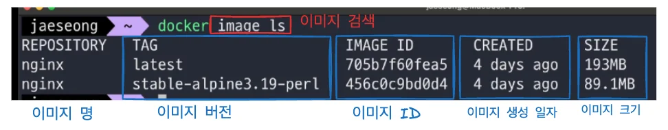

<a id="1c3eda9b0fe181f5a705c02151268de9"></a>

### 이미지 CLI

---

<details>
<summary>이미지 다운 &#45; <code>pull</code></summary>

> ✏️ 
> 
> <a id="1c3eda9b0fe18126b99ec43ba57bb660"></a>
> 
> <strong><code>github</code></strong>에서 프로젝트(코드)를 <code>git pull(clone)</code>  해서 받아올 수 있는 것 처럼<br>docker도 이미지를 <code>docker hub</code> 에서   <code>docker pull</code> 받아올 수 있다&#46;

<details>
<summary><a href="https://hub.docker.com/">도커 허브</a>에서 이미지 검색 및 다운 가능</summary>

<a id="1c3eda9b0fe1818eab20cad26b6d7e70"></a>

ex) <a href="https://hub.docker.com/search?q=nginx">docker hub &#45; nginx 검색</a>

</details>

<details>
<summary>이미지도 버전 관리가 된다&#46;  &#45; <code>tag</code></summary>

> 👉🏻 
> 
> <a id="1c3eda9b0fe1815f81d6c76c78f3f07e"></a>
> 
> <code>tag</code>는  이미지의 특정 버전을 나타낸다
> 
> <a id="1c3eda9b0fe181b2b133c6a9b4638a9d"></a>
> 
> 따라서 이미지에<strong><u> </u></strong><strong><u>특정 tag(버전)</u></strong><u>를 정</u>해서 다운 받을 수 있다&#46; 
> 
> <details>
> <summary><code>docker pull &#91;이미지명&#93;&#58;tag(버전)</code><br></summary>
> 
> - ex) docker pull nginx/unit<code>&#58;1&#46;29&#46;1&#45;minimal</code>
> 
> </details>
> 
> <a id="1c3eda9b0fe181a4ae86d3e43b1209f7"></a>
> 
> <u><code>tag(버전)</code></u><u>를 따로 명시하지 않</u>으면 <strong><u>default 값</u></strong>인 <code>&#58;latest</code> 로 명시 돼 <strong><u>최신 버전의 이미지를 다운</u></strong>한다&#46; 

<a id="1c3eda9b0fe181998067df74a7931651"></a>

버전마다 다른 종류의 이미지를 가지고 있다&#46;

<a id="1c3eda9b0fe181da9922f3419f1c5aaf"></a>

아래 그림을 통해 여러 버저닝된 이미지들을 확인할 수 있다&#46; 

- docker hub &#45; 이미지 &#45; <code>tags</code>
    

- 이미지의 버전(<code>tag</code>) 확인 
    

</details>

- 이미지 다운 &#45; <code>docker pull &#91;image&#93;</code>
    <a id="1c3eda9b0fe181b3b19fe5bf7ee84ac3"></a>

    ```docker
    docker pull [image]
    ```

</details>

<details>
<summary>이미지 검색 &#45; <code>ls</code></summary>



<a id="1c3eda9b0fe1816790a8cb4175730977"></a>

```docker
docker imgae ls
```

</details>

<details>
<summary>이미지 삭제 &#45; <code>rm</code></summary>

> ☝🏻 
> 
> <a id="1c3eda9b0fe18130a2c8d19150eeb47b"></a>
> 
> 이미지는 <strong><u>사용되지 않는 경우만 삭제가 가능</u></strong>하다&#46; 
> 
> <a id="1c3eda9b0fe181a4957ed14987739949"></a>
> 
> 만약 해당 이미지를 사용하여 컨테이너가 실행되고 있는 경우, 해당 컨테이너를 종료하고 삭제해야 한다&#46;
> 
> - 삭제 시, image의 id 값 일부만 입력해도 가능하다
> 
> 
> 
> <a id="1c3eda9b0fe18116b1bff17b3c9934ef"></a>
> 
> 컨테이너를 중단한 경우 (<code>docker stop &#91;컨테이너 ID or 명&#93;</code>) 
> 
> <a id="1c3eda9b0fe18196a884d75d5cb2d60f"></a>
> 
> <code>&#45;f</code> 옵션을  사용하여 중단(실행 X)된 컨테이너를 삭제할 수 있다&#46; 

<a id="1c3eda9b0fe18145ba49d505eeabbf8d"></a>

```docker
docker image rm [이미지 ID]
```

</details>

<details>
<summary>컨테이너에서 사용하지 않는 <strong><u>전체 이미지 삭제</u></strong> &#45; <code>docker image rm &#36;(docker images &#45;q)</code></summary>

<a id="1c3eda9b0fe1818eb871ec265157e023"></a>

```docker
# 컨테이너에서 사용하지 않는 전체 이미지 삭제
docker image rm $(docker images -q)

# 중단된 컨테이너에서 사용하지 않는 전체 이미지 삭제
docker image rm -f $(docker images -q)
```

- 전체 이미지 지정&#58; <code>&#36;(docker images &#45;q)</code>

</details>
