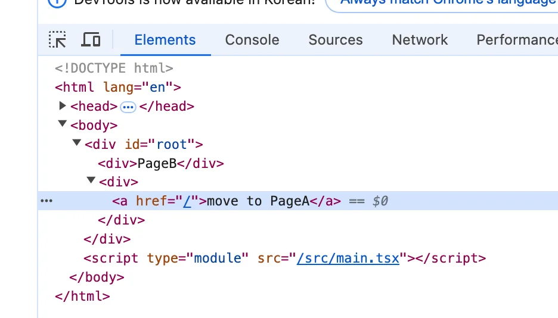
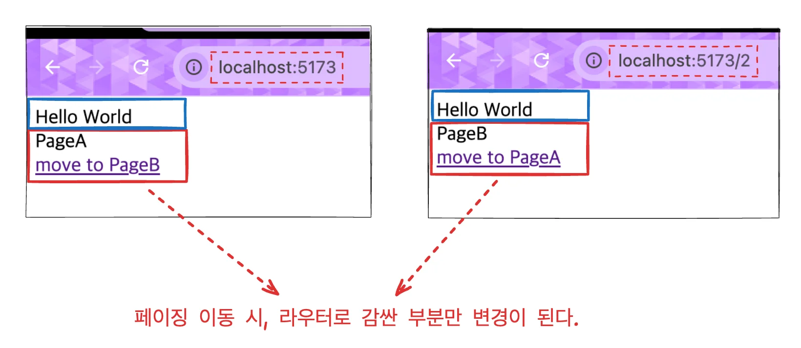

<a id="1c3eda9b0fe18146a7daf57fa01c11a8"></a>

## React Router&#58; Ver 6&#46;x

<details>
<summary>공식문서 </summary>

[Picking a Router v6&#46;28&#46;2]()

</details>

<details>
<summary>추가) router 사용 예시2</summary>

<a id="1c3eda9b0fe1816fbd59d87dbab381bf"></a>

```javascript
import React from "react";
import { BrowserRouter, Route, Routes } from "react-router-dom";
import { Login } from "./pages/Login";
import { Signup } from "./pages/Signup";
import { UserPointCharge } from "./pages/UserPointCharge";
import "bootstrap/dist/css/bootstrap.min.css";
import "./assets/styles/globalStyle.css";
import { AdminUser } from "./pages/AdminUser";
import { AdminCategory } from "./pages/AdminCategory";
import { UserMain } from "./pages/UserMain";
import { UserMy } from "./pages/UserMy";
import { AdminPaymentManage } from "./pages/AdminPaymentManage";
import { UserSchedule } from "./pages/UserSchedule";
import { UserLayout } from "./components/Layout/User";
import { AdminLayout } from "./components/Layout/Admin";
import { NotFound } from "./pages/NotFound";

function App() {
  return (
    <BrowserRouter>
      <Routes>
        <Route path="/login" element={<Login />} />
        <Route path="/signup" element={<Signup />} />
        <Route element={<UserLayout />}>
          <Route path="/" element={<UserMain />} />
          <Route path="/point" element={<UserPointCharge />} />
          <Route path="/user/my/:type" element={<UserMy />} />
          <Route path="/schedule/:id" element={<UserSchedule />} />
        </Route>
        <Route element={<AdminLayout />}>
          <Route path="/admin/user" element={<AdminUser />} />
          <Route path="/admin/category" element={<AdminCategory />} />
          <Route path="/admin/payment" element={<AdminPaymentManage />} />
        </Route>
        <Route path="/*" element={<NotFound />} />
      </Routes>
    </BrowserRouter>
  );
}

export default App;

```

</details>

---

<details>
<summary>Path 및 페이지 설정 &#45; &#60;BrowserRouter /&#62;, &#60;Routes /&#62;,  &#60;Route /&#62;</summary>

- Router 사용을 위한 전역 설정
    <a id="1c3eda9b0fe181b1b80ec5a2f7a94248"></a>

    ```javascript
    import { StrictMode } from "react";
    import { createRoot } from "react-dom/client";
    import App from "./App.tsx";
    import { BrowserRouter } from "react-router-dom";

    createRoot(document.getElementById("root")!).render(
      <StrictMode>
        <BrowserRouter>
          <App />
        </BrowserRouter>
      </StrictMode>
    );
    ```

<a id="1c3eda9b0fe1817ebd08fc007036874e"></a>

<br>

- Path 및 Component 설정
    <a id="1c3eda9b0fe18167a73bdf942144fa94"></a>

    ```javascript
    import { Route, Routes } from "react-router-dom";

    function App() {
      return (
        <Routes>
          <Route path="/" element={<PageA />} />   // 
          <Route path="/2" element={<PageB />} />
        </Routes>
      );
    };
    ```

</details>

<details>
<summary>페이지 링크(이동) &#45; &#60;Link /&#62; </summary>

> ☝🏻 
> 
> <a id="1c3eda9b0fe18182bac4c9e440856c29"></a>
> 
> 기존 HTML에서의 링크 사용 시, a 태그를 썻다&#46;
> 
> <a id="1c3eda9b0fe181088744c008251d9537"></a>
> 
> 그러나 싱글 페이지 App 에서는 a 태그 사용 시, 페이지가 바뀌는 것이 아닌, 완전히 서버로 HTTP 요청을 보내고 새로고침과 같은 느낌으로 페이지가 이동된다&#46;
> 
> <a id="1c3eda9b0fe181798ca4dbb521bdbe51"></a>
> 
> 이는 SPA의 특징을 활용하지 못한 방법으로 권장되지 않는다&#46; 
> 
> - <strong><u>싱글페이지 앱의 렌더링</u></strong> 방식이 아닌, <strong><u>서버 사이드 렌더링</u></strong> 방식으로 동작한다&#46;

<a id="1c3eda9b0fe1812f9602dc5c08bfb9d7"></a>

React에서는 React Router Dom에서 제공하는 <code>&#60;Link /&#62;</code>를  사용하여 링크를 걸어준다&#46;

<a id="1c3eda9b0fe18110a1dbedf8a2f5175a"></a>

```javascript
// PageA
import { Link } from "react-router-dom";

const PageA = () => {
  return (
    <>
      <div>PageA</div>
      <div>
        <Link to="/2">move to PageB</Link>
      </div>
    </>
  );
};

export default PageA;


// PageB
import { Link } from "react-router-dom";

const PageB = () => {
  return (
    <>
      <div>PageB</div>
      <div>
        <Link to="/">move to PageA</Link>
      </div>
    </>
  );
};

export default PageB;
```

- Link 태그(<code>&#60;Link /&#62;</code>)는  브라우저에서 a 태그와 동일하다&#46;
    

    

</details>

<details>
<summary>라우트로 감싼 영역만 페이징 된다&#46; </summary>



<a id="1c3eda9b0fe1811389e6eeb996291d15"></a>

```javascript
import { Route, Routes } from "react-router-dom";
import PageA from "./pages/PageA";
import PageB from "./pages/PageB";


function App() {
  return (
    <>
      <div>Hello World</div>  // Routes 외부에 존재하기 때문에, Link에 영향을 받지 않는다.
      <Routes>
        <Route path="/" element={<PageA />} />
        <Route path="/2" element={<PageB />} />
      </Routes>
    </>
  );
}

export default App;

```

</details>
