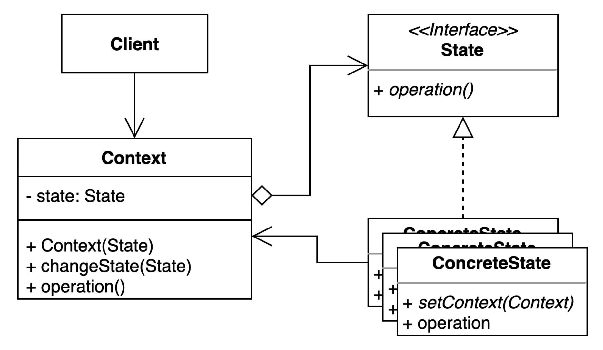

> 📝 
> 
> <a id="1deeda9b0fe180ffa6bbd725586a556e"></a>
> 
> <strong>질문</strong>
> 
> <details>
> <summary>상태 패턴은 어떤 패턴인가?</summary>
> 
> 
> 
> </details>
> 
> <details>
> <summary>상태 패턴의 장단점은?</summary>
> 
> 
> 
> </details>
> 
> <details>
> <summary>상태 패턴의 실무 활용 예제는?</summary>
> 
> 
> 
> </details>

<a id="1deeda9b0fe18009b6b4e8e4483f5f52"></a>

## 상태 ( State )  패턴

---

> 📖 
> 
> <a id="1deeda9b0fe1803ab2c3d3b9b89d0b73"></a>
> 
> <strong>상태 패턴 </strong>
> 
> ---
> 
> > <u>객체 내부 상태 변경</u>에 따라 <strong>객체의 행동이 달</strong>라지는 패턴
> 
> - 상태에 특화된 행동들을 분리해 낼 수 있으며, 새로운 행동을 추가 하더라도 다른 행동에 영향을 주지 않는다&#46; 
> 
> - 조건문을 줄이고, 코드의 유지보수성, 확장성을 높여준다&#46; 
> 
> 
> 
> <details>
> <summary>구성 요소</summary>
> 
> - <code>Context</code>
>     - 상태를 갖고 있으며, 상태에 따른 행동을 상태 객체에 위임하는 주체이다&#46; 
> 
> - <code>State</code> ( interface / abstract class )
>     - 각 상태에서 가능한 행동을 정의하는 인터페이스나 추상 클래스
> 
> - <code>ConcreteState</code> ( 구체 상태 클래스 )
>     - 실제 상태별 동작을 구현하는 클래스
> 
> </details>
> 
> <details>
> <summary>장•단점</summary>
> 
> > <strong>장점</strong>
> 
> - <code>조건문 제거</code>
>     - 상태에 따른<strong> </strong><strong><u>복잡한 조건문( if/else, switch 등)을 줄</u></strong>일 수 있다&#46;
> 
> - <code>유지보수성 향상</code>
>     - <strong><u>상태별 행동이 각 클래스에 캡슐화</u></strong>되어 있어,<strong> 새로운 상태 추가나 기존 상태 수정이 용이</strong>하다&#46;
> 
>     - 상태와 관련된 행동을 상태 객체에 위임하여 Context 클래스가 비즈니스 로직을 간소화한다&#46;
> 
> - <code>확장성</code>
>     - 새로운 상태를 추가할 때,기존 코드에 영향을 주지 않고 새로운 상태 클래스만 추가하면 된다 ( OCP )
> 
> > <strong>단점</strong>
> 
> - <code>클래스 수 증가</code>
>     - 상태가 많아질수록 관리해야 할 클래스가 많아져 오히려 복잡해질 수 있다&#46;
> 
> - <code>상태별 동작이 적을 경우 비효율</code>
>     - 상태에 따라 변하는 메서드가 적다면 오히려 불필요한 복잡성을 추가할 수 있다&#46;
> 
> </details>
> 
> <details>
> <summary>실무 활용 예시</summary>
> 
> - 미디어 플레이어 &#45; 재생, 일시정지, 정지 상태에 따른 버튼 동작
> 
> - 엘레베이터 &#45; 올라감, 내려감, 정지 상태
> 
> - 리모콘 &#45; TV 전원 ON/OFF 상태에 따른 동작
>     - TV가 꺼져있는데, 채널 버튼을 눌러도 아무런 동작이 없다&#46; 
> 
> </details>
> 
> <details>
> <summary>🧐 <code>상태 패턴</code> vs <code>전략 패턴</code></summary>
> 
> | 구분 | 상태 패턴 | 전략 패턴 |
> | --- | --- | --- |
> | 목적 | 객체의 상태에 따라 동작을 다르게 | 알고리즘(전략)을 동적으로 변경 |
> | 상태 / 전략 | 상태를 캡슐화한 클래스  | 알고리즘을 캡슐화한 클래스 |
> | 동작 위임 | 상태 객체가 동작을 결정 | 전략 객체가 동작을 결정 |
> | 사용 예시  | TV, 엘레베이터, 미디어 플레이어 등 | 정렬, 암호화 등 알고리즘 교체가 필요한 경우 |
> 
> </details>

<a id="1deeda9b0fe1800a9ba3f975460267d9"></a>

### 1&#46; 기본 예제

<a id="1deeda9b0fe180e59ec5d3be80e1b37b"></a>

### 코드

<details>
<summary>&#91; 코드 &#93; Student</summary>

<a id="1deeda9b0fe1804ea1fcd2eba3c6a8a5"></a>

```java
package _03_behavioral_patterns._20_state._01_before;

import java.util.ArrayList;
import java.util.List;

public class Student {

    private final String name;

    private final List<OnlineCourse> privateCourses = new ArrayList<>();

    public Student(String name) {
        this.name = name;
    }

    public boolean isEnabledForPrivateClass(OnlineCourse onlineCourse) {
        return privateCourses.contains(onlineCourse);
    }

    public void addPrivateCourse(OnlineCourse onlineCourse) {
        this.privateCourses.add(onlineCourse);
    }

    @Override
    public String toString() {
        return "Student{" +
                "name='" + name + '\'' +
                '}';
    }
}

```

</details>

<details>
<summary>&#91; 코드 &#93; OnlineCourse</summary>

<a id="1dfeda9b0fe180fb8a69d7986793cb3f"></a>

```java
package _03_behavioral_patterns._20_state._01_before;

import lombok.Getter;

import java.util.ArrayList;
import java.util.List;

@Getter
public class OnlineCourse {

    public enum State {
        DRAFT, PUBLISHED, PRIVATE
    }

    private State state = State.DRAFT;

    private final List<String> reviews = new ArrayList<>();

    private final List<Student> students = new ArrayList<>();

    public void addReview(String review, Student student) {
        if (this.state == State.PUBLISHED) {
            this.reviews.add(review);
        } else if (this.state == State.PRIVATE && this.students.contains(student)) {
            this.reviews.add(review);
        } else {
            throw new UnsupportedOperationException("리뷰를 작성할 수 없습니다.");
        }
    }

    public void addStudent(Student student) {
        if (this.state == State.DRAFT || this.state == State.PUBLISHED) {
            this.students.add(student);
        } else if (this.state == State.PRIVATE && availableTo(student)) {
            this.students.add(student);
        } else {
            throw new UnsupportedOperationException("학생을 해당 수업에 추가할 수 없습니다.");
        }

        if (this.students.size() > 1) {
            this.state = State.PRIVATE;
        }
    }

    public void changeState(State newState) {
        this.state = newState;
    }

    private boolean availableTo(Student student) {
        return student.isEnabledForPrivateClass(this);
    }
}

```

</details>

<details>
<summary>&#91; 코드 &#93; Client</summary>

<a id="1dfeda9b0fe18086937af07185bfd867"></a>

```java
package _03_behavioral_patterns._20_state._01_before;

public class Client {

    public static void main(String[] args) {
        Student student = new Student("LEE");
        OnlineCourse onlineCourse = new OnlineCourse();

        Student gyungsub = new Student("gyungsub");
        gyungsub.addPrivateCourse(onlineCourse);

        onlineCourse.addStudent(student);
        onlineCourse.changeState(OnlineCourse.State.PRIVATE);

        onlineCourse.addStudent(gyungsub);

        onlineCourse.addReview("hello", student);

        System.out.println(onlineCourse.getState());
        System.out.println(onlineCourse.getStudents());
        System.out.println(onlineCourse.getReviews());
    }
}

```

</details>

<a id="1dfeda9b0fe180b687d6c534c4925c7d"></a>

### 문제점

<a id="1dfeda9b0fe180afb3f9e19906e7c576"></a>

각 상태에 따른 동작을 <code>if&#45;else</code> 문을 통해서 일일이 정의한다&#46;

- 한눈에 코드가 들어오지 않고, 읽다가 헷갈린다&#46;

<a id="1dfeda9b0fe180bf91f3ff1590ba8ab8"></a>

이해하기도 어렵고, 유지 보수, 확장성 측면에서도 좋지 않다&#46; 

<a id="1deeda9b0fe180d7964cc787b986e7fd"></a>

### 2&#46; 패턴 적용

<a id="1deeda9b0fe180d2811bdb4473b6b291"></a>

### 코드

> <strong>State</strong>

<details>
<summary>&#91; 코드 &#93; &#60; interface &#62; State</summary>

<a id="1deeda9b0fe180f39e98f33cffbf0f75"></a>

```java
package _03_behavioral_patterns._20_state._02_after;

public interface State {

    void addReview(String review, Student student);

    void addStudent(Student student);
}
```

</details>

<details>
<summary>&#91; 코드 &#93; Draft</summary>

<a id="1deeda9b0fe1809baedae0440511c9f8"></a>

```java
package _03_behavioral_patterns._20_state._02_after;

public class Draft implements State {

    private OnlineCourse onlineCourse;

    public Draft(OnlineCourse onlineCourse) {
        this.onlineCourse = onlineCourse;
    }

    @Override
    public void addReview(String review, Student student) {
        throw new UnsupportedOperationException("Draft 상태에서는 리뷰를 남길 수 없습니다.");
    }

    @Override
    public void addStudent(Student student) {
        this.onlineCourse.getStudents().add(student);
        if (this.onlineCourse.getStudents().size() > 1) {
            this.onlineCourse.changeState(new Private(this.onlineCourse));
        }

    }
}

```

</details>

<details>
<summary>&#91; 코드 &#93; Published</summary>

<a id="1dfeda9b0fe18045b1d9df9fc9965917"></a>

```java
package _03_behavioral_patterns._20_state._02_after;

import lombok.RequiredArgsConstructor;

@RequiredArgsConstructor
public class Published implements State {

    private final OnlineCourse onlineCourse;

    @Override
    public void addReview(String review, Student student) {
        this.onlineCourse.getReviews().add(review);
    }

    @Override
    public void addStudent(Student student) {
        this.onlineCourse.getStudents().add(student);
    }
}
```

</details>

<details>
<summary>&#91; 코드 &#93; Private</summary>

<a id="1dfeda9b0fe180d98985e9b50b561591"></a>

```java
package _03_behavioral_patterns._20_state._02_after;

public class Private implements State {

    private final OnlineCourse onlineCourse;

    public Private(OnlineCourse onlineCourse) {
        this.onlineCourse = onlineCourse;
    }

    @Override
    public void addReview(String review, Student student) {
        if (this.onlineCourse.getStudents().contains(student)) {
            this.onlineCourse.getReviews().add(review);
        } else {
            throw new UnsupportedOperationException("Private 코스를 수강하는 학생만 리뷰를 남길 수 있습니다.");
        }
    }

    @Override
    public void addStudent(Student student) {
        if (student.isAvailable(this.onlineCourse)) {
            this.onlineCourse.getStudents().add(student);
        } else {
            throw new UnsupportedOperationException("Private 코스를 수강할 수 없습니다.");
        }
    }
}
```

</details>

---

<details>
<summary>&#91; 코드 &#93; OnlineCourse</summary>

<a id="1dfeda9b0fe180f88b9add0241bcdac2"></a>

```java
package _03_behavioral_patterns._20_state._02_after;

import lombok.Getter;

import java.util.ArrayList;
import java.util.List;

@Getter
public class OnlineCourse {

    private State state = new Draft(this);

    private final List<Student> students = new ArrayList<>();

    private final List<String> reviews = new ArrayList<>();

    public void addStudent(Student student) {
        this.state.addStudent(student);
    }

    public void addReview(String review, Student student) {
        this.state.addReview(review, student);
    }

    public void changeState(State state) {
        this.state = state;
    }
}

```

</details>

<details>
<summary>&#91; 코드 &#93; Student</summary>

<a id="1dfeda9b0fe1805da616dcf0c5fd16a5"></a>

```java
package _03_behavioral_patterns._20_state._02_after;

import java.util.HashSet;
import java.util.Set;

public class Student {

    private final String name;

    public Student(String name) {
        this.name = name;
    }

    private Set<OnlineCourse> onlineCourses = new HashSet<>();

    public boolean isAvailable(OnlineCourse onlineCourse) {
        return onlineCourses.contains(onlineCourse);
    }

    public void addPrivate(OnlineCourse onlineCourse) {
        this.onlineCourses.add(onlineCourse);
    }

    @Override
    public String toString() {
        return "Student{" +
                "name='" + name + '\'' +
                '}';
    }
}

```

</details>

<details>
<summary>&#91; 코드 &#93; Client</summary>

<a id="1dfeda9b0fe1806da503fda6ae25ddd2"></a>

```java
package _03_behavioral_patterns._20_state._02_after;

public class Client {

    public static void main(String[] args) {
        OnlineCourse onlineCourse = new OnlineCourse();
        Student student1 = new Student("LEE");
        Student student2 = new Student("SUB");
        student2.addPrivate(onlineCourse);

        onlineCourse.addStudent(student1);

        onlineCourse.changeState(new Private(onlineCourse));

        onlineCourse.addReview("hello", student1);

        onlineCourse.addStudent(student2);

        System.out.println(onlineCourse.getState());
        System.out.println(onlineCourse.getReviews());
        System.out.println(onlineCourse.getStudents());
    }
}

```

<a id="1dfeda9b0fe18092a345c4ad7582dd80"></a>

<strong>출력</strong>

<a id="1dfeda9b0fe180139912efce111011a3"></a>

```java
_03_behavioral_patterns._20_state._02_after.Private@20ad9418
[hello]
[Student{name='LEE'}, Student{name='SUB'}]
```

</details>

<a id="1deeda9b0fe180b9b41bdef6b526e301"></a>

### 3&#46; 장•단점

- 장점
    - 상태에 따른 동작을 개별 클래스로 옮겨서 관리할 수 있다&#46;

    - 기존의 특정 상태에 따른 동작을 변경하지 않고 새로운 상태에 다른 동작을 추가할 수 있다&#46;

    - 코드의 복잡도를 줄일 수 있다&#46;

- 단점
    - 복잡도가 증가한다&#46;
