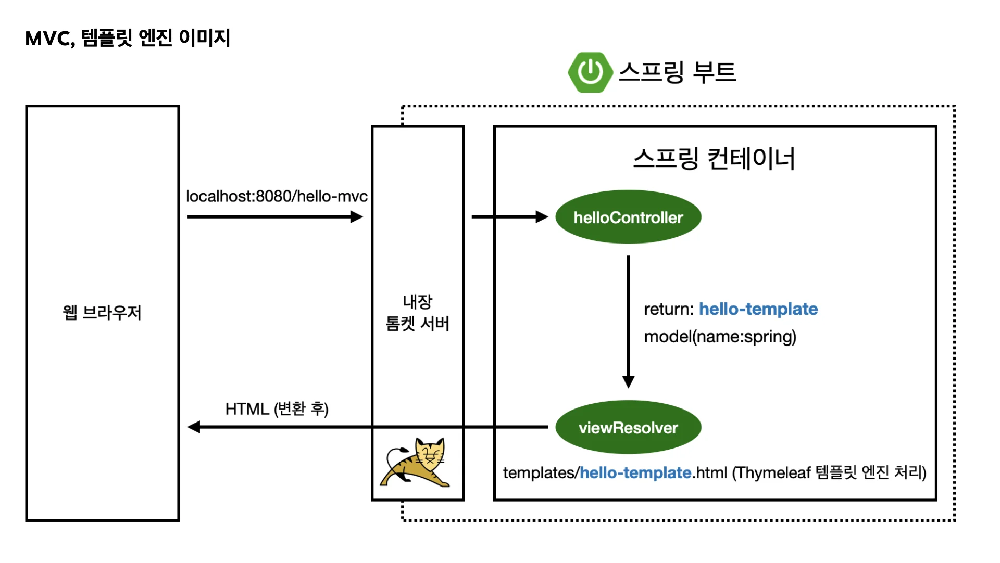
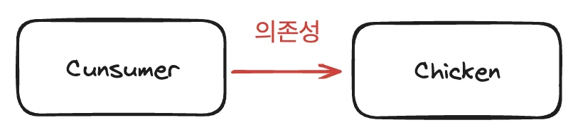
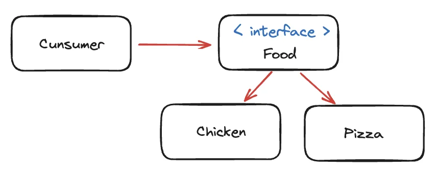
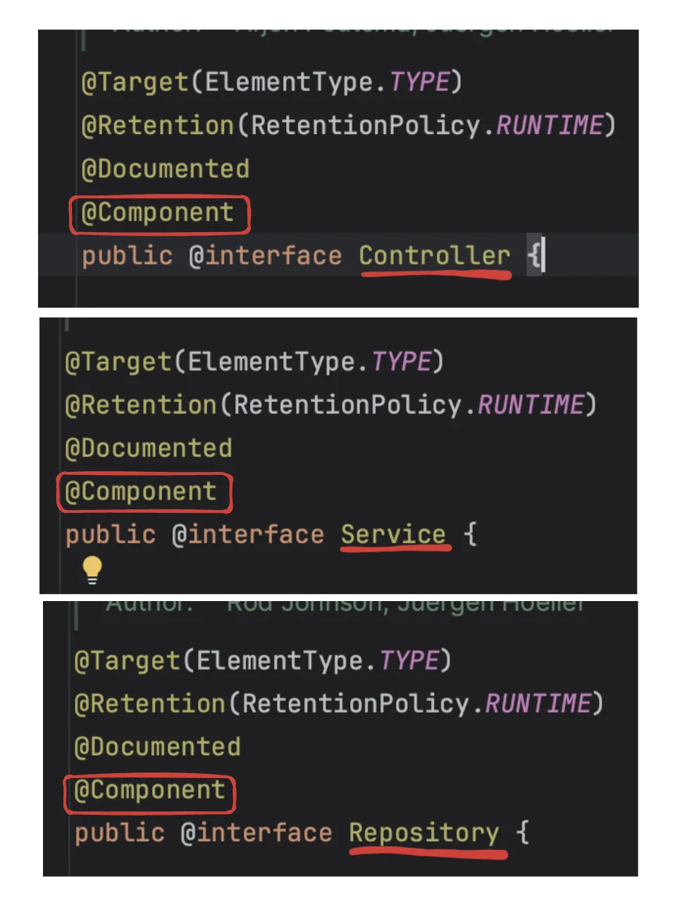
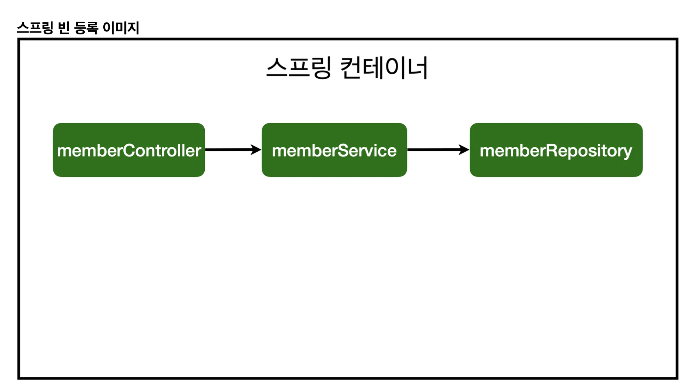
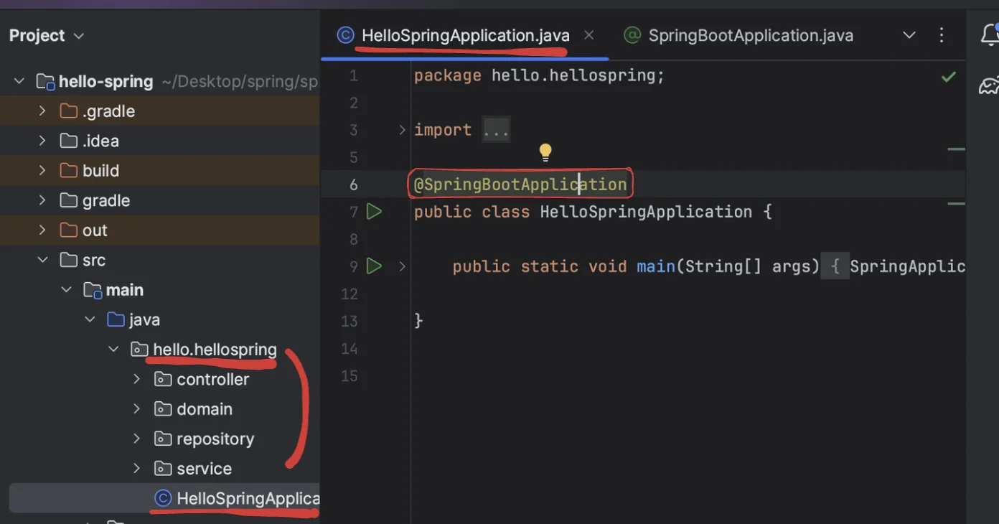
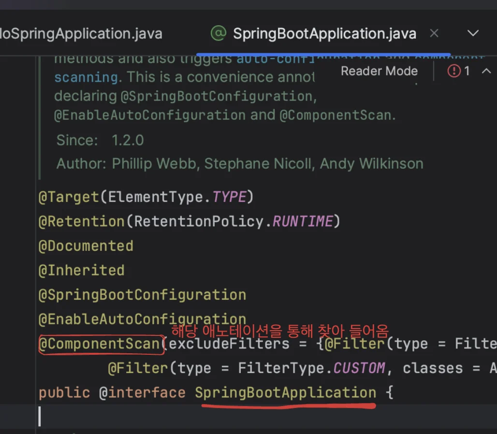

<details>
<summary>서론</summary>

<a id="1c3eda9b0fe181938993c79e28826a74"></a>

이전 챕터에서는 서비스, 리포지토리 등 데이터를 다루는 작업을 했다&#46;

<a id="1c3eda9b0fe18157af5bd49289154972"></a>

해당 데이터를 화면에 붙이기 위해 컨트롤러랑 뷰 템플릿이 필요하다&#46;

<a id="1c3eda9b0fe181ada01edb7bf940e5e3"></a>

따라서 스프링을 사용하여 멤버컨트롤러를 만들고 의존관계를 형성하여 뷰를 그리는 방법을 학습한다&#46;

<a id="1c3eda9b0fe181c6a07ac0d729a4fd44"></a>

(회원 가입 하고, 회원 가입된 결과를 HTML로 보이게 하고… 등)

<a id="1c3eda9b0fe1816988d6d3f37d6a578c"></a>

멤버 컨트롤러는 멤버 서비를 통해, 회원 가입을 하고, 데이터를 조회할 수 있어야 한다&#46; 

<a id="1c3eda9b0fe18134acb6fcdd71d90fc0"></a>

(의존관계, 멤버 컨트롤러가 멤버 서비스를 의존한다&#46;)

<a id="1c3eda9b0fe181e995b3e666ebf09648"></a>

스프링에서는 이러한 작업을 <strong>스프링 빈</strong>을 통해 쉽게 연동할 수 있게 해준다&#46;

</details>

> 📌 <u>스프링 빈</u>을 등록하는 2가지 방법
> 
> - 1) 컴포넌트 스캔 →  자동 의존관계 설정
> 
> - 2) 자바 코드로 직접  스프링 빈 등록

<a id="1c3eda9b0fe181d0b774e3435210f9d3"></a>

### <code>&#64;Controller</code> 애노테이션

<a id="1c3eda9b0fe1815fab4dd96964969ad7"></a>

spring이 처음 시작되면서 , Spring 컨테이너가 생성된다&#46; 

<a id="1c3eda9b0fe181b9a9a1c875a78f5a19"></a>

객체를 빈으로 등록하면 스프링 컨테이너에 안으로 들어가 스프링이 관리하게 한다&#46; 

<a id="1c3eda9b0fe1818e94b5e701e41de3f8"></a>

&#64;Controller &#45; 객체를 생성하여, 컨테이너에 넣고 스프링이 관리한다&#46; 

<details>
<summary>ex) HelloController)</summary>



<a id="1c3eda9b0fe1817cac4ad0337eda0359"></a>

```java
@Controller
 public class HelloController {
     @GetMapping("hello-mvc")
     public String helloMvc(@RequestParam("name") String name, Model model) {
         model.addAttribute("name", name);
         return "hello-template";
     }
}
```

</details>

<a id="1c3eda9b0fe181eeb56ad1141cdc10af"></a>

## <code>DI(의존관계 주입</code>) 3가지 방법

<a id="1c3eda9b0fe18175ab97cb7993263bcd"></a>

### 의존성

<details>
<summary><strong>강한 결합(Tight Coupling)</strong></summary>



<details>
<summary><strong>Consumer</strong></summary>

<a id="1c3eda9b0fe181a09dcefb33865e5947"></a>

```java
public class Consumer {
		public static void main(String[] args) {
        Consumer consumer = new Consumer();
        consumer.eat();
    }

    void eat() {
			  // 의존성: Cunsumer  -> Chicken
        Chicken chicken = new Chicken();
        chicken.eat();
    }
}
```

</details>

<details>
<summary><strong>Chicken</strong></summary>

<a id="1c3eda9b0fe181689ff8e5c66415e78e"></a>

```java
class Chicken {
    public void eat() {
        System.out.println("치킨을 먹는다.");
    }
}
```

</details>

<details>
<summary><strong>앱 변경 시(객체의 의존성 수정, </strong><strong><code>Chicken</code></strong><strong>  → </strong><strong><code>Pizza</code></strong><strong>), 다른 객체인 Cunsumer 내부 로직(</strong><strong><code>Consumer&#46;eat()</code></strong><strong> )까지 수정해야 한다&#46; </strong></summary>

<details>
<summary><strong>Consumer</strong></summary>

<a id="1c3eda9b0fe181cab41fd0a80b5326fe"></a>

```java
public class Consumer {
		public static void main(String[] args) {
        Consumer consumer = new Consumer();
        consumer.eat();
    }

    void eat() {
			  // 의존성: Cunsumer  -> Pizza
        Pizza pizza = new Pizza();
        pizza.eat();
    }
}
```

</details>

<details>
<summary><strong>Pizza</strong></summary>

<a id="1c3eda9b0fe18140ada5d4be9d840f6f"></a>

```java
class Pizza {
    public void eat() {
        System.out.println("피자를 먹는다.");
    }
}
```

</details>

</details>

<a id="1c3eda9b0fe181b5b9faf49c3a47a2ed"></a>

위와 같이 강한 결합으로 의존성 구성 시, 앱 내부 로직에 변경이 일어나는 경우 해당하는 객체만 변경하는 것이 아닌 의존성을 형성하는 다른 객체의 내부 로직까지 변경 되어야 한다&#46;

<a id="1c3eda9b0fe181daa2e8d374622e3a5d"></a>

즉, <strong>객체에 역할과 구현이 구분되지 않</strong>아 <strong><u>객체의 변경이 일</u></strong>어날 시, <strong><u>다른 객체 내부에까지 수정</u></strong>이 이루어 진다&#46; 

<a id="1c3eda9b0fe1819da9d8ed99904de60d"></a>

이는 <strong>앱의 유연성 및 확장성을 떨</strong>어뜨리는, 객체지향의 중요한 특징인 <strong><u><code>다형성</code></u></strong><strong><u>을 활용하지 못</u></strong>하는 좋지 않은 방법이다&#46; 

<a id="1c3eda9b0fe1810da845e9de86c89de3"></a>

프로젝트가 커질수록 수많은 객체들이 모여 앱을 이루는데, 객체간에 이렇게 <strong>강한 결합(Tight Coupling)</strong>으로 의존성이 구성된다면,  앱의 유지보수 및 확장 시 굉장히 많은 비용과 예상치 못하는 오류들이 발상될 수 있다&#46; 

<a id="1c3eda9b0fe1815d8daac0f7597378c0"></a>

따라서 객체지향의 특징인 유연성과 확장성을  활용하기 위한 다형성을 활용하여 설계해야 한다&#46; 

<a id="1c3eda9b0fe181d0a679da8262fafdcb"></a>

즉, 객체 간의 의존성은 인터페이스를 통해 설계해야한다&#46; 

<a id="1c3eda9b0fe1818db5c4d86580a2418f"></a>

(자세한 내용은 아래를 참조)<br>

</details>

<details>
<summary><strong> </strong><strong><a href="https://yozm.wishket.com/magazine/detail/1926/">느슨한 결합(Loosely Coupled)</a></strong><strong>&#58; </strong><strong><code>다형성</code></strong><strong> 활용</strong></summary>

> 📌 객체지향의 특징 중 하나인 <strong><code>다향성</code></strong>을 활용하여 <strong>객체간의 의존성을 낮</strong>추어 <strong><u>앱의 유연성과 변경 가능성을 용이</u></strong>하게 만들어주는 방법이다&#46; 

<a id="1c3eda9b0fe181139f78ca09e81ae8ca"></a>

위에서 설명했듯이 <strong>다향성</strong>은 <strong>객체를 </strong><strong><code>역할</code></strong><strong>과 </strong><strong><code>구현</code></strong><strong>으로 분리</strong>하는 것을 말한다&#46; 

<a id="1c3eda9b0fe181babe9cc017bd881df3"></a>

즉, 객체를 <strong><code>interface</code></strong>와 <strong><code>interface 구현 클래스</code></strong>(or <strong><code>instance</code></strong>)로 구분하여  

<a id="1c3eda9b0fe181c6824ec72e2abd6e72"></a>

<strong><u><code>interface 구현 클래스</code></u></strong>(or <strong><u><code>instance</code></u></strong><strong>) </strong>가 <strong><u><code>interface</code></u></strong><strong><u>(역할</u></strong>)에 <strong>의존</strong>하게 설계한다&#46;



<details>
<summary>Consumer</summary>

<a id="1c3eda9b0fe18189a90ad71dbaf5c8d8"></a>

```java
public class Consumer {
		
		// 인터페이스 
    void eat(Food food) {
        food.eat();
    }

    public static void main(String[] args) {
        Consumer consumer = new Consumer();
        consumer.eat(new Chicken());
        consumer.eat(new Pizza());
    }
}
```

</details>

<details>
<summary><strong>&#60; interface &#62;</strong> Food</summary>

<a id="1c3eda9b0fe181afb333e38eeb3ac437"></a>

```java
interface Food {
    void eat();
}
```

</details>

<details>
<summary>Chiken</summary>

<a id="1c3eda9b0fe181e7b776e159c5650b44"></a>

```java
class Chicken implements Food{
    @Override
    public void eat() {
        System.out.println("치킨을 먹는다.");
    }
}
```

</details>

<details>
<summary>Pizza</summary>

<a id="1c3eda9b0fe1817bbeeeed8198a2670a"></a>

```java
class Pizza implements Food{
    @Override
    public void eat() {
        System.out.println("피자를 먹는다.");
    }
}
```

</details>

</details>

<a id="1c3eda9b0fe1815e9e04d574b85a37f5"></a>

### 주입

<a id="1c3eda9b0fe1814486fffba80ce8b485"></a>

### <strong>필드 주입</strong>

> 📌 필드 값을 통한 의존성 주입

<a id="1c3eda9b0fe1811f8d33db405ef31811"></a>

```java
public class Consumer {
		
		// 필드 주입
    Food food;

    void eat() {
        this.food.eat();
    }

    public static void main(String[] args) {
        Consumer consumer = new Consumer();
        
        consumer.food = new Chicken();
        consumer.eat();

        consumer.food = new Pizza();
        consumer.eat();
    }
}

// ... 
```

<a id="1c3eda9b0fe181359c60c115f2dcee58"></a>

### <strong>메서드(setter) 주입</strong>

> 📌 setter를 통한 의존성 주입

<a id="1c3eda9b0fe181d5aaf1d605a56e2b35"></a>

```java
public class Consumer {

    Food food;

    void eat() {
        this.food.eat();
    }
    
		// 메서드(setter) 주입
    public void setFood(Food food) {
        this.food = food;
    }

    public static void main(String[] args) {
        Consumer consumer = new Consumer();
        consumer.setFood(new Chicken());
        consumer.eat();

        consumer.setFood(new Pizza());
        consumer.eat();
    }
}

// ... 
```

<a id="1c3eda9b0fe181fc8fdac9773ca6c13f"></a>

### <strong>권장) 생성자 주입</strong>

> 📌 <strong>생성자(Constructor)</strong>를 통한 의존성 주입

<a id="1c3eda9b0fe18192a9ddd03664c4d2b7"></a>

생성자 사용 시, 인스턴스 주입 여부를 검사한다&#46;

<a id="1c3eda9b0fe18119931ffebcee262bac"></a>

```java
public class Consumer {

    Food food;
		
		// 생성자를 통한 의존성 주입
    public Consumer(Food food) {
        this.food = food;
    }

    void eat() {
        this.food.eat();
    }

    public static void main(String[] args) {
        Consumer consumer = new Consumer(new Chicken());
        consumer.eat();

        consumer = new Consumer(new Pizza());
        consumer.eat();
    }
}


//  ..

```

<a id="1c3eda9b0fe181f7b760ef5fa80f1bf5"></a>

보통 DI 시, 한번 주입된 객체는 이후로 변경되지 않는다&#46; 즉, 변경되어서는 안된다&#46;

<a id="1c3eda9b0fe181b5ad4fc0c9803d4c98"></a>

 따라서 필드 나 setter 를 통한 주입은 외부 요인으로 인한 변경 가능성이 있는 좋지 않은 설계 방식이다&#46;( 변경이 필요한 경우 해당 방법을 부분적으로 사용)

<a id="1c3eda9b0fe181d8aa22d96f0aae9fb1"></a>

생성자 주입(constructor)을 통한 설계는 컴파일 과정에서 value 체크가 가능하며

<a id="1c3eda9b0fe181dd8d37f532393cdf5e"></a>

그리고 final 키워드를 사용하여 불변성을 유지하여 설계 할 수 있다&#46;

<a id="1c3eda9b0fe181138d47e25a712c0d58"></a>

이후 롬복의 &#64;RequirdArgsConstructor를 통해 간단하게 작성 가능하다

<a id="1c3eda9b0fe18187b6d1f7591c87c87a"></a>

# 1) 컴포넌트 스캔, 자동 의존관계 설정

<a id="1c3eda9b0fe18161be25d5c4bf78940c"></a>

<code>&#64;Component</code>, <code>&#64;Autowired</code> 을 활용하여 쉽게, 자동으로 의존관계를 설정할 수 있다&#46; 

<details>
<summary><strong>&#91; 컨트롤러 &#45; 서비스 &#45; 리포지토리 &#93; 디자인 패턴</strong></summary>

<a id="1c3eda9b0fe181358e99c6d7389a798e"></a>

일반적으로 많이 쓰는 정형화된 패턴

> <strong>컨트롤러</strong>&#58; 외부 요청<br><strong>서비스</strong>&#58; 비지니스 로직<br><strong>리포지토리</strong>&#58; 데이터 저장 

</details>

<a id="1c3eda9b0fe181178ea0fb11f54f2a89"></a>

### 자동 빈 등록 (<code>&#64;Component</code>)

<a id="1c3eda9b0fe1810f8f1fe471e5f318bd"></a>

<code>&#64;Component</code> 애노테이션을 통해 <strong>스프링 컨테이너, 해당 객체를 등록</strong>한다&#46; 그래서 <strong><u>컴포넌트 스캔</u></strong>이 부른다&#46; 또한, 스프링 컨테이너 안의 객체를 <strong>스프링 빈 </strong>이라 한다&#46; 

<a id="1c3eda9b0fe181648068f1565ca832e2"></a>

아래 애노테이션의 소스 코드를 보면 모두 다 <code>&#64;Component</code> 애노테이션이 포함되어 있는 것을 볼 수 있다&#46; 

> <code>&#64;Controller</code> <br><code>&#64;Service</code>
> 
> <a id="1c3eda9b0fe18195842ddafb36e2335c"></a>
> 
> <code>&#64;Repository</code>



<a id="1c3eda9b0fe18169a734d71e869cd413"></a>

### 자동 의존관계 주입 (<code>&#64;Autowired</code> )

<a id="1c3eda9b0fe181b1a534f0d908db7a05"></a>

<code>&#64;Autowired</code> 애노테이션을 통해 스프링 컨테이너 안의 객체들에게 <strong>의존관계를 주입(DI</strong>) 할 수 있다&#46;<br>(<code>memberController</code>, <code>memberService</code>, <code>memberRepository</code> 모두 <strong>스프링 빈으로 등록</strong> 되어 있어야 함)

- 생성자 주입 사용, 생성자가 하나인 경우 &#64;Autowired 생략 가능하다

<details>
<summary> 스프링 빈, 의존관계 주입</summary>



<details>
<summary>memberController</summary>

<a id="1c3eda9b0fe18194b215c32ab2faf83c"></a>

```java
@Controller  // 스프링 빈 등록
 public class MemberController {
     private final MemberService memberService;
     @Autowired   // 의존관계 주입
     public MemberController(MemberService memberService) {
         this.memberService = memberService;
     }
}
```

</details>

<details>
<summary>memberService</summary>

<a id="1c3eda9b0fe181a4ae9ddafd3d501137"></a>

```java
@Service   // 스프링 빈 등록
public class MemberService {
    private final MemberRepository memberRepository;

    @Autowired   // 의존관계 주입
    public MemberService(MemberRepository memberRepository) {
        this.memberRepository = memberRepository;
    }
}
```

</details>

<details>
<summary>memberRepository</summary>

<a id="1c3eda9b0fe1818ab803f058fab4d711"></a>

```java
@Repository   // 스프링 빈 등록
public class MemoryMemberRepository implements MemberRepository {
   .   .   .
```

</details>

</details>

<a id="1c3eda9b0fe18155aa31e95e04018528"></a>

### ※ 컴포넌트 스캔 범위( <code>&#64;ComponentScan</code>)

<a id="1c3eda9b0fe18143bcfcdbea068fd36e"></a>

시작점이 HelloSpringApplication 이다&#46; 해당 하위 패키지부터 스프링이 컴포넌트 스캔( spring bean을 등록 )한다&#46; 따라서 아무 곳에서 <code>&#64;Component</code>를 사용한다 해도 스프링 빈으로 등록되지 않는다&#46;

> 따로 설정 시 가능하다고 함<br><del>아마 시작점을 확장하거나, 중복 등록하면 가능하지 않을까 싶음</del>)<br>→ <code>&#64;ComponentScan</code> 애노테이션을 통해 시작점 지정, 따라서 포함하고 싶은 곳에 해당 애노테이션 사용 시 가능





<a id="1c3eda9b0fe18177adc3f03f294f6c1e"></a>

### ※스프링 빈 &#45; 싱글톤

<a id="1c3eda9b0fe1810cb2cad8e9c73cf86e"></a>

스프링 <strong>빈은 유일하게 하나만 등록(싱글톤)되어 공유</strong>한다&#46;

<a id="1c3eda9b0fe181af9e7af404c0f2bf60"></a>

따라서 <strong><u>같은</u></strong><u> </u><strong><u>스프링 빈 </u></strong><u>이면 모두 </u><strong><u>같은 인스턴스 </u></strong><u>이다</u>&#46; 

<a id="1c3eda9b0fe1812b8591da94227fd45d"></a>

설정으로 변경 가능하나, 특별한 경우를 제외하면 모두 싱글톤이다&#46; 

<a id="1c3eda9b0fe1818fa02bdce4910a384b"></a>

# 2) 자바 코드로 직접  스프링 빈 등록

> 스프링을 사용 시, 왠만한 것들은 다 스프링 빈으로 등록해서 사용해야 이점이 많다&#46; 

<a id="1c3eda9b0fe181999302d3079f6691b3"></a>

## 스프링 빈 직접 등록

> ※ Controller는 제외


> 📌  config 파일 생성 후  <code>&#64;Configuration</code> 등록 및 <code>&#64;Bean</code> 을 통한 객체 빈 등록

- hello&#46;hellospring/<strong>SpringConfig</strong>
    <a id="1c3eda9b0fe1812ea53fd899a97cecb4"></a>

    ```java
    package hello.hellospring;

    import hello.hellospring.repository.MemberRepository;
    import hello.hellospring.repository.MemoryMemberRepository;
    import hello.hellospring.service.MemberService;
    import org.springframework.context.annotation.Bean;
    import org.springframework.context.annotation.Configuration;

    @Configuration
    public class SpringConfig {

        @Bean
        public MemberService memberService() {
            return new MemberService(memberRepository());   // 등록된 스프링 빈으로 가져옴
        }

        @Bean
        public MemberRepository memberRepository() {
            return new MemoryMemberRepository();
        }
    }
    ```
