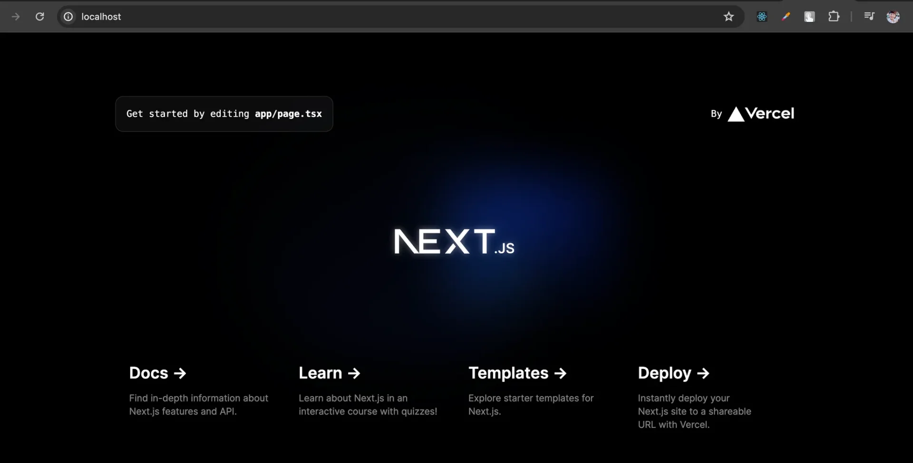

<a id="1c3eda9b0fe181f0a548d9900cb3dad1"></a>

##  &#91;실습&#93; Dokcer Compose로 프론트(Next&#46;js) 실행

---

<details>
<summary>1&#46; <strong>Next&#46;js 프로젝트 생성</strong></summary>

<a id="1c3eda9b0fe1815fa1b1f72267530071"></a>

```bash
npx create-next-app@latest
```

</details>

<details>
<summary>2&#46;  <code>Dockerfile</code>, <code>&#46;dockerignore</code>, <code>compose 파일</code> 작성</summary>

<a id="1c3eda9b0fe181d0b3c8d8e743e7c6e3"></a>

<strong>Dockerfile</strong>

<a id="1c3eda9b0fe18178b44bc9c25b793aa1"></a>

```docker
FROM node:20-alpine

WORKDIR /app

COPY . .

RUN npm install

RUN npm run build

EXPOSE 3000

ENTRYPOINT [ "npm", "run", "start" ]
```

<a id="1c3eda9b0fe181238d5ae82914c19131"></a>

<strong>&#46;dockerignore</strong>

<a id="1c3eda9b0fe1815fb0c0d2c397de1d4a"></a>

```docker
node_modules
```

<a id="1c3eda9b0fe1819d87bef2f0dffd1ceb"></a>

<strong>compose 파일(</strong><strong><code>compose&#46;yml</code></strong><strong>) 작성</strong>

<a id="1c3eda9b0fe181509284cf44df997d67"></a>

```yaml
services:
  my-web-server:
    build: .
    ports:
      - 80:3000
```

</details>

<details>
<summary>3&#46;  <strong>compose 파일 실행</strong> </summary>

<a id="1c3eda9b0fe18159834fd2cefdcc4784"></a>

```bash
docker compose up -d --build
```

</details>

<details>
<summary>4&#46; <strong>compose 실행 현황</strong></summary>

<a id="1c3eda9b0fe1816dbd20fe5af8d0793b"></a>

```bash
docker compose ps
docker ps
```

<a id="1c3eda9b0fe181828314dfaeaf6f91f9"></a>

 

</details>

<details>
<summary>5&#46; <a href="http://localhost:80">localhost&#58;80</a> 호출</summary>



</details>

<details>
<summary>6&#46; compose 실행된 컨테이너 </summary>

<a id="1c3eda9b0fe1818490f0c610cb2568ce"></a>

```bash
docker compose down
```

</details>

<a id="1c3eda9b0fe1813bb3d0fbd8d0349c8f"></a>
