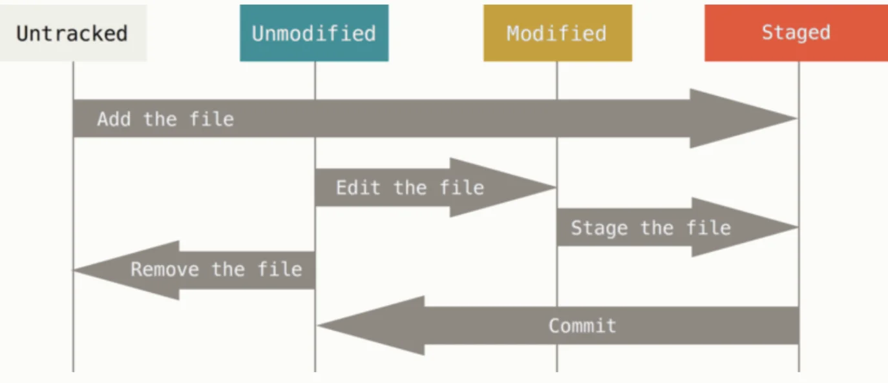
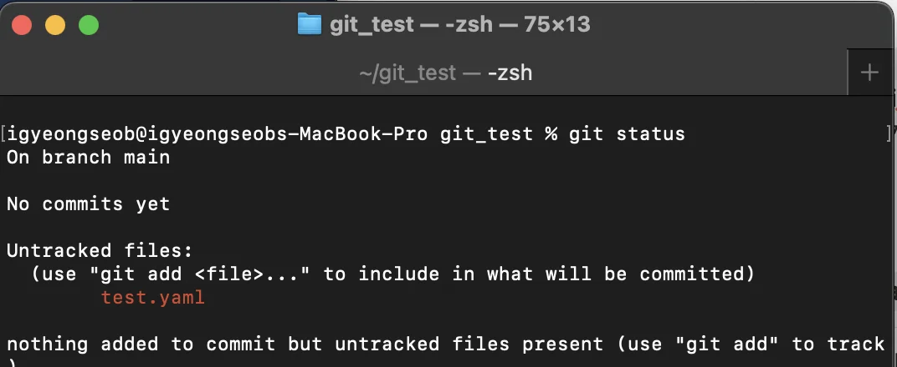
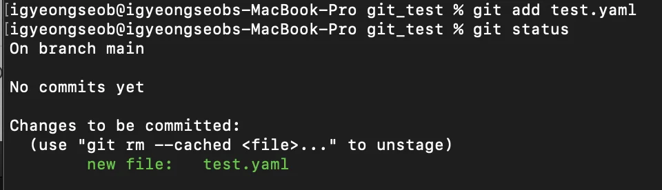
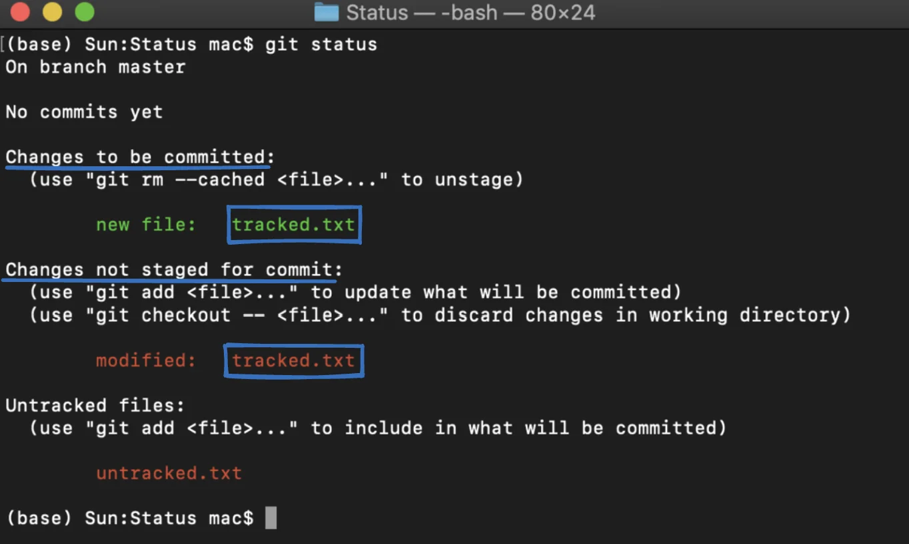

<a id="1c3eda9b0fe18142a29ae4886132c51c"></a>

 

> 📌 Reference<br><a href="https://seonkyukim.github.io/git-tutorial/git-status/">https&#58;//seonkyukim&#46;github&#46;io/git&#45;tutorial/git&#45;status/</a><br><a href="https://git-scm.com/book/ko/v2/Git%EC%9D%98-%EA%B8%B0%EC%B4%88-%EC%88%98%EC%A0%95%ED%95%98%EA%B3%A0-%EC%A0%80%EC%9E%A5%EC%86%8C%EC%97%90-%EC%A0%80%EC%9E%A5%ED%95%98%EA%B8%B0">https&#58;//git&#45;scm&#46;com/book/ko/v2/Git의&#45;기초&#45;수정하고&#45;저장소에&#45;저장하기</a>

<a id="1c3eda9b0fe1816182d1d58925d84746"></a>

## 파일 상태(status)

<a id="1c3eda9b0fe181519903caf0714b448b"></a>

### <code>Untracked</code>, <code>Tracked</code>

---

<a id="1c3eda9b0fe18124a4b2c3a7ccdf8ead"></a>

워킹 디렉토리의 파일은 먼저 크게 <code>Untracked</code>, <code>Tracked</code>  두가지 상태로 나뉜다&#46; 

> 워킹 디렉토리는 <strong>작업 중인 로컬 컴퓨터의 공간</strong>을 말한다&#46; 

<a id="1c3eda9b0fe1817aae59f3801a9aaf43"></a>

<code>Tracked</code>은 말 그대로 git이 해당 파일을 추적하는 상태로 파일 변경되는 것을 사용자에게 알려준다&#46; <br><code>Untracked</code>은 git이 해당 파일을 추적하지 않는 상태로, 해당 파일을 저장소에 관리하지 않는 것을 말한다&#46;

<a id="1c3eda9b0fe18104a772dd647d733bdc"></a>

파일을 새로 만드는 경우 <code>Untracked</code> 상태로써 git이 파일을 추적하지 않는다&#46;  

> git 저장소에 저장할 필요가 없는 파일들은 <code>Untraked</code> 상태로 두면 된다&#46;

<a id="1c3eda9b0fe1817ba151dadac64a2593"></a>

이후 <code>git add</code> 명령어를 사용하여 파일을 add 해주면, 해당 파일이 staging area에 저장되어 <code>Tracked</code> 상태 즉, git이 파일을 추적하는 상태가 된다&#46; <br>

<a id="1c3eda9b0fe181e3a98be45fa9627ad9"></a>

### <code>Tracked</code> &#45; <code>Unmodified</code>, <code>Modified</code>, <code>Staged</code>

---

<a id="1c3eda9b0fe181bea3abde6a35005ddc"></a>

<strong>Tracked  상태의 파일들은 다시 크게 </strong><code>Unmodified</code>, <code>Modified</code>, <code>Staged</code> 3개의 상태로 나뉜다&#46; 



- <strong><code>Staged</code></strong>&#58; <strong>staging area</strong>에 등록된 파일들
    <a id="1c3eda9b0fe181e087c4fac832ea1a9c"></a>

       → <code>git add</code>를 통해 <strong>staging area</strong>에 파일을 등록함

- <strong><code>Unmodified</code></strong>&#58;  staging area에 있는 파일들을 커밋한 후 상태

- <strong><code>Modified</code></strong>&#58; Unmodified 상태의 파일들을 수정한 상태

> <code>git add</code> → <code>Staged</code>  → <code>git commit</code> → <code>Unmodified</code> → 파일 수정 →  <code>Modified</code> → git add … (반복)

<a id="1c3eda9b0fe181409a97c7a696b9d15c"></a>

## <code>git status</code>

<a id="1c3eda9b0fe18170b903c287ec5d43e1"></a>

### <strong>Untacked 상태 </strong>

---

<a id="1c3eda9b0fe181bc8b5dc8b241629b24"></a>

<code>git status</code> 명령어 실행 시, 아래와 같이 <strong><u>Untracked files</u></strong><strong> </strong>명단에 있는 <strong>빨간색 파일들</strong>이 <strong><u>Untracked 상태의 파일들</u></strong>이다&#46;



<a id="1c3eda9b0fe181a992ceccdfa356ab2c"></a>

### <strong>Staged 상태</strong>

---

<a id="1c3eda9b0fe1810a8740e62eb78b3239"></a>

<code>git status</code> 명령어를 실행 시, 아래와 같이 <strong><u>Changes to be committed</u></strong><u> </u>명단에 있는 <strong>초록색 파일들</strong>이 <strong><u>Staged 상태의 파일들</u></strong>이다&#46; 



<a id="1c3eda9b0fe18119bd37db3fb9ee4eba"></a>

### <strong>Modified 상태</strong>

---

<a id="1c3eda9b0fe181a1bbb6db850cda7baf"></a>

<code>git status</code> 명령어를 실행 시, 아래와 같이 <strong><u>Changes not staged for commit</u></strong> 명단에 있는 <strong>빨간색 파일들</strong>이 <strong><u>Modified 상태의 파일</u></strong>들이다&#46; 

<a id="1c3eda9b0fe181179b7ae560d2c108ed"></a>

### Unmodified 상태 

---

<a id="1c3eda9b0fe181538aa3ffa810ccf5c6"></a>

커밋(<code>git commit</code>) 후,  <code>git status</code> 명령어를 실행하면 <code>Unmodified</code> 상태의 파일은 화면에 출력되지 않는다&#46; 

<details>
<summary><strong>🧐 커밋(</strong><code>git commit</code>)<strong> 시 주의 점</strong></summary>

<a id="1c3eda9b0fe181e3b226eb75ebec06bb"></a>

<code>git commit</code> 명령어는 <strong>Staging Area의 파일들을 커밋</strong>하기 때문에 <strong><code>git add</code></strong><strong>를 한 후, 해당 파일을  수정</strong>한 경우 다시<strong> </strong><strong><u><code>git add</code></u></strong><strong><u>를 통해 변경 파일을 Staging Area에 올</u></strong>려주어야한다&#46;

<a id="1c3eda9b0fe181c5aa30e78069e2200a"></a>

 만약  <u><code>git add</code></u><u>를 통해 변경 파일을</u><strong><u> Staging Area</u></strong><u>에 올려주</u> 않고 커밋(<code>git commit</code>)을 한다면 <u>변경 이전의 파일이 커밋</u>된다&#46; 

<a id="1c3eda9b0fe181a9a514f420469ce0fd"></a>

따라서 <strong><code>git add</code></strong><strong> 후 커밋 전 해당 파일을 수정 했</strong>다면 다시 <strong><u><code>git add</code></u></strong><strong><u>를 통해 Staging Area에 복사해온 후 커밋</u></strong>을 해야한다&#46;  

</details>

<details>
<summary>🤔  하나의 파일에 두개의 상태가 적용됨</summary>



<a id="1c3eda9b0fe181028ab6ec66623abb92"></a>

위 화면을 보면 <strong>tracked&#46;txt</strong>파일이 Staged 상태에도 있고 Modified 상태에도 있는 것을 확인할 수 있다&#46; 

<a id="1c3eda9b0fe1811685dff152c9a6cac9"></a>

<strong><u>Staging Area에 있는 파일</u></strong>은 <strong>워킹 디렉토리의 파일</strong>이 옮겨지는 것이 아니라<strong> </strong><strong><u>복사</u></strong>되는 것이다&#46;<br>따라서 <strong><u><code>git add</code></u></strong><u>를 한 후 </u><strong><u>해당 파일을 수정</u></strong>하게 되면 <strong><u>Staging Area</u></strong><u>에 있는</u><strong><u> 파일</u></strong><u>에는</u><strong><u> 수정내용이 반영되지 않</u></strong>아 <strong>하나의 파일</strong>이 위와 같은 <strong>두 개의 상태를 가질 수 있</strong>다&#46;

</details>

<a id="1c3eda9b0fe181eea53cf8242ca10a31"></a>

### &#43;) <strong>Modified 파일 되돌리기</strong>

<a id="1c3eda9b0fe18163a896caac24a04c02"></a>

modified 특정 파일(커밋 후 수정된 파일)을 가장 최근 커밋 버전으로 되돌릴 수 있다&#46; 

<a id="1c3eda9b0fe1817884bbcbe73ef8309a"></a>

즉, 워킹 디렉토리에서의 해당 파일의 수정 사항을 제거한다&#46; 

> 📌 git checkout &#45;&#45; &#91;파일 이름&#93;

<details>
<summary>ex) checkout <code>sample&#46;txt</code></summary>

<a id="1c3eda9b0fe181a5b534fdf788e24870"></a>

<code>sample&#46;txt</code> 파일을 가장 최근 커밋 버전으로 되돌린다&#46; 

<a id="1c3eda9b0fe1813db90bd46ca109a9d3"></a>

```bash
$ git checkout -- sample.txt
```

</details>
