<details>
<summary>EC2 콘솔 접속</summary>

---

- 해당하는 인스턴스 클릭
    

- 연결 클릭
    

    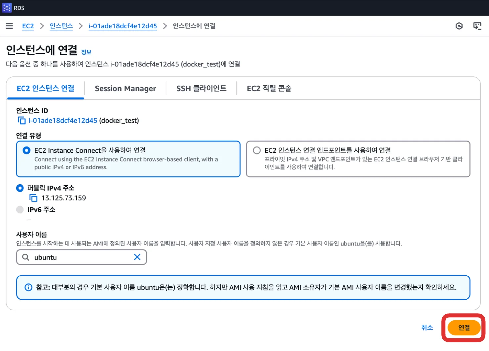

- 해당 EC2의 콘솔 창으로 접속 
    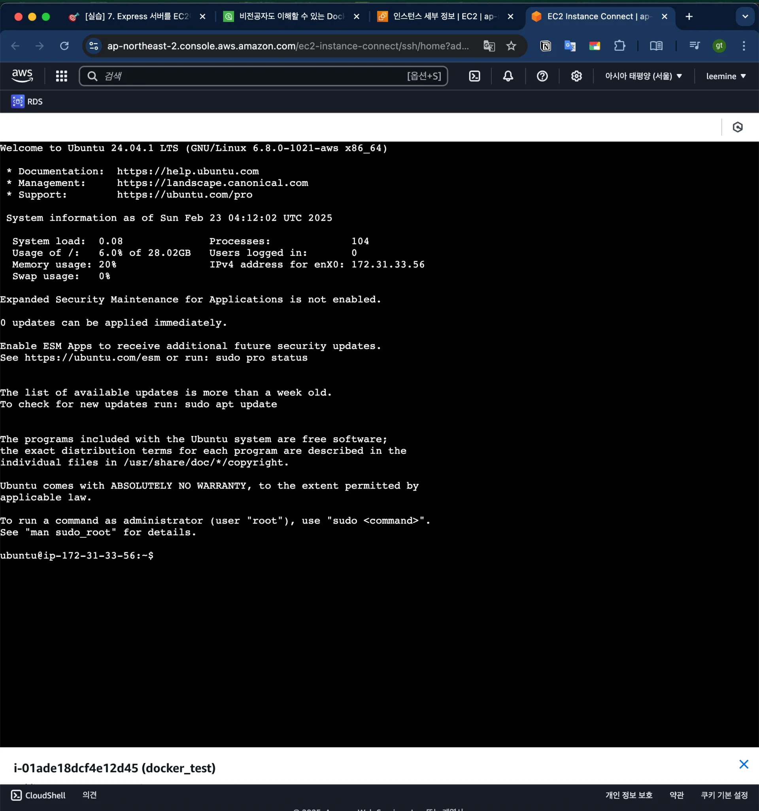

</details>

<a id="1c3eda9b0fe181b8b949e7a8aa919210"></a>

## &#91; 실습 &#93; AWS EC2 &#45; Spring Boot 베포

---

<a id="1c3eda9b0fe18143b8facf734ad0a2dc"></a>

### 1&#46; Docker CLI &#45; 베포

<details>
<summary><strong><code>로컬 환경</code></strong><strong> </strong><strong>프로젝트 설정</strong></summary>

[start&#46;spring&#46;io]()

- Dependencies
    - Spring Web

    - Spring Boot Devtools 

</details>

<details>
<summary>AppController</summary>

<a id="1c3eda9b0fe1816195e8e8d0a3fc449f"></a>

```java
@RestController
public class AppController {
  @GetMapping("/")
  public String home() {
    return "Docker, World!";
  }
}
```

</details>

<details>
<summary>Dockerfile </summary>

<a id="1c3eda9b0fe181d9b709fe6d528de4ab"></a>

```docker
FROM openjdk:17-jdk

COPY build/libs/*SNAPSHOT.jar app.jar

ENTRYPOINT ["java", "-jar", "/app.jar"]
```

</details>

<details>
<summary><strong>Spring Boot 프로젝트 빌드</strong></summary>

<a id="1c3eda9b0fe1810b8d1ffa8e0fa683ac"></a>

```bash
./gradlew clean build

aws ecr get-login-password --region ap-northeast-2 | docker login --username AWS --password-stdin 869673799096.dkr.ecr.ap-northeast-2.amazonaws.com

docker build -t docker-test .

docker tag docker-test:latest 869673799096.dkr.ecr.ap-northeast-2.amazonaws.com/docker-test:latest

docker push 869673799096.dkr.ecr.ap-northeast-2.amazonaws.com/docker-test:latest
```

</details>

<details>
<summary><strong>AWS EC2</strong><strong>에서 AWS CLI 설치 및 액세스 키 등록</strong></summary>

<a id="1c3eda9b0fe1818cbf4ce26d935d4843"></a>

<a href="#/post/1c3eda9b-0fe1-81f5-aae2-f39073a356a7">페이지</a> 

</details>

<details>
<summary><strong>AWS ECR로부터 이미지 다운받아 컨테이너 띄우기</strong></summary>

<a id="1c3eda9b0fe181058a5cd9c872b38059"></a>

```bash
# ECR 로그인
aws ecr get-login-password --region ap-northeast-2 | docker login --username AWS --password-stdin 002177417362.dkr.ecr.ap-northeast-2.amazonaws.com

# ECR 이미지 다운
docker pull 002177417362.dkr.ecr.ap-northeast-2.amazonaws.com/instagram-server 

# 컨테이너 실행
docker run -d -p 8080:8080 002177417362.dkr.ecr.ap-northeast-2.amazonaws.com/instagram-server
```

</details>

<details>
<summary>&#91; 🤬  오류 &#93;  <strong><u>빌드 환경</u></strong> 과 <strong><u>실행 환경</u></strong>의 CPU 아키텍처 불일치 </summary>

> ✏️ 
> 
> <a id="1c3eda9b0fe181e5bfa3fcf8a980461e"></a>
> 
> <strong><u>이미지를 빌드한 CPU 환경</u></strong>과 <strong><u>이미지를 실행 시키는 CPU 아키텍처 환경</u></strong>이 <strong>동일</strong>해야 한다&#46; 

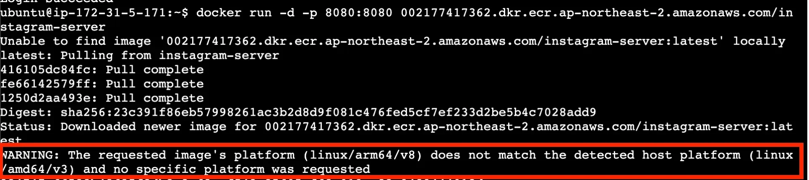

<a id="1c3eda9b0fe1814181b6f5091406d7ee"></a>

해당 오류는 CPU 아키텍처 환경이 달라 발생된다&#46; 

- 이미지 빌드는 M1과 같은 ARM 기반의 환경에서 진행한다&#46;

- 그러나 이미지를 실행 시키는 EC2는 linux로 설정했기 때문에, 동일하지 않아 오류가 발생된다&#46; 
    - M1, M2 &#46;&#46; &#58; <code>ARM 기반</code>

    - linux  &#46;&#46; &#58; <code>arm64/v8 기반</code>

<a id="1c3eda9b0fe1818a9ce0df469316f998"></a>

해결하기 위해서는 이미지를 <strong><u>실행시키고자 하는 </u></strong><strong><u>CPU 아키텍처에 맞</u></strong>춰서 이미지를 빌드해야 한다&#46; 

- 로컬 환경에서 아래와 같이 다시 빌드한 뒤 AWS ECR로 Push
    <a id="1c3eda9b0fe181549d21e41fb9bc1cda"></a>

    ```bash
    # jar 파일 build
    /gradlew clean build

    # ECR 로그인
    aws ecr get-login-password --region ap-northeast-2 | docker login --username AWS --password-stdin 002177417362.dkr.ecr.ap-northeast-2.amazonaws.com

    # linux 환경으로 이미지 빌드
    docker build --platform linux/amd64 -t docker-test .

    # 이미지 태그 설정
    docker tag docker-test:latest 869673799096.dkr.ecr.ap-northeast-2.amazonaws.com/docker-test:latest

    # ECR push
    docker push 869673799096.dkr.ecr.ap-northeast-2.amazonaws.com/docker-test:latest
    ```

- 컨테이너 실행
    <a id="1c3eda9b0fe181008507e20ba08c5757"></a>

    ```bash
    docker run -d -p 8080:8080 869673799096.dkr.ecr.ap-northeast-2.amazonaws.com/docker-test:latest
    ```

</details>

<details>
<summary>&#91; 🤬  오류 &#93;  인바운드 규칙 &#45; 8080 추가 필요</summary>

> ✏️ 
> 
> <a id="1c3eda9b0fe181b191b4d65e3850020f"></a>
> 
> 해당 보안 그룹에 8080 서버 포트 번호를 추가해야 정상적으로 접속이 가능하다&#46; 

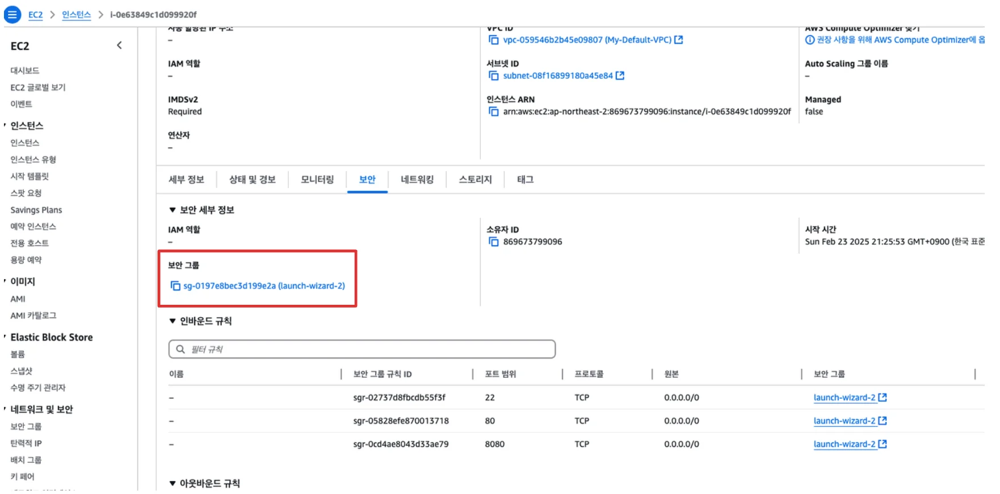

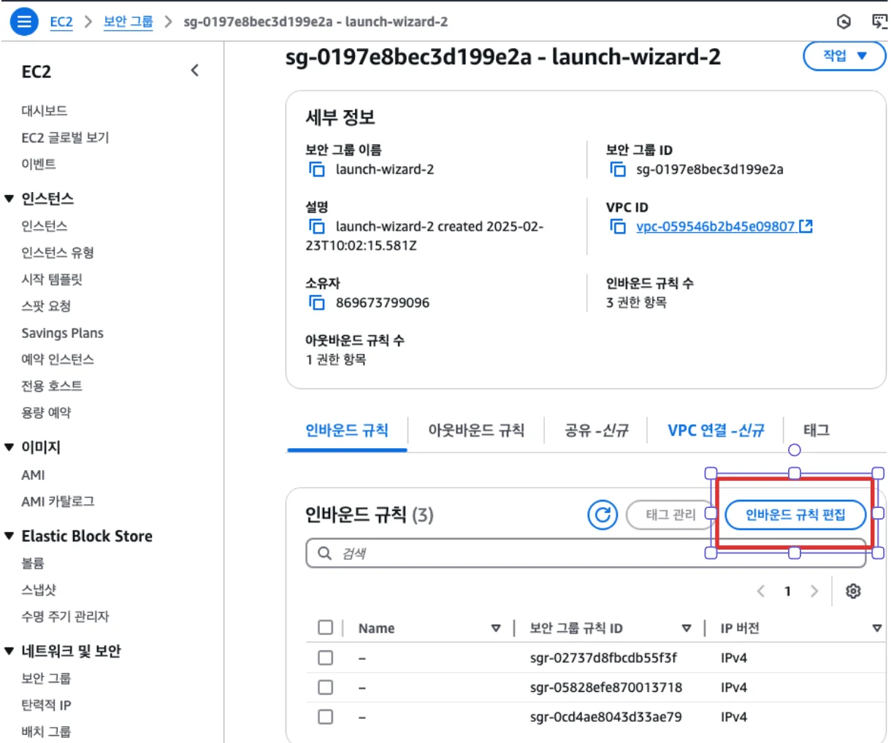

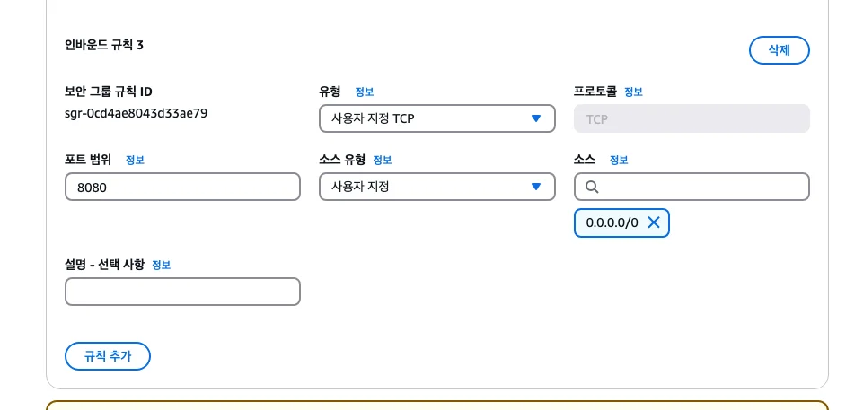

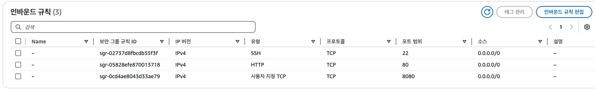

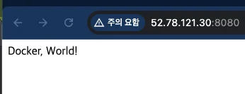

</details>

<details>
<summary>동작 확인</summary>

<a id="1c3eda9b0fe181b49a33d4f8dd5c27a7"></a>

```bash
docker ps
docker logs
```

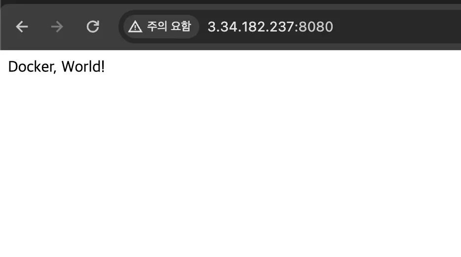

</details>

<a id="1c3eda9b0fe181798b3df2913e33f6df"></a>

### 2&#46; Docker Compose &#45;  베포

> ✏️ 
> 
> <a id="1c3eda9b0fe1816da0d0c889d646bbe4"></a>
> 
> Docker compose를 통해 더 간단하게 베포 가능하다&#46; 

- <strong>AWS EC2에 compose&#46;yml 만들기</strong>
    - 폴더 생성
        <a id="1c3eda9b0fe1816aa9fcccf00e22162d"></a>

        ```bash
        mkdir docker-test
        ```

        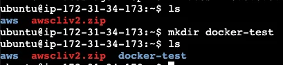

    - <strong>compose&#46;yml  </strong>
        <a id="1c3eda9b0fe181a497b3d10d5c6e6efa"></a>

        ```bash
        services:
          instagram-server:
            image: 869673799096.dkr.ecr.ap-northeast-2.amazonaws.com/docker-test:latest
            ports:
              - 8080:8080
        ```

        <a id="1c3eda9b0fe181e1ac1cf8b4185ceaf1"></a>

        ```bash
        # compose 파일 생성 및 편집
        vim docker-test/compose.yml

        # 확인
        cat docker-test/compose.yml 
        ```

        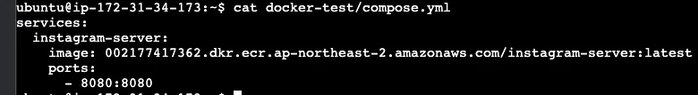

- 실행
    <a id="1c3eda9b0fe181b59d1cc75e23add6c0"></a>

    ```bash
    # ECR 로그인
    aws ecr get-login-password --region ap-northeast-2 | docker login --username AWS --password-stdin 002177417362.dkr.ecr.ap-northeast-2.amazonaws.com

    # compose 실행
    docker compose up --build -d
    ```

- 확인
    <a id="1c3eda9b0fe1819dbe09c725d3e355ff"></a>

    ```bash
    docker compose ps
    ```

    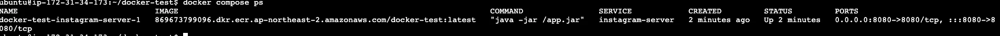

    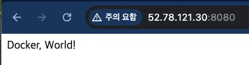
