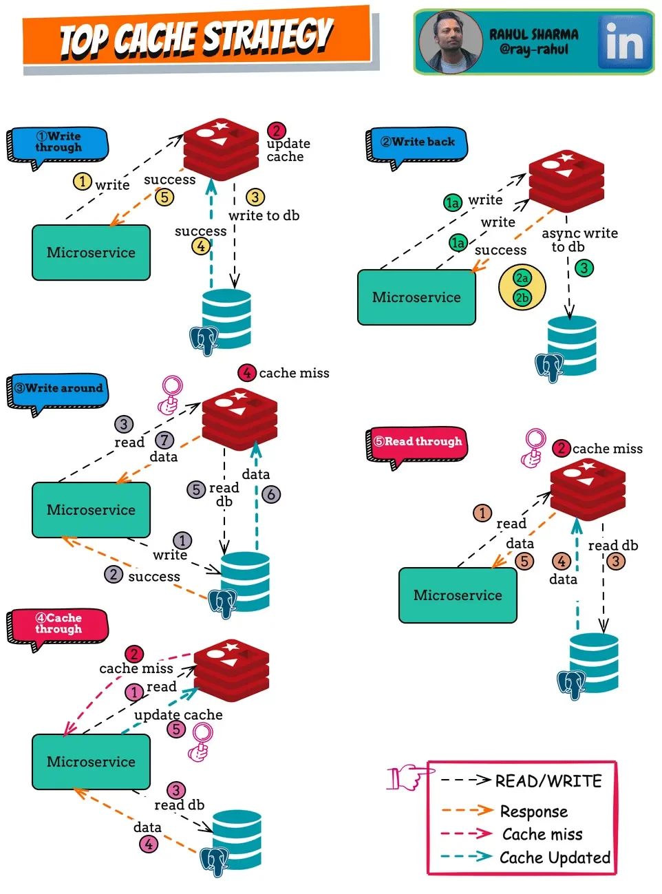
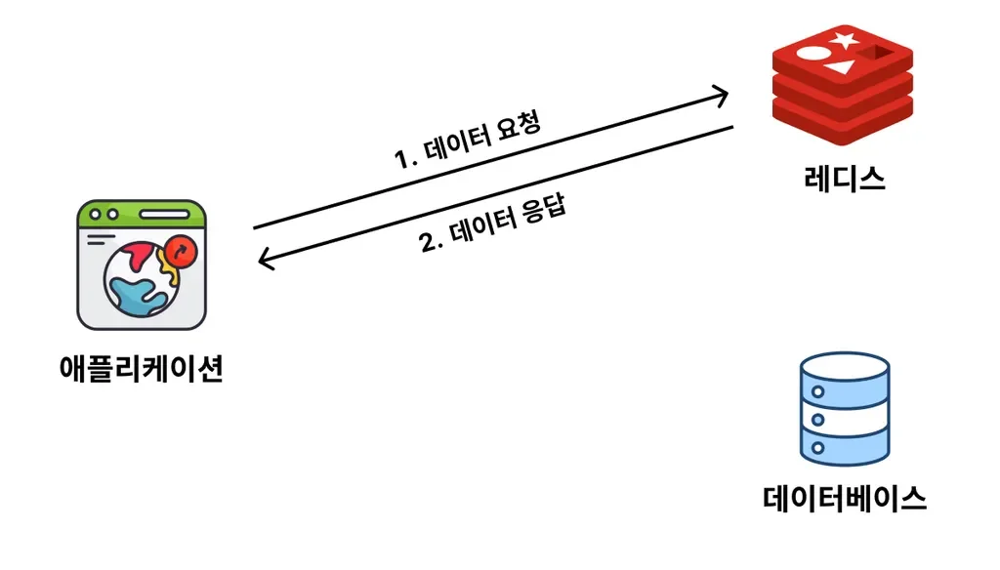
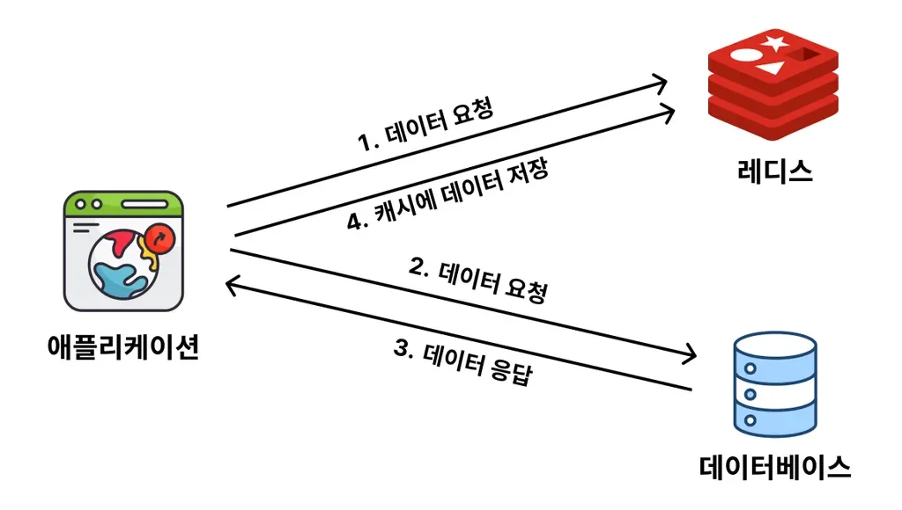
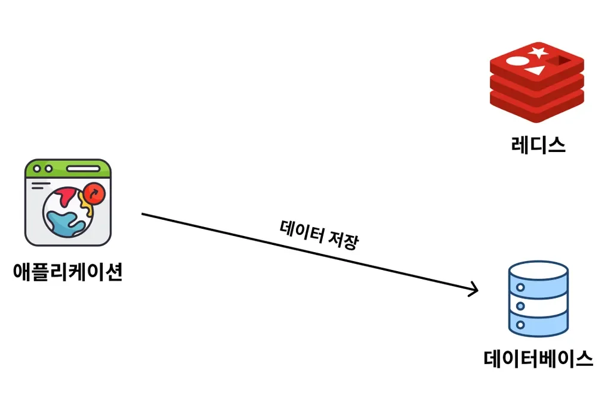

## Redis 데이터 캐싱 전략

---

> 📖 
> 
> 
> 
> Redis를 활용한 데이터 캐싱에 대한 다양한 전략이 있다&#46;
> 
> 
> 
> 그 중 가장 많이 사용되는 2가지 전략을 학습한다&#46;
> 
> - <code>Cache Aside</code> 
> 
> - <code>Write Around</code>

Redis TOP  캐싱 전략 

나머지 전략들은 해당 2가지 전략에 익숙해진 뒤 추가로 학습하는 것을 추천 ( 파레토 법칙 )

### <code>Cache Aside</code> (<code>Look Aside</code>, <code>Lazy Loading</code>) 전략

> ✏️ 
> 
> 
> 
> <strong><u>데이터 조회</u></strong> 시 주로 사용하는 전략이다&#46; 
> 
> -  <strong><u>Look Aside 전략</u></strong> or <strong><u>Lazy Loading 전략</u></strong> 이라고도 부른다&#46;
> 
> 
> 
>  <strong><u>캐시(Cache)에서 데이터를 확인</u></strong>하고, <strong><u>있</u></strong><strong>다면 응답</strong> or  <strong><u>없</u></strong><strong>다면 </strong><strong><u>DB 조회, 응답 후 캐싱 처리</u></strong>한다&#46; 
> 
> 

> 
<strong>캐시 </strong><strong><u>데이터가 있</u></strong><strong>는 경우 ( </strong><strong><code>Cache Hit </code></strong><strong>)</strong>

> 
> 
> 
> - Redis에 데이터 요청 시, 해당 데이터가 존재한다면 바로 Redis에서 데이터 반환한다&#46; 
>     - 이를 <code>Cache Hit</code> 이라 한다&#46;
> 
> -  <strong><u>메모리에서 바로 조회</u></strong>하여 가져오기 때문에, DB 조회 보다 <u>월등히 빠른 속도</u>를 낸다&#46; 
> 
> 

> 
> 

> 
<strong>캐시에 </strong><strong><u>데이터가 없</u></strong><strong>을 경우 ( </strong><strong><code>Cache Miss</code></strong><strong> )</strong>

> 
> 
> 
> - <u>캐싱된 데이터가 없</u>다면, <u>DB 조회 후 캐싱 처리</u>를 하기 때문에 <strong><u>기존 응답보다 더 느릴</u></strong> 수 있다&#46; ( 초기 한번만 발생 )
> 
> 

---

 ex)<strong><code>게시판</code></strong> 서비스

1. 처음 게시판 서비스를 배포했기 때문에 데이터베이스와 레디스에는 아무런 데이터도 저장이 안 되어 있다&#46; 

1. 일부 사용자가 들어와 게시글 작성을 함으로써 데이터를 저장한다&#46; 이 데이터는 데이터베이스에 저장된다&#46; (레디스에는 저장되지 않는다&#46;)

1. 사용자가 데이터를 조회하려고 요청한다&#46; 이 때, 데이터베이스로부터 바로 데이터 조회를 하기 전에 레디스에 있는 지 먼저 확인한다&#46; 

1. 레디스에 데이터가 없는 걸 확인한 뒤에 데이터베이스로부터 데이터를 조회해서 응답한다&#46; 

1. 데이터베이스로부터 조회한 데이터를 응답한 뒤에 레디스에도 데이터를 저장해둔다&#46;

1. 다시 한 번 사용자가 데이터를 조회하려고 요청한다&#46; 

1. 레디스에 조회하고자 하는 데이터가 있는 지 확인했더니, 데이터가 존재해서 레디스로부터 데이터를 바로 가져와버린다&#46; 

### <code>Write Around</code> 전략

> ✏️ 
> 
> 
> 
> <strong><code>Write Around</code></strong> 전략은 <strong><u>데이터를 어떻게 쓸 지(저장, 수정, 삭제)</u></strong>에 대한 전략으로 위 <strong><code>Cache Aside</code></strong> 전략과 같이 자주 활용된다&#46;
> 
> - <code>Cache Aside</code> 전략은 <u>데이터를 어떻게 조회</u>를 다루는 전략이다&#46;
> 
> 
> 
> 
> 
> <strong><u>쓰기 작업 </u></strong><strong>( 저장, 수정, 삭제) 시</strong> <strong><u>DB에만 반영</u></strong>하며 ( <strong>캐시 반영 ❌</strong> ) 조회에서는 <code>Cache Aside</code> 전략을 사용한다&#46;

ex) 

