> 📖 
> 
> <a id="1cbeda9b0fe180679e00f08301776381"></a>
> 
> <strong>객체지향의 </strong><strong><code>다형성</code></strong><strong>과 </strong><strong><code>OCP 원칙</code></strong><strong>을 </strong><strong><u>가장 잘 활용</u></strong>할 수 있는 곳 중에 하나가 바로 <strong><u>자료구조</u></strong>이다&#46;

<a id="1cbeda9b0fe180e5b7ddd73f5824d642"></a>

## 리스트 ( List )

---

> ✏️ 
> 
> <a id="1cbeda9b0fe180449041d6244bac3175"></a>
> 
> <strong>List</strong>
> 
> ---
> 
> <a id="1cbeda9b0fe1805c9b58cec2f20d9b01"></a>
> 
> <strong><u>순서가 있고, 중복을 허용</u></strong>하는 자료구조를 리스트(<strong><code>List</code></strong>)라 한다&#46; 
> 
> <a id="1cbeda9b0fe180d2842ee6cc682b9def"></a>
> 
> 이전에 직접 구현한 <strong><code>MyArrayList</code></strong> 와 <strong><code>MyLinkedList</code></strong>는 내부 <strong><u>구현만 다를 뿐</u></strong><u> </u><strong><u>같은 기능을 제공하는 리스트</u></strong>이다&#46; 
> 
> <a id="1cbeda9b0fe180af9787e90a4a66184f"></a>
> 
> 내부 구현이 다르기 때문에 상황에 따라 성능이 달라질 수 있으나, <strong><u>사용자 입장에서 보면 같은 기능을 제공</u></strong>한다&#46; ( 동일 형태의 메서드 구조 )
> 
> <a id="1cbeda9b0fe180d6bb7de61a3a6720a8"></a>
> 
> 따라서<strong><u> 이 둘의 공통 기능을 인터페이스로 뽑아 추상화</u></strong>하고 <strong><u>다형성을 활용</u></strong>한다면 여러 이점을 얻을 수 있따&#46;

<a id="1cbeda9b0fe180a39c78c65730e28084"></a>

### 추상화 1 &#45; 인터페이스 도입

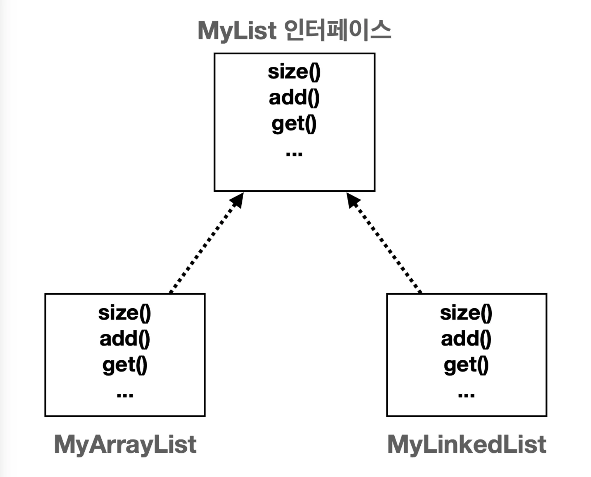

<a id="1cbeda9b0fe180a4a95cc6e8226abc71"></a>

### 코드

<details>
<summary>&#91; 코드 &#93; &#60; interface &#62; MyList</summary>

<a id="1cbeda9b0fe180fe9458d4e5cc29a8cb"></a>

```java
package collection.list;

public interface MyList<E> {

    int size();

    void add(E e);

    void add(int index, E e);

    E get(int index);

    E set(int index, E elemenet);

    E remove(int index);

    int indexOf(E o);
}

```

</details>

<details>
<summary>&#91; 코드 &#93; MyArrayList</summary>

<a id="1cbeda9b0fe180579c7ed1ff92e70c78"></a>

```java
package collection.list;

import java.util.Arrays;

public class MyArrayList<E> implements MyList<E> {

    private static final int DEFAULT_CAPACITY = 5;

    // 왜 제네릭을 사용하지 않고 Object를 사용하는가? E로 선언 시, new E[]로 Array 를 생성해야 한다.
    private Object[] elementData;
    private int size = 0;

    public MyArrayList(Object[] elementData) {
        this.elementData = new Object[DEFAULT_CAPACITY];  // new E[] 는 타입 이레이저로 인해 타입 오류가 발생된다.
    }

    public MyArrayList(int initialCapacity) {
        elementData = new Object[initialCapacity];
    }

    @Override
    public int size() {
        return size;
    }

    @Override
    public void add(E e) {
        if (size == elementData.length) {
            grow();
        }
        elementData[size] = e;
        size++;
    }

    @Override
    public void add(int index, E e) {
        if (size == elementData.length) {
            grow();
        }
        shiftRightFrom(index);
        elementData[index] = e;
        size++;
    }

    // 요소 index 부터 마지막까지 왼쪽으로 밀기
    private void shiftRightFrom(int index) {
        for (int i = size; i > index; i--) {
            elementData[i] = elementData[i - 1];
        }
    }

    @Override
    @SuppressWarnings("unchecked")
    public E get(int index) {
        return (E) elementData[index];
    }

    @Override
    @SuppressWarnings("unchecked")
    public E set(int index, E element) {
        elementData[index] = element;
        return (E) elementData[index];
    }

    @Override
    public E remove(int index) {
        E oldValue = get(index);
        shiftLeftFrom(index);

        size--;
        elementData[size] = null;
        return oldValue;
    }

    private void shiftLeftFrom(int index) {
        for (int i = index; i < size; i++) {
            elementData[i] = elementData[i + 1];
        }
    }

    @Override
    public int indexOf(E o) {
        for (int i = 0; i < size; i++) {
            if (o.equals(elementData[i])) {
                return i;
            }
        }
        return -1;
    }

    private void grow() {
        int oldCapacity = size;
        int newCapacity = oldCapacity * 2;
        elementData = Arrays.copyOf(elementData, newCapacity);
    }

    @Override
    public String toString() {
        return Arrays.toString(Arrays.copyOf(elementData, size)) + " size=" + size  + ", capacity=" + elementData.length;
    }
}

```

</details>

<details>
<summary>&#91; 코드 &#93; MyLinkedList</summary>

<a id="1cbeda9b0fe18028b84fca6f9a949809"></a>

```java
package collection.list;

public class MyLinkedList<E> implements MyList<E> {
    private Node<E> first;
    private int size = 0;

    @Override
    public void add(E e) {
        Node<E> newNode = new Node<>(e);
        if (first == null) {
            first = newNode;
        } else {
            Node<E> lastNode = getLastNode();
            lastNode.next = newNode;
        }
        size++;
    }

    private Node<E> getLastNode() {
        if(first ==  null) return first;
        Node<E> x = first;
        while (x.next != null) {
            x = x.next;
        }
        return x;
    }

    @Override
    public void add(int index, E e) {
        Node<E> newNode = new Node<E>(e);
        if (index == 0) {
            newNode.next = first;
            first = newNode;
        } else {
            Node<E> prev = getNode(index - 1);
            newNode.next = prev.next;
            prev.next = newNode;
        }
        size++;
    }

    @Override
    public E set(int index, E elemenet) {
        Node<E> x = getNode(index);
        E oldValue = x.item;
        x.item = elemenet;
        return oldValue;
    }

    @Override
    public E remove(int index) {
        Node<E> removeNode = getNode(index);
        E removeValue = removeNode.item;
        if (index == 0) {
            first = removeNode.next;
        } else {
            Node<E> prev = getNode(index - 1);
            prev.next = removeNode.next;
        }
        removeNode.item = null;
        removeNode.next = null;
        size--;
        return removeValue;
    }

    @Override
    public E get(int index) {
        Node<E> node = getNode(index);
        return node.item;
    }

    private Node<E> getNode(int index) {
        Node<E> x = first;
        for (int i = 0; i < index; i++) {
            x = x.next;
        }
        return x;
    }

    @Override
    public int indexOf(E o) {
        int index = 0;
        for (Node<E> x = first; x != null; x = x.next) {
            if (o.equals(x.item)) {
                return index;
            }
            index++;
        }
        return -1;
    }

    @Override
    public int size() {
        return size;
    }

    @Override
    public String toString() {
        return "MyLinkedList{" +
                "first=" + first +
                ", size=" + size +
                '}';
    }

    private static class Node<E> {
        E item;
        Node<E> next;

        public Node(E item) {
            this.item = item;
        }

        @Override
        public String toString() {
            StringBuilder sb = new StringBuilder();
            Node<E> temp = this;
            sb.append("[");
            while (temp != null) {
                sb.append(temp.item);
                if (temp.next != null) {
                    sb.append("->");
                }
                temp = temp.next;
            }
            sb.append("]");
            return sb.toString();
        }
    }
}

```

</details>

<a id="1cbeda9b0fe1809bbea6c7da1ad24b08"></a>

### 추상화 2 &#45; 의존관계 주입

> 🎬 
> 
> <a id="1cbeda9b0fe18086bb1feaa35d317f1a"></a>
> 
> <strong>시나리오</strong>
> 
> <a id="1cbeda9b0fe18099bc26e43bec7153fd"></a>
> 
> <code>ArrayList</code>(<code>MyArrayList</code>)를 활용해서 많은 데이터를 처리하는 <code>BatchProcessor</code> 클래스를 개발하고 있다고 가정하자&#46; 막상 프로그램을 개발하고 보니 데이터를 앞에 추가하거나 삭제하는 일이 많은 상황이라고 한다면, <code>ArrayList</code> 보다는 <code>Linked List</code>를 사용하는 것이 훨씬 효율적이다&#46;  
> 
> <a id="1cbeda9b0fe1806392a4f1075fd2df26"></a>
> 
> 따라서 해당 시나리오를 예제로 <strong><u>어떻게 List의 구현체를 상황에 맞게 변경</u></strong>할 수 있는지를 학습한다&#46; 
> 
> ---
> 
> > 데이터를 앞에 추가, 삭제 할 때의 연산 비용(빅오)
> 
> - Array List = <code>O(n)</code>
> 
> - Linked List&#58; <code>O(1)</code> 

<details>
<summary><strong>&#91;  🤬 Bad Case &#93;</strong><strong> 구체적인 MyArrayList에 의존하는 BatchProcessor</strong></summary>

<a id="1cbeda9b0fe180718d62e492310617e1"></a>

```java
package collection.list;

public class BatchProcesor {
		
	// private final MyArrayList<Integer> list = new MyArrayList<>();
    private final MyLinkedList<Integer> list = new MyLinkedList<>(); 

    public void logic(int size) {
        for (int i = 0; i < size; i++) {
            list.add(0, i);  // 앞에 추가
        }
    }
}
```

- BatchProcesor 내부에 List의 구현체들을 직접 생성하여 사용한다&#46; 
    <a id="1cbeda9b0fe18054b12ac32798f990ba"></a>

    ⇒ <strong>강한 결합 형성</strong>

- 따라서 예제 시나리오처럼 구현체를 변경해야 하는 경우, <strong><u>직접 해당 클래스 내부에 인스턴스 생성 로직을 변경</u></strong>해야한다&#46; → OCP 위반

- 이는 코드의 확장성 및 유지보수성이 떨어지는 설계이다&#46; 

- 따라서 리펙토링이 필요하다&#46;
    - <code>다형성</code> 및 <code>SRP</code>, <code>OCP</code>, <code>DIP </code>준수

    - 아래 내용 참조 

</details>

<details>
<summary><strong>&#91; 😎 Best Cast &#93;</strong>  <code>다형성</code> 활용 및  <code>SRP</code>, <code>OCP</code>, <code>DIP</code> 준수</summary>

<a id="1cbeda9b0fe180b7b46ee25967018956"></a>

```java
package collection.list.batchProcessor;

import collection.list.MyList;

public class BatchProcessorV2 {

    private final MyList<Integer> list;
		
		// 생성자 주입
    public BatchProcessorV2(MyList<Integer> list) {
        this.list = list;
    }

    public void logic(int size) {
        long startTime = System.currentTimeMillis();
        for (int i = 0; i < size; i++) {
            list.add(0, i); //앞에 추가
        }
        long endTime = System.currentTimeMillis();
        System.out.println("크기: " + size + ", 계산 시간: " + ( endTime - startTime) + "ms");
    }
}

```

<a id="1cbeda9b0fe18010985af1ed7ebca462"></a>

```java
// 상황에 맞는 구현체를 외부에서 주입한다. 
main() {
		new BatchProcessor(new MyArrayList());  // MyArrayList 사용
		new BatchProcessor(new MyLikedList());  // MyLinkedList 사용
}
```

</details>

<a id="1cbeda9b0fe180618276f7c559aa3bbd"></a>

### 코드

<details>
<summary>&#91; 코드 &#93; BatchProcessorV2</summary>

<a id="1cbeda9b0fe180d8a8ade9f6d1b8650a"></a>

```java
package collection.list.batchProcessor;

import collection.list.MyList;

public class BatchProcessorV2 {

    private final MyList<Integer> list;

    public BatchProcessorV2(MyList<Integer> list) {
        this.list = list;
    }

    public void logic(int size) {
        long startTime = System.currentTimeMillis();
        for (int i = 0; i < size; i++) {
            list.add(0, i); //앞에 추가
        }
        long endTime = System.currentTimeMillis();
        System.out.println("크기: " + size + ", 계산 시간: " + ( endTime - startTime) + "ms");
    }
}

```

</details>

<details>
<summary>&#91; 코드 &#93; BatchProcessorMain</summary>

<a id="1cbeda9b0fe180ad8902f828228eca6f"></a>

```java
package collection.list.batchProcessor;

import collection.list.MyArrayList;

public class BatchProcessorMain {
    public static void main(String[] args) {
        MyArrayList<Integer> list = new MyArrayList<>();
        // MyLinkedList<Integer> list = new MyLinkedList<>();

        BatchProcessorV2 processor = new BatchProcessorV2(list);
        processor.logic(50_000);
    }
}
```

</details>

- <strong>실행 결과</strong>
    > ✏️ 
    > 
    > <a id="1cbeda9b0fe180c6bfd7cb264602cfdc"></a>
    > 
    > 맨 앞에 데이터를 추가하는 연산의 경우 <code>LinkedList</code>를 사용한 방식이 <code>ArrayList</code>를 사용한 방식보다 <strong><u>월등히 빠르다&#46;</u></strong>
    > 
    > > <code>O(n)</code> → <code>O(1)</code>
    > 
    > - <strong>약 99&#46;83% </strong><strong>성능 개선 ( </strong><code>1731ms</code> → <code>3ms</code> )
    > 
    > - <strong>약 600배 이상</strong><strong> 빨라졌다&#46;</strong>

    <details>
    <summary><strong>1&#46; </strong><strong><code>ArrayList</code></strong>( <strong><code>MyArrayList</code></strong>)</summary>

    <a id="1cbeda9b0fe18081be59d5db7754ac93"></a>

    ```java
    public class BatchProcessorMain {
    		public static void main(String[] args) {
    		    MyArrayList<Integer> list = new MyArrayList<>();
    		
    			  BatchProcessorV2 processor = new BatchProcessorV2(list);
    		    processor.logic(50_000);
    		}
    }
    ```

    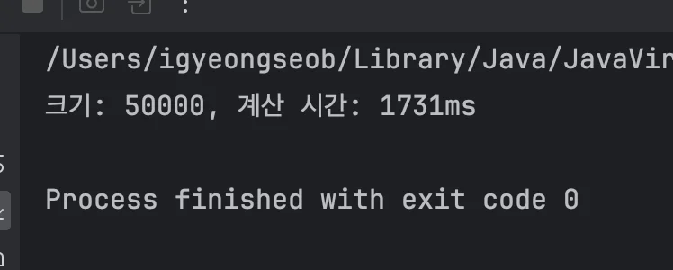

    </details>

    <details>
    <summary><strong><code>2&#46; LinkedList</code></strong><strong> ( </strong><strong><code>MyLinkedList</code></strong><strong> )</strong></summary>

    <a id="1cbeda9b0fe18085b963e476de529249"></a>

    ```java
    public class BatchProcessorMain {
        public static void main(String[] args) {
             MyLinkedList<Integer> list = new MyLinkedList<>();
             
            BatchProcessorV2 processor = new BatchProcessorV2(list);
            processor.logic(50_000);
        }
    }
    ```

    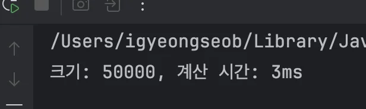

    </details>

<a id="1cbeda9b0fe180f88c60df7b5f1a1a2d"></a>

### 추상화 3 &#45; 컴파일 타입, 런타임 의존관계

> ✏️ 
> 
> <a id="1cbeda9b0fe180acbd61e88137da98e8"></a>
> 
> 의존관계는 크게 컴파일 타입 의존관계와 런타임 의존관계로 나눌 수 있다&#46; 
> 
> - 컴파일 타임(compile time)&#58; 코드 컴파일 시점을 의미
> 
> - 런타임(runtime)&#58; 프로그램 실행 시점 의미

<a id="1cbeda9b0fe18028b4a3f79e8c199784"></a>

### 컴파일 타임 의존관계

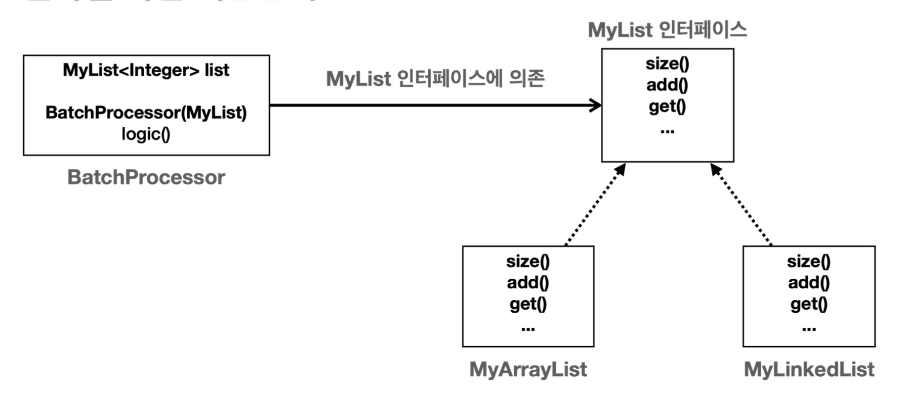

- 컴파일 타임 의존관계는 <strong><u>자바 컴파일러가 보는 의존관계</u></strong>이다&#46;  
    - 클래스에 모든 의존관계가 다 나타난다&#46; 

- 실행하지 않는 소스 코드에 정적으로 나타는 의존관계이다&#46; 
    - <code>BatchProcessor</code> 클래스를 보면 <code>MyList</code> 인터페이스만 사용한다<br>코드 어디에도 <code>MyArrayList</code> 나 <code>MyLinkedList</code> 같은 정보는 보이지 않는다&#46;<br>따라서 <code>BatchProcessor</code> 는 <code>MyList</code> 인터페이스에만 의존한다&#46;

<a id="1cbeda9b0fe180e99a3eca3d0348df20"></a>

### 런타임 의존관계

> ✏️ 
> 
> <a id="1cbeda9b0fe180b4bb01c1b2db5e63d4"></a>
> 
> 런타임 의존관계는 실제 프로그램이 작동할 때 보이는 의존관계이다&#46;
> 
> - 주로 생성된 인스턴스와 그것을 참조하는 의존관계이다&#46;
> 
> - 쉽게 얘기해서 프로그램이 실행될 때 인스턴스 간에 의존관계로 보면 된다&#46; 
> 
> <a id="1cbeda9b0fe180dfb48fcbc51dac3df2"></a>
> 
> 런타임 의존 관계는 프로그램 실행 중에 계속 변할 수 있다&#46;

<details>
<summary>예시 1) <code>MyArrayList</code></summary>

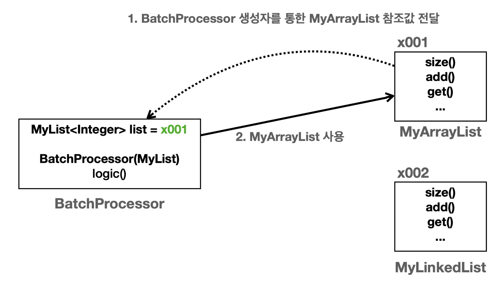

<a id="1cbeda9b0fe18057a44dcd609be907b4"></a>

```java
MyArrayList<Integer> list = new MyArrayList<>();
BatchProcessor processor = new BatchProcessor(list);
processor.logic(50_000);
```

- <code>BatchProcessor</code> 인스턴스의 <code>MyList list</code> 는 생성자를 통해 <code>MyArrayList(x001)</code> 인스턴스를 참조한다&#46;
    - <code>BatchProcessor</code> 인스턴스에 <code>MyArrayList(x001)</code> 의존관계 주입

- 따라서 이후 <code>logic()</code> 을 호출하면 <code>MyArrayList</code> 인스턴스를 사용하게 된다&#46;

</details>

<details>
<summary>예시 2) <code>MyLinkedList</code></summary>

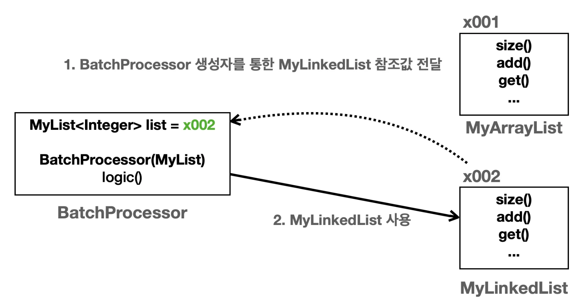

<a id="1cbeda9b0fe1808297fdc4dc1d810a68"></a>

```java
MyLinkedList<Integer> list = new MyLinkedList<>();
BatchProcessor processor = new BatchProcessor(list);
processor.logic(50_000);
```

- <code>BatchProcessor</code> 인스턴스의 <code>MyList list</code> 는 생성자를 통해 <code>MyLinkedList(x002)</code> 인스턴스를 참조한다&#46;
    - <code>BatchProcessor</code> 인스턴스에 <code>MyLinkedList(x002)</code> 의존관계 주입

- 따라서 이후 <code>logic()</code> 을 호출하면 <code>MyLinkedList</code> 인스턴스를 사용하게 된다&#46;

<a id="1cbeda9b0fe1803f9531dc2b467ee6a1"></a>

<br>	<br><br>

</details>

<a id="1cbeda9b0fe1803f8a64c6a64046b530"></a>

### 구현한 리스트의 성능 비교

<a id="1cbeda9b0fe18051b048c1cfc99e35a3"></a>

### 코드

<details>
<summary>&#91; 코드 &#93; MyListPerformanceTest</summary>

<a id="1cbeda9b0fe18041b68bcd9a91507761"></a>

```java
package collection.list;

public class MyListPerformanceTest {
    public static void main(String[] args) {
        int size = 50_000;
        System.out.println("==MyArrayList 추가==");
        addFirst(new MyArrayList<>(), size);
        addMid(new MyArrayList<>(), size);
        MyArrayList<Integer> arrayList = new MyArrayList<>(); // 조회용 데이터로 사용
        addLast(arrayList, size);

        System.out.println("==MyArrayList 추가==");
        addFirst(new MyLinkedList<>(), size);
        addMid(new MyLinkedList<>(), size);
        MyLinkedList<Integer> linkedList = new MyLinkedList<>();// 조회용 데이터로 사용

        addLast(linkedList, size);

        int loop = 10000;
        System.out.println("==MyArrayList 조회==");
        getIndex(arrayList, loop, 0);
        getIndex(arrayList, loop, size / 2);
        getIndex(arrayList, loop, size - 1);

        System.out.println("==MyLinkedList 조회==");
        getIndex(linkedList, loop, 0);
        getIndex(linkedList, loop, size / 2);
        getIndex(linkedList, loop, size - 1);

        System.out.println("==MyArrayList 검색==");
        search(arrayList, loop, 0);
        search(arrayList, loop, size / 2);
        search(arrayList, loop, size - 1);

        System.out.println("==MyLinkedList 검색==");
        search(linkedList, loop, 0);
        search(linkedList, loop, size / 2);
        search(linkedList, loop, size - 1);
    }

    private static void addFirst(MyList<Integer> list, int size) {
        long startTime = System.currentTimeMillis();
        for (int i = 0; i < size; i++) {
            list.add(0, i);
        }
        long endTime = System.currentTimeMillis();
        System.out.println("앞에 추가 - 크기: " + size + ", 계산 시간: " + (endTime - startTime) + "ms");
    }

    private static void addMid(MyList<Integer> list, int size) {
        long startTime = System.currentTimeMillis();
        for (int i = 0; i < size; i++) {
            list.add(i / 2, i);
        }
        long endTime = System.currentTimeMillis();
        System.out.println("평균 추가 - 크기: " + size + ", 계산 시간: " + (endTime - startTime) + "ms");
    }

    private static void addLast(MyList<Integer> list, int size) {
        long startTime = System.currentTimeMillis();
        for (int i = 0; i < size; i++) {
            list.add(i);
        }
        long endTime = System.currentTimeMillis();
        System.out.println("뒤에 추가 - 크기: " + size + ", 계산 시간: " + (endTime - startTime) + "ms");
    }

    private static void getIndex(MyList<Integer> list, int loop, int index) {
        long startTime = System.currentTimeMillis();
        for (int i = 0; i < loop; i++) {
            list.get(index);
        }
        long endTime = System.currentTimeMillis();
        System.out.println("index: " + index + ", 반복: " + loop + ", 계산 시간: " + (endTime - startTime) + "ms");
    }

    private static void search(MyList<Integer> list, int loop, int findValue) {
        long startTime = System.currentTimeMillis();
        for (int i = 0; i < loop; i++) {
            list.indexOf(findValue);
        }
        long endTime = System.currentTimeMillis();
        System.out.println("findValue: " + findValue + ", 반복: " + loop + ", 계산 시간: " + (endTime - startTime) + "ms");
    }
}

```

</details>

<details>
<summary>실행 결과</summary>

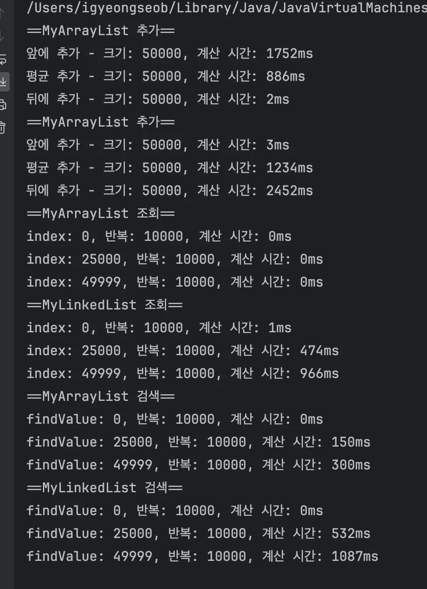

</details>

<a id="1cbeda9b0fe1808ba129e2174318d9aa"></a>

### 설명

<a id="1cbeda9b0fe180fd9173f1cf3a936467"></a>

<strong>직접 만든 배열 리스트와 연결 리스트 &#45; 성능 비교 표</strong>

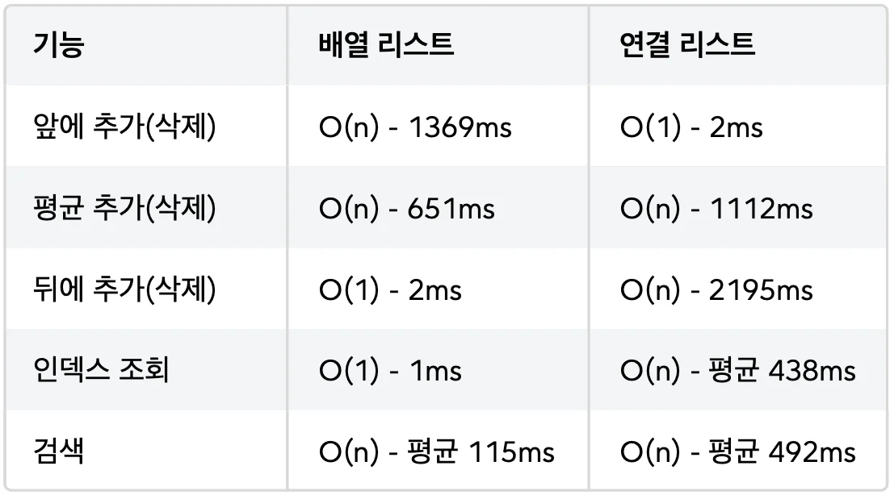

<details>
<summary><strong>추가, 삭제</strong></summary>

- 배열 리스트는 인덱스를 통해 추가나 삭제할 위치를 O(1)로 빠르게 찾지만, 추가나 삭제 이후에 데이터를 한칸씩 밀어야 한다&#46; 이 부분이 O(n)으로 오래 걸린다&#46;

- 연결 리스트는 인덱스를 통해 추가나 삭제할 위치를 O(n)으로 느리게 찾지만, 실제 데이터의 추가는 간단한 참조 변경으로 빠르게 O(1)로 수행된다&#46;

</details>

> 🗒️ 
> 
> <a id="1cbeda9b0fe18094854aea12bfbea176"></a>
> 
> <strong>정리</strong>
> 
> ---
> 
> 1. <strong>&#91; 🤬 Bad Case &#93;</strong><strong> 컴파일 타임 의존관계 지정</strong>
>     <a id="1cbeda9b0fe180e9889fdd6cac9105d4"></a>
> 
>     ```java
>     public class BatchProcessor {
>     		private final MyArrayList<Integer> list = new MyArrayList(); //코드 변경 필요
>     ```
> 
>     <a id="1cbeda9b0fe1805197e8c16ab233ba8d"></a>
> 
>     위와 같이<strong> </strong><strong><code>BatchProcessor</code></strong><strong> </strong><strong><u>클래스 내부</u></strong><strong>에서 </strong><strong><code>MyArrayList</code></strong><strong> </strong><strong><u>인스턴스를 생</u></strong><u>성</u>하여 <strong>컴파일 타임 의존관계를 지정</strong>했다면 이후 <code>MyLinkedList</code>로 수정하기 위해서는 <strong><code>BatchProcessor</code></strong> 클래스 내부 코드를 변경해야 한다&#46;  
> 
>     - 코드의 확장성 및 재사용성 측면에서 좋지 못한 설계이다&#46; 
> 
>     - OCP, DIP 위반 
> 
> 1. <strong>&#91; 😆 Best Case &#93;</strong><strong> </strong><strong>전략 패턴</strong><strong>  ( 추상화, 캡슐화, 다형성, 구성 )</strong>
>     > ✏️ 
>     > 
>     > <a id="1cbeda9b0fe180f59d50dbb0b65b8eb8"></a>
>     > 
>     > <strong>전략 패턴</strong>
>     > 
>     > ---
>     > 
>     > <a id="1cbeda9b0fe1809d8fdaee3f7ce7f9aa"></a>
>     > 
>     > <strong>클라이언트 클래스는</strong><strong> </strong><strong><u>컴파일 타임</u></strong><strong>에 </strong><strong><u>추상적인 것에 의존</u></strong><strong>하고, </strong><strong><u>런타임에 의존 관계 주입</u></strong><strong><u>을 통해 </u></strong><strong><u>구현체를 주입</u></strong><strong>받아 사용함으로써, <br></strong>클라이언트 코드의 변경 없이, 구현 알고리즘인 <code>MyList</code> 인터페이 스의 구현을 자유롭게 확장할 수 있다&#46; ( OCP 준수 )
> 
>     - <strong>다형성</strong>
>         - <code>BatchProcessor</code> 클래스는 구체적인 <code>MyArrayList</code> 나 <code>MyLinkedList</code> 에 의존하는 것이 아니라 추상적인 <code>MyList</code> 에 의존한다&#46; 따라서 런타임에 <code>MyList</code> 의 구현체를  얼마든지 선택할 수 있다&#46;   
> 
>     - <strong>구성, DIP</strong> → OCP, SRP
>         - <code>BatchProcessor</code> 에서 사용하는 리스트의 의존관계를 클래스에서 미리 결정하는 것이 아니라, 런타임에 객체 를 생성하는 시점으로 미룬다&#46; 따라서 런타임에 <code>MyList</code> 의 구현체를 변경해도 <code>BatchProcessor</code> 의 코드는 전 혀 변경하지 않아도 된다&#46;
> 
>         - 이렇게 생성자를 통해 <u>런타임 의존관계를 주입</u>하는 것을 <strong><u>생성자 의존관계 주입</u></strong> 또는 줄여서 <strong><u>생성자 주입</u></strong>이라 한다&#46;<br>

<a id="1cbeda9b0fe180d8b6eefe31d943e13a"></a>

### 추가) 이중 연결리스트 구현

<a id="1cbeda9b0fe1806b9638fe1bafa9229f"></a>

### 코드

<details>
<summary>&#91; 코드 &#93; </summary>

<a id="1cbeda9b0fe180ad88fffeb580b2b0a6"></a>

```java

```

</details>

<a id="1cbeda9b0fe18071a504c95cbfaff691"></a>

### 설명

<details>
<summary>처음 데이터 추가 </summary>

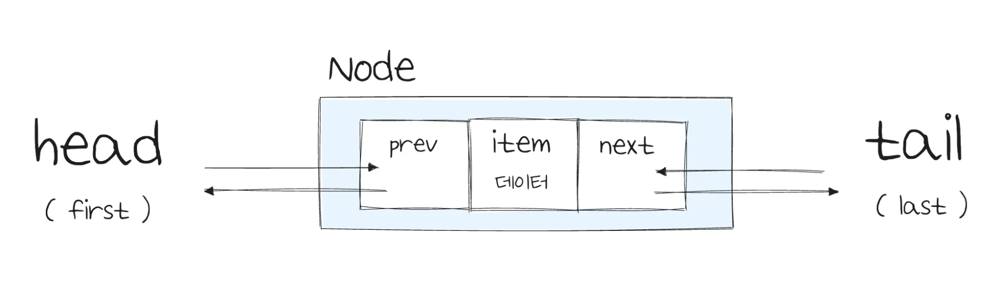

- 

</details>

<details>
<summary>앞(head)에 데이터 추가</summary>


</details>

<details>
<summary>마지막(tail)에 데이터 추가</summary>


</details>

<details>
<summary>앞(head)에 데이터 삭제</summary>


</details>

<details>
<summary>마지막(tail)에 데이터 삭제</summary>


</details>

<a id="1cbeda9b0fe180738ee5f35a94993cb2"></a>

## 자바 리스트 

> 📖 
> 
> <a id="1cbeda9b0fe1808c90a5f021d37ad416"></a>
> 
> List 자료구조
> 
> ---
> 
> <a id="1cbeda9b0fe1803cb9c3ef8f56857fc7"></a>
> 
> 위에서 설명했듯이 <strong><u>순서가 있고, 중복을 허용</u></strong>하는 자료구조를 리스트라 한다&#46; <br>자바 컬렉션 프레임워크가 제공하는 가장 대표적인 자료구조가 바로 리스트이다&#46; 
> 
> <a id="1cbeda9b0fe180e18d3fd3c80ade8388"></a>
> 
> 리스트와 관련된 컬렉션 프레임워크는 아래와 같은 구조를 가진다&#46;
> 
> 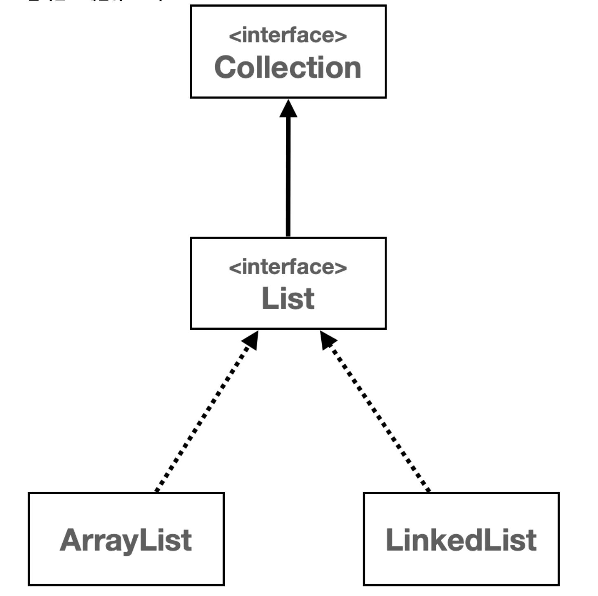

> ✏️ 
> 
> <a id="1cbeda9b0fe18097bdddc65bb107fdc4"></a>
> 
> <strong>Collection 인터페이스 </strong>
> 
> ---
> 
> <a id="1cbeda9b0fe1803e9045f8dd1d22a66b"></a>
> 
> <code>Collection</code> 인터페이스는 java&#46;util 패키지의 컬렉션 프레임워크의 핵심 인터페이스 중 하나이다&#46; 
> 
> <a id="1cbeda9b0fe180849e5bd13384bb2982"></a>
> 
> 해당 인터페이스는 자바에서 다양한 컬렉션, 즉 데이터 그룹(자료구조)을 다루기 위한 메서드를 정의한다&#46; Collection 인터페이스는 List, Set, Queue와 같은 다양한 하위 인터페이스와 함께 사용되며, 이를 통해 데이터를 리스트 , 세트, 큐 등의 형태로 관리할 수 있다&#46; 

<a id="1cbeda9b0fe1807fb2b6d60e20e90d5f"></a>

### <strong> List 인터페이스</strong>

> ✏️ 
> 
> <a id="1cbeda9b0fe18007b9f9e2fb438f77b2"></a>
> 
> List 인터페이스는 <code>java&#46;util</code> 패키지에 있는 컬렉션 프레임워크의 일부이다&#46;
> 
> <a id="1cbeda9b0fe1801581d1eba36d6f22d6"></a>
> 
> LIst는 객체들의 <strong><u>순서가 있</u></strong>는 컬렉션을 나타내며, 같은 객체의 <strong><u>중복 저장을 허용</u></strong>한다&#46; 
> 
> <a id="1cbeda9b0fe18000bcdecc7e8255600f"></a>
> 
> 이 리스트는 배열과 비슷하지만, <strong><u>크기가 동적으로 변화하는 컬렉션을 다룰 때 </u></strong>유연하게 사용할 수 있다&#46; 
> 
> <a id="1cbeda9b0fe180159b45e59c5c9df852"></a>
> 
> <strong><code>List 인터페이스</code></strong>는 <code>ArrayList</code>, <code>LinkedList</code> 와 같은 여러 구현 클래스를 가지고 있으며, 각 클래스는 <code>List</code> 인터페이스의 메서드를 구현한다&#46; 

- <strong>List 인터페이스의 주요 메서드 </strong>
    | 메서드 | 설명 |
    | --- | --- |
    | <strong><code>add(E e)</code></strong> | 리스트의 끝에 지정된 요소를 추가한다&#46;  |
    | <strong><code>add(int index, E element)</code></strong> | 리스트의 지정된 위치에 요소를 삽입한다&#46;  |
    | <strong><code>addAll(Collection&#60;? extends E&#62; c)</code></strong> | 지정된 컬렉션의 모든 요소를 리스트의 끝에 추가한다&#46;  |
    | <strong><code>addAll(int index, Collection&#60;? extends E&#62; c)</code></strong> | 지정된 컬렉션의 모든 요소를 리스트의 지정된 위치에 추가한다&#46; |
    | <strong>get(int index)</strong> | 리스트에서 지정된 위치의 요소를 반환한다&#46;  |
    | <strong><code>set(int index, E element)</code></strong> | 지정된 위치의 요소를 변경하고, 이전 요소를 반환한다&#46;  |
    | <strong><code>remove(int index)</code></strong> | 리스트에서 지정된 위치의 요소를 제거하고 그 요소를 반환한다&#46;  |
    | <strong><code>remove(Object o)</code></strong> | 리스트에서 지정된 첫 번째 요소를 제거한다&#46; |
    | <strong><code>clear()</code></strong> | 리스트에서 모든 요소를 제거한다&#46;  |
    | <strong><code>indexOf(Object o)</code></strong> | 리스트에서 지정된 요소의 첫 번째 인덱스를 반환한다&#46;  |
    | <strong><code>lastIndexOf(Object o)</code></strong> | 리스트에서 지정된 요소의 마지막 인덱스를 반환한다&#46;  |
    | <strong><code>contains(Object o)</code></strong> | 리스트가 지정된 요소를 포함하고 있는지 여부를 반환한다&#46; |
    | <strong><code>sort(Comparator&#60;? super E&#62; c)</code></strong> | 리스트의 요소를 지정된 비교자에 따라 정렬한다&#46;  |
    | <strong><code>subList(int fromIndex, int toIndex)</code></strong> | 리스트의 일부분의 뷰를 반환한다&#46;  |
    | <code>size()</code> | 리스트의 요소 수를 반환한다&#46;  |
    | <strong><code>isEmpty()</code></strong> | 리스트가 비어있는지 여부를 반환한다&#46;  |
    | <strong><code>iterator()</code></strong> | 리스트의 요소에 대한 반복 문자를 반환한다&#46;  |
    | <strong><code>toArray()</code></strong> | 리스트의 모든 요소를 배열로 반환한다&#46;  |
    | <strong><code>toArray(T&#91;&#93; a)</code></strong> | 리스트의 모든 요소를 지정된 배열로 반환한다&#46;  |

<a id="1cbeda9b0fe180bf8967c974beda6108"></a>

### 자바 ArrayList

> ✏️ 
> 
> <a id="1cbeda9b0fe180dea338f87376cd4b93"></a>
> 
> <strong><code>java&#46;util&#46;ArrayList</code></strong>
> 
> ---
> 
> <a id="1cbeda9b0fe1805a8628db66646140f5"></a>
> 
> 자바에서 제공하는 <code>ArrayList</code>는 지금까지 직접 구현한 <code>MyArrayList</code>와 거의 유사하다&#46;<br>특징은 다음과 같다&#46;

- 배열을 사용한 데이터 관리

<details>
<summary><strong>기본 CAPACITY&#58;</strong> <code>10</code>,  <strong>리사이징&#58;</strong> <code>50%</code></summary>

> ✏️ 
> 
> - <strong><code>DEFAULT&#95;CAPACITY</code></strong><strong><code> = </code></strong><strong><code>10</code></strong> 
> 
> - <strong><code>RESIZING</code></strong><strong><code> = </code></strong><strong><code>1&#46;5</code></strong>
>     - 최적화는 자바 버전에 따라 달라질 수 있다&#46;

- <strong><code>CAPACITY</code></strong>를  넘어가면 배열 크기를 <strong><code>50%</code></strong> 증가시킨다&#46; 
    - <strong><code>10 → 15 → 22 → 33 → 49</code></strong> 로 증가

    - <strong><u><code>new</code></u></strong><code>Capacity</code> = <strong><u><code>old</code></u></strong><code>Capacity &#42; 1&#46;5 </code>

</details>

<details>
<summary>메모리 고속 복사 연산</summary>

<details>
<summary><strong>🧐  비교</strong></summary>

<a id="1cbeda9b0fe180ee8e52c7911cdcaf21"></a>

<strong>한 칸씩 이동 ⇒ </strong><strong><code>O(n)</code></strong>

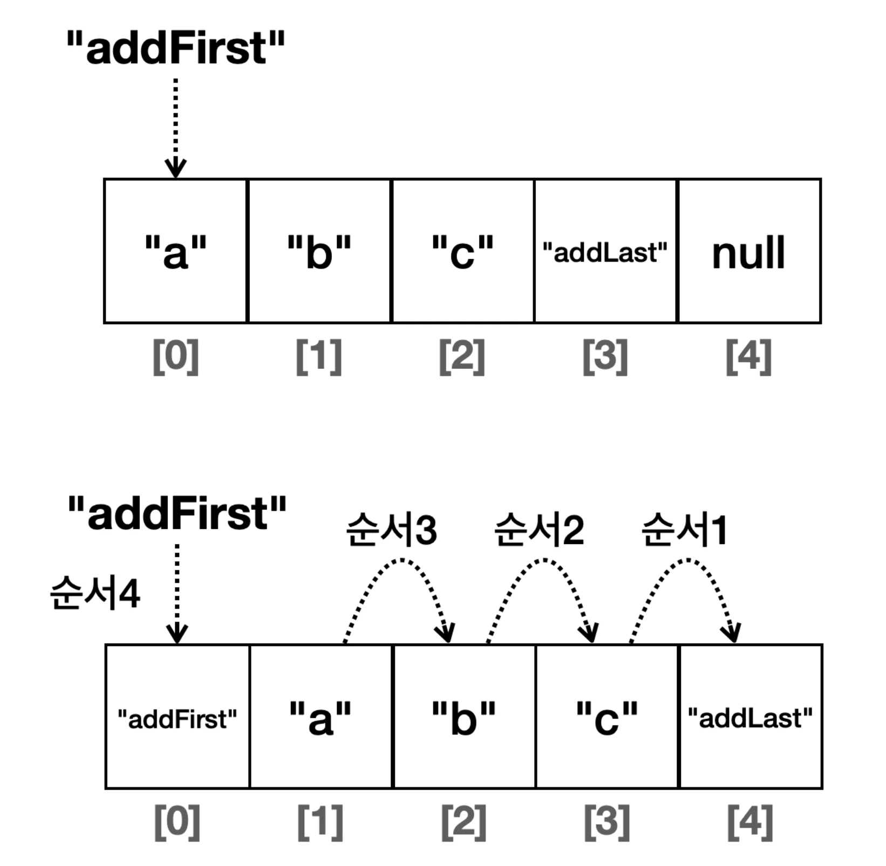

<a id="1cbeda9b0fe1802d8a75fa548558b300"></a>

<strong>메모리 고속 복사 </strong>

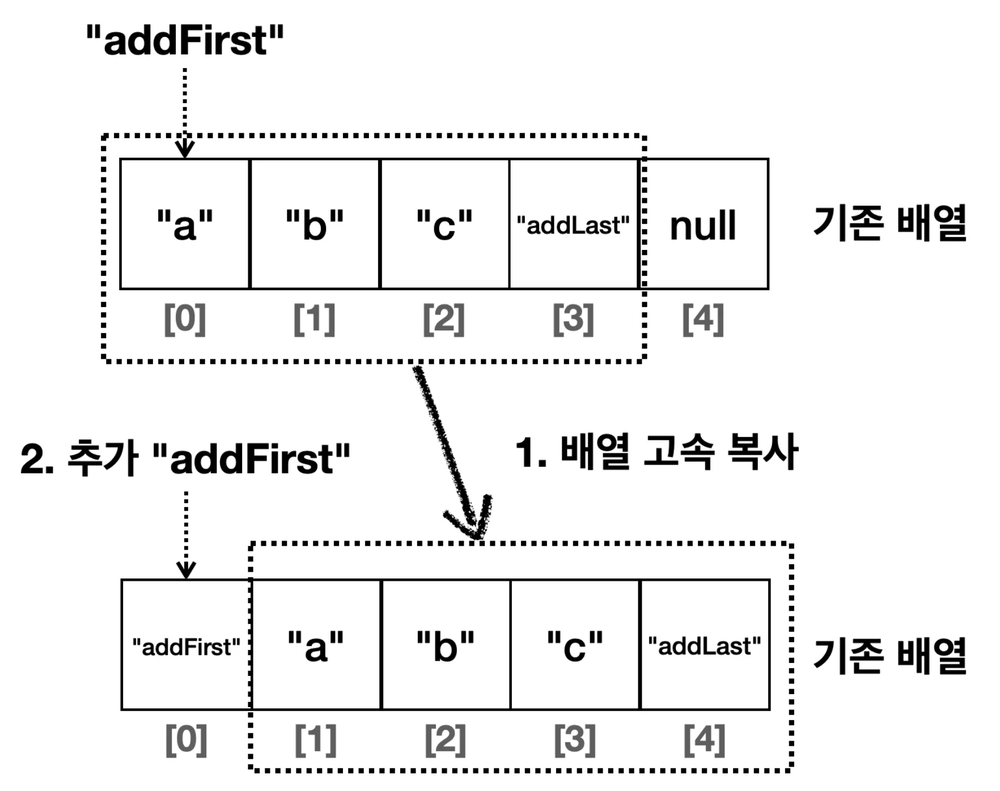

</details>

- ArrayList의 중간 위치에 데이터를 추가하면, 추가할 위치 이후의 모든 요소를 한 칸씩 뒤로 이동시켜야 한다&#46; 

- <strong><u>자바가 제공하는 ArrayList</u></strong>는 이 부분 최적화한다&#46;
    - 배열의 요소 이동은 시스템 레벨에서 최적화된 <strong><u>메모리 고속 복사 연산을 사용</u></strong>해 빠르게 수행된다&#46; 

    - <code>System&#46;arraycopy()</code>를 사용한다&#46; 

</details>

<a id="1cbeda9b0fe1809292addcb4cf54ef7e"></a>

### 자바 Linked List

> ✏️ 
> 
> <a id="1cbeda9b0fe1802fa152d8053cfacbfc"></a>
> 
> <strong><code>java&#46;util&#46;LinkedList</code></strong>
> 
> ---
> 
> <a id="1cbeda9b0fe180b28b7aca252bd476a4"></a>
> 
> 자바에서 제공하는 <code>LinkedList</code> 또한 지금까지 직접 구현한 <code>MyLinkedList</code>와 거의 유사하다&#46; 특징은 다음과 같다&#46; 

<details>
<summary><strong>단일 연결 리스트</strong></summary>

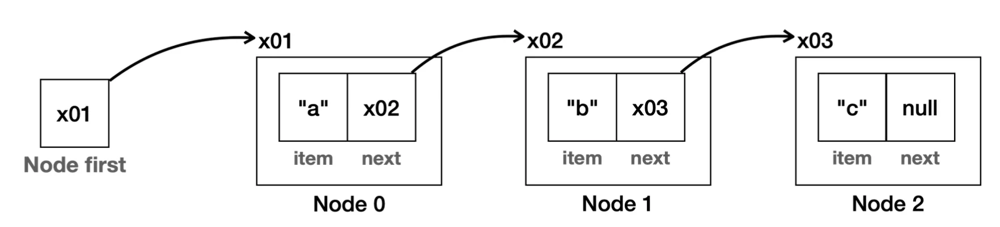

- 직접 만든 MyLinkedList는 위 그림과 같이 단일 연결 리스트이다&#46; 

- 이전 노드로 이동할 수 없다&#46; 

- 역방향 조회 불가 

- 마지막 위치에서 추가, 삭제 연산 시 <code class="language-math">O(n)</code>

</details>

<details>
<summary><strong>이중  연결 리스트 </strong></summary>

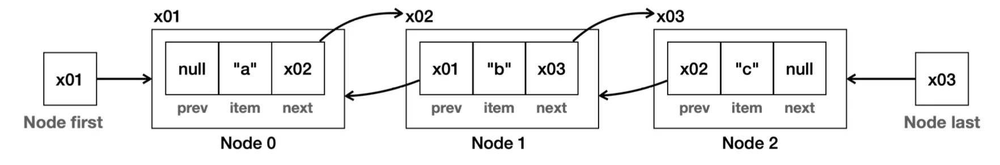

- 자바가 제공하는 <code>LinkedList</code>는 <strong>이중 연결 구조를 사용</strong>한다&#46; <br>해당 구조는 다음 노드 뿐만 아니라 이전 노드로도 이동할 수 있다&#46;
    - ex) <code>node&#46;next</code>를 호출 →  다음 노드로, <code>node&#46;prev</code> 호출 → 이전 노드

- 마지막 노드에 대한 참조를 제공한다&#46;
    - 역방향 조회 가능

    - 데이터를 마지막에 추가하거나 삭제하는 경우, <code>O(1)</code>의 성능 

- 양방향으로 참조값을 제공하기 때문에 인덱스 조회 성능 최적화 가능
    - index 절반 이하 → <code>head</code>에서 부터 탐색

    - index 절반 이상 → <code>tail</code>에서 부터 탐색

</details>

<details>
<summary><strong>자바 LinkedList</strong></summary>

<a id="1cbeda9b0fe18058ac21fb7c2b8b390d"></a>

자바에서 제공하는 <strong><code>LinkedList</code></strong><strong>는 </strong><strong><u>이중 연결리스트 구조</u></strong><strong>를 가진다&#46; </strong>

<a id="1cbeda9b0fe180a5a099ef4493580972"></a>

```java
class Node {
		E item;
		Node next;
		Node prev; 
}

class LinkedList {
		Node first; //첫 번째 노드 참조 
		Node last; //마지막 노드 참조 
		int size;
}	
```

</details>

<a id="1cbeda9b0fe1804bb68beff3cb4731b8"></a>

### 자바 리스트 성능 비교 

> /icons/arrows-swap-horizontally_green.svg 
> 
> - <code>MyList</code> → <code>List</code>
> 
> - <code>MyArrayList</code> → <code>ArrayList</code>
> 
> - <code>MyLinkedList</code> → <code>LinkedList</code>

<a id="1cbeda9b0fe1809dbfd2d2b5053a10d6"></a>

### 코드

<details>
<summary>&#91; 코드 &#93; JavaListPerformanceTest</summary>

<a id="1cbeda9b0fe180f092c0ce1b90f696eb"></a>

```java
package collection.list.performanceTest;

import java.util.ArrayList;
import java.util.LinkedList;
import java.util.List;

public class JavaListPerformanceTest {
    public static void main(String[] args) {
        int size = 50_000;
        System.out.println("==ArrayList 추가==");
        addFirst(new ArrayList<>(), size);
        addMid(new ArrayList<>(), size);
        ArrayList<Integer> arrayList = new ArrayList<>(); // 조회용 데이터로 사용
        addLast(arrayList, size);

        System.out.println("==ArrayList 추가==");
        addFirst(new LinkedList<>(), size);
        addMid(new LinkedList<>(), size);
        LinkedList<Integer> linkedList = new LinkedList<>();// 조회용 데이터로 사용

        addLast(linkedList, size);

        int loop = 10000;
        System.out.println("==ArrayList 조회==");
        getIndex(arrayList, loop, 0);
        getIndex(arrayList, loop, size / 2);
        getIndex(arrayList, loop, size - 1);

        System.out.println("==LinkedList 조회==");
        getIndex(linkedList, loop, 0);
        getIndex(linkedList, loop, size / 2);
        getIndex(linkedList, loop, size - 1);

        System.out.println("==ArrayList 검색==");
        search(arrayList, loop, 0);
        search(arrayList, loop, size / 2);
        search(arrayList, loop, size - 1);

        System.out.println("==LinkedList 검색==");
        search(linkedList, loop, 0);
        search(linkedList, loop, size / 2);
        search(linkedList, loop, size - 1);
    }

    private static void addFirst(List<Integer> list, int size) {
        long startTime = System.currentTimeMillis();
        for (int i = 0; i < size; i++) {
            list.add(0, i);
        }
        long endTime = System.currentTimeMillis();
        System.out.println("앞에 추가 - 크기: " + size + ", 계산 시간: " + (endTime - startTime) + "ms");
    }

    private static void addMid(List<Integer> list, int size) {
        long startTime = System.currentTimeMillis();
        for (int i = 0; i < size; i++) {
            list.add(i / 2, i);
        }
        long endTime = System.currentTimeMillis();
        System.out.println("평균 추가 - 크기: " + size + ", 계산 시간: " + (endTime - startTime) + "ms");
    }

    private static void addLast(List<Integer> list, int size) {
        long startTime = System.currentTimeMillis();
        for (int i = 0; i < size; i++) {
            list.add(i);
        }
        long endTime = System.currentTimeMillis();
        System.out.println("뒤에 추가 - 크기: " + size + ", 계산 시간: " + (endTime - startTime) + "ms");
    }

    private static void getIndex(List<Integer> list, int loop, int index) {
        long startTime = System.currentTimeMillis();
        for (int i = 0; i < loop; i++) {
            list.get(index);
        }
        long endTime = System.currentTimeMillis();
        System.out.println("index: " + index + ", 반복: " + loop + ", 계산 시간: " + (endTime - startTime) + "ms");
    }

    private static void search(List<Integer> list, int loop, int findValue) {
        long startTime = System.currentTimeMillis();
        for (int i = 0; i < loop; i++) {
            list.indexOf(findValue);
        }
        long endTime = System.currentTimeMillis();
        System.out.println("findValue: " + findValue + ", 반복: " + loop + ", 계산 시간: " + (endTime - startTime) + "ms");
    }
}

```

</details>

<details>
<summary>실행 결과 </summary>

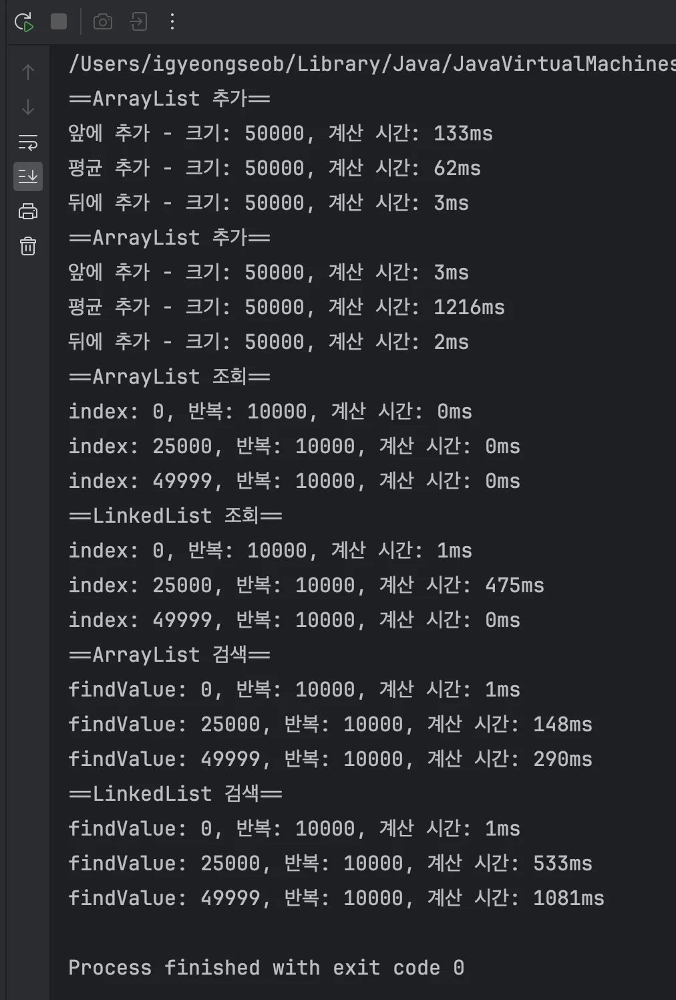

</details>

> /icons/tag_green.svg 
> 
> <a id="1cbeda9b0fe18081af57fdd83c1eac32"></a>
> 
> <strong>성능 비교표 </strong>
> 
> ---
> 
> <a id="1cbeda9b0fe180c19969cddf0eb01905"></a>
> 
> <strong>직접 만든 배열리스트, 연결리스트</strong>
> 
> 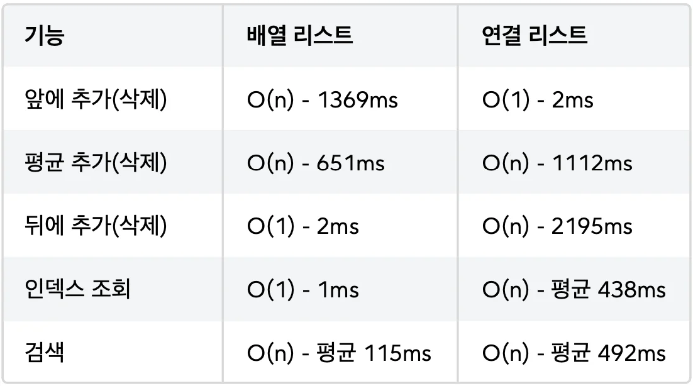
> 
> <a id="1cbeda9b0fe1809c89e7e526ef52b74e"></a>
> 
> <strong>자바가 제공하는 배열리스트, 연결리스트 </strong>
> 
> 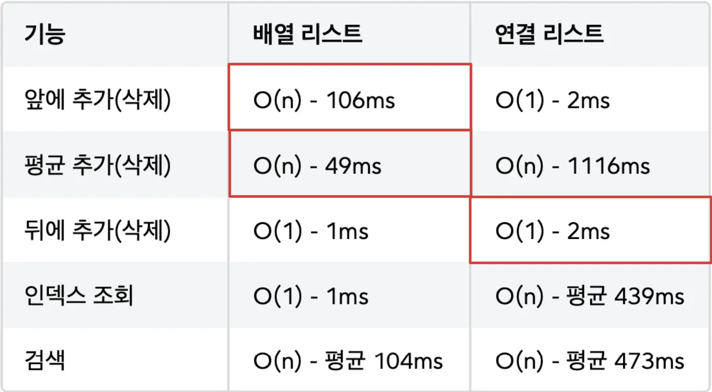

<details>
<summary><strong>🧐 데이터를 추가할 때 자바 ArrayList가 직접 구현한 MyArrayList보다 빠른 이유</strong></summary>

<a id="1cbeda9b0fe1800e8fc1cc612f1244f0"></a>

<strong><code>자바의 배열 리스트</code></strong>는 이때 <strong><u>메모리 고속 복사를 사용</u></strong>하기 때문에 <strong><u>성능이 최적화</u></strong>된다&#46;

<a id="1cbeda9b0fe180a39cd2e26b078e996f"></a>

메모리 고속 복사는 <u>시스템에 따라 성능이 다르기</u> 때문에 정확한 계산은 어렵지만 대략 <code>O(n/10)</code> 정도로 추정하고 <strong><u>상수를 제거</u></strong>하면 <code>O(n)</code>이 된다&#46; 

- 메모리 고속 복사라도 데이터가 아주 많으면 느려진다&#46;

</details>

> ☝🏻 
> 
> <a id="1cbeda9b0fe180d5884cf92164873235"></a>
> 
> <strong>시간 복잡도와 실제 성능</strong>
> 
> ---
> 
> <a id="1cbeda9b0fe18080bd67e0d60ff64940"></a>
> 
> 이론적으로 <code>MyLinkedList</code> 의 평균 추가(중간 삽입) 연산은 <code>MyArrayList</code> 보다 빠를 수 있다&#46; 
> 
> <a id="1cbeda9b0fe180dc95f0f2096515713c"></a>
> 
> 그러나 실제 성능은 요소의 순차적 접근 속도, 메모리 할당 및 해제 비용, CPU 캐시 활용도 등 다양한 요소에 의해 영향을 받는다&#46;
> 
> <a id="1cbeda9b0fe18050a62fc0a06c9df480"></a>
> 
> <code>MyArrayList</code> 는 요소들이 메모리 상에서 연속적으로 위치하여 CPU 캐시 효율이 좋고, 메모리 접근 속도가 빠르다&#46;<br>반면, <code>MyLinkedList</code> 는 각 요소가 별도의 객체로 존재하고 다음 요소의 참조를 저장하기 때문에 CPU 캐시 효율이 떨어지고, 메모리 접근 속도가 상대적으로 느릴 수 있다
> 
> <a id="1cbeda9b0fe180579323e1b145af7417"></a>
> 
> <code>MyArrayList</code> 의 경우 <code>CAPACITY</code> 를 넘어서면 배열을 다시 만들고 복사하는 과정이 추가된다&#46; 하지만 한번에 2배씩 늘어나기 때문에 이 과정은 가끔 발생 하므로, 전체 성능에 큰 영향을 주지는 않는다&#46;
> 
> <a id="1cbeda9b0fe180b49fa9cf3af27513fe"></a>
> 
> 정리하면 이론적으로 <code>MyLinkedList</code> 가 평균 추가(중간 삽입)에 있어 더 효율적일 수 있지만, 현대 컴퓨터 시스템의 메모리 접근 패턴, CPU 캐시 최적화 등을 고려할 때 <code>MyArrayList</code> 가 실제 사용 환경에서 더 나은 성능을 보여주는 경우가 많다&#46;
> 
> <a id="1cbeda9b0fe1802cb575c60f078320ca"></a>
> 
> <strong>배열 리스트 vs 연결 리스트</strong>
> 
> ---
> 
> <a id="1cbeda9b0fe1803c856cda8e34e70d9d"></a>
> 
> 대부분의 경우 <strong><u>배열 리스트가 성능상 유리</u></strong>하다&#46; 이런 이유로 <strong><u>실무</u></strong><strong><u>에서는 </u></strong><strong><u>주로 배열 리스트를 기본으로 사용</u></strong>한다&#46; <strong><u>만약 데이터를 앞쪽에서 자주 추가하거나 삭제</u></strong>할 일이 있다면 <strong><u>연결 리스트를 고려</u></strong>하자&#46;

<a id="1cbeda9b0fe1800ca516c77037d6404e"></a>

## 문제 풀이

<a id="1cbeda9b0fe18080b0f4f81da832dead"></a>

### 문제 1) 배열 → 리스트

> 💬 
> 
> <a id="1cbeda9b0fe1805694a5db5538d3e4cf"></a>
> 
> <strong>문제 설명</strong>
> 
> - <code>ArrayEx1</code> 는 배열을 사용한다&#46; 이 코드를 배열 대신에 리스트를 사용하도록 변경하자&#46;
> 
> - 다음 코드와 실행 결과를 참고해서 리스트를 사용하는 <code>ListEx1</code> 클래스를 만들어라

<a id="1cbeda9b0fe180a89982c5d555d0b151"></a>

```java
package collection.list.test.ex1;

public class ArrayEx1 {
		public static void main(String[] args) {
				int[] students = {90, 80, 70, 60, 50};
				
				int total = 0;
				for (int i = 0; i < students.length; i++) {
				   total += students[i];
				}
		
				double average = (double) total / students.length;
				System.out.println("점수 총합: " + total);
				System.out.println("점수 평균: " + average);
		} 
}
```

<a id="1cbeda9b0fe180ca900ad3ac6457dc78"></a>

실행 결과

<a id="1cbeda9b0fe18075bbefee9369680859"></a>

```java
점수 총합: 350 
점수 평균: 70.0
```

<details>
<summary>정답) &#91; 코드 &#93; <code>ListEx1</code></summary>

<a id="1cbeda9b0fe1801db0a9ff6a10c78ba9"></a>

```java

```

</details>

<a id="1cbeda9b0fe180949650c49e1181eb16"></a>

### 문제 2) 리스트 입력, 출력

> 💬 
> 
> <a id="1cbeda9b0fe180dda77ff1e4477b07ba"></a>
> 
> <strong>문제 설명</strong>
> 
> <a id="1cbeda9b0fe180209eddf1ffa6db892e"></a>
> 
> 사용자에게 <code>n</code> 개의 정수를 입력받아서 <code>List</code> 에 저장하고, 입력 순서대로 출력하자&#46;
> 
> <a id="1cbeda9b0fe180d8bc3fcfe27219499c"></a>
> 
> <code>0</code> 을 입력하면 입력을 종료하고 결과를 출력한다&#46;
> 
> <a id="1cbeda9b0fe180229c39f14b73f63129"></a>
> 
> 출력 시 출력 포멧은 <code>1, 2, 3, 4, 5</code> 와 같이 <code>,</code> 쉼표를 사용해서 구분하고,<br>마지막에는 쉼표를 넣지 않아야 한다&#46;

<a id="1cbeda9b0fe180deb18dc659c778b490"></a>

실행 결과

<a id="1cbeda9b0fe180b7a49ccb5d79789885"></a>

```java
n개의 정수를 입력하세요 (종료 0) 
1
2
3
4 
5 
0

출력
1, 2, 3, 4, 5
```

<details>
<summary>정답) &#91; 코드 &#93; <code>ListEx2</code></summary>

<a id="1cbeda9b0fe180deabfbc2aa6c14d2d7"></a>

```java

```

</details>

<a id="1cbeda9b0fe180549007f8fc5bf59104"></a>

### 문제 3) 합계와 평균

> 💬 
> 
> <a id="1cbeda9b0fe180fa846ed29bbfcdfa89"></a>
> 
> <strong>문제 설명</strong>
> 
> <a id="1cbeda9b0fe180a38116f1260e1a74aa"></a>
> 
> 사용자에게 <code>n</code> 개의 정수를 입력받아서 <code>List</code> 에 보관하고, 보관한 정수의 합계와 평균을 계산하는 프로그램을 작성하자&#46;

<a id="1cbeda9b0fe1803a9ee9f20900d46ce0"></a>

실행 결과

<a id="1cbeda9b0fe180ee9390ed2aedeafde6"></a>

```java
n개의 정수를 입력하세요 (종료 0) 
1
2
3
4 
5 
0

입력한 정수의 합계: 15
입력한 정수의 평균: 3.0
```

<details>
<summary>정답) &#91; 코드 &#93; <code>ListEx3</code></summary>

<a id="1cbeda9b0fe1801f9bdae7396eacbb4f"></a>

```java

```

</details>

<a id="1cbeda9b0fe1800dbe38ce87eab51336"></a>

### 문제 4) <strong>리스트를 사용한 쇼핑 카트</strong>

> 💬 
> 
> <a id="1cbeda9b0fe180f2851dd51a93a2b704"></a>
> 
> <strong>문제 설명</strong>
> 
> <a id="1cbeda9b0fe180d28145d6d00df83db6"></a>
> 
> <strong><code>ShoppingCartMain</code></strong> 코드가 작동하도록 <strong><code>ShoppingCart</code></strong> 클래스를 완성해라&#46; <strong><code>ShoppingCart</code></strong> 는 내부에 리스트를 사용해야 한다&#46;

<details>
<summary><strong>&#91; 코드 &#93; Item</strong></summary>

<a id="1cbeda9b0fe1803f80a4f67c93d175f6"></a>

```java
package collection.list.test;

public class Item {

    private String name;
    private int price;
    private int quantity;

    public Item(String name, int price, int quantity) {
        this.name = name;
        this.price = price;
        this.quantity = quantity;
    }

    public String getName() {
        return name;
    }

    public int getTotalPrice() {
        return price * quantity;
    }
}
```

</details>

<details>
<summary><strong>&#91; 코드 &#93; ShoppingCartMain</strong></summary>

<a id="1cbeda9b0fe180b4b883eb4be65e1512"></a>

```java
package collection.list.test.ex2;

public class ShoppingCartMain {
    public static void main(String[] args) {
        ShoppingCart cart = new ShoppingCart();

        Item item1 = new Item("마늘", 2000, 2);
        Item item2 = new Item("상추", 3000, 4);

        cart.addItem(item1);
        cart.addItem(item2);
        
        cart.displayItems();
    }
}

```

</details>

<a id="1cbeda9b0fe18053bc30d76bb345299e"></a>

실행 결과

<a id="1cbeda9b0fe180aabdf1f302741b5d73"></a>

```java
장바구니 상품 출력
상품명:마늘, 합계:4000
상품명:상추, 합계:12000
전체 가격 합:16000
```

<details>
<summary>정답) &#91; 코드 &#93; <strong><code>ShoppingCart</code></strong></summary>

<a id="1cbeda9b0fe18081a5a7ee8a7edbe2a4"></a>

```java

```

</details>
