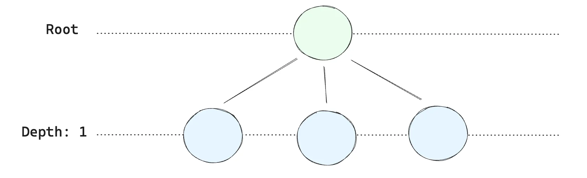

<a id="1c3eda9b0fe1819bbf9df80496ab9665"></a>

### 1&#46; B &#43; 트리

<a id="1c3eda9b0fe1815fabf5eb70a7b527bd"></a>

<code>B &#43; 트리</code>는 DB에서 사용하는 <strong><u>균형 잡힌 트리 구조</u></strong>로, 인덱스를 빠르게 탐색하는데 최적화된 구조이다&#46;

- <strong><code>내부 노드</code></strong> ( Intermediate Node )&#58; 검색 키만 저장 ( 실제 데이터 ❌ )

- <strong><code>리프 노드</code></strong><strong> ( Leaf Node )</strong>&#58;  실제 데이터를 가리키거나 포함

- 모든 리프 노드가 양쪽으로 <u>연결된 연결리스트</u> 형태 → 범위 검색이 빠름 ( <code>O(1)</code>)

- 검색이 트리의 높이(<code>log N</code>) 에 비례하여 빠름

<a id="1c3eda9b0fe1816294a0eb2ca75a4403"></a>

### <strong>2&#46; 클러스터 인덱스(Clustered Index)</strong>

> ✏️ 
> 
> <a id="1c3eda9b0fe181b3b430cd6af49e9cd8"></a>
> 
> <strong>클러스터 인덱스는 </strong><strong><u>테이블의 기본 정렬 기준</u></strong><strong>이 된다&#46;</strong>
> 
> - <strong>클러스터 인덱스의 </strong><strong><u>리프 노드</u></strong><strong>에는 </strong><strong><u>실제 데이터가 저장</u></strong><strong>된다&#46; </strong>
> 
> - 테이블 자체가 <strong><code>PK(Primary Key)</code></strong><strong> 기준으로 </strong><strong><u>B&#43; 트리로 정렬</u></strong>됨&#46;

<details>
<summary>ex) PK ( 클러스터 인덱스 ) = <code>article&#95;id</code></summary>

<a id="1c3eda9b0fe181b7aed2ea7dac6a9a65"></a>

<strong>article 테이블</strong>

<a id="1c3eda9b0fe1811baed6fb31f9ae8c33"></a>

```sql
CREATE TABLE article (
    article_id BIGINT PRIMARY KEY, -- 클러스터 인덱스
    board_id BIGINT,
    title VARCHAR(255),
    content TEXT
);
```

<a id="1c3eda9b0fe181e79a23ce1a8b3189d9"></a>

<strong>데이터 삽입</strong>

<a id="1c3eda9b0fe181188eeed67f03fbdc92"></a>

```sql
INSERT INTO article(article_id,  board_id, title, content) VALUES
(1, 10, 'First Post', 'Hello'),
(2, 10, 'Second Post', 'World'),
(3, 20, 'Another Board', 'Content'),
(4, 10, 'Third Post', 'More Content'),
(5, 20, 'Yet Another', 'Again');
```

<a id="1c3eda9b0fe1812f8b56c18e6e57275a"></a>

<strong>B &#43; Tree &#45; 클러스터 인덱스 (article&#95;id 기준)</strong>

<a id="1c3eda9b0fe181e8b73ad06f2cc204cc"></a>

```sql
        [3]         <- 루트 노드, 균형 잡힌 트리 구조를 가지므로, 중간 값을 루트 노드로 설정함 ( 루트 노트의 3은 균형 잡힌 트리 구조를 할당 하기 위한 더미 데이터와 같음, 리프노드에 실제 3의 값을 할당함 ) 
       /   \
 [1,2]      [3,4,5]  <- 리프 노드 (실제 데이터가 여기에 저장됨)
```

- <code>article&#95;id</code>가 <strong>B&#43; 트리의 정렬 기준</strong>이 된다&#46; 

- <strong>리프 노드에 실제 데이터가 저장됨</strong>

</details>

<a id="1c3eda9b0fe1819d84bfea6b2ee6c7b7"></a>

### <strong>3&#46; 보조 인덱스(Secondary Index)</strong>

> ✏️ 
> 
> <a id="1c3eda9b0fe181b6a7bbcb76b864aa17"></a>
> 
> <strong>보조 인덱스는 </strong><strong><u>클러스터 인덱스</u></strong><strong>를 가리킨다</strong>
> 
> - <strong>보조 인덱스의 리프 노드에는 실제 데이터가 아닌, </strong><strong><u>클러스터 인덱스의 PK 저장</u></strong>
> 
> - 즉, <strong><u>보조 인덱스</u></strong><strong>를 통해</strong><strong><u> PK를 찾은 뒤, </u></strong><strong><u>다시 클러스터 인덱스를 조회</u></strong><strong>한다&#46;</strong>
>     - <strong>Index Lookup</strong>

<details>
<summary><strong>ex) board&#95;id에 보조 인덱스를 추가하는 경우</strong></summary>

<a id="1c3eda9b0fe1816487efc6d81361db89"></a>

```sql
CREATE INDEX idx_article_board_id ON article(board_id);
```

<a id="1c3eda9b0fe18142b18ddab96dedecb6"></a>

<strong> 보조 인덱스 (board&#95;id 기준)</strong>

<a id="1c3eda9b0fe181aebf9beaab05189d71"></a>

```sql
        [10] 
       /    \
  [10,10]  [20,20]  <- 리프 노드 (article_id만 저장)
```

- <strong>보조 인덱스의 리프 노드에는 article&#95;id 값만 존재</strong>

- board&#95;id  = 10 검색
    1. <strong>보조 인덱스(B&#43; 트리)에서 board&#95;id = 10을 찾음 <br>   → article&#95;id 리스트(1, 2, 4)를 얻음</strong>

    1. <strong>클러스터 인덱스(B&#43; 트리)에서 해당 article&#95;id(1, 2, 4)를 다시 조회하여 데이터를 가져옴</strong>

</details>

<a id="1c3eda9b0fe1819b833cf041407e86b9"></a>

### 4&#46; B &#43; 트리에서 레벨을 나누는 기준

<a id="1c3eda9b0fe181e8a26fdff17f1d429d"></a>

B&#43; 트리의 <strong>레벨(level)</strong>, 즉 <strong><u>트리의 깊이(depth</u></strong>)는 <strong><u>데이터의 크기</u></strong>와 <strong><u>B&#43; 트리의 균형 유지 방식</u></strong>에 따라 달라진다&#46;

- 트리의 깊이를 계산하는 중요한 요소는 <strong>한 노드가 몇 개의 자식 노드를 가질 수 있는지</strong>에 따라 결정된다&#46;
    - ex) 데이터의 크기가 100만이라도 트리의 깊이는 매우 얕을 수 있다&#46;

<a id="1c3eda9b0fe18182a783f779e650d77e"></a>

B&#43; 트리에서 <strong>각 노드</strong>는 <strong>정해진 수의 자식 노드를 가질 수 있다&#46;<br>이 수를 </strong><strong><code>B 트리의 차수(Branching Factor)</code></strong><strong>라 하고, 각 노드에 저장할 수 있는 키의 개수이다&#46;</strong>

1. 차수 ( Branching Factor ) 와  트리의 깊이
    > ✏️ 
    > 
    > <a id="1c3eda9b0fe181698fabf4090e2c8e70"></a>
    > 
    > <strong><code>B &#43; 트리</code></strong>에서 <strong><u>차수가 크</u></strong>면, 트리가 <u>깊이가 얕</u>고 <strong><u>수평적으로 확장</u></strong>된다&#46; 
    > 
    > - 반대로 차수가 작으면 깊이가 깊어져, 수직적으로 확장된다&#46;

    <details>
    <summary>ex1)  차수&#58; 3, 깊이&#58; 1</summary>

    - 차수가 3이고 트리의 깊이가 1일 때, 아래와 같은 트리 구조를 형성한다&#46; 
        

        - <strong>최대 3개의 자식 노드</strong>가 있을 수 있다&#46;

    </details>

    <details>
    <summary>ex2) 100만 개 데이터, 차수&#58; 3</summary>

    - <strong>1,000,000개의 데이터를 처리하는 B&#43; 트리 (차수 3)</strong>
        <a id="1c3eda9b0fe18125a174d324eb8ab8af"></a>

        ```sql
        # 100만 개의 데이터, 차수: 3
        •	1레벨에서 1개 노드
        •	2레벨에서 3개 노드
        •	3레벨에서 9개 노드
        •	4레벨에서 27개 노드
        •	5레벨에서 81개 노드
        •	6레벨에서 243개 노드
        •	7레벨에서 729개 노드
        •	8레벨에서 2,187개 노드
        •	9레벨에서 6,561개 노드
        •	10레벨에서 19,683개 노드
        •	11레벨에서 59,049개 노드
        •	12레벨에서 177,147개 노드
        •	13레벨에서 531,441개 노드
        •	14레벨에서 1,594,323개 노드

        # 14 레벨로 표현됨
        ```

        <a id="1c3eda9b0fe1811f84cfed3513fe514e"></a>

        <strong>따라서, 1,000,000개 정도의 데이터는 14레벨 이하의 트리에서 충분히 다룰 수 있습니다&#46;</strong>

    </details>

<a id="1c3eda9b0fe181128a24e88d9a3a2fa9"></a>

### 5&#46; B&#43; 트리의 동작방식

> ✏️ 
> 
> <a id="1c3eda9b0fe18110a3b6cbf2739df836"></a>
> 
> <strong><code>B&#43; 트리</code></strong>는 <strong><u>동적 크기 할당(Dynamic Allocation)</u></strong>  방식이다&#46;
> 
> <a id="1c3eda9b0fe181a59306f57bf786c96a"></a>
> 
> 즉, 데이터 삽입 시 자<strong><u>동으로 노드를 분할(Split)</u></strong>하고, <strong><u>연결 리스트의  포인터만 갱신</u></strong>한다&#46; 
> 
> <a id="1c3eda9b0fe181f7ae8fdb4b1fc5ae43"></a>
> 
> 미리 크기를 정해두는 게 아닌 <strong><u>삽입, 삭제할 때마다 노드 크기를 유지</u></strong><strong>하면서 </strong><strong><u>자동으로 확장, 축소</u></strong>된다&#46;

<details>
<summary><strong>B&#43; 트리의 리프 노드가 연결 리스트를 사용하는 이유</strong></summary>

<a id="1c3eda9b0fe1817dbf0ec6700cddfe25"></a>

연결 리스트를 쓰면 <strong><u>범위 검색(RANGE SCAN)</u></strong>이 매우 빠르게 수행된다&#46; 

<a id="1c3eda9b0fe181ffb4fded8ee83005f3"></a>

```sql
SELECT * FROM article WHERE article_id BETWEEN 100 AND 200;
```

<a id="1c3eda9b0fe1815eace6d05288c3d045"></a>

<strong>연속된 데이터를 검색</strong>할 때, B&#43; 트리에서는 <strong>연결 리스트를 통해 한 번만 인덱스를 타고 들어간 후, 순차적으로 읽어오면 된다&#46; </strong>

<a id="1c3eda9b0fe181f796fcfd5bf37cca76"></a>

→ O(n)

</details>

<details>
<summary><strong>리프 노드 사이즈 초과 시 → 노드 분할 ( Split )</strong></summary>

<a id="1c3eda9b0fe18157a35ff4426f71d3ec"></a>

리프 노드가 꽉 차면, <strong>자동으로 두 개의 리프 노드로 나누고, 연결 리스트 포인터를 조정한다&#46;</strong>

- ex) 리프 노드 = <code>&#91;1, 2, 3, 4, 5, 6, 7, 8 &#93;</code>
    <a id="1c3eda9b0fe1812098c9e227d97ded9e"></a>

    <strong>초기 상태 ( 리프 노드 하나 )</strong>

    <a id="1c3eda9b0fe1815f9b97d03773a5f212"></a>

    ```sql
    [1,2,3,4,5,6,7,8]  <-- 한 개의 리프 노드 (가득 참)
    ```

    <a id="1c3eda9b0fe181f48047e1c5aec90ffe"></a>

    <strong>분할(Split)</strong>

    <a id="1c3eda9b0fe18154b4fae3b725e4e772"></a>

    ```sql
            [5]  <-- 루트 노드 (탐색용)
           /   \
     [1,2,3,4]  <->  [5,6,7,8]  <-- 리프 노드 (연결 리스트 유지) 
    ```

    - <strong>중간값(5)이 루트 노드로 올라감</strong>

    - <strong>리프 노드가 두 개로 분할되고, 서로 연결된 상태를 유지함</strong>

    - <strong>연결 리스트의 포인터만 갱신하면 되므로 비용이 적음</strong>

</details>

<details>
<summary>데이서 삭제 시 → <strong>노드 병합, 데이터 재배치 ( Merge &#38; Redistribution )</strong></summary>

> ✏️ 
> 
> <a id="1c3eda9b0fe181b2a698c67b78577564"></a>
> 
> 노드에 데이터가 너무 적어지면, <strong><u>이웃 노드와 합쳐(Merge) 연결 리스트를 유지</u></strong>하고
> 
> <a id="1c3eda9b0fe181cfa3a9f232f364cc08"></a>
> 
> <strong><u>데이터를 재배치(Redistribution)</u></strong>하여 균형을 맞춤 

- <strong>ex) </strong>
    <a id="1c3eda9b0fe181e09d96db95aedb990b"></a>

    <strong>초기 상태 </strong>

    <a id="1c3eda9b0fe181ad9285dec655b6793a"></a>

    ```sql
            [5]
           /   \
     [1,2,3,4]  <->  [5,6,7,8]
    ```

    <a id="1c3eda9b0fe18187a3f4fb6767171325"></a>

    <strong>데이터 삭제 처리</strong>

    <a id="1c3eda9b0fe18132baaaf83624e04fe9"></a>

    ```sql
    DELETE FROM article WHERE article_id = 5;
    ```

    <a id="1c3eda9b0fe181e1b0b9ff2dd463cf9a"></a>

    <strong> 삭제 후 (데이터 부족) → 병합 (Merge)</strong>

    <a id="1c3eda9b0fe181599ffef1ba9c3b31b1"></a>

    ```sql
    [1,2,3,4,6,7,8]  <-- 하나의 리프 노드로 합쳐짐!
    ```

    - <strong>노드가 너무 작아지면 이웃 노드와 병합(Merge)</strong>

    - <strong>포인터를 갱신하여 연결 리스트를 유지</strong>

    - <strong>트리의 균형 자동 조정</strong>

</details>

<a id="1c3eda9b0fe181b0bf98c89e280f282b"></a>

### 6&#46; <code>B&#43; 트리</code> vs <code>해시테이블 &#45; 개별 체이닝</code>

<a id="1c3eda9b0fe18178abacc370ba457500"></a>

B&#43; 트리에서 <strong><u>리프 노드가 연결 리스트처럼 이어지는 방식</u></strong>은 <strong>해시 테이블의 체이닝(Chaining) 방식</strong>과 유사한 부분이 있다&#46;

<a id="1c3eda9b0fe18154b7a1e2629c04cb07"></a>

그러나 두 구조는 그 목적과 동작원리가 다르다&#46;

<details>
<summary><strong>유사점</strong></summary>

- <strong>연결된 리스트 구조</strong>&#58;
    <a id="1c3eda9b0fe1814980aeed861ddc42c3"></a>

    B&#43; 트리의 리프 노드는 <strong><u>연결 리스트로 연결</u></strong>되어 있고, 해시 테이블의 체이닝 방식에서도 각 버킷에 <strong>리스트</strong>(혹은 다른 자료구조)를 사용하여 충돌을 처리한다&#46;&#46;

    - <strong><code>B&#43; 트리</code></strong>
        -  범위 검색(Range Scan)이나 순차 검색이 빠르고 효율적으로 이루어진다&#46;

    - <strong><code>해시 테이블</code></strong>
        - 동일한 해시 값이 나오는 데이터들끼리 <strong>체인</strong> 형태로 연결하여 저장한다&#46;

- <strong>동적 크기 조정</strong>&#58;
    <a id="1c3eda9b0fe181fe87dbeba4358314a8"></a>

    B&#43; 트리에서 <strong>리프 노드의 분할</strong>과 <strong>병합</strong>은 체이닝 방식에서도 비슷하게 <strong>버킷의 리스트 크기</strong>가 초과되면 추가 버킷을 만들어 연결하거나, <strong>버킷을 병합</strong>하여 조정할 수 있다&#46;

</details>

<details>
<summary>차이점</summary>

1. 목적, 사용 사례
    - <code>B&#43; 트리</code>
        - 주로 <strong><u>범위 검색(range queries)</u></strong>과 <strong><u>정렬된 데이터 검색</u></strong>에 최적화된 자료구조이다&#46; 

        - ex) DB 인덱싱, 파일 시스템, 디스크 기반 데이터 접근 등

    - <code>해시테이블</code>
        - 주로 <strong><u>빠른 검색(lookup)</u></strong> 을 위해 사용되며, 특정 값에 대한 빠른 검색(<code>O(1)</code>)에 최적화된 자료구조이다&#46; 

        - ex) 캐시 시스템, 데이터 조회, 키&#45;값 쌍 관리 등

1. 데이터 접근 방식
    - <code>B&#43; 트리</code>
        - <u>정렬된 순서로 데이터를 저장</u>하고 <strong><u>범위 검색</u></strong>이나 <strong><u>순차 조회</u></strong>가 필요할 때 매우 효율적이다&#46; 

        - 리프 노드는 <strong><u>연결리스트</u></strong>처럼 이어져 있기 때문에, <strong><u>범위 쿼리 시 순차적으로 데이터를 읽을 수 있</u></strong>다&#46; 

    - <code>해시테이블</code>
        - <strong>무작위</strong>(unordered)로 저장

        - 즉, 특정 키를 찾을 때는 매우 빠르지만, 범위 검색을 하는 데는 적합하지 않다&#46;

        - 해시 테이블은 <strong>키&#45;값 쌍</strong>에 대한 <strong>직접적인 매핑</strong>만 제공한다&#46;

1. 데이터 삽입, 삭제
    - <code>B&#43; 트리</code>
        - <strong>B&#43; 트리</strong>에서 데이터 삽입 시 리프 노드가 <strong>분할(Split)</strong>되어야 할 때, <strong>중간값이 올라가고</strong> 새로 삽입된 리프 노드가 기존 리프 노드와 <strong>연결된다&#46; </strong>

        - 이때 <strong>리프 노드는 여전히 연결 리스트 형태</strong>로 이어진다&#46;

    - <code>해시테이블</code>
        - <u>충돌을 해결</u>하기 위해 <strong>체이닝</strong> 방식으로 리스트나 다른 자료구조를 이용해 데이터를 저장한다&#46;

        - 데이터가 삽입될 때마다 해당 버킷에 연결 리스트가 추가되거나, 충돌을 해결할 수 있도록 구조를 확장한다&#46;

1. <strong>검색의 효율성</strong>
    - <code>B&#43; 트리</code>
        - <strong>정렬된 데이터</strong>에 대해 효율적인 범위 검색과 순차 접근이 가능

        - 인덱스를 타고 내려가며 범위에 맞는 데이터를 한 번에 찾을 수 있다&#46;

    - <code>해시테이블</code>
        - <strong>정확한 키 검색</strong>에는 O(1)의 시간 복잡도를 가진다&#46;

        - <strong>범위 검색</strong>이나 <strong>정렬된 조회</strong>가 불가능하고, 검색이 <strong>무작위</strong>로 이루어진다&#46;

</details>

> ✏️ 
> 
> <a id="1c3eda9b0fe1811d923ae61532204cc0"></a>
> 
> <strong>정리</strong>
> 
> - <u><code>B&#43; 트리</code></u><u>의 리프 노드 연결 리스트</u>와 <u><code>해시 테이블</code></u><u>의 체이닝</u>은 <strong><u>연결된 리스트 구조</u></strong>를 사용한다는 점에서 비슷하다&#46;
> 
> - <code>B&#43; 트리</code>는 <strong><u>정렬된 범위 검색에 최적화</u></strong>되어 있고, <code>해시 테이블</code>은<strong><u> 빠른 키 검색에 최적화</u></strong>되어 있다&#46;
> 
> -  <code>B&#43; 트리</code>는 <strong><u>범위 검색을 효율적으로 처리</u></strong>할 수 있는 반면, <code>해시 테이블</code>은 <strong><u>범위 검색에 적합하지 않</u></strong>다&#46;
