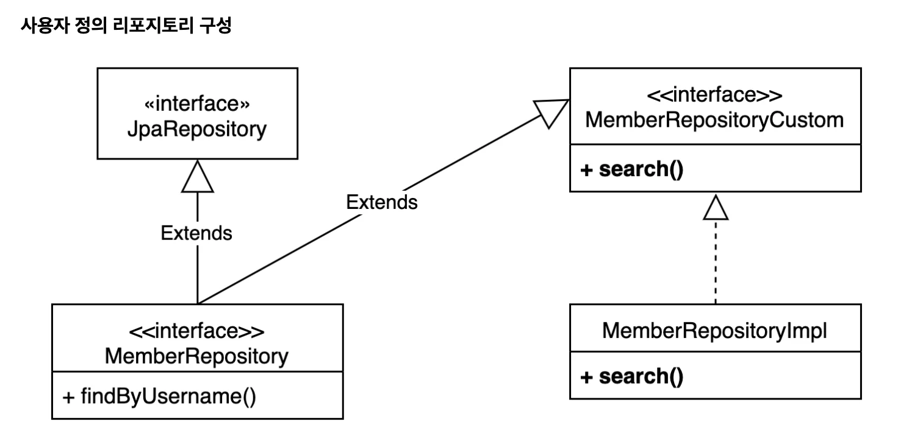

<a id="1c3eda9b0fe18193b81fdde8ee8d1922"></a>

## 사용자 정의 repository

---

> 📖 
> 
> <a id="1c3eda9b0fe18107a628d4a1e4fc9671"></a>
> 
> Spring Data JPA에서 Querydsl 사용 시, 사용자 정의 Repository를 생성 해당 클래스 내부에 Querydsl 메서드를 정의하고 상속 처리한다&#46; 



1. 사용자 정의 인터페이스 작성
    <details>
    <summary>&#91; 코드 &#93; MemberRepositoryCustom</summary>

    <a id="1c3eda9b0fe181a3ab40c72ec2f60a1e"></a>

    ```java
    public interface MemberRepositoryCustom {
    		List<MemberTeamDto> search(MemberSearchCondition condition);
    }
    ```

    </details>

1. 사용자 정의 인터페이스 구현
    <details>
    <summary>&#91; 코드 &#93; MemberRepositoryImpl</summary>

    <a id="1c3eda9b0fe1812f85e1fe644b2f3ccd"></a>

    ```java
    package com.example.lectureprac.repository;

    import com.example.lectureprac.dto.MemberSearchCondition;
    import com.example.lectureprac.dto.MemberTeamDto;
    import com.example.lectureprac.dto.QMemberTeamDto;
    import com.example.lectureprac.entity.QMember;
    import com.example.lectureprac.entity.QTeam;
    import com.querydsl.core.types.Predicate;
    import com.querydsl.core.types.dsl.BooleanExpression;
    import com.querydsl.jpa.impl.JPAQueryFactory;
    import jakarta.persistence.EntityManager;
    import lombok.RequiredArgsConstructor;
    import lombok.extern.slf4j.Slf4j;
    import org.springframework.util.StringUtils;
    import org.springframework.web.bind.annotation.RestController;

    import java.util.List;

    import static com.example.lectureprac.entity.QMember.member;
    import static com.example.lectureprac.entity.QTeam.team;
    import static org.springframework.util.StringUtils.hasText;


    public class MemberRepositoryImpl implements MemberRepositoryCustom {

        private final JPAQueryFactory queryFactory;

        public MemberRepositoryImpl(EntityManager em) {
            this.queryFactory = new JPAQueryFactory(em);
        }

        @Override
        //회원명, 팀명, 나이(ageGoe, ageLoe)
        public List<MemberTeamDto> search(MemberSearchCondition condition) {

            return queryFactory
                    .select(new QMemberTeamDto(
                            member.id,
                            member.username,
                            member.age,
                            team.id,
                            team.name))
                    .from(member)
                    .leftJoin(member.team, team)
                    .where(
                            usernameEq(condition.getUsername()),
                            teamNameEq(condition.getTeamName()),
                            ageGoe(condition.getAgeGoe()),
                            ageLoe(condition.getAgeLoe())
                    )
                    .fetch();
        }

        private BooleanExpression usernameEq(String username) {
            return hasText(username) ? member.username.eq(username) : null;
        }

        private BooleanExpression teamNameEq(String teamName) {
            return hasText(teamName) ? team.name.eq(teamName) : null;
        }

        private BooleanExpression ageGoe(Integer ageGoe) {
            return ageGoe != null ? member.age.goe(ageGoe) : null;
        }

        private BooleanExpression ageLoe(Integer ageLoe) {
            return ageLoe != null ? member.age.loe(ageLoe) : null;
        }
    }

    ```

    </details>

1. 스프링 데이터 리포지토리에 <u>사용자 정의 인터페이스 상속</u>
    <details>
    <summary>&#91; 코드 &#93; MemberRepository</summary>

    <a id="1c3eda9b0fe181598170fabe834c9a4a"></a>

    ```java
    package study.querydsl.repository;

    import org.springframework.data.jpa.repository.JpaRepository;
    import study.querydsl.entity.Member;
    import java.util.List;

    public interface MemberRepository extends JpaRepository<Member, Long>, MemberRepositoryCustom {
       List<Member> findByUsername(String username);
    }

    ```

    </details>

1. 커스텀 리포지토리 동작 테스트 
    <details>
    <summary>&#91; 코드 &#93; MemberRepository</summary>

    <a id="1c3eda9b0fe181d6acf8f90339b7e93c"></a>

    ```java
    @Test
    public void searchTestByWhereParamter() {
        Team teamA = new Team("teamA");
        Team teamB = new Team("teamB");
        em.persist(teamA);
        em.persist(teamB);

        Member member1 = new Member("member1", 10, teamA);
        Member member2 = new Member("member2", 20, teamA);
        Member member3 = new Member("member3", 30, teamB);
        Member member4 = new Member("member4", 40, teamB);

        em.persist(member1);
        em.persist(member2);
        em.persist(member3);
        em.persist(member4);

        MemberSearchCondition condition = new MemberSearchCondition();
        condition.setAgeGoe(35);
        condition.setAgeLoe(40);
        condition.setTeamName("teamB");

        List<MemberTeamDto> result = memberRepository.search(condition);

        assertThat(result).extracting("username").containsExactly("member4");
    }
    ```

    </details>
