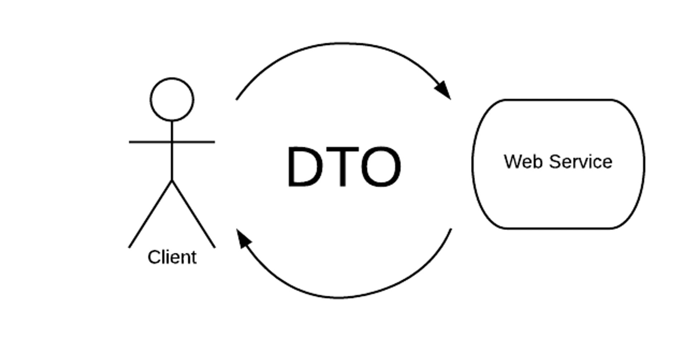
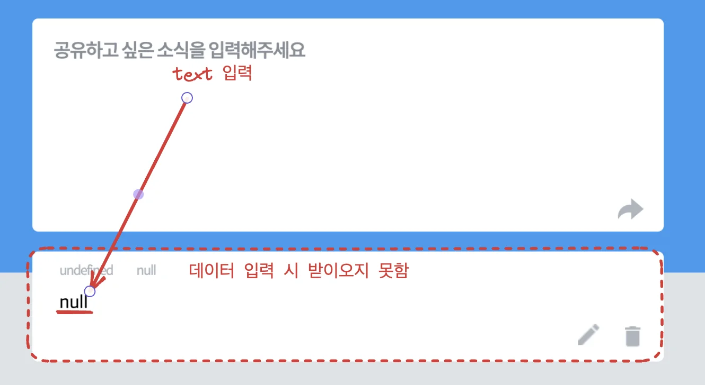
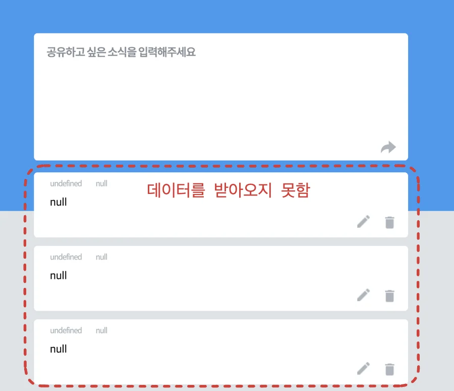
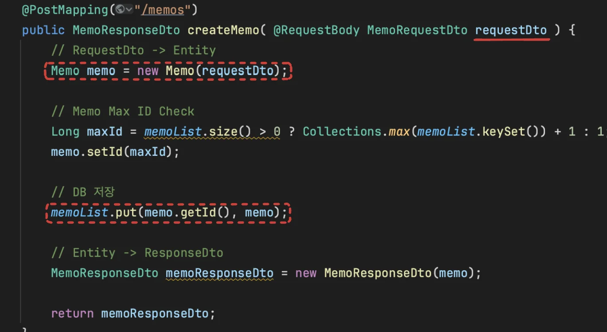
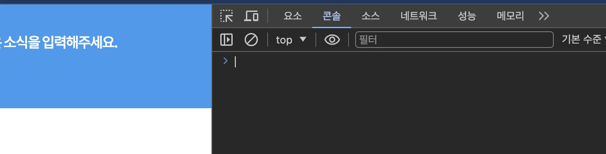
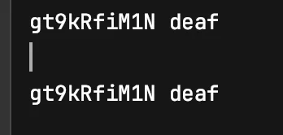
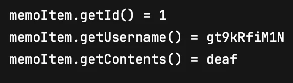
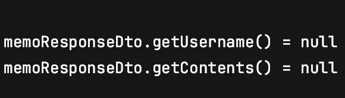
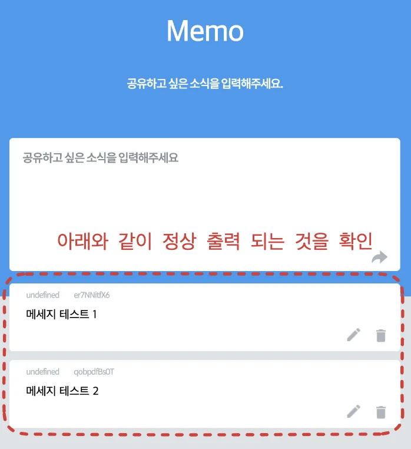

<a id="1c3eda9b0fe181558c9ad65a8a0a2edc"></a>

### 메모장 기능 설계

<details>
<summary><code>READ</code>&#58; 접속 하자마자 메모 전체 목록 조회하기 </summary>

<details>
<summary>GET API 사용해서 메모 목록 불러오기</summary>

<a id="1c3eda9b0fe1813197e5c735ed9111f2"></a>

<code>&#64;GetMapping</code> anotation을 사용한 api 매핑

<a id="1c3eda9b0fe181caae82e94e55b50b9a"></a>

```java
@GetMapping("/memos")
public List<MemoResponseDto> getMemos() {
```

</details>

</details>

<details>
<summary><code>CREATE</code>&#58; 메모 생성</summary>

<details>
<summary>POST API 사용해서 메모 신규 생성</summary>

<a id="1c3eda9b0fe1816b97dbeaa654ab83cd"></a>

<code>&#64;PutMapping</code> anotation을 사용한 api 매핑

<a id="1c3eda9b0fe18196beddd9621371ad0b"></a>

```java
@PostMapping("/memos")
public MemoResponseDto createMemo( @RequestBody MemoRequestDto requestDto ) {

// 클라이언트 요청이 담긴 RequestDto -> Entity
Memo memo = new Memo(requestDto);
```

</details>

<details>
<summary>메모 저장 및 반환</summary>

<a id="1c3eda9b0fe1811ea7a6ec0abee05afc"></a>

```java
// 메모리 저장 ( 원래는 DB 저장 ) 
memoList.put(memo.getId(), memo);

// Entity -> Client로 응답할 ResponseDto 
MemoResponseDto memoResponseDto = new MemoResponseDto(memo);

return memoResponseDto;
```

</details>

<details>
<summary><code>MemoResponseDto</code>  Constructor</summary>

<a id="1c3eda9b0fe181be925fcf61fee8d6e7"></a>

```java
public MemoResponseDto(Memo memo) {
    this.id = memo.getId();
    this.username = memo.getUsername();
    this.contents = memo.getContents();
}
```

</details>

</details>

<details>
<summary><code>UPDATE</code>&#58; 메모 변경</summary>

<details>
<summary>PUT API 사용한메모 내용 수정</summary>

<a id="1c3eda9b0fe1817fb565f059b230b09b"></a>

<code>&#64;PutMapping</code> anotation을 사용한 api 매핑

<a id="1c3eda9b0fe181ed841cc70e7dff6a95"></a>

```java
@PutMapping("/memos/{id}")
public Long updateMemo(@PathVariable Long id, @RequestBody MemoRequestDto requestDto) {
```

</details>

<details>
<summary>사용자가 삭제하려는 메모가 DB에 존재하는지 확인</summary>

<a id="1c3eda9b0fe18132a049cd5e98c37ded"></a>

```java
// 해당 메모가 DB에 존재하는지 확인
if(memoList.containsKey(id)) {
```

</details>

<details>
<summary>해당 메모 내용 변경</summary>

<details>
<summary>Memo&#46;update()</summary>

<a id="1c3eda9b0fe1811d911ff7a0d87eeefa"></a>

```java
public void update(MemoRequestDto requestDto) {
    this.username = requestDto.getUsername();
    this.contents = requestDto.getContents();
}
```

</details>

<details>
<summary>MemoController</summary>

<a id="1c3eda9b0fe181a9bc91fa74d8f1d24a"></a>

```java
// 해당 메모 가져오기
Memo memo = memoList.get(id);

// memo 수정
memo.update(requestDto);
```

</details>

</details>

</details>

<details>
<summary><code>DELET</code>&#58; 메모 삭제</summary>

<details>
<summary>DELETE API 사용한 메모 삭제</summary>

<a id="1c3eda9b0fe181d5be9afd27b1ff81cb"></a>

<code>&#64;DeleteMapping</code> anotation을 사용한 api 매핑

<a id="1c3eda9b0fe18135ba03d0d606828416"></a>

```java
@DeleteMapping("/memos/{id}")
public Long deleteMemo(@PathVariable Long id) {
```

</details>

<details>
<summary>사용자가 삭제하려는 메모가 DB에 존재하는지 확인</summary>

<a id="1c3eda9b0fe181d2b341ee0a08db6d15"></a>

```java
// 해당 메모가 DB에 존재하는지 확인
if(memoList.containsKey(id)) {
```

</details>

<details>
<summary>DB에서 해당 메모 삭제</summary>

<a id="1c3eda9b0fe181aeba6de54f657788ca"></a>

```java
// 메모 삭제: List.remove()
memoList.remove(id);
```

</details>

</details>

<a id="1c3eda9b0fe181deac6be22b277d99c4"></a>

### API 테이블

> <a href="#/post/1c3eda9b-0fe1-810d-a48e-d17771c587b5">페이지</a> <br><a href="#/post/1c3eda9b-0fe1-81ed-be99-c90234388e57">페이지</a> 

[메모 생성](#/post/1c3eda9b-0fe1-8139-b8f5-f928d01c3fea)

[메모 조회](#/post/1c3eda9b-0fe1-81a0-aa26-c41314684f78)

[메모 변경](#/post/1c3eda9b-0fe1-81e5-9d45-d47aed345bf7)

[메모 삭제](#/post/1c3eda9b-0fe1-813f-a8cc-f0c378873a8b)

<details>
<summary>🧐  컬렉션 방식 </summary>

<a id="1c3eda9b0fe181a18678fca90efaa588"></a>

<strong><u><code>POST</code></u></strong><strong><u> 기반 파일을 등록</u></strong>하는 형식으로 서버에서 리소스의 URI를 생성하고 관리한다&#46; 


</details>

<details>
<summary>🧐 스토어 방식</summary>

<a id="1c3eda9b0fe181429b0aecc7bcacc9ee"></a>

<strong><u><code>PUT</code></u></strong><strong><u> 기반으로 파일을 등</u></strong>록하는 형식으로 클라이언트에서 리소스를 관리한다&#46;


</details>

<details>
<summary>🧐 PATCH, PUT, POST</summary>

- <code>PATCH</code>&#58; 부분 수정

- <code>PUT</code>&#58;  기존에 데이터를 덮어씀 (기존 데이터 사라짐) 

- <code>POST</code>&#58; 무적&#33;

<a id="1c3eda9b0fe181c7991bcb51fd255b8e"></a>

<code>PUT</code>은 기존의 데이터를 완전히 덮어쓰기 때문에, <code>PUT</code>을 사용하려면 클라이언트에서 기존 회원 데이터와 수정할 데이터를 모조리 보내서 완전히 바꿔야 한다&#46;  → 비용이 너무 큼<br>따라서 완전히 데이터를 교체하는 <code>게시판 수정</code> 같은 경우 사용한다&#46; 

<a id="1c3eda9b0fe181fb8e75c03cb9a79ae5"></a>

→ 기존 데이터를 <code>GET</code>으로 불러와서 <code>PUT</code>으로 교체 

</details>

<a id="1c3eda9b0fe18176a6f5c91e6c66631d"></a>

## CRUD 구현

<a id="1c3eda9b0fe181ea9fded76172cc8d96"></a>

### DTO 



> 📌 <strong>DTO(Data Transfer Object)<br></strong><strong><u>데이터 전송 및 이동</u></strong>을 위해 <strong><u>생성되는 객체</u></strong>를 의미한다&#46;

> <strong>Request의 데이터를 처리</strong>할 때 사용되는 객체는 <code>RequestDto</code>,

<a id="1c3eda9b0fe181ba8db8dcbaed4cda37"></a>

 <strong>Response를 할 때 사용</strong>되는 객체는 <code>ResponseDto</code>

<a id="1c3eda9b0fe1818a9f7fc6cb213b0440"></a>

라는 이름을 붙여 DTO 클래스를 만든다&#46; <br>( 일반적인 규칙으로 조직에 따라 규칙이 다를 수 있다&#46; )

- Client에서 보내오는 데이터를 객체로 처리 시 사용

- 서버의 계층간의 이동 시 사용

- DB와 소통하는 Java 클래스를 Client에 반환하는 것이 아닌 DTO로 한번 변환 후 반환 때 사용

<details>
<summary><strong>DB 연동 전, 메모리 구현체로 설계</strong></summary>

<a id="1c3eda9b0fe1810e8d3ff435cf039f39"></a>

```java
// 메모리 구현체 ( DB 연동 전 )
private final Map<Long, Memo> memoList = new HashMap<>();
```

</details>

<a id="1c3eda9b0fe181a5af5efbb76bb31b7b"></a>

### <code>Create</code> &#45; 메모 생성

<details>
<summary>🧐 <code>&#64;NoArgsConstructor</code></summary>

<a id="1c3eda9b0fe18102bfb4f92684dd5043"></a>

Argument가 없는 기존 생성자 자동생성, 롬복

</details>

<details>
<summary>🧐 &#64;RequestBody</summary>


</details>

<details>
<summary>🧐  <strong>DTO &#45; </strong>Setter 메서드를 사용하지 않음</summary>

<a id="1c3eda9b0fe18123b81accda7207b3bb"></a>

DTO&#58; 데이터 전달 목적으로만 사용 따라서 데이터 업데이트가 필요하지 않음

</details>

<details>
<summary>1&#46; 메모 데이터를 저장할 Memo 클래스 생성</summary>

<details>
<summary><strong>Entity</strong> &#45; <code>Memo</code></summary>

<a id="1c3eda9b0fe181658ce3fae9dc70b005"></a>

```java
package com.sparta.memo.entity;

import com.sparta.memo.dto.MemoRequestDto;
import lombok.Getter;
import lombok.NoArgsConstructor;
import lombok.Setter;

@Getter
@Setter
@NoArgsConstructor
public class Memo {
    private Long id;
    private String username;
    private String contents;

    public Memo(MemoRequestDto requestDto) {
        this.username = requestDto.getUsername();
        this.contents = requestDto.getContents();
    }
}

```

</details>

</details>

<details>
<summary>2&#46; 메모 생성하기 API를 받을 수 있는 Controller와 메서드 생성</summary>

<a id="1c3eda9b0fe1819f8b03f3c14707732a"></a>

```java
@RestController
@RequestMapping("/api")
public class MemoController {

    @PostMapping("/memos")
    public MemoResponseDto createMemo(@RequestBody MemoRequestDto requestDto) {
        return null;
    }
}
```

</details>

<details>
<summary>3&#46; Client에 데이터를 반환할 때 사용할 <code>MemoResponseDto</code> 클래스 생성</summary>

<details>
<summary><code>MemoReponseDto</code></summary>

<a id="1c3eda9b0fe1818597b5eee9f5597d3b"></a>

```java
package com.sparta.memo.dto;

import lombok.Getter;

@Getter
public class MemoResponseDto {
    private Long id;
    private String username;
    private String contents;
}
```

</details>

</details>

<details>
<summary>4&#46; Client의 요청 데이터를 받아줄 MemoRequestDto 클래스 생성</summary>

<details>
<summary> <code>MemoRequestDto</code></summary>

<a id="1c3eda9b0fe1813490d8ff8a31a12bf2"></a>

```java
package com.sparta.memo.dto;

import lombok.Getter;

@Getter
public class MemoRequestDto {
    private String username;
    private String contents;
}
```

</details>

</details>

<details>
<summary><code>MemoController</code></summary>

<a id="1c3eda9b0fe181e782a5de18a317d763"></a>

```java
@RestController
@RequestMapping("/api")
public class MemoController {

    // 메모리 기반 ( DB 연동 전 )
    private final Map<Long, Memo> memoList = new HashMap<>();

    @PostMapping("/memos")
    public MemoResponseDto createMemo( @RequestBody MemoRequestDto requestDto ) {
        // RequestDto -> Entity
        Memo memo = new Memo(requestDto);

        // Memo Max ID Check
        Long maxId = memoList.size() > 0 ? Collections.max(memoList.keySet()) + 1 : 1;
				memo.setId(maxId);


        // DB 저장
        memoList.put(memo.getId(), memo);

        // Entity -> ResponseDto
        MemoResponseDto memoResponseDto = new MemoResponseDto(memo);

        return memoResponseDto;
    }
```

</details>

<a id="1c3eda9b0fe181cf9572c6caacd1ddee"></a>

### <code>Read</code> &#45; 메모 읽어오기 

<details>
<summary>🧐<strong> </strong><strong><code>stream()</code></strong> ?</summary>


</details>

<a id="1c3eda9b0fe181ef9f59c6484a52a07c"></a>

```java
@GetMapping("/memos")
public List<MemoResponseDto> getMemos() {

    // Map  ->  List
    List<MemoResponseDto> responseList = memoList.values().stream()
            .map(MemoResponseDto::new).toList();

    return responseList;
}
```

<a id="1c3eda9b0fe1815cab86d763a36b00cf"></a>

### <code>Update</code> &#45;  메모 수정

<details>
<summary><code>update()</code>  &#45; 메모 수정</summary>

<a id="1c3eda9b0fe1812580ceebcab793b6bb"></a>

```java
public void update(MemoRequestDto requestDto) {
    this.username = requestDto.getUsername();
    this.contents = requestDto.getContents();
}
```

</details>

<a id="1c3eda9b0fe181219edbed5826169dc0"></a>

```java
@PutMapping("/memos/{id}")
public Long updateMemo(@PathVariable Long id, @RequestBody MemoRequestDto requestDto) {
    
    // 해당 메모가 DB에 존재하는지 확인
    if(memoList.containsKey(id)) {
    
				// 해당 메모 가져오기
        Memo memo = memoList.get(id);

        // memo 수정
        memo.update(requestDto);
        
        return memo.getId();
        
    } else {
        throw new IllegalArgumentException("선택한 메모는 존재하지 않습니다.");
    }
}
```

<a id="1c3eda9b0fe18172a5b4e91c5bb4f4bf"></a>

### <code>Delete</code> &#45; 메모 삭제

<a id="1c3eda9b0fe181b5af5fd7d55119bd64"></a>

```java
@DeleteMapping("/memos/{id}")
public Long deleteMemo(@PathVariable Long id) {

    // 해당 메모가 DB에 존재하는지 확인
    if(memoList.containsKey(id)) {
    
        // 메모 삭제: List.remove() 
        memoList.remove(id);
        
        return id;
        
    } else {
        throw new IllegalArgumentException("선택한 메모는 존재하지 않습니다.");
    }
}
```

<a id="1c3eda9b0fe181aaae03f4344cf4487f"></a>

### 전체 코드

<details>
<summary><strong>Entity</strong> &#45; <code>Memo</code></summary>

<a id="1c3eda9b0fe181548ea7c1e489a8886f"></a>

```java
package com.sparta.memo.entity;

import com.sparta.memo.dto.MemoRequestDto;
import lombok.Getter;
import lombok.NoArgsConstructor;
import lombok.Setter;

@Getter
@Setter
@NoArgsConstructor
public class Memo {
    private Long id;
    private String username;
    private String contents;

    public Memo(MemoRequestDto requestDto) {
        this.username = requestDto.getUsername();
        this.contents = requestDto.getContents();
    }
}

```

</details>

<details>
<summary><strong>DTO </strong></summary>

<details>
<summary> <code>MemoRequestDto</code></summary>

<a id="1c3eda9b0fe1812b9564db9babc9e4f8"></a>

```java
package com.sparta.memo.dto;

import lombok.Getter;

@Getter
public class MemoRequestDto {
    private String username;
    private String contents;
}
```

</details>

<details>
<summary><code>MemoReponseDto</code></summary>

<a id="1c3eda9b0fe1817d810ef00702d6883f"></a>

```java
package com.sparta.memo.dto;

import lombok.Getter;

@Getter
public class MemoResponseDto {
    private Long id;
    private String username;
    private String contents;
}
```

</details>

</details>

<details>
<summary><strong>Controller</strong> &#45; <code>MemoController</code></summary>

<a id="1c3eda9b0fe181728016d73704b03b19"></a>

```java
package com.sparta.memo.controller;

import com.sparta.memo.dto.MemoRequestDto;
import com.sparta.memo.dto.MemoResponseDto;
import com.sparta.memo.entity.Memo;
import org.springframework.web.bind.annotation.*;

import java.util.Collections;
import java.util.HashMap;
import java.util.List;
import java.util.Map;

@RestController
@RequestMapping("/api")
public class MemoController {

    // 메모리 기반 ( DB 연동 전 )
    private final Map<Long, Memo> memoList = new HashMap<>();

    @PostMapping("/memos")
    public MemoResponseDto createMemo( @RequestBody MemoRequestDto requestDto ) {
        // RequestDto -> Entity
        Memo memo = new Memo(requestDto);

        // Memo Max ID Check
        Long maxId = memoList.size() > 0 ? Collections.max(memoList.keySet()) + 1 : 1;

        // DB 저장
        memoList.put(memo.getId(), memo);

        // Entity -> ResponseDto
        MemoResponseDto memoResponseDto = new MemoResponseDto(memo);

        return memoResponseDto;
    }

    @GetMapping("/memos")
    public List<MemoResponseDto> getMemos() {
        // Map To List
        List<MemoResponseDto> responseList = memoList.values().stream()
                .map(MemoResponseDto::new).toList();

        return responseList;
    }

    @PutMapping("/memos/{id}")
    public Long updateMemo(@PathVariable Long id, @RequestBody MemoRequestDto requestDto) {

        // 해당 메모가 DB에 존재하는지 확인
        if(memoList.containsKey(id)) {

            // 해당 메모 가져오기
            Memo memo = memoList.get(id);

            // memo 수정
            memo.update(requestDto);

            return memo.getId();

        } else {
            throw new IllegalArgumentException("선택한 메모는 존재하지 않습니다.");
        }
    }

    @DeleteMapping("/memos/{id}")
    public Long deleteMemo(@PathVariable Long id) {

        // 해당 메모가 DB에 존재하는지 확인
        if(memoList.containsKey(id)) {

            // 메모 삭제: List.remove()
            memoList.remove(id);

            return id;

        } else {
            throw new IllegalArgumentException("선택한 메모는 존재하지 않습니다.");
        }
    }
}

```

</details>

<details>
<summary>🧐 Error) 생성한 메모가 list에 저장되지 않음</summary>



<a id="1c3eda9b0fe181f5b463ddfbfd1f4328"></a>

생성되는 메모에 id를 설정하지 않았음

<a id="1c3eda9b0fe181fe88a2c03d293e28dd"></a>

```java
// memo id 값 설정 ( 그냥 ++로 주면 되지 않나?)
Long maxId = memoList.size() > 0 ? Collections.max(memoList.keySet()) + 1 : 1;
// memo에 고유한 id값 저장 
// 간단한 앱이라 그냥 사용하지만 uuid를 사용한 고유 값을 줘야한다. 
memo.setId(maxId);
```

<details>
<summary>메모 생성 api ( <code>createMemo</code> )</summary>

<a id="1c3eda9b0fe181f4a64eea683f435115"></a>

```java
@PostMapping("/memos")
    public MemoResponseDto createMemo( @RequestBody MemoRequestDto requestDto ) {
        // RequestDto -> Entity
        Memo memo = new Memo(requestDto);

        // Memo Max ID Check
        Long maxId = memoList.size() > 0 ? Collections.max(memoList.keySet()) + 1 : 1;
        memo.setId(maxId);

        // DB 저장
        memoList.put(memo.getId(), memo);

        // Entity -> ResponseDto
        MemoResponseDto memoResponseDto = new MemoResponseDto(memo);

        return memoResponseDto;
    }
```

</details>

</details>

<a id="1c3eda9b0fe18114a6a5db6c31476b14"></a>

### 🧐 Error) 메모는 정상 생성되나 입력한 데이터를 저장하지 못함



<a id="1c3eda9b0fe181f1aa54ff8ea985acfa"></a>

아래 메모 생성 로직을 보면 client에서 받아와 생성되는 객체인 <code>requestDto</code>를 memo 인스턴스에 주입하는 것을 알 수 있다




> <strong>의심1)  Memo 인스턴스가 생성될 시 주어지는 인자가 정상적으로 주입되는가?</strong>

<a id="1c3eda9b0fe18136a29af63b786cb591"></a>

<code>Memo</code> 엔티티를 확인해본 결과 아래와 같이 Constructor를 사용하여 받아와  해당 필드값에 주입하는 것을 확인 

<a id="1c3eda9b0fe1814fa4aac29ef245831a"></a>

```java
public class Memo {
	  .   .   .
		
		public Memo(MemoRequestDto requestDto) {
	      this.username = requestDto.getUsername();
	      this.contents = requestDto.getContents();
	  }
```

> <strong>의심2) </strong>요청 데이터를 받아와 객체로 만드는<strong> </strong><code>MemoResponseDto</code>는  정상적으로 요청을 받아와 getter로 반환할 수 있는가? 

<details>
<summary>✅ <strong> </strong>Memo 생성 로직에  아래와 같이 console 값을 추가하여 확인 </summary>

<a id="1c3eda9b0fe181b981e1fea9610e4559"></a>

```java
public Memo(MemoRequestDto requestDto) {
		// request 값 확인
    System.out.println(requestDto.getUsername() + " " + requestDto.getContents());
    
    this.username = requestDto.getUsername();
    this.contents = requestDto.getContents();
		
		// memo 필드에 주입되는 값 확인
    System.out.println(username + " " + contents);
}
```

<a id="1c3eda9b0fe181b89d9cf88039eb9e4f"></a>

콘솔 확인 불가능… 값이 안나온다



> ✅ <strong>확인 가능</strong><br>⇒  코드 수정 후 서버 재시작 안함<br>⇒ 인텔리제이 터미널에서 확인 가능함



</details>

<details>
<summary>✅ <strong> memoList 값 찍어보기 </strong></summary>

<a id="1c3eda9b0fe181c4b55bee4378deb511"></a>

빈 메모지가 계속 생기는 것을 보면  메모의 생성이 입력될 때마다 List의 아이템 값들은 계속 생성됨

<a id="1c3eda9b0fe181eea65fe4692f02c3ee"></a>

→ 메모 리스트에서 값이 정상적으로 들어가 있으면 읽어오는 api 에서 문제가 있는 것이므로 해당 부분에서 찾으면됨 

<a id="1c3eda9b0fe181689271d135cf0c09dc"></a>

```java
 // 메모 리스트 확인
  for (Memo memoItem : memoList.values()) {
      System.out.println("memoItem.getId() = " + memoItem.getId());
      System.out.println("memoItem.getUsername() = " + memoItem.getUsername());
      System.out.println("memoItem.getContents() = " + memoItem.getContents());
      System.out.println();
  }
```

<a id="1c3eda9b0fe18197ab0cfeb095b7230d"></a>

입력한 값을 정상으로 받아오는 것을 확인함 그러므로 메모를 읽어옴<br>→ 메모 리스트를 반환하는 <code>getMemos</code> api 확인



</details>

<details>
<summary>✅ 메모 리스트를 반환하는 <code>getMemos</code> api 확인</summary>

<a id="1c3eda9b0fe181bcb276d2c3f5b70b19"></a>

위 방법들을 통해  메모 리스트를 반환하는 <code>getMemos</code> api 에서 문제가 있는 것을 확인했다&#46; 

<a id="1c3eda9b0fe181a38045ebcd8bdc78d3"></a>

아래와 같이 반환하는 memolist를 for 문으로 출력하여 값이 들어오는 확인

<a id="1c3eda9b0fe181358889e68e30b3db12"></a>

```java
for (MemoResponseDto memoResponseDto : responseList) {
    System.out.println("memoResponseDto.getUsername() = " + memoResponseDto.getUsername());
    System.out.println("memoResponseDto.getContents() = " + memoResponseDto.getContents());
}
```

<details>
<summary>getMemos()</summary>

<a id="1c3eda9b0fe1813dbe7eced5912350fa"></a>

```java
public List<MemoResponseDto> getMemos() {
        // Map To List
        List<MemoResponseDto> responseList = memoList.values().stream()
                .map(MemoResponseDto::new).toList();

        return responseList;
    }
```

</details>

<a id="1c3eda9b0fe18163a121e64a272425ee"></a>

값을 찍어보니 null 값이 나오는 것을 확인함



<a id="1c3eda9b0fe18151aa22df5b6480c18a"></a>

따라서 메모리스트를 반환하는 <code>repsonseList</code>에서 문제가 있음을 확인

</details>

<details>
<summary>✅ <strong><code>ResponseDto</code></strong><strong>에서  값을 받아오는지 확인 </strong></summary>

<a id="1c3eda9b0fe181e9be4af901ce336b88"></a>

메모 생성(<code>createMemo</code>) 시에  <strong><u><code>m</code></u></strong><strong><u><code>emo</code></u></strong><strong><u> 엔티티가</u></strong> <strong><u><code>ResponseDto</code></u></strong>로 변경될 때, <strong><u>해당되는 인스턴스에 제대로 값이 들어가지 않</u></strong>아 <strong><u>ResponseDto 받아오는 </u></strong><code>repsonseList</code>에서 값이 제대로 생성 되지 않았다&#46;

<a id="1c3eda9b0fe18108925be4d09108ab59"></a>

```java
// Entity -> ResponseDto
MemoResponseDto memoResponseDto = new MemoResponseDto(memo); 
```

<a id="1c3eda9b0fe18114aa6dd9d797a218a2"></a>

<br><br>따라서 <code>MemoResponseDto</code>를 확인해본 결과<code> MemoResponseDto</code>의 constructor에 필드값들이 주입되지 않았다는 것을 알아냈다&#46; 

</details>

<details>
<summary>✅ 해결) <code>MemoResponseDto</code> 생성자에 필드값 주입</summary>

<a id="1c3eda9b0fe181e59ca8e27812259747"></a>

```java
public MemoResponseDto(Memo memo) {
    this.id = memo.getId();
    this.username = memo.getUsername();
    this.contents = memo.getContents();
}
```

<details>
<summary><strong>MemoResponseDto</strong></summary>

<a id="1c3eda9b0fe181b8bd49e2ed52403061"></a>

```java
@Getter
public class MemoResponseDto {
    private Long id;
    private String username;
    private String contents;

    public MemoResponseDto(Memo memo) {
        this.id = memo.getId();
        this.username = memo.getUsername();
        this.contents = memo.getContents();
    }
}
```

</details>

<a id="1c3eda9b0fe181feb6eced4a05788fc0"></a>

생성자를 주입 후 아래와 같이 정상적으로 메모 입력값을 받아와 리스트로 출력되는 것을 확인 할 수 있다&#46; 



</details>
