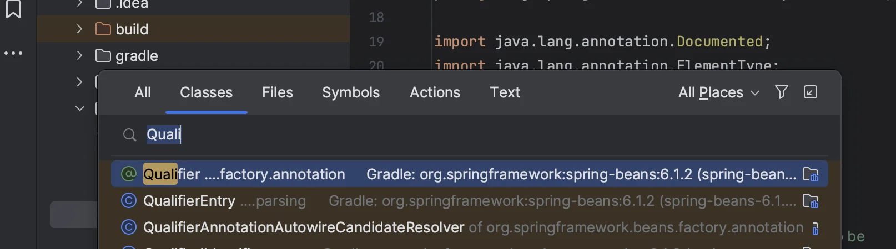
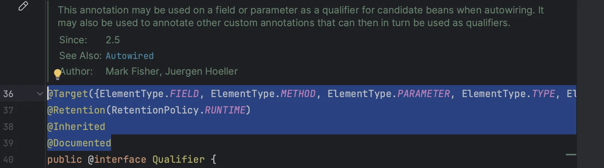
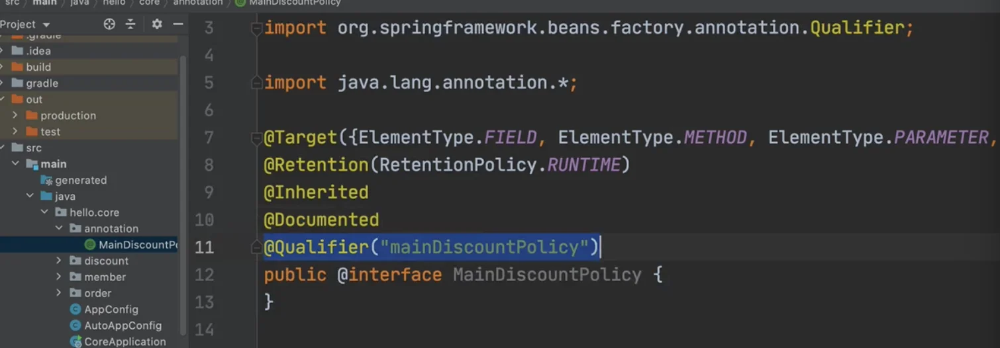
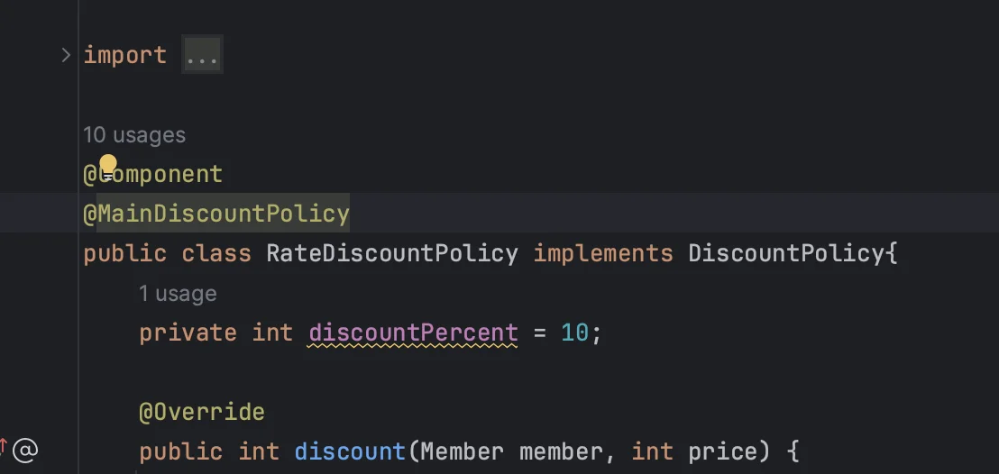

<a id="1c3eda9b0fe181f480c8d1c3d62381f1"></a>

## 커스텀 애노 테이션

---

> <code>Qualifier(</code><strong><code>&#34;mainDiscountPolicy&#34;</code></strong><code>)</code> <br>이렇게 <strong>문자(String 타입) 를 적으면 컴파일 시 타입 체크가 안</strong>된다<br>→  아래와 같이 <strong>애노테이션을 만</strong>들고 그 안에서 <strong>&#64;Qualifier를 명시</strong>하여  해결

<a id="1c3eda9b0fe18142ac0cf718e393e60a"></a>

## 방법

---

<a id="1c3eda9b0fe1811bbe8eccc08694403c"></a>

###    0&#46; annotation 폴터 및 인터페이스(애노테이션) 생성

<a id="1c3eda9b0fe18185a6f1fa6811c76bd4"></a>

### 1&#46; <strong>Quailfier 검색</strong> (classes 검색&#58; <code>cmd</code> &#43; <code>O</code>) 



<a id="1c3eda9b0fe181258b0cdf534953fe55"></a>

### 2&#46; <strong>Quailfier의 애노테이션들 복사, 붙여넣기</strong>



<a id="1c3eda9b0fe1816f9946cae3dd5e878b"></a>

```java
@Target({ElementType.FIELD, ElementType.METHOD, ElementType.PARAMETER, ElementType.TYPE, ElementType.ANNOTATION_TYPE})
@Retention(RetentionPolicy.RUNTIME)
@Inherited
@Documented
```

<a id="1c3eda9b0fe18155bea9ca1f5f186164"></a>

### 3&#46; <strong>&#64;Qualifier 지정</strong>



<a id="1c3eda9b0fe1812a872ae11b6ca2f377"></a>

```java
package hello.core.annotation;

import org.springframework.beans.factory.annotation.Qualifier;

import java.lang.annotation.*;

@Target({ElementType.FIELD, ElementType.METHOD, ElementType.PARAMETER, ElementType.TYPE, ElementType.ANNOTATION_TYPE})
@Retention(RetentionPolicy.RUNTIME)
@Inherited
@Documented
@Qualifier("mainDiscountPolicy")
public @interface MainDiscountPolicy {
}
```

<a id="1c3eda9b0fe1813b9fabe0255555545f"></a>

### 4&#46; <strong>애노테이션 적용</strong>

> 만든 애노테이션(<code>&#64;MainDiscountPolicy</code>)  <strong>클래스</strong>(<code>RateDiscountPolicy</code>), <strong>파라미터</strong>에 적용 



<a id="1c3eda9b0fe181f19a38e9ebd47a45cd"></a>

```java
@Component
@MainDiscountPolicy
public class RateDiscountPolicy implements DiscountPolicy {}
```

<a id="1c3eda9b0fe181e6bf05ea713b1c588c"></a>

```java
//생성자 자동 주입
@Autowired
public OrderServiceImpl(MemberRepository memberRepository, @MainDiscountPolicy DiscountPolicy discountPolicy) {
		 this.memberRepository = memberRepository;
     this.discountPolicy = discountPolicy;
}

//수정자 자동 주입
@Autowired
public DiscountPolicy setDiscountPolicy(@MainDiscountPolicy DiscountPolicy discountPolicy) {
     this.discountPolicy = discountPolicy;
 }
```

> 📌 <strong>참고<br></strong>애노테이션에는 <strong>상속이라는 개념이 없</strong>다&#46; 이렇게 여러 애노테이션을 모아서 사용하는 기능은 <strong>스프링이 지원</strong>해주는 기능 이다&#46; <u><code>&#64;Qualifier</code></u><u> 뿐만 아니라 다른 애노테이션들도 함께 조합해서 사용할 수 있</u>다&#46; 단적으로 <code>&#64;Autowired</code> 도 재 정의 할 수 있다&#46; 물론 <u>스프링이 제공하는 기능을 뚜렷한 목적 없이 무분별하게 재정의 하는 것은 유지보수에 더 혼란만 가중할 수 있</u>다
