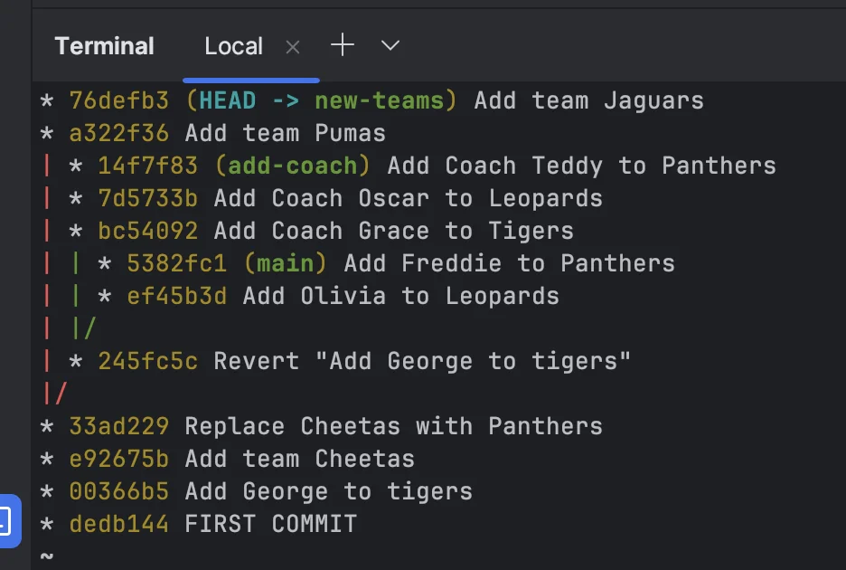

<details>
<summary>브랜치 생성</summary>

<a id="1c3eda9b0fe181e38e34d805f6b721a3"></a>

```bash
git branch [브랜치명]
```

</details>

<details>
<summary>브랜치 목록 확인</summary>

<a id="1c3eda9b0fe181469486ea2e5482efe0"></a>

```bash
git branch
```

</details>

<details>
<summary>&#91;브랜치명&#93;  브랜치로 이동</summary>

<a id="1c3eda9b0fe181638f26fa6e23c04347"></a>

```bash
git switch [브랜치명]
```

> • <code>checkout</code> 명령어가 Git 2&#46;23 버전부터 <code>switch</code>, <code>restore</code>로 분리

</details>

<details>
<summary>브챈치 생성과 동시에 이동하기</summary>

<a id="1c3eda9b0fe181c9912fdcf0dc505b92"></a>

```bash
git switch -c new-teams
```

</details>

<details>
<summary>브랜치 삭제하기</summary>

<a id="1c3eda9b0fe181b38662fd3d185e6ddc"></a>

```bash
git branch -d (삭제할 브랜치명)
```

</details>

<details>
<summary>브랜치 이름 바꾸기</summary>

<a id="1c3eda9b0fe181f2bb93da6a7e596179"></a>

```bash
git branch -m (기존 브랜치명) (새 브랜치명)
```

</details>

<details>
<summary>merger 하지 않고 branch를 삭제하고 싶은 경우</summary>

<a id="1c3eda9b0fe18177800ecc61d0460912"></a>

지워질 브랜치에만 있는 내용의 커밋이 있을 경우, 즉 다른 브랜치로 가져오지 않은 내용이 있는 브랜치를 지울 때는 <code>&#45;d</code> 대신 <code>&#45;D</code>(대문자)로 강제 삭제 해야한다&#46;

<a id="1c3eda9b0fe181bc9495d28576a41b01"></a>

```bash
git branch -D (강제삭제할 브랜치명)
```

</details>

<details>
<summary>여러 브랜치의 내역 편리하게 보기</summary>

<a id="1c3eda9b0fe18128a6e2ee3485e688dd"></a>

```bash
git log --all --decorate --oneline --graph
```

> <code>git log</code>&#58;  현재 브랜치의 commit 내역만 볼수 있음



</details>
