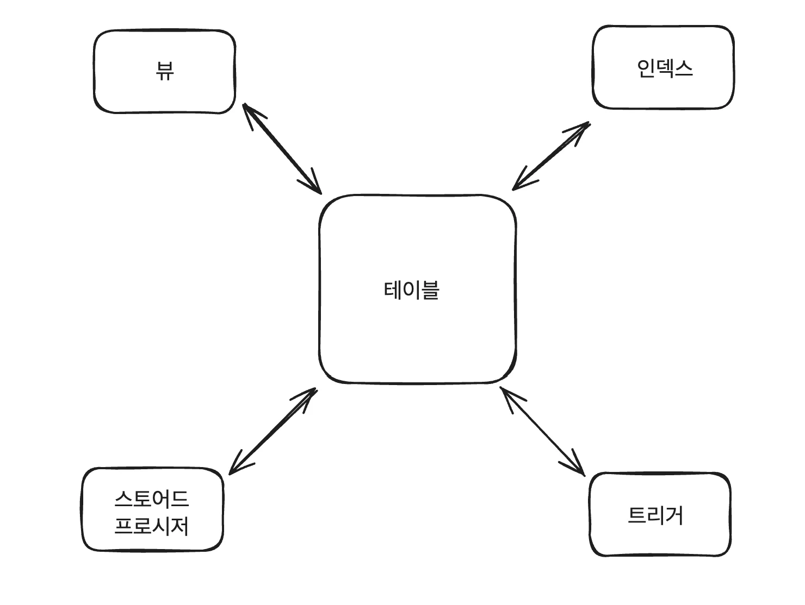
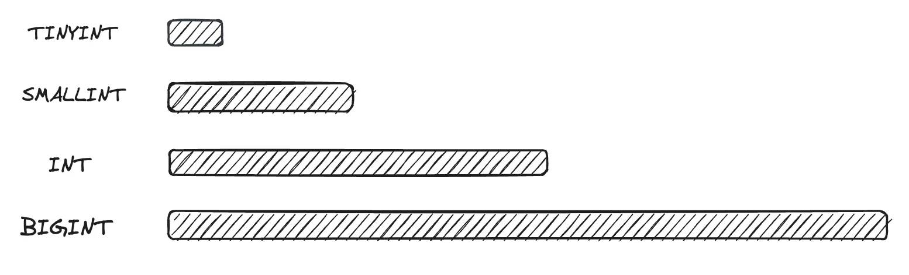
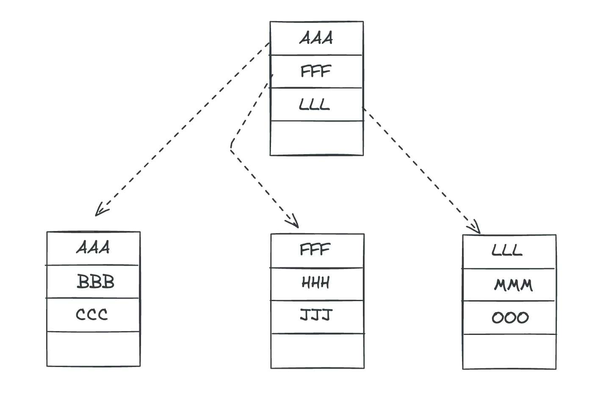

<details>
<summary>reference</summary>

- &#91;도서&#93; 혼자 공부하는 SQL

- &#91;도서&#93; 이것이 MySQL 이다&#46; ( 다시보기 )

</details>

> ✏️ 
> 
> 
> 
> <a id="1c3eda9b0fe181e4be9df5cd9ecfe198"></a>
> 
> DB의 핵심 개체는 테이블이다&#46; 
> 
> <a id="1c3eda9b0fe181c88841cc99e59569eb"></a>
> 
> 하지만 DB에서는 테이블 외 인덱스, 뷰, 스토어드 프로시저, 트리거, 함수, 커서 등의 개체도 필요하다&#46; 
> 
> - 인덱스&#58; 데이터 조회 속도 성능 향상
> 
> - 뷰&#58; 테이블 일부 제한적으로 표현
> 
> - 스토어드 프로시저&#58; SQL에서 프로그래밍 가능

<a id="1c3eda9b0fe181b7846def56b4f05ee3"></a>

## SQL 기본 문법

<a id="1c3eda9b0fe1816f837bfe47c4103644"></a>

### 집계함수

<details>
<summary>집계 함수</summary>

| 함수명 | 설명 |
| --- | --- |
| SUM() | 합계 구함 |
| AVG() | 평균 구함 |
| MIN() | 최솟값 구함 |
| MAX() | 최대값 구함 |
| COUNT() | 행 개수 카운팅 |
| COUNT(DISTINCT()) | 행 개수 카운팅 (중복 1개만 카운팅) |

</details>

<details>
<summary>집계 함수 사용 시, <code>WHERE</code> → <code>HAVING</code></summary>

> ✏️ 
> 
> <a id="1c3eda9b0fe181e58b6bdab805d68418"></a>
> 
> <code>HAVING</code>
> 
> - 집계 함수와 관련된 조건을 제한
> 
> - <code>GROUP BY</code> 다음에 나옴

- 오류 &#45; where
    <a id="1c3eda9b0fe18146aed8f359684e09e0"></a>

    ```sql
    SELECT mem_id "회원 아이디", SUM(price*amount) "총 구매 금액"
    FROM buy
    WHERE SUM(price * amount) > 1000;
    GROUP BY mem_id;
    ```

    <a id="1c3eda9b0fe1810daf05c363397e7977"></a>

    Error Code&#58; 1111&#46; Invalid use of group function

    <a id="1c3eda9b0fe181269ab3de1e243e9203"></a>

    → 집계 함수는 where 절로 나타낼 수 없다&#46; 

- 해결 &#45; <code>having</code>
    <a id="1c3eda9b0fe181fcaf9ec20523d10d89"></a>

    ```sql
    SELECT mem_id "회원 아이디", SUM(price*amount) "총 구매 금액"
    FROM buy
    GROUP BY mem_id;
    HAVING SUM(price*amount) > 1000;
    ORDER BY SUM(price*amount) DESC; 
    ```

</details>

<a id="1c3eda9b0fe181f9bb43cf41467dcac3"></a>

### 기본 SQL &#45; 데이터 변경

<details>
<summary>데이터 입력&#58; <code>INSERT</code></summary>

<a id="1c3eda9b0fe1819ea8aeea5e5af0db42"></a>

```sql
# 기본 문법
INSERT INTO 테이블 [(열1, 열2, ...)] VALUES (값1, 값2 ...)
```

- 열 순서 상관없음

- 스키마에 정의된 열의 값이 없으면 <code>null</code>로 삽입됨

<details>
<summary>ex)</summary>

<a id="1c3eda9b0fe18170bc38f9428475946b"></a>

```sql
# 테이블 생성
CREATE TABLE toys(id INT, name CHAR(4), age INT);


# 데이터 입력 1
INSERT INT toys (id, age, name) VALUES (1, 12, '버즈');

# 조회
SELECT * FROM toys WHERE id = 1;
 # id:1, name:'버즈', age=12


# 데이터 입력 2
INSERT INT toys (id, name) VALUES (2, '버즈');
# 조회
SELECT * FROM toys WHERE id = 2;
 # id:2, name:'버즈', age=null
```

</details>

</details>

<details>
<summary>&#43;) <code>AUTO&#95;INCREMENT</code></summary>

<a id="1c3eda9b0fe181c7abcae4cd67a5c369"></a>

```sql
# 테이블 생성
CREATE TABLE users (
		id INT AUTO_INCREMENT PRIMARY KEY,
		name CHAR(20)
		age INT
);

# 데이터 삽입
INSERT INTO users VALUES (NULL, '이름1' 21);
INSERT INTO users VALUES (NULL, '이름2' 25);
INSERT INTO users VALUES (NULL, '이름4' 23);

# users 테이블 조회
SELECT * FROM users
 # id 값 1개씩 증가해서 정상 출력됨
```

<a id="1c3eda9b0fe18117aeb0eebf4cc2856e"></a>

<br>

</details>

<details>
<summary>&#43;) INSERT 한줄 작성</summary>

<a id="1c3eda9b0fe181f5a14dd8c6902bda17"></a>

```sql
# 이전 
INSERT INTO users VALUES (NULL, '이름1' 21);
INSERT INTO users VALUES (NULL, '이름2' 25);
INSERT INTO users VALUES (NULL, '이름4' 23);

# 개선) 한번에 생성
INSERT INTO users VALUES (NULL, '이름1' 21), (NULL, '이름2' 25), (NULL, '이름4' 23);
```

<a id="1c3eda9b0fe181f5936df739edcebbe2"></a>

<br>

</details>

<details>
<summary>데이터 수정&#58; <code>UPDATE</code></summary>

<a id="1c3eda9b0fe181618058e35ba35f6dbe"></a>

```sql
# 기본 문법
UPDATE 테이블명
	SET 열1=값1, 열2=값2
	WHERE 조건
```

- ex)
    <a id="1c3eda9b0fe181d0a6a8e92a6fc56d2a"></a>

    ```sql
    UPDATE city_pool
    	SET city_name = '뉴욕', population = 0
    	WHERE city_name = 'New York';
    SELECT * FROM city_popul WHERE city_name = '뉴욕';
    ```

</details>

<details>
<summary>데이터 삭제&#58; <code>DELETE</code></summary>

<a id="1c3eda9b0fe181698d19dc34aea2b239"></a>

```sql
DELETE FORM city_popul
  WHERE city_name LIKE 'New%'
  LIMIT 5 # 위 조건에 해당하는 상위 5건만 삭제
```

</details>

<details>
<summary>&#43;) 대용량 테이블 삭제</summary>

<a id="1c3eda9b0fe1819099a0e4af535e86cf"></a>

```sql
DELETE FROM big_table1;

DROP TABLE big_table2;

TRUNCATE TABLE big_table3;
```

- DELETE&#58; 삭제 오래걸림

- DROP&#58; 테이블 자체 삭제, 속도 빠름

- TRUNCATE&#58; 빈 테이블 남김(스키마 유지), 속도 빠름<br>

</details>

<a id="1c3eda9b0fe181dc9bd2dc87481b30f4"></a>

## SQL 고급 문법

<a id="1c3eda9b0fe1811eafa4e6517d96298c"></a>

### 데이터 형식

<details>
<summary>정수형</summary>



| 데이터 형식 | 바이트 수 | 숫자 범위 |
| --- | --- | --- |
| TINYINT | 1 | &#45;128 &#126; 127 |
|  SMALLINT | 2 | &#45;32,768 &#126; 32,767 |
| INT | 4 | 약 &#45;21억 &#126; &#43; 21억 |
| BIGINT | 8 | 약 &#45;900경 &#126; &#43;900경 |

- <code>Error Code&#58; 1264&#46; Out of range value for column  …</code>
    - 정의한 타입의 범위를 벗어나면 해당 오류가 발생함

</details>

<a id="1c3eda9b0fe181e3af0dda8024a02933"></a>

&#46; &#46; &#46;

<a id="1c3eda9b0fe18124a239cc00bd388190"></a>

### 제약조건 → 견고한 테이블

- 기본키

- 외래키

- 고유키&#58; 휴대폰, 이메일 = 중복 허용 X

<a id="1c3eda9b0fe1819f8c7be71673061cf8"></a>

제약조건은 데이터의 무결성을 지키기 위해 제한하는 조건이다&#46; 

- 데이터의 무결성&#58; 데이터에 결함이 없음

- ex) 네이버 회원의 아이디 중복 

<a id="1c3eda9b0fe18165a2cff314f9d25909"></a>

        → 이메일, 블로그, 등 다른 서비스에서 결함이 발생된다&#46;

- MYSQL의 대표적인 제약조건
    - PRIMARY KEY

    - FOREIGN KEY

    - UNIQUE
        - 기본키와 비슷하지만 <code>NULL</code> 값을 허용한다&#46; 

    - CHECK

    - DEFAULT&#58; 기본값 정의

    - NOT NULL&#58; NULL 허용 X

> ✏️ 
> 
> <a id="1c3eda9b0fe181188f7dcbb8d317361a"></a>
> 
> <strong>기본키 &#45; 외래키 테이블 관계</strong>
> 
> - 외래 키가 설정된 테이블을 먼저 삭제해야 한다&#46; 

<a id="1c3eda9b0fe181a7aff0de2433a6626d"></a>

### 가상 테이블&#58; 뷰

<a id="1c3eda9b0fe181d0a241c19b14be1871"></a>

```sql
# 문법
CREATE VIEW 뷰_이름
AS
	SELECT 문;
```

<details>
<summary>ex)</summary>

<a id="1c3eda9b0fe18131ad8be1867a59ca6d"></a>

```sql
USE market_db;
CREATE VIEW v_member
AS
		SELECT mem_id, mem_name, addr FROM memebrs;
```

</details>

- 뷰 사용 이유
    - 보안(security)에 도움이 된다&#46; 

    - 특정 테이블에서 민감한 데이터를 제외하고  view 보여줄 수 있다&#46; 
        - ex) 회원 &#45; 비밀번호, 주민번호, 전화번호 …

    <a id="1c3eda9b0fe181e78e29d04ea7643e07"></a>

    작업이 많아 아르바이트생의 도움을 받아야 하는 경우

    <a id="1c3eda9b0fe1817e91e5e6fb06c50125"></a>

    해당 계정에 권한 제한을 두고, 회원(member) 테이블을 접근하지 못하게 하고

    <a id="1c3eda9b0fe18106ae46d8701aad3f42"></a>

    뷰 테이블만 접근 가능하도록하여 보안을 유지할 수 있다&#46;

- 데이터베이스에서 보안은 상당히 중요한 주제이다&#46;
    - 은행을 예로 들면

    - 은행에서도 DB의 테이블에 정보를 저장하낟&#46; 

    - 만약 통장 테이블에 고객의 예금을 관리한다고 하면,

    - 은행에서 일하는 모든 직원에서 root 권한을 부여하면, 고의든 실수이든 예금을 마음대로 사용할 수 있어 큰 사고가 발생될 수 있다&#46; 

    - 이런 사고를 미연에 방지하기 위해 직업 등급에 따라 고객정보에 접근할 수 있는 권한으 차등 부여한다&#46; 
        - ex) 1억 이상의 예금 이체, 적금 해지, 통장 개설 등의 작업은 어느 정도 직급이 있는 사람에게만 권한을 부여함 

<a id="1c3eda9b0fe181af9ea4e36f7babec4b"></a>

## 인덱스

<details>
<summary>인덱스 특징</summary>

- 인덱스 생성 시 검색 속도가 무척 빨라질 수 있다&#46; 

- 종류&#58; 클러스터형 인덱스, 보조 인덱스
    - 클러스터형 인덱스&#58; 영어 사전

    - 보조 인덱스&#58; 책 뒤의 찾아보기

- Primary Key, Unique를 설정한 열에는 자동으로 인덱스가 생성된다&#46;

- B&#45;Tree 구조를 갖는다&#46; 

- 클러스터형 인덱스는 테이블에 1개만 생성할 수 있고

- 보조 인덱스는 테이블에 여러개 생성할 수 있다&#46; 

- 인덱스 생성, 삭제를 위해서 <code>CREATE INDEX</code>, <code>DROP INDEXT</code>문을 사용할 수 있다&#46; 

- 클러스터형 인덱스가 보조 인덱스보다 검색 성능이 더 좋다&#46;

</details>

<details>
<summary>인덱스 장단점</summary>

- 장점
    - 검색 속도가 무척 빨라질 수 있다&#46; ( 단, 항상 그런 것은 아니다&#46; 

    - 해당 쿼리의 부하가 줄어들어, 결국 시스템 전체 성능이 향상된다&#46; 

- 단점
    - 인덱스가 DB 공간을 차지하여 추가적인 공간이 필요하다&#46; 
        - 약 DB의 10% 정도 추가 공간이 필요하다&#46;

    - 처음 인덱스 생성 시, 많은 시간이 소요될 수 있다&#46;

    - 데이터의 변경 작업이 자주 일어나는 경우, 오히려 성능이 나빠질 수 있다&#46;

</details>

<details>
<summary>인덱스 종류</summary>

- 클러스터형 인덱스
    - 영어사전과 같다&#46; 
        - 알파벳 순으로 정리되어, 별도의 찾아보기가 필요없다&#46; 

- 보조 인덱스
    - 책 뒤의 찾아보기와 같다&#46; 
        - 별도의 찾아보기가 있고, 해당 단어를 찾은 후 표시된 실제 페이지를 펼쳐야 찾는 내용이 있다&#46; 

</details>

<details>
<summary>인덱스 내부 동작&#58; B&#45;Tree</summary>

> ✏️ 
> 
> <a id="1c3eda9b0fe181cba39acef90912c4cd"></a>
> 
> B&#45;Tree
> 
> - <strong><u>균형 잡힌 트리</u></strong>



</details>

<details>
<summary>인덱스 생성, 제거</summary>

<a id="1c3eda9b0fe18151adb0d6996dbba4e6"></a>

```sql
# 인덱스 생성
CREATE [UNIQUE] INDEX 인덱스명
	ON 테이블명 (열_이름) [ASC | DESC]
```

- UNIQUE
    - 중복이 안되는 고유 인덱스를 만든다&#46; 

    - 생략하면 중복이 허용된다&#46; 

- ASC, DESC
    - 인덱스를 오름차순 or 내림차순으로 정렬하여 생성한다&#46; 
        - default =  ASC

        - DESC로 만드는 경우는 거의 없다&#46; 

<a id="1c3eda9b0fe181289af3f89109772277"></a>

```sql
# 인덱스 제거
DROP INDEX 인덱스명 ON 테이블명
```

</details>

<details>
<summary>☝🏻 중복 데이터가 많은 열, 인덱스 ⇒ 성능 <code>↓</code></summary>

<a id="1c3eda9b0fe18142a28adcd1c53043c0"></a>

중복 데이터가 많은 열에 인덱스를 생성하는 것은 오히려 성능에 악영향을 준다&#46; 

- ex) 성별

</details>

<details>
<summary>인덱스의 효과적인 사용 방법</summary>

- 하나의 열에 하나의 인덱스를 생성

- WHERE 절에 사용되는 열에 인덱스 생성

- WHERE절에 사용되더라도 자주 사용해야 가치가 있따&#46; 

- 데이터 중복이 높은 열은 인덱스를 만들어도 효과가 없다&#46; 

- 클러스터형 인덱스는 테이블당 하나만 생성할 수 있다&#46;

- 사용하지 않는 인덱스는 제거해라 

</details>

<a id="1c3eda9b0fe181bf81ccc244f2378ade"></a>

## 스토어드 프로시저
