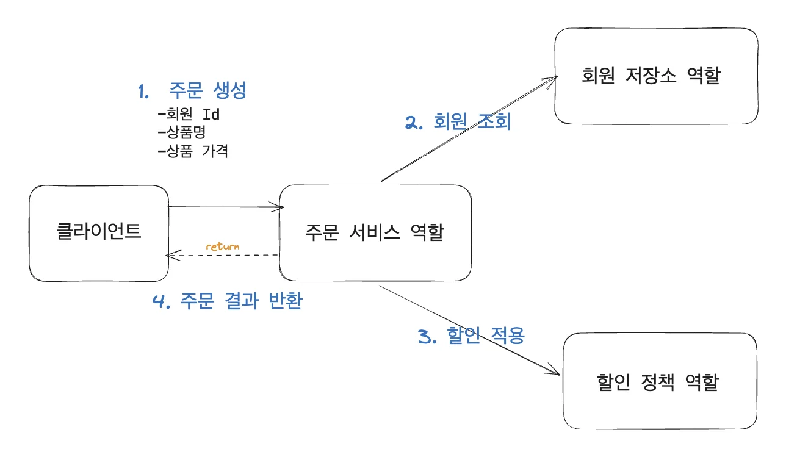
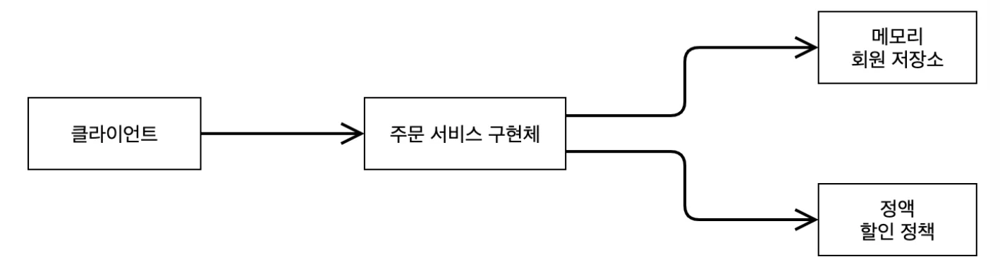

### 주문 할인 정책

> <strong>• 회원은 상품을 주문할 수 있다&#46; • 회원 등급에 따라 할인 정책을 적용할 수 있다&#46; • 모든 VIP는 1000원을 할인해주는 고정 금액 할인을 적용한다&#46; (추후 수정될 수 있음)</strong>

할인 정책은 변경 가능성이 높다&#46; → 기본 할인 정책이 아직 정해지지 못했고, 오픈 직전까지 고민을 미루고 싶다&#46; 최악의경우 할인을 적용하지 않을 수 있다&#46; (미확정)

## 주문 도메인 관계도

### 주문 도메인 역할

> /icons/report_gray.svg 실제로는 <strong>주문 데이터를 DB에 저장</strong>하지만, 예제가 너무 복잡해질 수 있어 <strong>생략</strong> → <u>단순 주문 결과만 반환</u>

> <strong>1&#46;</strong> <strong>주문 생성&#58;</strong> 클라이언트 → 주문 서비스에서 주문 생성 요청 <strong>2&#46; 회원 조회</strong>&#58; 할인을 위한 회원 등급 확인 필요함, 그래서 주문 서비스는 회원 저장소에서 회원을 조회 <strong>3&#46; 할인 적용</strong>&#58; 주문 서비스는 회원 등급에 따른 할인 여부를 할인 정책에 위임함 <strong>4&#46; 주문 결과 반환</strong>&#58; 주문 서비스는 할인 결과를 포함한 주문 결과 반환&#46;

### 주문 도메인 역할, 구현

> <strong>역할(인터페이스)과 구현 분리</strong> &#91;<code>다형성</code>&#93;

역할과 구현을 분리했기 때문에 자유롭게 구현 객체를 조립할 수 있게 설계

따라서, <strong><u>세부 정책 내용이 변경</u></strong><strong>되어도 </strong><strong><u>유연하게 변경  및 확장 </u></strong><strong>가능</strong>

## 주문 도메인 클래스 다이어그램

> 실제 객체  레벨 구현도

## 주문 도메인 객체 다이어 그램

실제 application을 띄워서, 동적으로 객체들이 생성(new)될때, 형성되는 객체들의 연관관계도

> <strong>저장소</strong>&#91; <code>메모리</code> → <code>DB</code> &#93;, <strong>할인정책</strong><strong>(</strong><strong><code>일정금액</code></strong><strong> → </strong><strong><code>%</code></strong><strong>) </strong>이 변경되어도<u> </u><strong><u>협력 관계 그대로 재사용 가능</u></strong>

### 1) 객체 다이어그램(메모리 구현체)

초기 개발 시, 아직 DB가 정해지지 않음

### 2) 객체 다이어그램(DB)

