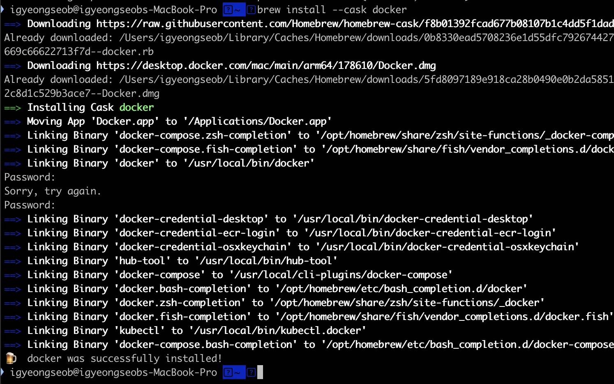

<a id="1c3eda9b0fe18167be44d3fb127d70c5"></a>

‣

<details>
<summary>Homebrew Docker 설치 &#45; 오류</summary>

1. Docker 설치
    <a id="1c3eda9b0fe1811f8d66eb6ebafe3a2f"></a>

    ```bash
    brew install --cask docker
    ```

    - <strong><code>—cask</code></strong>
        - <code>&#45;&#45;cask</code> 옵션을 통해  Docker Desktop on Mac을 설치할 수 있다

        - <code> docker&#45;compose</code>, <code>docker&#45;machine을</code> 같이 설치하여 추가 설정없이 간편하게 사용 가능하다&#46;

    

1. 설치(버전) 확인
    <a id="1c3eda9b0fe1818eb90fcfec388e63d1"></a>

    ```bash
    docker --version
    ```

    <a id="1c3eda9b0fe1817bac59fd8aa3cd5a42"></a>

    ```bash
    docker-compose --version
    ```

</details>

<a id="1c3eda9b0fe181b9b89ed9ee15a8e37a"></a>

<code>&#45;&#45;cask</code> 옵션을 통해  설치한 Docker Desktop 이 동작하지 않음

<a id="1c3eda9b0fe18151bc25c0cc94427ff4"></a>

따라서 삭제하고 공식문서에서 다운 받아서 설치 

<a id="1c3eda9b0fe181f5a941e52becca65b7"></a>

```bash
brew uninstall --cask docker
```

- Docker Desktop 설치 
    [&#91;Docker&#93; 맥 OS에 도커 설치하기(Install Docker on MacOS)]()
