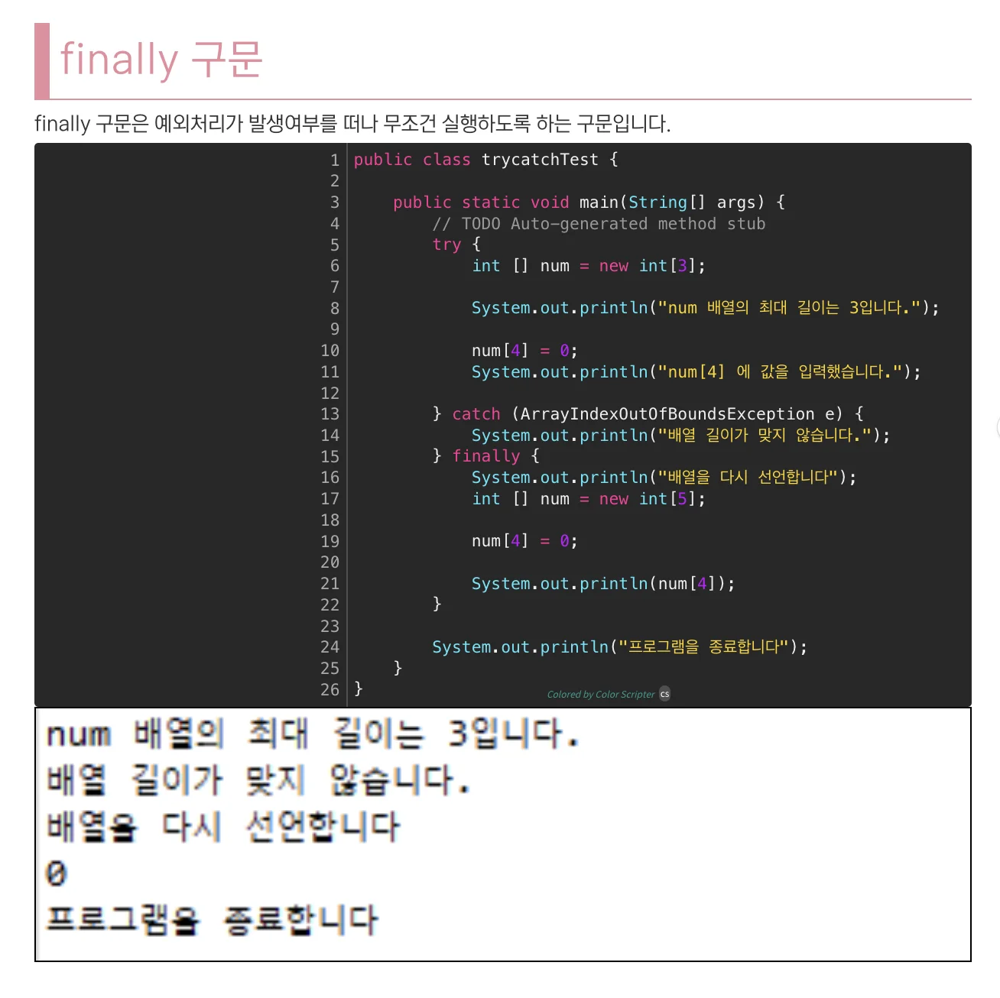
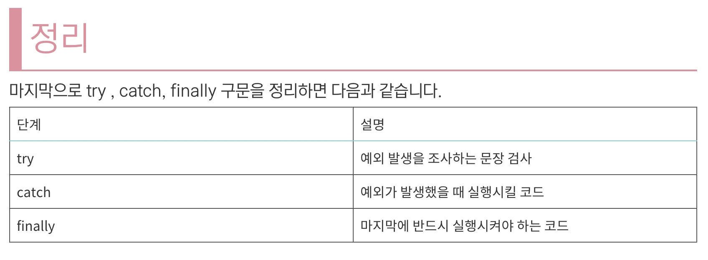
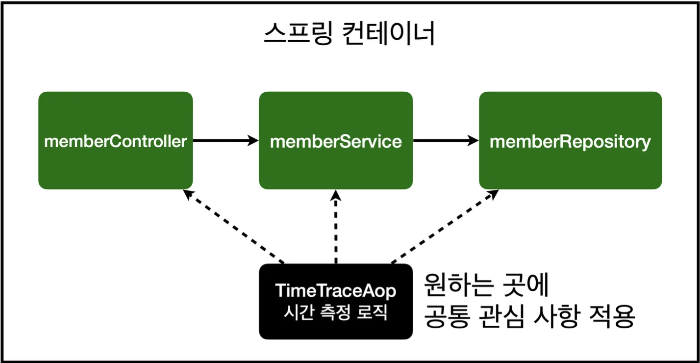

<details>
<summary>Reference)</summary>

<a id="1c3eda9b0fe18144ba00fd204a43e91b"></a>

<a href="https://www.inflearn.com/course/lecture?courseSlug=%EC%8A%A4%ED%94%84%EB%A7%81-%EC%9E%85%EB%AC%B8-%EC%8A%A4%ED%94%84%EB%A7%81%EB%B6%80%ED%8A%B8&#38;unitId=49600">https&#58;//www&#46;inflearn&#46;com/course/lecture?courseSlug=스프링&#45;입문&#45;스프링부트&#38;unitId=49600</a>

<a id="1c3eda9b0fe181079f3ed13ab536c01e"></a>

<a href="https://galid1.tistory.com/498">https&#58;//galid1&#46;tistory&#46;com/498</a>

</details>

> 24&#46;1&#46;16  &#45; 스프링 핵심(기본) 학습 후 추가 정리

<a id="1c3eda9b0fe1817d9ec0f0d6d30d5efb"></a>

# AOP 적용 전 시나리오 

<a id="1c3eda9b0fe1819c83fbddc826100b98"></a>

작성하 모든 메서드의 실행 시간을 측정하려고 한다

>  (회원가입, 회원 조회) 메서드들에서 각각 <code>try&#45;finally문</code>으로 시간을 측정(<code>System&#46;currentTimeMillis()</code>)하여 결과 값을 출력함&#46;

<a id="1c3eda9b0fe181dd9756d3bd447711c4"></a>

### 🧐 try &#45; finally 문

> reference&#58; <a href="https://mozi.tistory.com/550">https&#58;//mozi&#46;tistory&#46;com/550</a><br>→ 해당 블로그 내용 발췌





<a id="1c3eda9b0fe181d29deee5a0c60c5708"></a>

### MemebrService <strong>회원 조회 시간 측정 추가</strong>

<a id="1c3eda9b0fe181628779feca60225d3a"></a>

```java
package hello.hellospring.service;

import hello.hellospring.domain.Member;
import hello.hellospring.repository.MemberRepository;
import org.springframework.beans.factory.annotation.Autowired;
import org.springframework.transaction.annotation.Transactional;

import java.util.List;
import java.util.Optional;

@Transactional
public class MemberService {
    private final MemberRepository memberRepository;

    @Autowired
    public MemberService(MemberRepository memberRepository) {
        this.memberRepository = memberRepository;
    }

    /**
     * 회원가입
     */
    public Long join(Member member) {
        long start = System.currentTimeMillis();
        try {
            validateDuplicateMember(member); //중복 회원 검증 memberRepository.save(member);
            return member.getId();
        } finally {
            long finish = System.currentTimeMillis();
            long timeMs = finish - start;
            System.out.println("join " + timeMs + "ms");
        } 
		}

    private void validateDuplicateMember(Member member) {
        memberRepository.findByName(member.getName())
                .ifPresent(m-> {
                    throw new IllegalStateException("이미 존재하는 회원입니다.");
                });
    }

    /**
     * 전체 회원 조회
     */
    public List<Member> findMembers() {
        long start = System.currentTimeMillis();
        try {
            return memberRepository.findAll();
        } finally {
            long finish = System.currentTimeMillis();
            long timeMs = finish - start;
            System.out.println("findMembers " + timeMs + "ms");
        }
    }

    public Optional<Member> findOne(Long memberId) {
        return memberRepository.findById(memberId);
    }

}
```

<a id="1c3eda9b0fe181e68894ceaa4c3ed77b"></a>

# AOP <strong>적용</strong>

> AOP(Aspect Oriented Programming)<br>공통 관심 사항(cross&#45;cutting concern) , 핵심 관심 사항(core concern, 비지니스 로직)을 분리



<a id="1c3eda9b0fe181e4abd7d0fc3f72b743"></a>

### <code>&#64;Aspect</code>

<a id="1c3eda9b0fe181cbacd0f4702eeae13d"></a>

<strong>공통 관심 사항(cross&#45;cutting concern</strong>) Class임을 알려주는 Anotation(&#64;) 이다&#46;

<a id="1c3eda9b0fe181c78b35fe0a09e75d92"></a>

해당 Anotation은 컴포넌트 스캔(<code>&#64;Component</code>)을 포함하지 않기 때문에 따로 Bean 등록 처리를 해야한다&#46; (아래에서 다시 설명함 )

<a id="1c3eda9b0fe1812f81acd5f61074d201"></a>

### <strong><code>&#64;Around(&#34;Pointcut&#34;)</code></strong>

<a id="1c3eda9b0fe181ba8e43eba770399075"></a>

핵심 관심 사항(core concern, 비지니스 로직)의 실패여부와 상관없이 전후 실행되도록 하는 애노테이션이다&#46; (이전 finally 역할)

<a id="1c3eda9b0fe1817eab4cd34591b7e9ae"></a>

해당 Anotation은 속성값으로 <code>Pointcut</code>을 전달해주어야 한다&#46;  

<a id="1c3eda9b0fe18126824bf443a69cb8c8"></a>

```java
// ex) 
@Around("execution(* hello.hellospring..*(..))")
```

<a id="1c3eda9b0fe1819999ebd5444b03e7b9"></a>

### PointCut 표현식 (<code>&#64;Pointcut</code> )

<a id="1c3eda9b0fe181618aecce92c46c679e"></a>

&#64;Pointcut은 <strong><code>공통 관심 사항(cross&#45;cutting concern</code></strong><code>)</code>이 적용될 <code>JointPoint</code> 들을 정의한 것이다&#46; <br>ㄷ

<a id="1c3eda9b0fe1814793c2cb01260fca09"></a>

### <code>execution</code>(<code>접근제어자 반환형, 패키지를 포함한 클래스 경로, 메소드 파라미터</code>)

<details>
<summary>ex&#95;1) <code>public void get&#42;()</code></summary>

<a id="1c3eda9b0fe181f6943fd18d7f76d014"></a>

```java
@Pointcut("execution(public void get*())")
```

<a id="1c3eda9b0fe181b1ab00c798ad472d06"></a>

퍼블릭형의 반환형이 없는(<code>public void</code>) 형태의 메소드 중 get으로 시작하는(<code>get&#42;</code>) 모든 메소드중 파라미터가 존재하지 않는(<code>()</code>) 메소드들에게 적용

</details>

<details>
<summary>ex&#95;2) <code>&#42; &#42;(&#46;&#46;)</code></summary>

<a id="1c3eda9b0fe1815b99c9ea2eed959b8d"></a>

```java
@Pointcut("execution(* *(..))")
```

> • 첫번째 <code>&#42;</code>기호&#58; <code>접근제어자와 반환형</code> 모두를 상관하지 않고 적용<br>• 두번째 <code>&#42;</code>기호&#58;  어떠한 경로에 존재하는 클래스도 상관하지 않고 적용<br>• <code>(&#46;&#46;)</code> &#58; 메소드의 파라미터가 몇개가 존재하던지 상관없이 실행하는 경우 의미

</details>

<details>
<summary>ex&#95;3) <code>&#42; com&#46;java&#46;ex&#46;Car&#46;accelerate()</code></summary>

<a id="1c3eda9b0fe1818e9f42cd9ba6f8cb5a"></a>

```java
@Pointcut("execution(* com.java.ex.Car.accelerate())")
```

> • 첫번째 <code>&#42;</code>기호&#58; <code>접근제어자와 반환형</code> 모두를 상관하지 않고 적용<br>• <code>com&#46;java&#46;ex&#46;Car&#46;accelerate()&#58;</code> <strong>해당 Class의accelerate()</strong> (파라미터가 없는)메소드가 호출될 때 실행하는 경우를 의미

</details>

<details>
<summary>ex&#95;4)<code> &#42; com&#46;java&#46;&#46;&#42;&#46;&#42;()</code></summary>

<a id="1c3eda9b0fe181cbbd2de5c162d52ec3"></a>

```java
@Pointcut("execution(* com.java..*.*())")

```

> • <code>&#46;&#46;</code> &#58;  해당 패키지를 포함한 모든 하위패키지에 적용

<a id="1c3eda9b0fe1810d96a2cdb286ae7d4b"></a>

→ 접근제어자, 반환형을 상관하지 않고<code>com&#46;java</code>패키지를 포함한 모든 하위디렉토리의 모든 Class의 모든 파라미터가 존재하지 않는 메소드에 적용

</details>

<a id="1c3eda9b0fe181b8831ff05ac5d587ea"></a>

### <code>within(Class 경로)</code>

<a id="1c3eda9b0fe18132bcfbd084a6780455"></a>

패키지 내의 모든 메소드에 적용할 때 사용한다&#46;

<a id="1c3eda9b0fe181359ad3c08285a0b2bb"></a>

```java
@Pointcut("within(main.java.*)")
-> main.java 하위의 모든 클래스의 모든 메소드에 적용하겠다는 의미

@Pointcut("within(main.java.service)")
-> main.java.service 클래스안의 모든 메소드에 적용하겠다는 의미
```

<a id="1c3eda9b0fe181808a3cd6be653da1db"></a>

### Bean(bean id)

<a id="1c3eda9b0fe1814f8c05c53a96c696e7"></a>

### Annotation

<a id="1c3eda9b0fe181acaa12f7393769cbe9"></a>

사용자가 직접 만든 Annotation에 기반해 Aspect를 적용할 수도 있다&#46;

<a id="1c3eda9b0fe181e693bec09614c2e8b3"></a>

## <strong>시간 측정 AOP 등록</strong>

<a id="1c3eda9b0fe181138daedb57caf262ba"></a>

```java
package hello.hellospring.aop;

import org.aspectj.lang.ProceedingJoinPoint;
import org.aspectj.lang.annotation.Around;
import org.aspectj.lang.annotation.Aspect;

@Aspect
public class TimeTraceAop {
    @Around("execution(* hello.hellospring..*(..))")
    public Object excute(ProceedingJoinPoint joinPoint) throws Throwable {
        long start = System.currentTimeMillis();

        System.out.println("START: " + joinPoint.toString());

        try {
            return joinPoint.proceed();
        } finally {
            long finish = System.currentTimeMillis();
            long timeMs = finish - start;

            System.out.println("END: " + joinPoint.toString()+ " "+ timeMs + "ms");
        }
    }
}
```

<a id="1c3eda9b0fe181268769c6f696af2a25"></a>

## <strong>AOP</strong>&#45; Bean 등록

<a id="1c3eda9b0fe1814c8168f4f9e90801d9"></a>

### 1) 컴포넌트 스캔( <code>&#64;Compents</code> )

<a id="1c3eda9b0fe181908701e5eedcbd2f10"></a>

```java
@Component
@Aspect
public class TimeTraceAop {
    @Around("execution(* hello.hellospring..*(..))")
    public Object excute(ProceedingJoinPoint joinPoint) throws Throwable {
        long start = System.currentTimeMillis();

	     .   .   .
```

<a id="1c3eda9b0fe1813692edf98ce2819cef"></a>

### 2)  수동으로 Bean 등록 (권장)

> ’기술 지원 로직’ 에 속하는 AOP는 수동으로 등록하여 명확하게 알 수 있게 처리<br>→ 자세한 내용은 아래 링크 참조 <a href="#/post/1c3eda9b-0fe1-81f3-9602-d4a33831b901">페이지</a> 

<a id="1c3eda9b0fe1817db814d6b876a0bce8"></a>

수동으로 직접 confing 파일에 빈으로 등록함

<a id="1c3eda9b0fe181ceb85cce616a5e1fb3"></a>

```java
@Configuration
public class SpringConfig {

		 .   .   .

		@Bean
    public TimeTraceAop timeTraceAop(){
        return new TimeTraceAop();
    }
}
```
