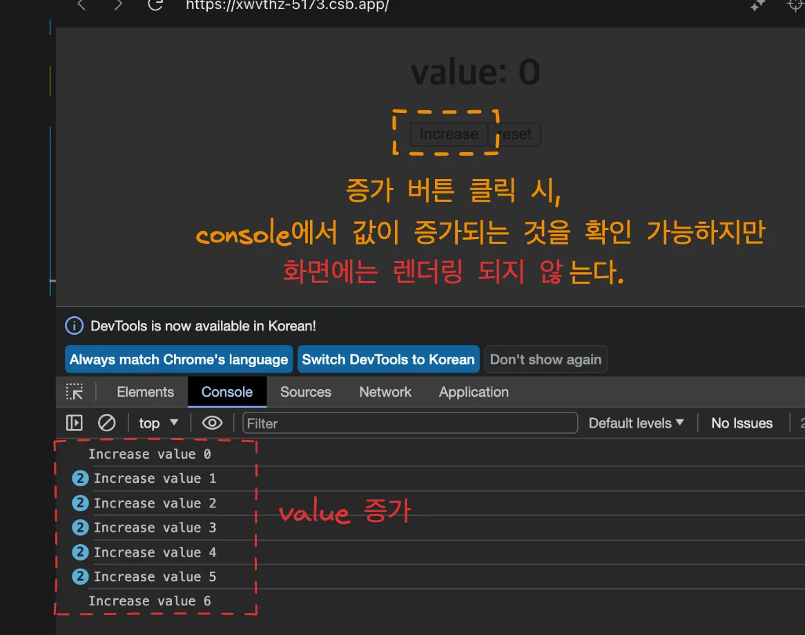
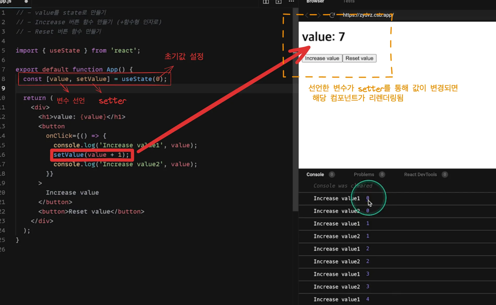

<a id="1c3eda9b0fe181239b12c701a3a30db8"></a>

## State

---

> 📖 
> 
> <a id="1c3eda9b0fe181148b47d1e3eb5045dd"></a>
> 
> <u>컴포넌트 내부</u>에서 사용되는 변수
> 
> - state 값이 변하면 <u>컴포넌트가 </u><strong><u>리렌더링</u></strong><strong> 되며,</strong><u>렌더링 사이클에서 값이 보존</u>된다&#46;
> 
> - useState&#58; <code>const &#91; 변수 , set변수 &#93; = useState(초기값)</code>

<details>
<summary>리액트 훅&#58; <code>useState</code> &#45; <strong>state</strong>, <strong>setState</strong></summary>


</details>

<details>
<summary>코드 실습</summary>

<details>
<summary>🤬 오류 &#45; console 상으로 값이 변경되는 것은 확인 가능하나, 실제 화면에 렌더링 되지 않음</summary>

<details>
<summary>&#91; 코드 &#93; App&#46;js</summary>

<a id="1c3eda9b0fe18112942df0a037fb3d0b"></a>

```javascript
import "./styles.css";
export default function App() {
  let value = 0;
  return (
    <div className="App">
      <h1>value: {value}</h1>
      <button
        onClick={() => {
          console.log("Increase value", value);
          value = value + 1;
          console.log("Increase value", value);
        }}
      >
        Increase
      </button>
      <button>reset</button>
    </div>
  );
}

```

</details>

---



- 위와 같이 증가 버튼 클릭 시, onClick Event를 통해 컴포넌트 내부 변수인 value값이 증가되는 것을 console에서 확인 할 수 있지만, <strong>실제 화면에는 렌더링되지 않</strong>는다&#46;

</details>

<details>
<summary>😁 해결 &#45; 리액트 훅&#58; <strong><code>useState</code></strong></summary>

<details>
<summary>&#91; 코드 &#93; App&#46;js</summary>

<a id="1c3eda9b0fe181b4b704e96e07550ab7"></a>

```javascript
import { useState } from "react";

export default function App() {
  const [value, setValue] = useState(0);
  return (
    <div className="App">
      <h1>value: {value}</h1>
      <button
        onClick={() => {
          console.log("Increase value", value);
          setValue(value + 1);
          console.log("Increase value", value);
        }}
      >
        Increase
      </button>
      <button
        onClick={() => {
          setValue(0);
        }}
      >
        reset
      </button>
    </div>
  );
}
```

</details>

---

<a id="1c3eda9b0fe18144aeaaea60b1e7f615"></a>

```javascript
const [ 변수 , set변수 ] = useState(초기값)
```



</details>

</details>
