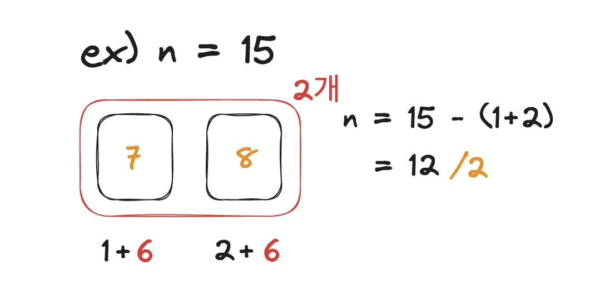

<a id="1c3eda9b0fe181aabf7fcddc26b76839"></a>

# 풀이

<a id="1c3eda9b0fe18107a6c6d82c699c786b"></a>

### 풀이1)



<a id="1c3eda9b0fe18172bd78d3d0b6080c81"></a>

위 와 같이 1, 2, 3 값과 개수를 확장해 가면서 해당 값을 뺀 n 값을 개수로 나누어 0이 나오는 경우 위와 같이 연속된 수의 합이 된다&#46; 

<a id="1c3eda9b0fe18133bc4fe3e74a336e62"></a>

```java
import java.util.*;
public class Main {
    public int solution(int n) {
        int answer=0, cnt=1;
        n--;
        while(n>0){
            cnt++;
            n=n-cnt;
            if(n%cnt==0) answer++;
        }
        return answer;
    }

    public static void main (String[] args){
        Main T = new Main();
        Scanner sc = new Scanner(System.in);
        int n = sc.nextInt();
        System.out.print(T.solution(n));
    }
}
```
