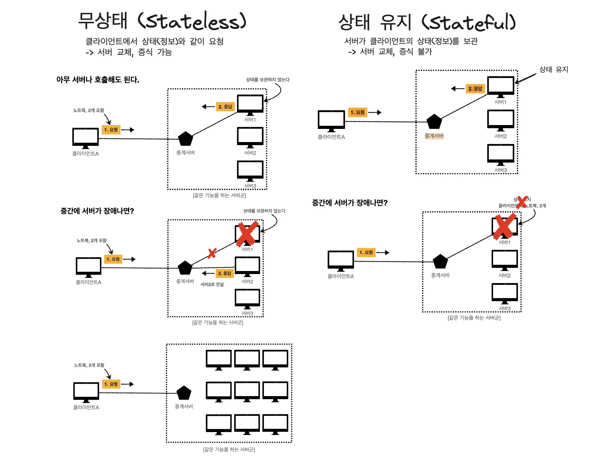
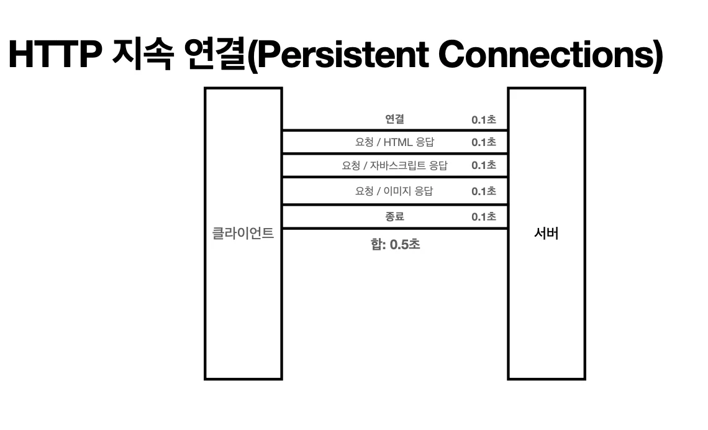
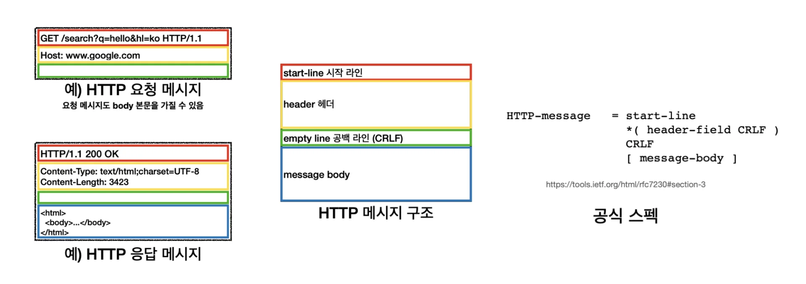
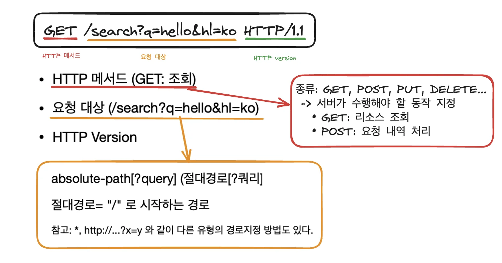
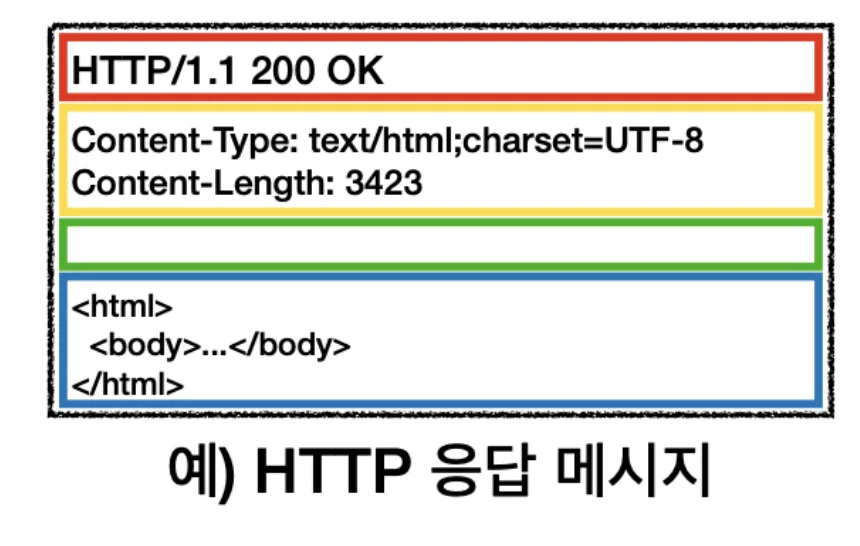

# HTTP ( Hyper Text Transfer Protocol)

> HTML, Text, Image, 음성, 영상 , 파일, JSON, XML (API) 등  거의 모든 바이너리(0, 1)  형태의 데이터 전송 가능

> 서버간 데이터를 주고 받을 때, 대부분 HTTP 사용

### HTTP 역사

- HTTP/0&#46;9 1991년&#58; GET 메서드 지원, HTTP 헤더 X

- HTTP/1&#46;0 1996년&#58; 메서드, 헤더 추가

- <strong>HTTP/1&#46;1 1997년&#58; 가장 많이 사용 (중요)</strong>
    - RFC2068 (1997) → RFC2616 (1999) → RFC7230 &#126; RFC7235 (2014)

- HTTP/2 2015&#58; 성능 개선

- HTTP/3 진행중&#58; TCP 대신에 UDP를 사용하여 성능 개선

### 기반 프로토콜

- TCP&#58; HTTP/1&#46;1, HTTP/2

- UDP&#58; HTTP/3

현재는 <u><code>HTTP/1&#46;1</code></u><u>을 주로 사용</u>하며, HTTP/2, HTTP/3 도 점점 증가하는 추세임

### HTTP 특징

- 클라이언트 서버 구조

- 무상태 프로토콜(Stateless), 비연결성

- HTTP 메세지

- 단순하며 확장 가능함

# Stateless(무상태)

### 무상태(stateless) 프로토콜

> 서버 &#45; 클라이언트 상태 보존X → 서버 확장성 높으나, 추가 데이터(상태) 전송이 필요하다는 단점이 있음 

### ● Stateless, Stateful 비교

### 서버 설계  시 어떻게서든지 <code>Stateless</code> 하게 설계해야한다&#46;

> 서비스의 이벤트로 인해<strong><u> </u></strong><strong><u><code>같은 시간</code></u></strong><strong><u>에 순간적으로 증가되는 </u></strong><strong><u><code>대용량 트래픽</code></u></strong><strong><u>을  받</u></strong>아야하는 경우, Stateless 하게 설계한 경우 <strong><code>서버 확장</code></strong>을 통해 해결 가능하다&#46; 

→ 정확히 같은 시간에 맞춰 발생되는 대용량 트래픽

ex) 선착순 이벤트, 명절 KTX 예약,  학과 수업 등록 등

ex) 저녁 6&#58;00 선착순 1000명 치킨 할인 이벤트 → 수만명 동시 요청

# 비연결성 ( Connectionless )

> • HTTP는 기본 연결을 유지 하지 않는 비연결성 가지는 모델이다&#46;  ( 일반적으로 초 단위 이하의 빠른 속도로 응답함) • 1시간 동안 수천명이 서비스를 사용해도, 실제 서버에서 동시에 처리하는 요청은 수십개 이하로 매우 작음      ex) 웹 브라우저에서 계속 연속해서 검색 버튼을 누르지 않음   • 서버의 자원을 매우 효율적으로 사용할 수 있음

## 비연결성의 한계 

- TCP/IP 연결을 새로 맺어야 함&#46; → <code>3 Way handshake</code>  시간 소요

- 다시 웹 브라우저 접속 시  → HTML &#43; CSS, JS, 추가 이미지 등 수 많은 자원 다시 다운로드 → 비용이 너무 큼

## 해결) HTTP 지속 연결 ( Persistent Connections )  

> <code>HTTP 지속 연결(Persistent Connections)</code>로 동작 방식을 변경하여 이전 비연결성 문제 해결  →  HTTP/2 &#46;&#46;/3 더 많이 최적화됨 

- 하나의 요청에 필요한 요청들이 모두 응답될 때까지 연결을 유지한다&#46; 

- 연결을 한번만 맺고 끊기 때문에, Connectionless 방식보다 TCP/IP 연결 횟수가 적다&#46;
    

    따라서 그만큼 빠른 통신이 가능하다&#46; 

# HTTP 메세지 

HTTP 메세지에 모든 자원들을 전송한다&#46; (서버간에 데이터를 주고 받을 떄도 사용)

## 요청 메세지

### Start&#45;line (시작 라인)

## 응답 메세지

### Start&#45;line (시작 라인)

### Header

### message body

