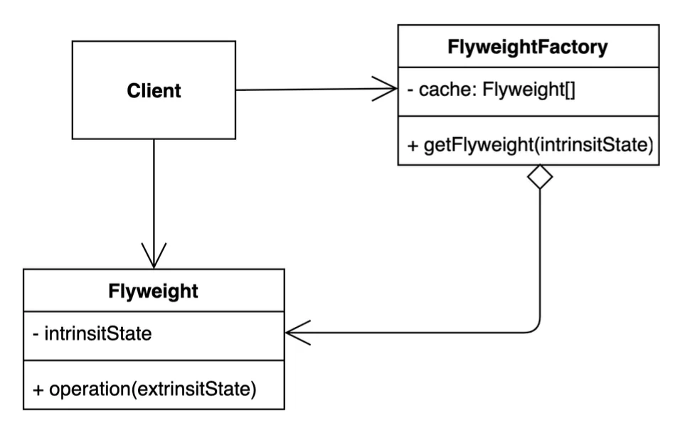
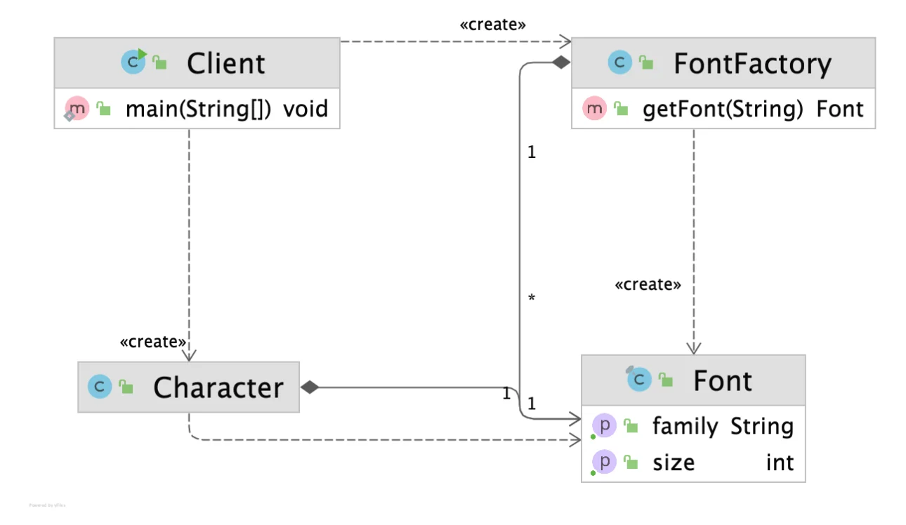

> 📝 
> 
> <a id="1d3eda9b0fe18088988fed32d354a7a4"></a>
> 
> <strong>질문</strong>
> 
> <details>
> <summary>플라이웨이트 패턴이란?</summary>
> 
> 
> 
> </details>
> 
> <details>
> <summary>플라이웨이트 패턴의 장단점은?</summary>
> 
> 
> 
> </details>
> 
> <details>
> <summary>실무에서 어떻게 사용되는가?</summary>
> 
> 
> 
> </details>

<a id="1d3eda9b0fe1800ba317eed501edaba6"></a>

## 플라이웨이트 패턴

---

> 📖 
> 
> <a id="1d3eda9b0fe180628785ef6a6c4a32a7"></a>
> 
> <strong>플라이웨이트 패턴</strong>
> 
> ---
> 
> 
> 
> > 객체를 가볍게 만들어 메모리 사용을 줄이는 패턴
> 
> -  <strong><u>메모리 사용을 최소화</u></strong><strong>하기 위해 </strong><strong><u>동일한 객체를 공유</u></strong>해서 사용한다&#46;
>     - 많은 수의 객체가 필요할 때, <strong><u>공통된 상태는 공유(재사용)</u></strong>하고 <strong><u>변하는 상태만 분리</u></strong>해서 <strong>객체 수를 줄</strong>이는 방식으로 설계한다&#46;
> 
>     <details>
>     <summary><strong><code>자주 변하는 속성(외적인 속성, extrinsit)</code></strong>과 <strong><code>변하지 않는 속성(내적인 속성, intrinsit)</code></strong>을 분리하고 재사용한다&#46;</summary>
> 
>     - <strong><code>변하지 않는 속성(내적인 속성, intrinsit)</code></strong>
>         - <u>객체 내부에 저장</u>되며 <strong><u>여러 객체 간에 공유</u></strong>될 수 있는 <strong>불편 데이터</strong>를 말한다&#46;
> 
>     - <strong><code>자주 변하는 속성(외적인 속성, extrinsit)</code></strong>
>         - <u>객체 외부에서 설정</u>되며 <strong><u>특정 컨텍스트에서만 사용</u></strong>되는 데이터를 말한다&#46;
> 
>     <a id="1d3eda9b0fe18089847bdd36fad0decf"></a>
> 
>     이러한 분리를 통해 동일한 <strong><u>내재적 속성을 가진 객체를 재사용함</u></strong>으로써 메모리 소비를 줄이고 성능을 개선한다&#46;
> 
>     </details>

<a id="1d3eda9b0fe18004930de0aafce8e01b"></a>

### 1&#46; 기본 예제

<a id="1d3eda9b0fe18077884de40411465855"></a>

### 코드

<details>
<summary>&#91; 코드 &#93; Character</summary>

<a id="1d3eda9b0fe1802aaf72e7fec081dab2"></a>

```java
package _02_structural_patterns._11_flyweight._01_before;

public class Character {

    private char value;
    private String color;
    private String fontFamily;
    private int fontSize;

    public Character(char value, String color, String fontFamily, int fontSize) {
        this.value = value;
        this.color = color;
        this.fontFamily = fontFamily;
        this.fontSize = fontSize;
    }
}
```

</details>

<details>
<summary>&#91; 코드 &#93; Cilent</summary>

<a id="1d3eda9b0fe180698277ca5805160f24"></a>

```java
package _02_structural_patterns._11_flyweight._01_before;

public class Cilent {

    public static void main(String[] args) {

        Character c1 = new Character('h', "white", "Nanum", 12);
        Character c2 = new Character('e', "white", "Nanum", 12);
        Character c3 = new Character('l', "white", "Nanum", 12);
        Character c4 = new Character('l', "white", "Nanum", 12);
        Character c5 = new Character('o', "white", "Nanum", 12);
    }
}

```

</details>

<a id="1d3eda9b0fe1804bad58ff12295fdbce"></a>

### 2&#46; 패턴 적용

<a id="1d3eda9b0fe180069cbfe51e33eda291"></a>

### 코드



<details>
<summary>&#91; 코드 &#93; Font</summary>

<a id="1d3eda9b0fe180de9261f70e1e8e40c1"></a>

```java
package _02_structural_patterns._11_flyweight._02_after;

public final class Font {

    final String family;
    final int size;

    public Font(String family, int size) {
        this.family = family;
        this.size = size;
    }
}
```

</details>

<details>
<summary>&#91; 코드 &#93; FontFactory</summary>

<a id="1d3eda9b0fe1803a851be5986cbd2bfb"></a>

```java
package _02_structural_patterns._11_flyweight._02_after;

import java.util.HashMap;
import java.util.Map;

public class FontFactory {

    private Map<String, Font> cache = new HashMap<>();

    public Font getFont(String font) {
        if (cache.containsKey(font)) {
            return cache.get(font);
        } else {
            String[] split = font.split(":");
            Font newFont = new Font(split[0], Integer.parseInt(split[1]));
            cache.put(font, newFont);
            return newFont;
        }
    }
}

```

</details>

<details>
<summary>&#91; 코드 &#93; Character</summary>

<a id="1d3eda9b0fe180d4bc6dcf2b79b6b044"></a>

```java
package _02_structural_patterns._11_flyweight._02_after;

import lombok.Getter;

/** 불변 객체 -> record  ( java 14 )
 public record Character(char value, String color, Font font) {
 }
 */

@Getter
public class Character {

    private final char value;
    private final String color;
    private final Font font;

    public Character(char value, String color, Font font) {
        this.value = value;
        this.color = color;
        this.font = font;
    }
}

```

</details>

<details>
<summary>&#91; 코드 &#93; Client</summary>

<a id="1d3eda9b0fe180a69e62ef17f41b9b16"></a>

```java
package _02_structural_patterns._11_flyweight._02_after;

public class Client {

    public static void main(String[] args) {
        FontFactory fontFactory = new FontFactory();
        Character c1 = new Character('h', "white", fontFactory.getFont("nanum:12"));
        Character c2 = new Character('e', "white", fontFactory.getFont("nanum:12"));
        Character c3 = new Character('l', "white", fontFactory.getFont("nanum:12"));
        Character c4 = new Character('l', "white", fontFactory.getFont("nanum:12"));
        Character c5 = new Character('0', "white", fontFactory.getFont("nanum:12"));
    }
}
```

</details>

<a id="1d3eda9b0fe180b18c0dd1374a3a59c3"></a>

### Notes

<details>
<summary><strong><code>intrinsit</code></strong><strong> 객체 캐싱을 통해 재사용하여 메모리 최적화</strong></summary>

<a id="1d3eda9b0fe180d9ab16da66db79f8c6"></a>

```java
public class FontFactory {

    private Map<String, Font> cache = new HashMap<>();

    public Font getFont(String font) {
        if (cache.containsKey(font)) {
            return cache.get(font);
        } else {
            String[] split = font.split(":");
            Font newFont = new Font(split[0], Integer.parseInt(split[1]));
            cache.put(font, newFont);
            return newFont;
        }
    }
```

- 변하지 않는 속성을 가진 객체들을 map을 통해 캐싱 처리하여 생성된 인스턴스를 재사용하므로써 메모리 사용을 최적화한다&#46;

</details>

<a id="1d3eda9b0fe180aa8e7fd7fd80c3fbcd"></a>

### 3&#46; 장•단점

- 장점
    - 애플리케이션에서 사용하는 메모리를 줄일 수 있다&#46;

- 단점
    - 코드의 복잡도가 증가한다&#46;

<a id="1d3eda9b0fe180ac946cd36ec7097c53"></a>

### 4&#46; 실무 활용

> ✏️ 
> 
> > 자바
> 
> - <strong><code>Integer&#46;valueOf(int)</code></strong>
>     - 캐시 제공
> 
>     - ‣

<a id="1d3eda9b0fe180e58e47ec417d9dc45f"></a>

### 코드

<details>
<summary>&#91; 코드 &#93; FlyweightInJava</summary>

<a id="1d3eda9b0fe180868e35e95ae50609d7"></a>

```java
package _02_structural_patterns._11_flyweight._03_java;

public class FlyweightInJava {

    public static void main(String[] args) {
        Integer i1 = Integer.valueOf(10);
        Integer i2 = Integer.valueOf(10);
        System.out.println(i1 == i2);
    }
}

```

</details>
