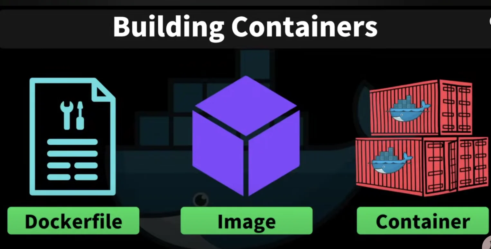
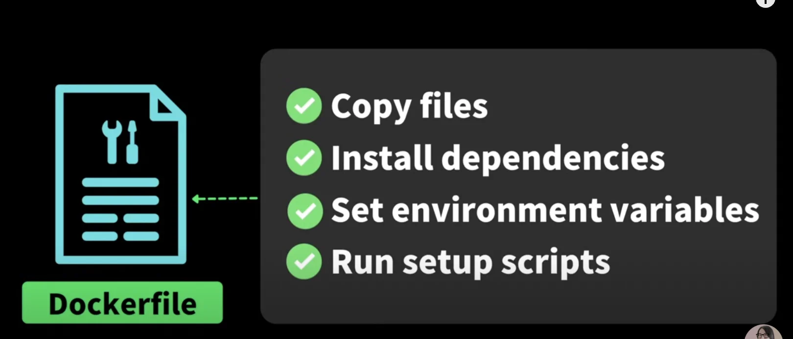
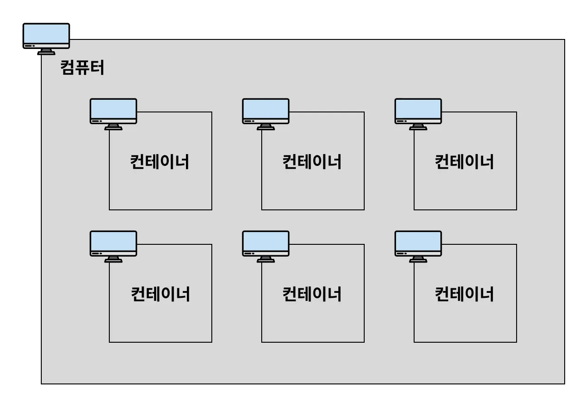

<a id="1c3eda9b0fe181b08d89fbfc0fffea92"></a>

## Docker 기본 개념

---

> 📖 
> 
> 
> 
> <a id="1c3eda9b0fe181359602dae43f8235de"></a>
> 
> <strong><u>컨테이너</u></strong>를 사용하여 <u>각각의 프로그램</u>을 <strong><u>분리된 환경</u></strong>에서 <u>실행 및 관리</u>할 수 있는 툴이다&#46;

<details>
<summary><code>VM</code> vs <code>Container</code></summary>


- VM 
    - 각각의 <strong><u>독립적인 운영체제를 사용</u></strong>하기 때문에, 굉장히 무겁다&#46;

- Container
    - 컨테이너 엔진 host OS에 접근해서 처리해준다&#46;

    - 컨테이너 엔진 중 가장 많이 사용하는 것이 Docker이다&#46; 

</details>

<details>
<summary>도커 사용 이유</summary>

> <code>이식성</code>&#58; 특정 프로그램을 다른 곳으로 쉽게 옮겨서 설치 및 실행할 수 있는 특성

- 매번 귀찮은 <strong><u>설치 과정</u></strong>을 일일이<u> 거치지  않</u>아도 된다&#46; 

- 항상 <strong>일관</strong>되게<u> 프로그램을 설치할 수 있</u>다&#46; ( 버전, 환경 설정, 옵션, 운영체제 등 )

- <strong><u>각 프로그램이 독립적인 환경에서 실행</u></strong>되기 때문에 프로그램 간에 서로 충돌이 일어나지 않는다&#46; 

</details>

<details>
<summary>Dockerfile</summary>



</details>

<details>
<summary>컨테이너 ( Container )</summary>



<a id="1c3eda9b0fe1814983e8ef8d08438901"></a>

<u>하나의 컴퓨터 환경 내</u>에서 <strong><u>독립적인 컴퓨터 환경을 구성</u></strong>해서, <strong><u>각 환경애 프로그램을 별도로 설치</u></strong> 가능 하도록 하는개념이다&#46; 

<a id="1c3eda9b0fe1814bb656f4954fcf7e41"></a>

하나의 컴퓨터 환경 내에서 여러개의 미니 컴퓨터 환경을 구성할 수 있는 형태이다&#46; 

<a id="1c3eda9b0fe1818db52df446fa6ea38f"></a>

이러한 <strong><u>미니 컴퓨터</u></strong>를 <code>Docker</code>에서 <strong><u>컨테이너(Container)</u></strong>라고 부른다&#46; 

</details>

<details>
<summary>컨테이너의 독립성</summary>

<a id="1c3eda9b0fe181238cabdd4d81b0d0be"></a>

위의 설명에서 컨테이너가 ‘독립적인 컴퓨터 환경’이라 설명했는데, 어떤 부분이 독립적으로 관리되는지는 아래와 같다&#46; 

- 디스크(저장 공간)
    - 각 컨테이너마다 서로 각자의 저장 공간을 가지고 있다&#46; 

    - 일반적으로 A 컨테이너 내부에서 B 컨테이너 내부에 있는 파일에 접근할 수 없다&#46; 

- 네트워크(IP, Port) 
    - 각 컨테이너마다 고유의 네트워크를 가지고 있다&#46; 

    - 컨테이너는 각자의 IP주소가 있다&#46;

</details>

<details>
<summary>이미지</summary>

> ✏️ 
> 
> <a id="1c3eda9b0fe18191a49ccfe5140287a7"></a>
> 
> <code>이미지(Image)</code>는 프로그램을 실행하는데 필요한 <u>설치 과정, 설정, 버전 정보 등을 포함</u>하고 있다&#46; 그리고 이를 통해  Docker에서 이미지로 정의한 프로그램을 <u>Container 환경에서 손쉽게 실행 </u>시킬 수 있다&#46;

<a id="1c3eda9b0fe1815f908bfdf9875e1ff0"></a>

닌텐도와 같은 게임기에서 여러가지 칩을 꽃아서 다양한 게임을 할 수 있다&#46; Dokcer 또한 이와 유사하다&#46; 

<a id="1c3eda9b0fe1813cba94cce9aad963b5"></a>

 <code>Docker</code>에서는 <code>Image</code>를 통해 <strong><u>특정 프로그램을 도커 환경(Container)에서 실행</u></strong> 시킬 수 있다&#46; 

- 닌텐도 &#45; 게임 칩 = Docker &#45; Image
    

- ex 1) Node&#46;js 기반의 Express&#46;js 서버 프로젝트 이미지
    <a id="1c3eda9b0fe1818ca0a3e7744ae3b386"></a>

    해당 이미지를 Docker로 실행시키면, Express&#46;js 서버 프로젝트가 컨테이너(Container) 환경에서 복잡한 설치 과정없이 손쉽게 실행된다&#46; 

- ex 2) MySQL 서버 이미지
    <a id="1c3eda9b0fe181a68a58ecc65071a07d"></a>

    해당 이미지를 Docker로 실행시키면 해당 버전의 MySQL 서버가 컨테이너(Container) 환경에서 실행된다&#46; 

    <a id="1c3eda9b0fe18133ade1c6f9ac413b40"></a>

    일일이 MySQL을 설치할 필요없이 MySQL 데이터베이스를 사용할 수 있다&#46; 

</details>

<details>
<summary>IP, Port</summary>


</details>

<details>
<summary>도커 설치 &#45; Mac OS</summary>

<details>
<summary>homebrew 사용한 설치</summary>

- homebrew 설치
    [Homebrew]()

- 도커 설치
    <a id="1c3eda9b0fe1819e8576e057f72ee65b"></a>

    ```bash
    ㅇbrew intall docker
    ```

- 도커 설치 확인
    <a id="1c3eda9b0fe18120b6d5e32361418bb1"></a>

    ```bash
    docker --version
    ```

<a id="1c3eda9b0fe181f5b59ecc7a36ab4cc5"></a>

<br>

</details>

</details>

<details>
<summary>실습) Nginx 실행</summary>

<details>
<summary>🧐 Nginx 란?</summary>

- 웹 서버 ( HTML 웹 페이지를 렌더링 시키는 역할 )

- 로드 밸런싱

- 리버스 프록시 

</details>


<details>
<summary>1&#46; docker 이미지(nginx) 다운</summary>

<a id="1c3eda9b0fe18192a74fe37df85244a8"></a>

```docker
docker pull nginx
```

</details>

<details>
<summary>2&#46; docker 이미지 리스트 확인</summary>

<a id="1c3eda9b0fe18129ae19f6856fcaf7ad"></a>

```docker
docker image ls
```

</details>

<details>
<summary>3&#46; docker 이미지 실행(run) → 컨네이너 실행</summary>

<a id="1c3eda9b0fe181fead64e407ff38f950"></a>

```docker
docker run --name webserver -d -p 80:80 nginx
```

<details>
<summary>localhost&#58;80 접속 &#45; 실행 화면 확인</summary>


</details>

</details>

<details>
<summary>4&#46; docker 실행 중 인 컨테이너  확인</summary>

<a id="1c3eda9b0fe1817d91e1d0b5e327307c"></a>

```docker
docker ps 
```

</details>

<details>
<summary>5&#46; docker 컨테이너 멈춤(Stop)</summary>

<a id="1c3eda9b0fe1813ea4fed4d7c1c897f1"></a>

```docker
docker stop [컨테이너 ID (or 컨테이너명)]
```

</details>

</details>
