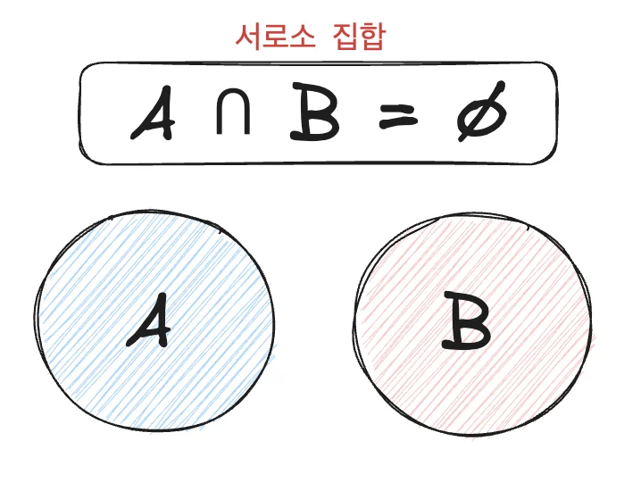
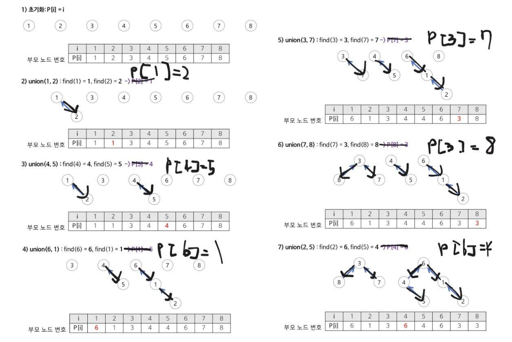

[연결리스트](#/post/1c3eda9b-0fe1-81eb-9a12-c4b875ec73dc)

[레드 블랙 트리](#/post/1c3eda9b-0fe1-816c-89f2-edb9db0a3681)

[ConcurrentHashMap](#/post/1c3eda9b-0fe1-8109-8295-e3acf7a4c2a8)

[제목 없음](#/post/1d0eda9b-0fe1-808c-99e1-ca02395a0c8b)

## <a href="https://gmlwjd9405.github.io/2018/08/31/algorithm-union-find.html">Union &#45; Find 알고리즘</a> 

🧐 <strong>Disjoint(서로소) Set ?</strong>

<strong>서로 중복되지 않는 부분 집합들(서로소)</strong>로 이루어진 데이터들의 자료구조

<code>Disjoint Set</code>을 표현할 때 사용하는 알고리즘

구현에 <u>비트벡트, 배열, 연결리스트, 트리</u> 등이 있으며

그 중 가장 효율적인 연산 처리는  <code>트리</code>를 이용한 구현이다&#46;

🧐 

