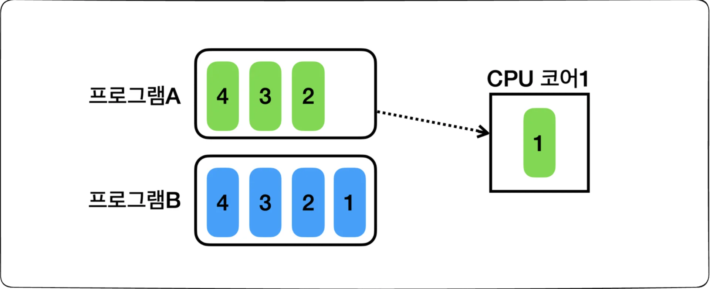
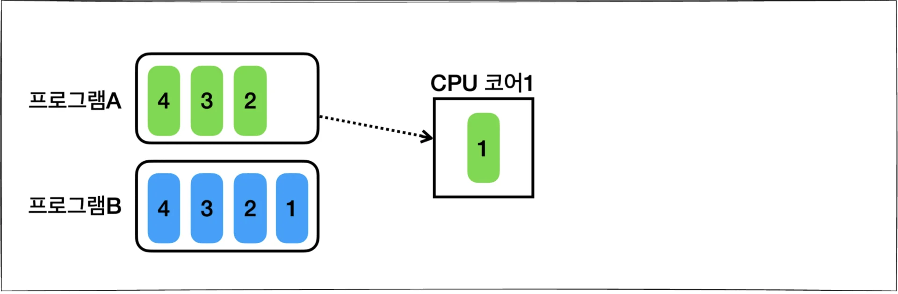
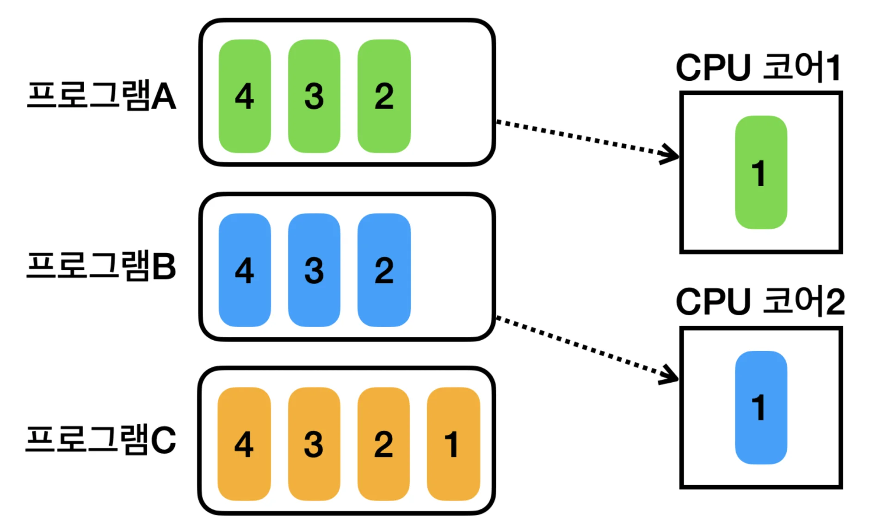
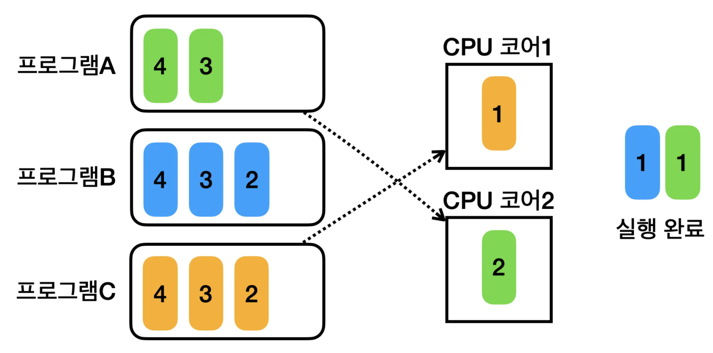
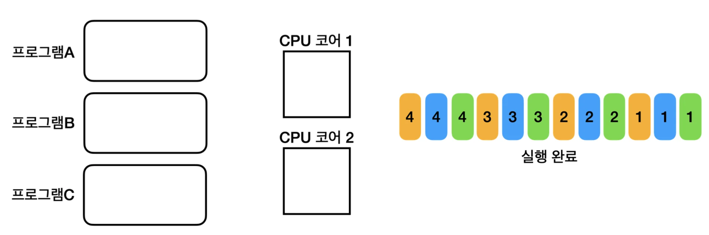

> ☝🏻 
> 
> 
> 
> 멀티스레드에 대해 제대로 이해하려면 먼저 멀티태스킹과 프로세스 같은 운영체제의 기본 개념들에 대해서 알아야한다&#46; 
> 
> 
> 
> 해당 챕터는 멀티스레드를 이해하기 위한 목적으로 최대한 단순하게 핵심 내용만 알아본다&#46; 

## 멀티태스킹

---

### 단일 프로그램 실행

---

만약 <strong><u>프로그램을 2개 이상 동시에 실행</u></strong> 되며, 연산을 처리할 수 있는 <strong><u>CPU 코어가 1개</u></strong>만 있다면 

코어가 Task(코드)를 처리하는 방식은 위 그림과 같을 것이다&#46; 

> ✏️ 
> 
> 
> 
> 프로그램의 실행이란 프로그램으 구성하는 코드를 순서대로 CPU에서 연산(실행)하는 것이다&#46; 
> 
> 
> 
> CPU 코어를 하나로 가정하므로 한 번에 하나의 프로그램 코드만 실행 가능하다&#46; 

<code>프로그램 A</code> 안에 있는 <strong><u>모든 Task(코드)를  실행</u></strong>한 후에만, <code>프로그램 B</code>의 <strong><u>Task(코드)를 실행</u></strong>할 수 있다&#46; 

- 실제 초창기의 컴퓨터는 이처럼 한 번에 하나의 프로그램만 실행했다&#46; 

예를 들어, 음악 프로그램이 끝난 뒤에, 워드 프로그램을 실행할 수 있다면 컴퓨터 사용자는 매우 답답할 것이다 &#46;

이를 해결하기 위해 <strong><u>하나의 CPU 코어</u></strong>로 <strong><u>여러 프로그램을 동시에 실행</u></strong>하는 <strong><code>멀티태스킹</code></strong> 기술이 등장했다&#46; 

### 멀티태스킹

---

> ✏️ 
> 
> 
> 
> 순서대로 촬영한 연속된 사진을 빠르게 교차해서 보여줄 경우, 사람은 이를 움직이는 영상으로 인지한다&#46; 
> 
> - 애니메이션이 바로 이 원리를 이용한다&#46;  예를 들어, 우리가 애니메이션을 볼 때 <code>1초</code>에 <strong><u>30 &#126; 60장의 사진</u></strong>이 지나간다&#46; 이를 사람은 사진이 아닌,<strong> </strong><strong><u>연속해서 움직이는 영상으로 인지</u></strong>한다&#46; 
> 
> 
> 
>  현대의 CPU는 초당 수십억 번 이상의 연산을 수행한다&#46; 
> 
> - 쉽게 이야기하면 초당 수십억 장의 사진이 빠르게 교차되는 것이다&#46; 
> 
> 
> 
>  만약 CPU가 매우 빠르게 두 프로그램의 코드를 번갈아 수행한다면, 사람이 느낄 때 두 프로그램이 동시에 실행되는 것 처럼 느껴질 것이다&#46; 
> 
> - 대략 0&#46;01초(10ms) 단위로 돌아가며 실행한다&#46; 

해당 방식은 CPU 코어가 프로그램 A의 코드를 0&#46;01초 정도 수행하다가 잠시 멈추고, 프로그램 B의 코드를 0&#46;01초 정도 수행한다&#46;

그리고 다시 프로그램 A의 이전에 실행 중인 코드로 돌아가서 0&#46;01초 정도 코드를 수행하며 이를 반복한다&#46; 

- 컨텍스트 스위칭 비용 발생 

이렇게 각 <strong><u>프로그램의 실행 시간을 분할</u></strong>해서 마치 <u>동시에 실행</u><u>되는 것 처럼 보이는 것</u>을 <strong><u>시분할(Time Sharing, 시간 공유) 기법</u></strong> 이라 한다&#46; 

이를 통해 하나의 CPU 코어만으로 여러 프로그램이 동시에 실행되는 것 처럼 느낄 수 있다&#46; 

이렇게 <strong><u>하나의 컴퓨터 시스템</u></strong>이 <strong><u>동시에 여러 작업을 수행</u></strong>하는 능력을 <strong><code>멀티태스킹(Mulitasking)</code></strong>이라 한다&#46; 

> ☝🏻 
> 
> 
> 
> <strong>참고)</strong>
> 
> 
> 
> <code>CPU</code>에 <strong><u>어떤 프로그램이 얼마만큼 실행될지</u></strong>는 <strong>운영체제가 결정</strong>하는데, 이것을 <code>스케줄링(Scheduling)</code>이라 한다&#46; 
> 
> 
> 
> 이때  단순히 시간으로만 작업을 분할하지는 않고, CPU를 최대한 활용할 수 있는 <strong><u>다양한 우선순위와 최적화 기법을 사용</u></strong>한다&#46; 
> 
> > 운영체제가 스케줄링을 수행하고, CPU를 최대한 사용하면서 작업이 골고루 수행될 수 있게 최적화한다&#46; 
> > 
> > - 자세한 내용은 운영체제 이론 참고

## 멀티 프로세싱

---

> 📖 
> 
> 
> 
> CPU 안에는 실제 연산을 처리할 수 있는 코어가 있다&#46; 과거에는 하나의 CPU 안에 보통 하나의 코어만 들어있었다&#46; 
> 
> - CPU와 코어를 따로 분리하여 얘기하기 않았다&#46;
> 
> 
> 
> 그러나 <strong><u>최근</u></strong>에는 <strong><u>하나의 CPU 안</u></strong>에 <strong>보통 </strong><strong>2개 이상의 코어</strong><strong>가 들</strong>어있다&#46; 

### 멀티 프로세싱 

> <strong>예시</strong>

> ☝🏻 
> 
> 
> 
> 해당 예시는, 여러 코어를 사용하기 때문에 <code>멀티프로세싱</code>이며, 동시에 <u>각각 단일 CPU 코어</u>에서 <strong><u>여러 작업을 분할해서 수행</u></strong>하기 때문에 <code>멀티태스킹</code>이다&#46; 

> ✏️ 
> 
> 
> 
> <strong><code>멀티태스킹</code></strong>은 위와 같이 하나의 코어에서 빠르게 프로세스를 바꿔서 실행하는 <code>시분할 방식</code> 과 아래와 같이 멀티 코어 환경에서 <code>병렬 처리</code> 하는 방식이 있다&#46;  
> 
> - 시분할 방식 ( Time Sharing, 문맥 전환 ) 
> 
> - 병렬 처리 ( Parallel Processing, 멀티코어 활용 )

-  CPU 코어&#58; <code>2</code> 

- 프로그램&#58; <code>A</code>, <code>B</code>, <code>C</code>
    

    - CPU 코어가 2개이기 때문에,  물리적으로 동시에 2개의 프로그램을 처리할 수 있다&#46; 

    

    - CPU 코어들이 프로그램 A와 프로그램 B를 실행하다가 잠시 멈추고, 프로그램 C와 프로그램 A를 수행한다&#46; 

    - 코어 개수보다 더 많은 프로그램을 실행 할 수 있다&#46;
        - 멀티태스킹

    

    > ✏️ 
    > 
    > 
    > 
    > <code>멀티프로세싱</code> ( <code>Multiprocessing</code> )
    > 
    > 
    > 
    > 컴퓨터 시스템에서 <strong><u>둘 이상의 프로세스(CPU 코어)를 사용</u></strong>하여 <strong><u>여러 작업을 동시에 처리</u></strong>하는 기술을 의미한다&#46;
    > 
    > 
    > 
    > 멀티프로세싱 시스템은 <u>하나의 CPU 코어 만을 사용</u>하는 시스템보다 <strong><u>동시에 더 많은 작업을 처리</u></strong>할 수 있다&#46;

### <code>멀티프로세싱</code> vs <code>멀티태스킹</code>

> ✏️ 
> 
> - <code>멀티프로세싱</code>&#58; 하드웨어 장비 관점
> 
> - <code> 멀티태스킹</code>&#58; 운영체제 소프트웨어 관점

- <strong>멀티프로세싱</strong>
    - <strong><u>여러 CPU ( 여러 CPU 코어 )</u></strong>를 사용하여 <strong><u>동시에 여러 작업을 수행</u></strong>하는 것

    - <u>하드웨어 기반</u>으로 성능 향상시킨다&#46;

    - ex ) <u>다중 코어 프로세서</u>를 사용하는 현대 컴퓨터 시스템

- <strong>멀티태스킹</strong>
    - <strong><u>단일 CPU(단일 CPU 코어)</u></strong>가 <u>여러 작업을 동시에 수행하는 </u><u>것처럼 보이게</u> 하는 것

    - <strong><u>소프트웨어 기반</u></strong>으로 <u>CPU 시간을 분할</u>하여 각 작업에 할당한다&#46; 

    - ex) 현대 운영 체제에서 여러 애플리케이션이 동시에 실행되는 환경
