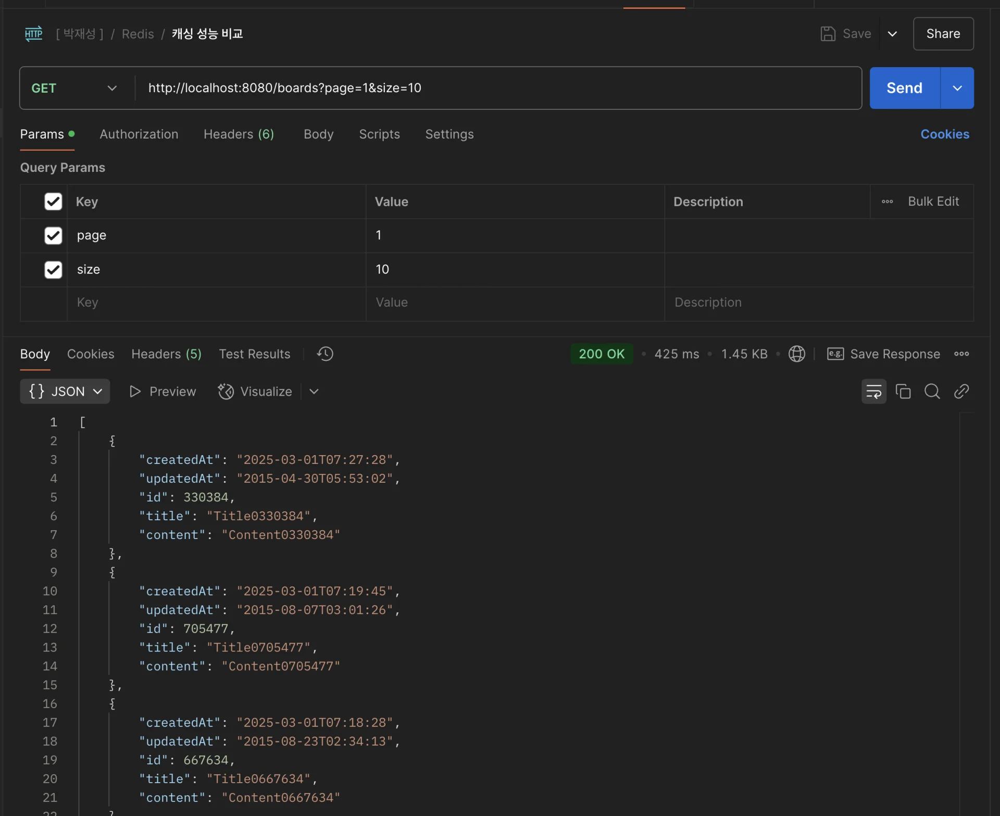
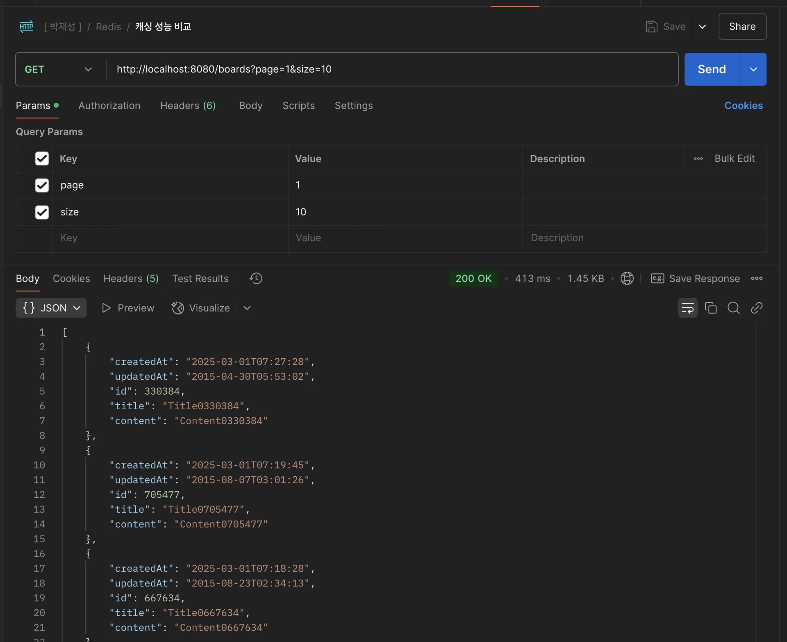
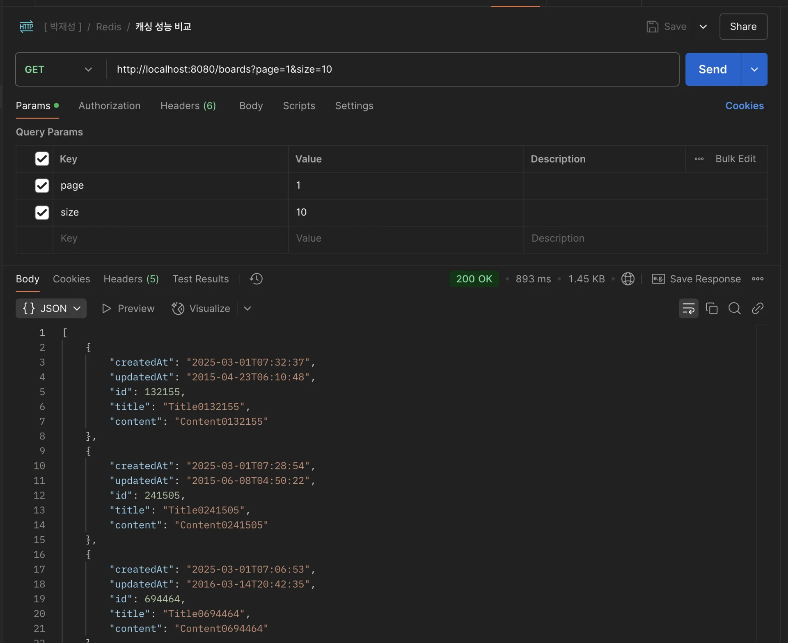
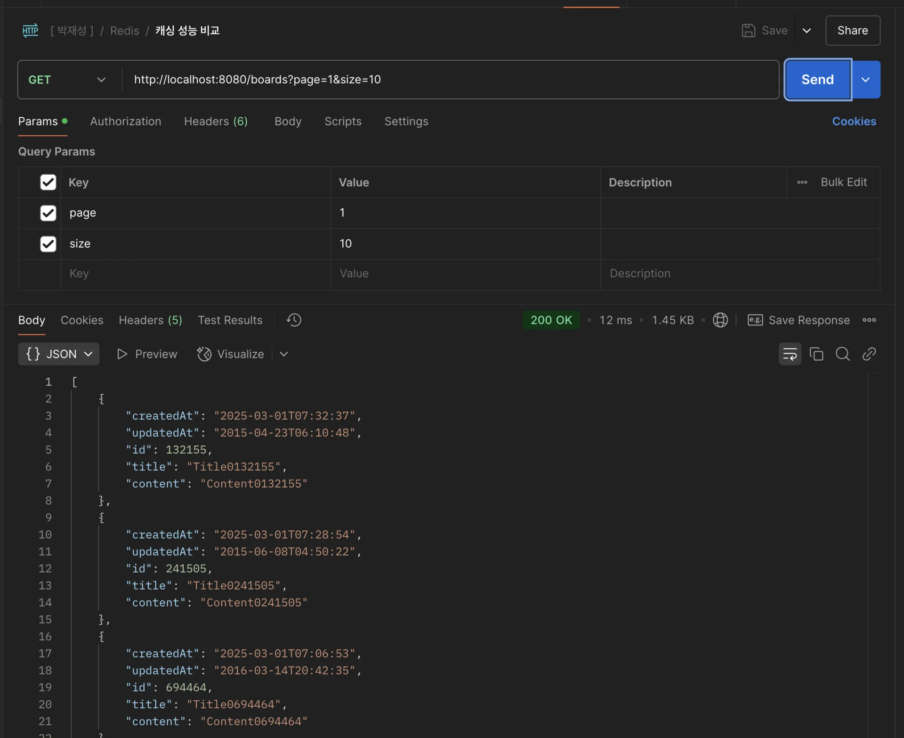
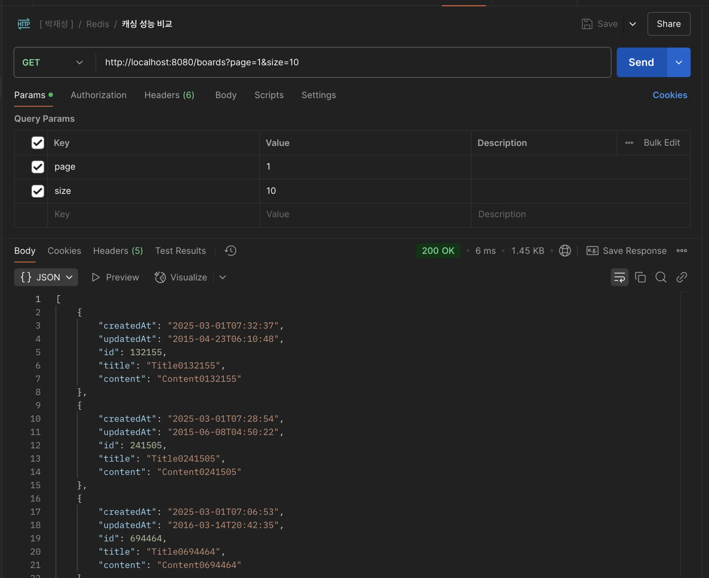
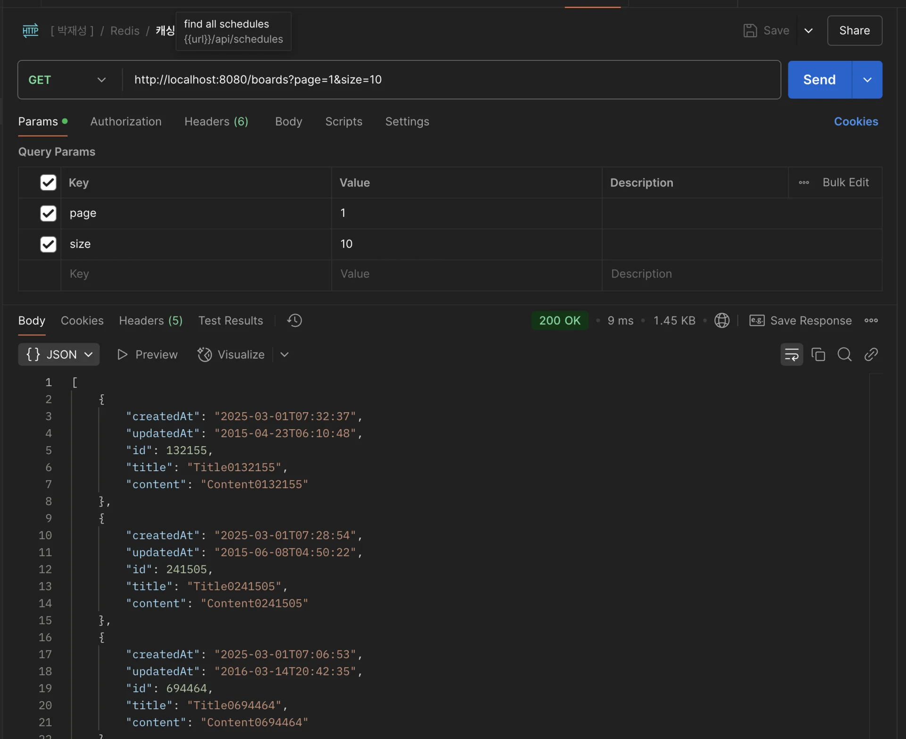

<a id="1c3eda9b0fe181ac8050c7d72a5c4335"></a>

## Redis 적용 전후, 성능 비교

---

> 📖 
> 
> <a id="1c3eda9b0fe181b6ba4dd2ff15cfcfbd"></a>
> 
> 성능 개선을 할 때는 반드시 <strong><u>수치를 측정하여 비교</u></strong>해야 한다&#46; 
> 
> <a id="1c3eda9b0fe181048d70e0e5abc4cf97"></a>
> 
> 실제로 얼마나 느린지, 개선한 뒤 얼마나 빨라졌는 지를  측정해야 한다&#46; 
> 
> <a id="1c3eda9b0fe181bfb7cceeeef040033e"></a>
> 
> 즉, <strong><u>정확한 데이터(수치)로 표현</u></strong>해야 한다&#46; 

<details>
<summary> Redis 적용 전</summary>

<a id="1c3eda9b0fe1816db337c570a2eafe8c"></a>

```java
@Service
public class BoardService {
  ...
  //  @Cacheable(cacheNames = "getBoards", key = "'boards:page:' + #page + ':size:' + #size", cacheManager = "boardCacheManager")
  public List<Board> getBoards(int page, int size) {
    Pageable pageable = PageRequest.of(page - 1, size);
    Page<Board> pageOfBoards = boardRepository.findAllByOrderByCreatedAtDesc(pageable);
    return pageOfBoards.getContent();
  }
}
```

<details>
<summary> Postman 측정&#58; <code>평균 413ms</code></summary>






</details>

</details>

<details>
<summary>Redis 적용 후 &#45; 처리속도 <code>약 40배</code> 개선</summary>

<a id="1c3eda9b0fe18138b6b1d4da34e76b6a"></a>

```java
@Service
public class BoardService {
  ...
  
  @Cacheable(cacheNames = "getBoards", key = "'boards:page:' + #page + ':size:' + #size", cacheManager = "boardCacheManager")
  public List<Board> getBoards(int page, int size) {
    Pageable pageable = PageRequest.of(page - 1, size);
    Page<Board> pageOfBoards = boardRepository.findAllByOrderByCreatedAtDesc(pageable);
    return pageOfBoards.getContent();
  }
}
```

<details>
<summary>처음 캐시에 데이터 등록&#58; <code>893ms</code></summary>



- 처음 API를 호출하여 캐싱 처리 시, 기존 API 응답 속도보다 더 느리다&#46; 

</details>

<details>
<summary>캐싱 데이터 응답&#58; <code>평균 10ms 이내</code>  ⇒ <u>응답 처리 속도</u>가 <strong>약 40배 정도 개선</strong></summary>







<a id="1c3eda9b0fe18145907ac454aa3504e6"></a>

대부분의 응답이 10ms 이내에 처리되는 것을 확인할 수 있다&#46; 

<a id="1c3eda9b0fe1816dba02dd44e2760c65"></a>

캐싱 이후, <u>응답 처리 속도</u>가 <strong>약 40배 정도 개선</strong>되는 것을 확인할 수 있다&#46; 

</details>

</details>
