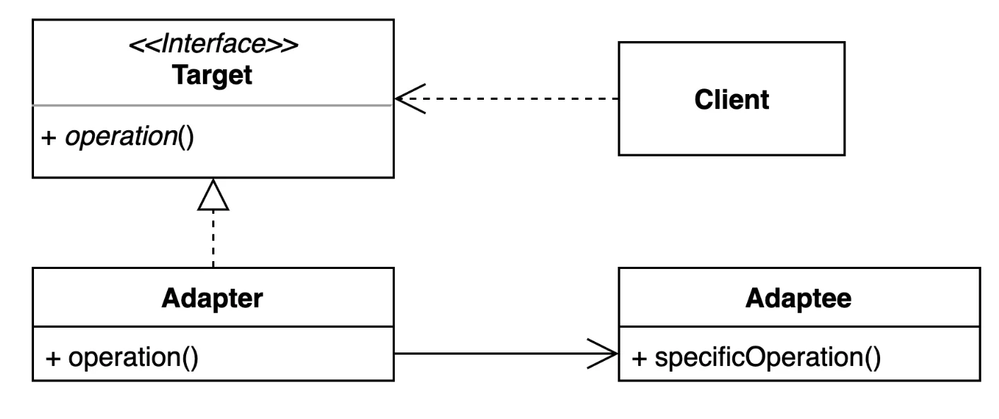
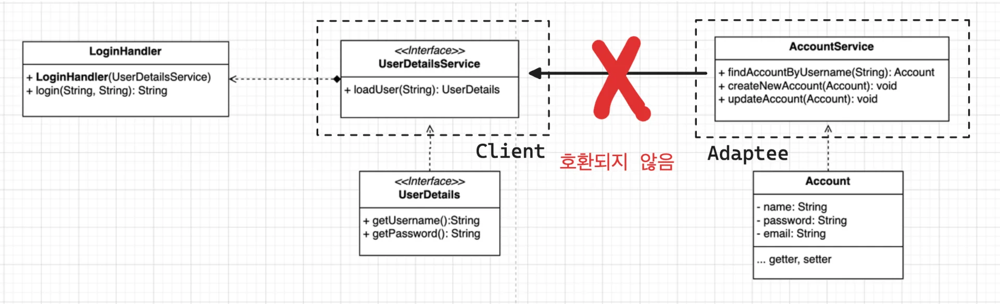
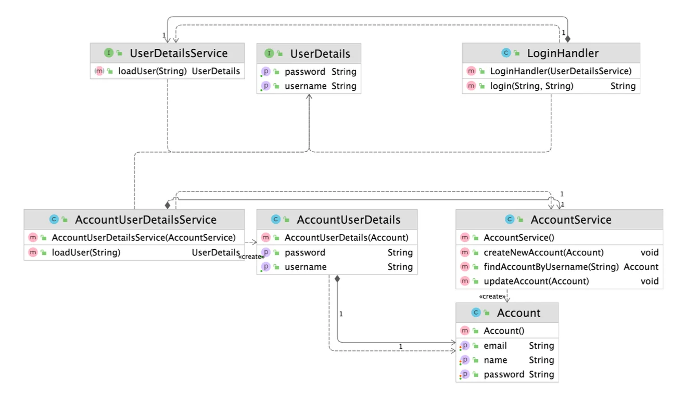
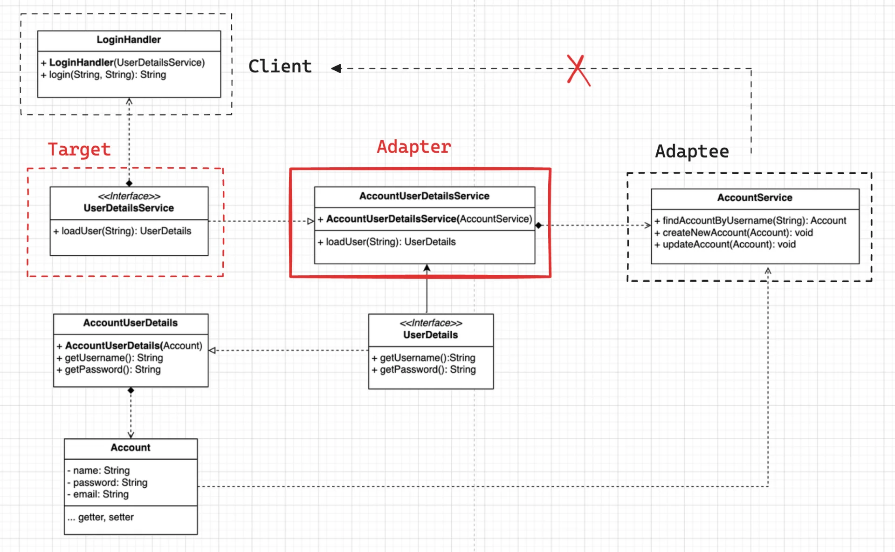

<a id="1c5eda9b0fe180e2a554cde622b2cbf7"></a>

## 어댑터( Adapter ) 패턴

---



> ✏️ 
> 
> <a id="1c5eda9b0fe180bda9e0ddb739a2b8c8"></a>
> 
> 기존 코드를 클라이언트가 사용하는 인터페이스의 구현체로 바꿔주는 패턴
> 
> - 클라이언트가 사용하는 인터페이스를 따르지 않는 기존 코드를 재사용 할 수 있게 한다&#46; 
> 
> > ✅ 장점
> 
> - 기존 코드를 변경하지 않고 원하는 인터페이스 구현체를 만들어 재사용 할 수 있다&#46; 
> 
> - 기존 코드가 하던 일과 특정 인터페이스 구현체로 변환하는 작업을 각기 다른 클래스로 분리하여 관리할 수 있다&#46; 
> 
> > ❗단점
> 
> - 새 클래스를 만들기 때문에 복잡도가 증가한다&#46; 
> 
> - 경우에 따라서는 기존 코드가 해당 인터페이스를 구현하도록 수정하는 것이 좋은 선택이 될 수도 있다&#46; 

<a id="1c5eda9b0fe180f98157f70427443408"></a>

### 1&#46; 기본 예제

---



<a id="1c5eda9b0fe180e387dac5daa8f749d9"></a>

### 코드 

[DesignPattern&#95;with&#95;jave/src/main/java/&#95;02&#95;structural&#95;patterns/&#95;06&#95;adapter/&#95;01&#95;before at main · gyungsubLee/DesignPattern&#95;with&#95;jave]()

<details>
<summary>security</summary>

<details>
<summary>&#91; 코드 &#93; LoginHandler</summary>

<a id="1c5eda9b0fe180278f4cfb16344d0da6"></a>

```java
package _02_structural_patterns._06_adapter._02_after.security;

public class LoginHandler {

    private final UserDetailsService userDetailsService;

    public LoginHandler(UserDetailsService userDetailsService)  {
        this.userDetailsService = userDetailsService;
    }

    public String login(String username, String password) {
        UserDetails userDetails = userDetailsService.loadUser(username);
        if (userDetails.getPassword().equals(password)) {
            return userDetails.getUsername();
        } else {
            throw new IllegalArgumentException();
        }
    }
}

```

</details>

<details>
<summary>&#91; 코드 &#93; &#60; interface &#62; UserDetails</summary>

<a id="1c5eda9b0fe18082b552f68c74fb3c4d"></a>

```java
package _02_structural_patterns._06_adapter._02_after.security;

public interface UserDetails {

    String getUsername();
    String getPassword();
}

```

</details>

<details>
<summary>&#91; 코드 &#93; &#60; interface &#62; UserDetailsService</summary>

<a id="1c5eda9b0fe180e5a3adf2e697f4c078"></a>

```java
package _02_structural_patterns._06_adapter._02_after.security;

public interface UserDetailsService {

    UserDetails loadUser(String username);
}
```

</details>

</details>

<details>
<summary>&#91; 코드 &#93; AccountService</summary>

<a id="1c5eda9b0fe180469690faafd9ffe81c"></a>

```java
package _02_structural_patterns._06_adapter._02_after;

public class AccountService {

    public Account findAccountByUsername(String username) {
        Account account = new Account();
        account.setName(username);
        account.setPassword(username);
        account.setEmail(username);
        return account;
    }

    public void createNewAccount(Account account) {

    }

    public void updateAccount(Account account) {

    }
}
```

</details>

<details>
<summary>&#91; 코드 &#93; Account</summary>

<a id="1c5eda9b0fe18022ae7ce04066ce1869"></a>

```java
package _02_structural_patterns._06_adapter._02_after;

public class Account {

    private String name;
    private String password;
    private String email;

    public String getName() {
        return name;
    }

    public void setName(String name) {
        this.name = name;
    }

    public String getPassword() {
        return password;
    }

    public void setPassword(String password) {
        this.password = password;
    }

    public String getEmail() {
        return email;
    }

    public void setEmail(String email) {
        this.email = email;
    }
}

```

</details>

<a id="1c5eda9b0fe18034a8f7f9ab7927110e"></a>

### 2&#46; 어댑터 패턴 적용

---

<details>
<summary>강의 자료</summary>



</details>



<a id="1c5eda9b0fe180b5b928f3f083c45e29"></a>

### 코드 

[DesignPattern&#95;with&#95;jave/src/main/java/&#95;02&#95;structural&#95;patterns/&#95;06&#95;adapter/&#95;02&#95;after at main · gyungsubLee/DesignPattern&#95;with&#95;jave]()

<details>
<summary>security</summary>

<details>
<summary>&#91; 코드 &#93; LoginHandler</summary>

<a id="1c5eda9b0fe180fbbce8e0fed14f21ee"></a>

```java
package _02_structural_patterns._06_adapter._02_after.security;

public class LoginHandler {

    private final UserDetailsService userDetailsService;

    public LoginHandler(UserDetailsService userDetailsService)  {
        this.userDetailsService = userDetailsService;
    }

    public String login(String username, String password) {
        UserDetails userDetails = userDetailsService.loadUser(username);
        if (userDetails.getPassword().equals(password)) {
            return userDetails.getUsername();
        } else {
            throw new IllegalArgumentException();
        }
    }
}

```

</details>

<details>
<summary>&#91; 코드 &#93; &#60; interface &#62; UserDetails</summary>

<a id="1c5eda9b0fe18094be7edb9f9860d8a2"></a>

```java
package _02_structural_patterns._06_adapter._02_after.security;

public interface UserDetails {

    String getUsername();
    String getPassword();
}

```

</details>

<details>
<summary>&#91; 코드 &#93; &#60; interface &#62; UserDetailsService</summary>

<a id="1c5eda9b0fe18029891af35c22a1adef"></a>

```java
package _02_structural_patterns._06_adapter._02_after.security;

public interface UserDetailsService {

    UserDetails loadUser(String username);
}
```

</details>

</details>

<details>
<summary>&#91; 코드 &#93; AccountUserDetails</summary>

<a id="1c5eda9b0fe1802c9f61e416b01920dc"></a>

```java
package _02_structural_patterns._06_adapter._02_after;

import _02_structural_patterns._06_adapter._02_after.security.UserDetails;

public class AccountUserDetails implements UserDetails {

    private Account account;

    public AccountUserDetails(Account account) {
        this.account = account;
    }

    @Override
    public String getUsername() {
        return account.getName();
    }

    @Override
    public String getPassword() {
        return account.getPassword();
    }
}

```

</details>

<details>
<summary>&#91; 코드 &#93; AccountUserDetailsService</summary>

<a id="1c5eda9b0fe180f3a14fc8d660aea685"></a>

```java
package _02_structural_patterns._06_adapter._02_after;

import _02_structural_patterns._06_adapter._02_after.security.UserDetails;
import _02_structural_patterns._06_adapter._02_after.security.UserDetailsService;

public class AccountUserDetailsService implements UserDetailsService {

    private final AccountService accountService;

    public AccountUserDetailsService(AccountService accountService) {
        this.accountService = accountService;
    }

    @Override
    public UserDetails loadUser(String username) {
        return new AccountUserDetails(accountService.findAccountByUsername(username));
    }
}

```

</details>

<details>
<summary>&#91; 코드 &#93; AccountService</summary>

<a id="1c5eda9b0fe180249395ffb3fa3e93ac"></a>

```java
package _02_structural_patterns._06_adapter._02_after;

public class AccountService {

    public Account findAccountByUsername(String username) {
        Account account = new Account();
        account.setName(username);
        account.setPassword(username);
        account.setEmail(username);
        return account;
    }

    public void createNewAccount(Account account) {

    }

    public void updateAccount(Account account) {

    }
}
```

</details>

<details>
<summary>&#91; 코드 &#93; Account</summary>

<a id="1c5eda9b0fe18024a7a3fce4031d22e8"></a>

```java
package _02_structural_patterns._06_adapter._02_after;

public class Account {

    private String name;
    private String password;
    private String email;

    public String getName() {
        return name;
    }

    public void setName(String name) {
        this.name = name;
    }

    public String getPassword() {
        return password;
    }

    public void setPassword(String password) {
        this.password = password;
    }

    public String getEmail() {
        return email;
    }

    public void setEmail(String email) {
        this.email = email;
    }
}

```

</details>

<details>
<summary>&#91; 코드 &#93; App</summary>

<a id="1c5eda9b0fe180f48a36d73cadc975d1"></a>

```java
package _02_structural_patterns._06_adapter._02_after;

import _02_structural_patterns._06_adapter._02_after.security.LoginHandler;
import _02_structural_patterns._06_adapter._02_after.security.UserDetailsService;

public class App {
    public static void main(String[] args) {
        AccountService accountService = new AccountService();
        UserDetailsService userDetailsService = new AccountUserDetailsService(accountService);
        LoginHandler loginHandler = new LoginHandler(userDetailsService);
        String login = loginHandler.login("username1", "username1");
        System.out.println(login);
    }
}

```

</details>

<a id="1c5eda9b0fe180baa5eae4156acc501d"></a>

### 3&#46; 실무 활용 예제   

> ✏️ 
> 
> - 자바
>     - <code>java&#46;util&#46;Arrays&#35;asList(T…)</code>
> 
>     - <code>java&#46;util&#46;Collections&#35;list(Enumeration)</code>, <code>java&#46;util&#46;Collections&#35;enumeration()</code>
> 
>     - <code>java&#46;io&#46;InputStreamReader(InputStream)</code>
> 
>     - <code>java&#46;io&#46;OutputStreamWriter(OutputStream)</code>
> 
> -  스프링
>     -  <code>HandlerAdpter</code>&#58; 우리가 작성하는 다양한 형태의 핸들러 코드를 스프링 MVC가 실행할 수 있는 형태로 변환해주는 어댑터용 인터페이스
>         - <a href="#/post/1c3eda9b-0fe1-8199-9d02-eeae5b4b5588">페이지</a> 

<a id="1c5eda9b0fe180f4ac39c09277292de4"></a>

### 코드

[DesignPattern&#95;with&#95;jave/src/main/java/&#95;02&#95;structural&#95;patterns/&#95;06&#95;adapter/&#95;03&#95;java at main · gyungsubLee/DesignPattern&#95;with&#95;jave]()

<details>
<summary>&#91; 코드 &#93; AdapterInJava</summary>

<a id="1c5eda9b0fe1800188def8932837ae1e"></a>

```java
package _02_structural_patterns._06_adapter._03_java;

import java.io.*;
import java.util.*;

public class AdapterInJava {

    public static void main(String[] args) {
        // collections
        List<String> strings = Arrays.asList("a", "b", "c");
        Enumeration<String> enumeration = Collections.enumeration(strings);
        ArrayList<String> list = Collections.list(enumeration);

        // io
        try(InputStream is = new FileInputStream("input.txt");
            InputStreamReader isr = new InputStreamReader(is);
            BufferedReader reader = new BufferedReader(isr)) {
            while(reader.ready()) {
                System.out.println(reader.readLine());
            }
        } catch (IOException e) {
            throw new RuntimeException(e);
        }
    }
```

</details>

<details>
<summary>&#91; 코드 &#93; AdapterInSpring</summary>

<a id="1c5eda9b0fe180a38faeec6122253587"></a>

```java
package _02_structural_patterns._06_adapter._03_java;

import org.springframework.web.servlet.DispatcherServlet;
import org.springframework.web.servlet.HandlerAdapter;
import org.springframework.web.servlet.mvc.method.annotation.RequestMappingHandlerAdapter;


public class AdapterInSpring {
    public static void main(String[] args) {
        DispatcherServlet dispatcherServlet = new DispatcherServlet();
        HandlerAdapter handlerAdapter = new RequestMappingHandlerAdapter();
    }
}
```

</details>

<details>
<summary>&#91; 코드 &#93; HelloController</summary>

<a id="1c5eda9b0fe18024b2a4c35106bd9674"></a>

```java
package _02_structural_patterns._06_adapter._03_java;

import org.springframework.stereotype.Controller;
import org.springframework.web.bind.annotation.GetMapping;

@Controller
public class HelloController {

    @GetMapping("/hello")
    public String hello() {
        return "hi";
    }
}
```

</details>
