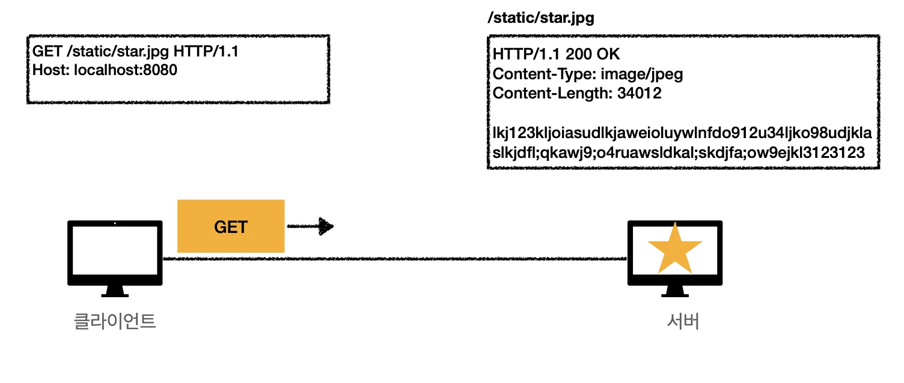
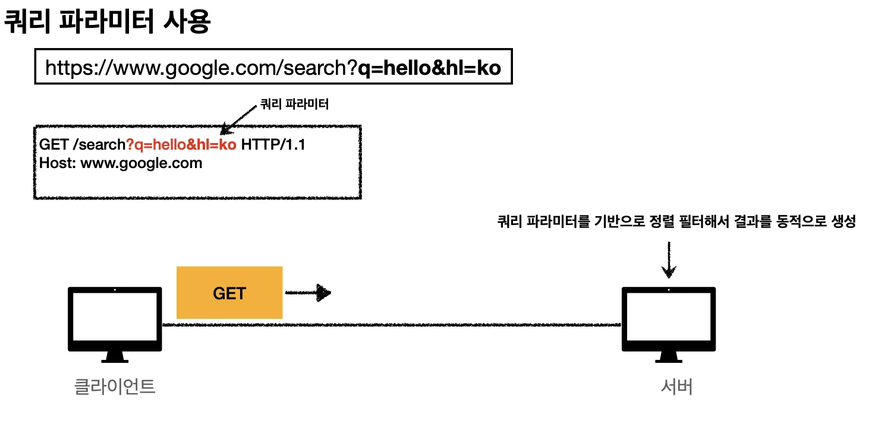
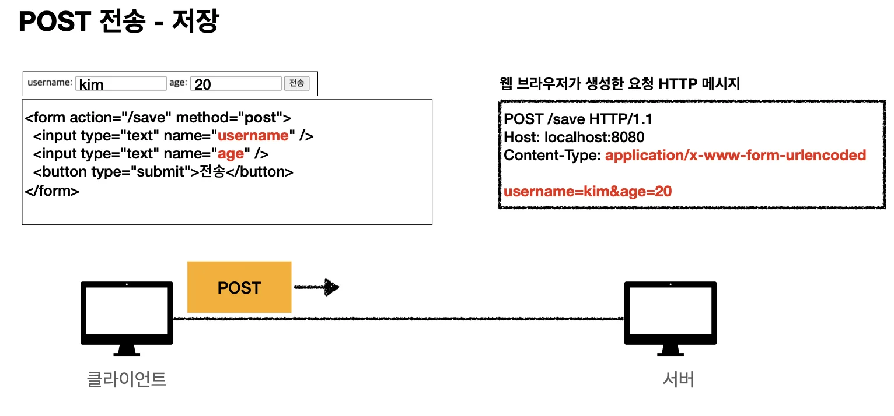
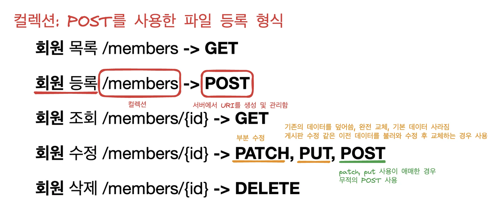
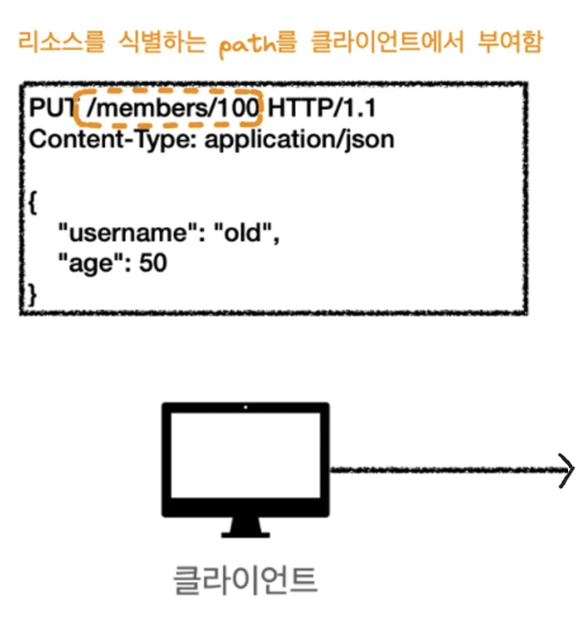
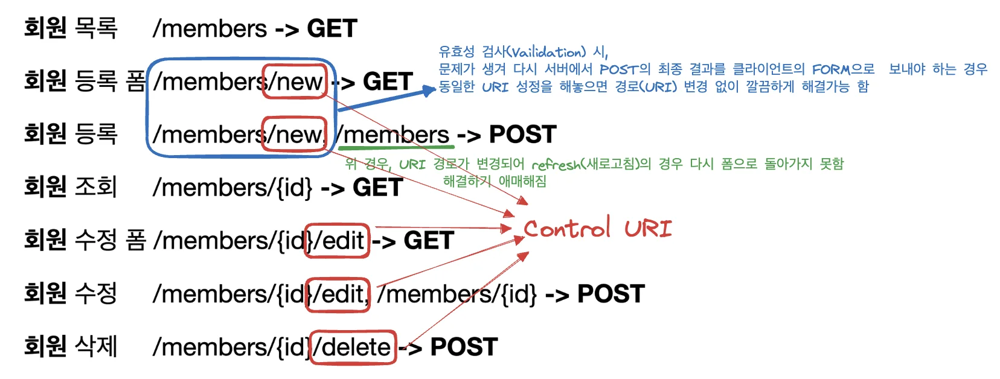

# 클라이언트에서 서버로 데이터 전송

## 전송 방식(<code>쿼리파라미터</code>, <code>메세지 바디</code>)

### <u>쿼리 파라미터</u>를 통한 데이터 전송

- <code>GET</code>

-  주로 정렬 필터(검색어)

> 검색어, 정렬 조건 과 같은 특정 데이터에 대한 state를 클라이언트에 받아 서버에서 해당하는 데이터를 찾을 떄

### <u>메세지 바디</u>를 통한 데이터 전송

- <code>POST</code>, <code>PUT</code>, <code>PATCH</code>

- 회원 가입, 상품 주문, 리소스 등록, 리소스 변경

## 정적 데이터 조회 (조회&#58; <code>GET</code>)

정적 데이터는 일반적으로 <strong><u>쿼리 파라미터 없</u></strong><u>이 </u><strong><u>리소스 경로</u></strong><u>로</u><strong><u> 단순하게 조회 </u></strong><strong>가능</strong>

→ 이미지, 정적 텍스트 문서 

## 동적 데이터 조회 (조회&#58; <code>GET</code>)

> <code>GET</code>은 <code>쿼리 파라미터</code>를 사용해서 데이터를 전달함 

<strong><u>쿼리 파라미터를 사용</u></strong>하여 <strong>조회 조건을 줄</strong>여주는 <strong><u>필터</u></strong>, <strong>조회 결과를 정렬</strong>하는<strong><u> 정렬 조건</u></strong>에 주로 사용  → 검색, 게시판 목록에서 정렬 필터(검색어)

## HTML Form을 통한 데이터 전송 (<code>GET</code>, <code>POST</code>, multipart/form&#45;data)

> ⚠️  HTML Form 전송은 <strong>GET, POST만 지원</strong>

### HTML Form submit시 POST 전송

-  예) 회원 가입, 상품 주문, 데이터 변경

> 📌 Content&#45;Type&#58; application/x&#45;www&#45;form&#45;urlencoded 
> 
> 
> 
> form의 내용을 메시지 바디를 통해서 전송(key=value, 쿼리 파라미터 형식)
> 
> 
> 
> 전송 데이터를 url encoding 처리
> 
> 
> 
> 예) abc김 &#45;&#62; abc%EA%B9%80

### HTML Form GET 전송 

> ⚠️ GET &#45; 저장&#58; 사용 ❌
> 
> 

### Content&#45;Type&#58; multipart/form&#45;data

> 📌 파일 업로드 같은 바이너리 데이터 전송시 사용 다른 종류의 여러 파일과 폼의 내용 함께 전송 가능(그래서 이름이 multipart 임)

## HTTP API를 통한 데이터 전송

> 형식에 맞게 만들어서 넘기면 된다&#46; (보통 형식에 맞는 라이브러리들 이미 존재함, 가져다 쓰기)

- 서버 to 서버
    - 백엔드 시스템 통신

-  앱 클라이언트 • 아이폰, 안드로이드

-  웹 클라이언트 • HTML에서 Form 전송 대신 자바 스크립트를 통한 통신에 사용(AJAX) • 예) React, VueJs 같은 웹 클라이언트와 API 통신

-  POST, PUT, PATCH&#58; 메시지 바디를 통해 데이터 전송

- GET&#58; 조회, 쿼리 파라미터로 데이터 전달

- Content&#45;Type&#58; application/json을 주로 사용 (사실상 표준) • TEXT, XML, JSON 등등

# HTTP API 설계 예시 

> ⚠️ 중요&#33; 대부분 POST 기반 컬렉션 형식을 많이 쓴다&#46;  PUT 기반 스토어는 거의 없다&#46;  ( 진짜 파일 업로드 비슷한 서버는 스토어(PUT) 형식으로 제공한다고 함 )

## HTTP API &#45; 컬렉션

> 📌 <strong>정리</strong>
> 
> ---
> 
> 
> 
> <code>POST</code> 기반 파일을 등록하는 형식 서버에서 리소스를 URI를 생성하고 관리한다&#46; 아래의 예시에서의 컬렉션&#58; /members
> 
> 
> 
> ex) 회원 관리 API 제공

> PUT은 기존의 데이터를 완전히 덮어쓰기 때문에,  PUT을 사용하려면 클라이언트에서 기존 회원 데이터와  수정할 회원 데이터를 모조리 보내서 완전히 바꿔야 한다&#46; → 너무 큰 낭비임 ⇒ 완전히 교체하는 게시판 수정 같은 경우 사용함

> 📌 <strong>복습</strong>
> 
> 
> 
> 클라이언트에서 요청 받은 리소스를 서버에서 신규 리스소 식별자 생성하여 넣어두고 해당 리소스 식별자(path)를 응답의 Location에 담아 클라이언트에게 알려준다&#46; 

## HTTP API &#45; 스토어

> 📌 <strong>정리</strong>
> 
> ---
> 
> 
> 
> <code>PUT</code> 기반으로 파일을 등록하는 형식 클라이언트에서 관리하는 리소스 저장소 아래의 예시에서 스토어&#58; <strong> </strong><strong>/files</strong>
> 
> 
> 
> ex) 정적 컨텐츠 관리, 원격 파일 관리

> put을 가지고 파일을 등록하고 있기 때문에, ‘/files’ 에 있는 post의 의미를 임의로 정할 수 있다&#46;  위 경우, 임의로 대량의 파일을 등록하는 것으로 지정함

## HTML FORM  

> ⚠️ <strong>해당 내용은 </strong><strong><u>순수한 HTML FORM</u></strong><strong> 만 사용하여 이야기한다&#46; 따라서 GET, POST 만 지원됨 실제 사용 시, AJAX 나  JavaScript 가지고 API 통신 가능함 </strong>

> 📌 <strong>정리 </strong><strong><code>GET</code></strong><strong>, </strong><strong><code>POST</code></strong><strong>만 지원 </strong>
> 
> 
> 
> <strong> → 제약 있음 </strong>
> 
> 
> 
> <strong>→ </strong><strong>Control URI(동사)</strong><strong>를 사용하여 해결함 </strong>
> 
> 
> 
> ex) 웹 페이지 회원 관리 

> 📌 <strong>Control URI ( Controller ) </strong>GET, POST만 지원하여 생기는 제약을 해결하기 위해<strong> </strong><strong>동사로 된 리소스 경로(Control URI)</strong>를 사용한다&#46; → Control URI&#58; POST <code>/new</code>, <code>/edit</code>, <code>/delete</code>   또한 HTTP API 사용 시, HTTP 메서드로 해결하기 애매한 경우도 사용한다&#46; 
> 
> > 실무에선 많이 쓴다고 함 그러나 무식하게 쓰면 안됨  <strong>최대한 리소스 라는 개념을 가지고 URI를 설계</strong>하고 <strong>안될 경우, Control URI</strong>를 대체제로 싸야함

##  참고 정리하면 좋은 URI 설계 개념

> 👉🏻 좋은 practice들의 모아서 정리한 개념들 ( 정답은 아니라고 하심 )

### <strong>문서(document)</strong>

- 단일 개념(파일 하나, 객체 인스턴스, 데이터베이스 row)
    

    예) /members/100, /files/star&#46;jpg

### <strong>컬렉션(collection)</strong>

> 실제 개발 시, 대부분 컬렉션을 씀

- 서버가 관리하는 리소스 디렉터리

- 서버가 리소스의 URI를 생성하고 관리
    

    예) /members

### <strong>스토어(store)</strong>

- 클라이언트가 관리하는 자원 저장소

- 클라이언트가 리소스의 URI를 알고 관리
    

    예) /files

### <strong>컨트롤러(controller), 컨트롤 URI</strong>

- 문서, 컬렉션, 스토어로 해결하기 어려운 추가 프로세스 실행 HTTP FORM이나 HTTP API에서도 굉장히 많이 사용함

- 동사를 직접 사용
    

    예) /members/{id}/delete

> 주문의 상태를 다음 상태로 진행 → 애매함 ⇒ Post /orders/{id}/delivery

> 📌 good practive reference) <a href="https://restfulapi.net/resource-naming/">https&#58;//restfulapi&#46;net/resource&#45;naming/</a>
