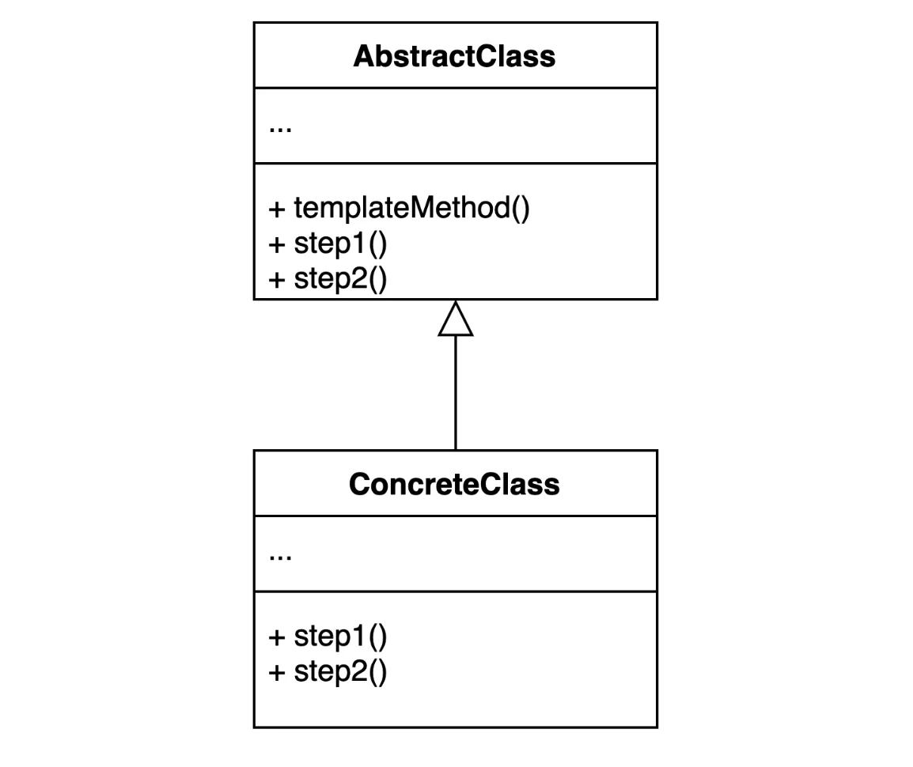
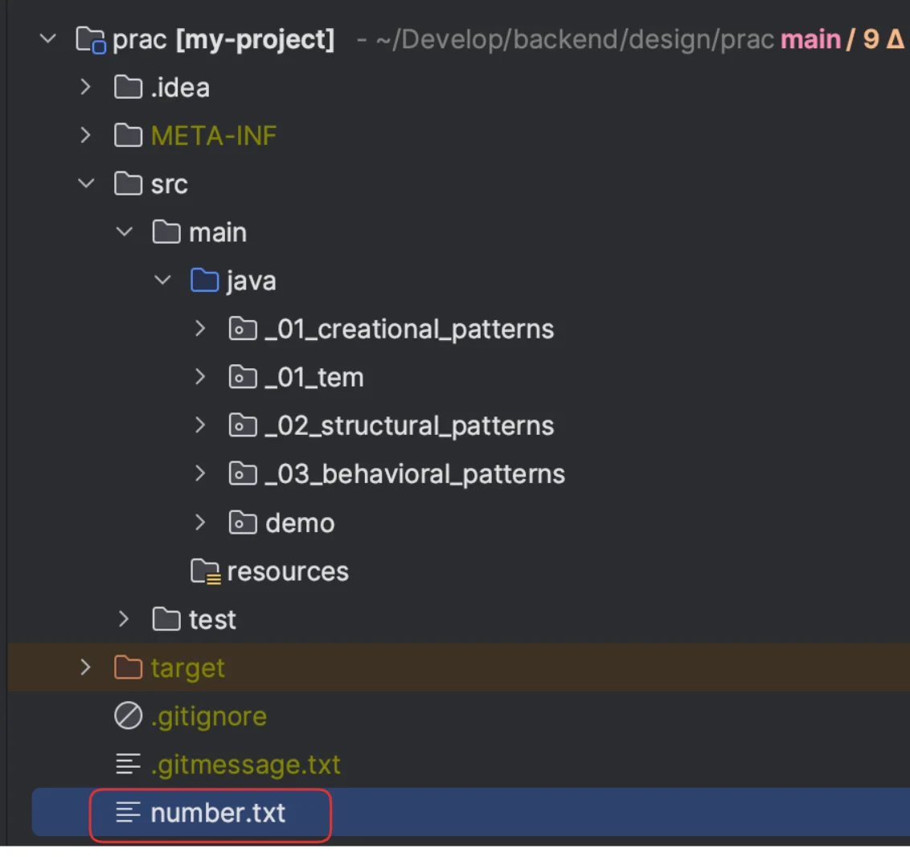
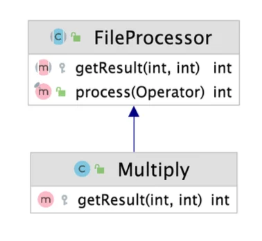
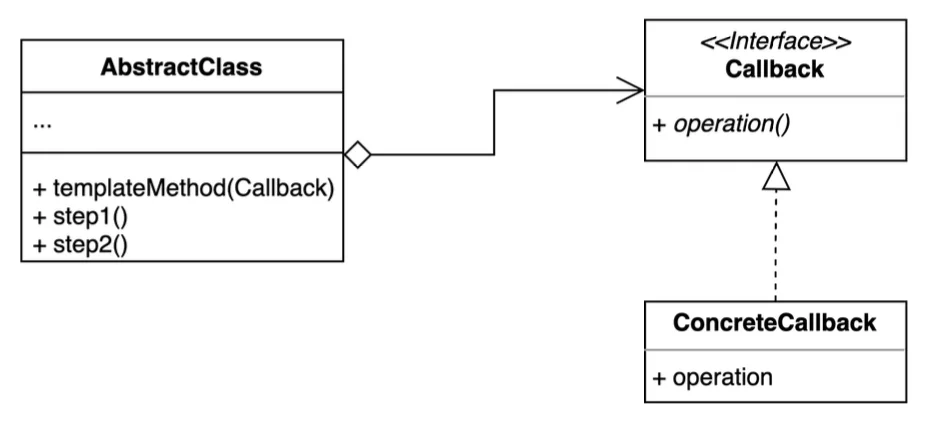

> 📝 
> 
> <a id="1e2eda9b0fe18071b8dbf23b5728ca76"></a>
> 
> <strong>질문</strong>
> 
> <details>
> <summary></summary>
> 
> 
> 
> </details>

<a id="1e2eda9b0fe18041af51f8adcb1b3896"></a>

## 템플릿 메서드 ( Template method ) 패턴

---

> 📖 
> 
> <a id="1e2eda9b0fe1800ca2cad2840607c7a3"></a>
> 
> <strong>템플릿 메서드 ( Template method ) 패턴</strong> 
> 
> ---
> 
> > 알고리즘 구조를 <strong><u>서브 클래스가 확장</u></strong>할 수 있도록 <strong><u>템플릿을 제공</u></strong>하는 방법
> 
> - <strong><u>상위(추상) 클래스</u></strong>는 <strong><u>전체 흐름(템플릿)을 제공</u></strong>하고 <strong><u>하위 클래스</u></strong>는 <strong>일</strong><strong><u>부 세부(구체적) 동작</u></strong><strong>만 </strong><strong><u>재정의(overriding)</u></strong><strong>한다&#46;</strong>
> 
> 
> 
> <details>
> <summary>구성 요소</summary>
> 
> - <code>Abstract Class</code>, 상위(추상) 클래스
>     - 알고리즘의 전체적인 흐름(템플릿 메서드)을 정의하며, 일부 단계를 추상 메서드로 선언한다&#46; 
> 
> - <code>Concrete Class</code>, 하위(구체) 클래스 
>     - 상위 클래스의 추상 메서드를 구체적으로 구현
> 
> - <code>templateMethod()</code>, 템플릿 메서드
>     - 알고리즘의 각 단계를 순서대로 호출하는 메서드
> 
>     - 상위 클래스에서 형식을 정의하며, 하위 클래스에서 세부 동작을 확장한다&#46;
> 
> </details>
> 
> <details>
> <summary>장•단점</summary>
> 
> > <strong>장점</strong>
> 
> - 알고리즘의 구조를 한 곳(<code>abstract class</code>)에서 관리하기 때문에 유지보수가 쉽다&#46; 
> 
> - 코드 중복을 줄이고, 일관된 흐름을 보장할 수 있다&#46;
> 
> - 하위 클래스에서 필요한 부분만 오버라이드 하면 되므로 확장성이 높다&#46; 
> 
> > <strong>단점</strong>
> 
> - 상속에 의존하므로 클래스 수가 많아질 경우 구조가 복잡해질  수 있다&#46;
> 
> - 알고리즘의 각 단계가 강하게 결합될 수 있다&#46;
> 
> </details>
> 
> <details>
> <summary>실무 활용 예시</summary>
> 
> > ✏️ 
> > 
> > - <strong><u>전체 프로세스는 변하지 않</u></strong><strong>지만 </strong><strong><u>일부 단계</u></strong><strong>만 </strong><strong><u>상황별로 다르게 처리</u></strong><strong>해야 할때</strong>
> > 
> > - <strong><u>코드 중복을 줄</u></strong>이고, <strong><u>흐름(알고리즘</u></strong><strong><u>)</u></strong>을 <strong><u>한 곳에서 통제</u></strong>하고 싶을 때
> > 
> > <a id="1e2eda9b0fe180479b33c67f008e3d8b"></a>
> > 
> > 위와 같은 경우, 템플릿 메서드 패턴을 사용한다&#46; 
> 
> </details>
> 
> <details>
> <summary>코드 예시</summary>
> 
> <details>
> <summary>ex) Ramen ( 라면 )</summary>
> 
> <a id="1e2eda9b0fe1801ab8f9d73bd35abc6b"></a>
> 
> ```java
> // Abstract Class
> abstract class RamenTemplate {
>     public void makeRamen() { // 템플릿 메서드
>         boilWater();
>         putNoodles();
>         putExtra();        // 추상 메서드 (하위 클래스에서 구현)
>         waitForMinutes();  // 추상 메서드 (하위 클래스에서 구현)
>     }
>     public void boilWater() { System.out.println("물을 끓인다."); }
>     public void putNoodles() { System.out.println("면을 넣는다."); }
>     public abstract void putExtra();
>     public abstract void waitForMinutes();
> }
> 
> // Concrete Class
> class ShinRamen extends Ramen {
>     public void putExtra() { System.out.println("계란을 넣는다."); }
>     public void waitForMinutes() { System.out.println("4분 기다린다."); }
> }
> 
> class RaccoonRamen extends Ramen {
>     public void putExtra() { System.out.println("콩나물을 넣는다."); }
>     public void waitForMinutes() { System.out.println("5분 기다린다."); }
> }
> ```
> 
> - 위와 같이 상위 형식(abstract class or interface)에서  <u>라면 끓이는 과정(알고리즘)</u>을 <strong>템플릿 메서드로 정의</strong>하고 하위(구체) 클래스에서 상속하여 세부 동작을 정의한다&#46; 
> 
> - 이를 통해 라면을 끊이는 전체 과정은 변하지 않으면서, 라면 종류에 따라 추가 재료나 끊이는 시간만 다르게 구현할 수 있다&#46; 
> 
> </details>
> 
> <details>
> <summary>ex) Coffee ( 커피 )</summary>
> 
> <details>
> <summary>&#91; 코드 &#93;  <code>Abstract Class</code>, 상위(추상) 클래스</summary>
> 
> <a id="1e2eda9b0fe1802392f8cb9c80de316e"></a>
> 
> ```java
> abstract class CoffeeTemplate {
> 
>     // 템플릿 메서드: '전체 흐름'을 고정
>     public final void makeCoffee() {
>         boilWater();
>         prepareIngredients();  // 종류(구현체)마다 다르게 세부 구현
>         brew();
>         pourInCup();
>     }
> 
>     private void boilWater() {
>         System.out.println("물을 끓입니다.");
>     }
> 
>     // 하위 클래스 - 구체적인 동작 정의
>     protected abstract void prepareIngredients();
> 
>     private void brew() {
>         System.out.println("커피를 내립니다.");
>     }
> 
>     private void pourInCup() {
>         System.out.println("커피를 컵에 붓습니다.");
>     }
> }
> ```
> 
> </details>
> 
> <details>
> <summary>&#91; 코드 &#93; <code>Concrete Class</code>, 하위(구체) 클래스</summary>
> 
> <a id="1e2eda9b0fe180469a42f7cb52213c89"></a>
> 
> ```java
> class Americano extends CoffeeTemplate {
> 
>     @Override
>     protected void prepareIngredients() {
>         System.out.println("아메리카노용 원두를 준비합니다.");
>     }
> }
> ```
> 
> <a id="1e2eda9b0fe180e59f25d3df180027ba"></a>
> 
> ```java
> class Latte extends CoffeeTemplate {
> 
>     @Override
>     protected void prepareIngredients() {
>         System.out.println("라떼용 원두와 우유를 준비합니다.");
>     }
> }
> ```
> 
> </details>
> 
> </details>
> 
> </details>

<a id="1e2eda9b0fe180879139cd1fe5a8fd1a"></a>

### 1&#46; 기본 예제

<a id="1e2eda9b0fe18055a496f9d42d575912"></a>

### 코드

<details>
<summary>&#91; 코드 &#93; FileProcessor</summary>

<a id="1e2eda9b0fe18000aaadd9ecd3ab4f28"></a>

```java
package _03_behavioral_patterns._22_template._01_before;

import java.io.BufferedReader;
import java.io.FileReader;
import java.io.IOException;

public class FileProcessor {

    private String path;

    public FileProcessor(String path) {
        this.path = path;
    }

    public int process() {
        try (BufferedReader reader = new BufferedReader(new FileReader(path))) {
            int result = 0;
            String line = null;
            while ((line = reader.readLine()) != null) {
                result += Integer.parseInt(line);
            }
            return result;
        } catch (IOException e) {
            throw new IllegalArgumentException(path + "에 해당하는 파일이 없습니다.", e);
        }
    }
}


```

</details>

<details>
<summary>&#91; 코드 &#93; MultuplyFileProcessor</summary>

<a id="1e2eda9b0fe180a0b6e0e4715cd8c727"></a>

```java
package _03_behavioral_patterns._22_template._01_before;

import java.io.BufferedReader;
import java.io.FileReader;
import java.io.IOException;

public class MultuplyFileProcessor {

    private String path;

    public MultuplyFileProcessor(String path) {
        this.path = path;
    }

    public int process() {
        try (BufferedReader reader = new BufferedReader(new FileReader(path))) {
            int result = 0;
            String line = null;
            while ((line = reader.readLine()) != null) {
                result *= Integer.parseInt(line);
            }
            return result;
        } catch (IOException e) {
            throw new IllegalArgumentException(path + "에 해당하는 파일이 없습니다.", e);
        }
    }
}

```

</details>

<details>
<summary>&#91; 코드 &#93; Client</summary>

<a id="1e2eda9b0fe180b2b587d818e662b289"></a>

```java
package _03_behavioral_patterns._22_template._01_before;

public class Client {

    public static void main(String[] args) {
        FileProcessor fileProcessor = new FileProcessor("number.txt");
        int result = fileProcessor.process();
        System.out.println(result);
    }
}
```

<a id="1e2eda9b0fe1808a85abecc6b14d28db"></a>

number&#46;txt

<a id="1e2eda9b0fe18007a5d5e68409a7f92d"></a>

```java
1
1
123
```

<a id="1e2eda9b0fe180c9b1e1cadf80887ead"></a>

실행 결과

<a id="1e2eda9b0fe1802aa8a6f03f497ad862"></a>

```java
125
```

- <u>공백</u>(<code>””</code>)이나, <u>문자</u>가 들어가는 경우 추가 처리가 필요
    - <code>NumberFormatException</code> 발생

</details>

<details>
<summary>🧐 <code>FileReader</code> 가 읽어오는 기본 경로 </summary>

> ☝🏻 
> 
> <a id="1e2eda9b0fe1809b869efdf821dd8ce3"></a>
> 
> <code>FileReader</code>는 <strong>Classpath(Resource)</strong> 기준이 아니라 <strong><u>File System 경로</u></strong><u> 기준</u> 이다&#46;

- <strong>FileReader 기본 경로는 현재 실행하는 </strong><strong><u>프로젝트의 루트 디렉터리</u></strong> 기준이다&#46;

<a id="1e2eda9b0fe18094927edce7ce8c95e7"></a>

```java
/your-project-folder
    ├── src/
    ├── build.gradle
    ├── number.txt   ← 여기다 두면 됨!!
```

<a id="1e2eda9b0fe180e9b93dc938ee016fae"></a>

<br>따라서 <code>FileReader</code>로 파일을 읽어오고 동작을 수행하고 싶은 경우, 해당 파일을 프로젝트 root 폴더에 만들면 된다 &#46;



<a id="1e2eda9b0fe1806ca442f8c169a34303"></a>

또한 특정 폴더(ex&#46; <strong><code>src/main/resources</code></strong><strong>) 에서 생성 및 읽어오고 싶다면 아래와 같이 프로젝트 root 경로를 기준으로 해당 경로를 명시한다&#46; </strong>

<a id="1e2eda9b0fe1804cb1eed7d9391dd318"></a>

```java
new FileReader("src/main/resources/number.txt")
```

</details>

<a id="1e2eda9b0fe180659341ecf28a144193"></a>

### 문제점

<a id="1e2eda9b0fe18051a662fc932629a9ce"></a>

<code>FileProcessor</code>, <code>MultuplyFileProcessor</code>에서 동일한 알고리즘(동작)이 중복으로 발생

<a id="1e2eda9b0fe180fc9e07c5e528413cc3"></a>

⇒  <code>&#43;</code>&#46; <code>&#42;</code> 연산만 다름

<a id="1e2eda9b0fe1802d90e9fef267b49d83"></a>

이를 템플릿 메서드를 통해 상위 형식으로 추출하고 하위(구현) 클래스에서는 연산자만 구체적으로 정의

<a id="1e2eda9b0fe1805694a4f6f5862861f1"></a>

### 2&#46; 패턴 적용 &#45; 템플릿 메서드, 템플릿 콜백

<a id="1e2eda9b0fe180f6ad11f10ed5542602"></a>

### 템플릿 메서드 패턴

<a id="1e2eda9b0fe1805496fbfc3003b7bb71"></a>

### 코드



<details>
<summary>&#91; 코드 &#93; FileProcessor &#45; <code>AbstractClass</code></summary>

<a id="1e2eda9b0fe180338bdec3ac002e360c"></a>

```java
package _03_behavioral_patterns._22_template._02_after;

import java.io.BufferedReader;
import java.io.FileReader;
import java.io.IOException;

public abstract class FileProcessor {

    private String path;

    public FileProcessor(String path) {
        this.path = path;
    }
		
		// 템플릿 - 변경되지 않는 로직
    public int process() {
        try (BufferedReader reader = new BufferedReader(new FileReader(path))) {
            int result = 1;
            String line = null;
            while ((line = reader.readLine()) != null) {
                result = getResult(result, Integer.parseInt(line));
            }
            return result;
        } catch (IOException e) {
            throw new IllegalArgumentException(path + "에 해당하는 파일이 없습니다.", e);
        }
    }

		// 하위 구현체에서 구현될 변경되는 로직
    protected abstract int getResult(int result, int number);
}

```

</details>

<details>
<summary>&#91; 코드 &#93; Plus &#45; <code>ConcreteClass</code></summary>

<a id="1e2eda9b0fe180bd97dbee2b4084312d"></a>

```java
package _03_behavioral_patterns._22_template._02_after;

public class Plus extends FileProcessor  {

    public Plus(String path) {
        super(path);
    }

    @Override
    public int getResult(int result, int number) {
        return result += number;
    }
}
```

</details>

<details>
<summary>&#91; 코드 &#93; Multiply &#45; <code>ConcreteClass</code></summary>

<a id="1e2eda9b0fe18047b406dab4a6d50e90"></a>

```java
package _03_behavioral_patterns._22_template._02_after;

public class Multiply extends FileProcessor {

    public Multiply(String path) {
        super(path);
    }

    @Override
    public int getResult(int result, int number) {
        return result *= number;
    }
}
```

</details>

<details>
<summary>&#91; 코드 &#93; Client</summary>

<a id="1e2eda9b0fe18099a1b8c127c1093ae2"></a>

```java
package _03_behavioral_patterns._22_template._02_after;

public class Client {

    public static void main(String[] args) {
    //  FileProcessor fileProcessor = new Plus("number.txt");  
        FileProcessor fileProcessor = new Multiply("number.txt");
        int result = fileProcessor.process();
        System.out.println(result);
    }
}

```

</details>

<a id="1e2eda9b0fe1808ba779cdc9d0f814a4"></a>

### 템플릿 콜백 패턴 ( <del>상속</del> → 위임 )

> 📖 
> 
> <a id="1e2eda9b0fe1803d8a7aeb9c1dc07d1e"></a>
> 
> <strong>템플릿 콜백 ( Template&#45;Callback ) 패턴</strong>
> 
> ---
> 
> 
> 
> > 콜백으로 상속 대신 <strong><u>위임</u></strong><strong>을</strong> 사용하는 템플릿 패턴
> 
> - 상속 대신 <strong><u>익명 내부 클래스</u></strong> 또는 <strong><u>람다 표현식</u></strong> 활용 가능
> 
> - 실제 많이 사용된다&#46; 

<details>
<summary>&#91; 코드 &#93; &#60; interface &#62; Operator</summary>

<a id="1e2eda9b0fe180749d4ac34ccc4764ef"></a>

```java
package _03_behavioral_patterns._22_template._02_after;

public interface Operator {

    int getResult(int result, int number);
}
```

</details>

<details>
<summary>&#91; 코드 &#93; FileProcessor</summary>

<a id="1e2eda9b0fe180e4a835fb5181ee16e5"></a>

```java
package _03_behavioral_patterns._22_template._02_after;

import java.io.BufferedReader;
import java.io.FileReader;
import java.io.IOException;

public class FileProcessor {

    private String path;

    public FileProcessor(String path) {
        this.path = path;
    }

    public int process(Operator operator) {
        try (BufferedReader reader = new BufferedReader(new FileReader(path))) {
            int result = 1;
            String line = null;
            while ((line = reader.readLine()) != null) {
                result = operator.getResult(result, Integer.parseInt(line));
            }
            return result;
        } catch (IOException e) {
            throw new IllegalArgumentException(path + "에 해당하는 파일이 없습니다.", e);
        }
    }
}

```

</details>

<details>
<summary>&#91; 코드 &#93; Client</summary>

<a id="1e2eda9b0fe180118e3fe09c9838b2f9"></a>

```java
package _03_behavioral_patterns._22_template._02_after;

public class Client {

    public static void main(String[] args) {
        FileProcessor fileProcessor = new FileProcessor("number.txt");
//        int result = fileProcessor.process((sum, number)-> sum += number);
        int result = fileProcessor.process((sum, number)-> sum *= number);
        System.out.println(result);
    }
}
```

- <strong><u>람다</u></strong>를 통해 <u>상속  없</u>이 <code>위임</code>을 통해  <strong><u>간단하게 정의  및 확장이 가능</u></strong>하다&#46;

</details>

<a id="1e2eda9b0fe180a6a75adcd5e60eb186"></a>

### NOTES

> ☝🏻 
> 
> - interface의 메서드는 <code>protected</code> 선언이 불가하다&#46;  
>     -  <code>public</code> 만 가능
> 
> - java 9 이상 부터는 <code>private</code> 도 사용 가능하나, <u>interface 내부</u>에서만 사용 가능하다&#46; 
>     - <code>implement</code> 한 클래스에서도 <u>호출 불가</u>함  
> 
>     - java 8 부터 <code>default</code>를 통해 <u>interface 에서도 동작 정의가 가능 </u>해졌기 때문에 <u>외부 호출없이 </u><u>내부에서만 동작</u><u>되는 메서드</u>인 경우 <code>private</code> 으로 <u>캡슐화</u>한다&#46;

<a id="1e2eda9b0fe180afb562d320f65807b1"></a>

### 3&#46; 장•단점

- 장점
    - 템플릿 코드를 재사용하고 중복 코드를 줄일 수 있다&#46; 

    - 템플릿 코드를 변경하지 않고 상속을 받아서 구체적인 알고리즘만 변경 가능하다&#46;

    - 템플릿 콜백 패턴 사용 시, 상속 없이 위임만으로 더 간단하게 정의할 수 있다&#46; 

- 단점
    - 리스코프 치환 원칙을 위반할 수 있다&#46; 
        - 부모 타입의 객체를 자식 타입 객체로 대체해도 프로그램이 문제없이 동작해야 한다&#46;

    - 알고리즘 구조가 복잡할 수록 템플릿을 유지하기 어려워진다&#46; 

<a id="1e2eda9b0fe1801aa94bed98761bb208"></a>

### 4&#46; 실무 활용

> ✏️ 
> 
> > 자바
> 
> - HttpServlet
> 
> > 스프링
> 
> - 템플릿 메서드 패턴
>     - <code>Configuration</code>
> 
> - 템플릿 콜백 패턴
>     - <code>JdbcTemplate</code>
> 
>     - <code>RestTemplate</code>
> 
>     - …

<a id="1e2eda9b0fe180a1870be6b2d2ed6aa5"></a>

### 코드

<details>
<summary>&#91; 코드 &#93; MyHello</summary>

<a id="1e2eda9b0fe180589183eb0a7938e0b0"></a>

```java
package _03_behavioral_patterns._22_template._03_java;

import jakarta.servlet.ServletException;
import jakarta.servlet.http.HttpServlet;
import jakarta.servlet.http.HttpServletRequest;
import jakarta.servlet.http.HttpServletResponse;

import java.io.IOException;

public class MyHello extends HttpServlet {

    @Override
    protected void doGet(HttpServletRequest req, HttpServletResponse res) throws ServletException, IOException {
        super.doGet(req, res);
    }

    @Override
    protected void doPost(HttpServletRequest req, HttpServletResponse res) throws ServletException, IOException {
        super.doPost(req, res);
    }
}


```

</details>

<details>
<summary>&#91; 코드 &#93; TemplateInJava</summary>

<a id="1e2eda9b0fe180ad8bb8e57c3bb90f85"></a>

```java
package me.whiteship.designpatterns._03_behavioral_patterns._22_template._03_java;

import javax.servlet.http.HttpServlet;

public class TemplateInJava {

    public static void main(String[] args) {
        HttpServlet httpServlet;
    }
}
```

</details>

<details>
<summary>&#91; 코드 &#93; TemplateInSpring</summary>

<a id="1e2eda9b0fe1808eb579cb3fb43a8ced"></a>

```java
package me.whiteship.designpatterns._03_behavioral_patterns._22_template._03_java;

import org.springframework.context.annotation.Bean;
import org.springframework.context.annotation.Configuration;
import org.springframework.http.*;
import org.springframework.jdbc.core.JdbcTemplate;
import org.springframework.security.config.annotation.web.builders.HttpSecurity;
import org.springframework.security.web.SecurityFilterChain;
import org.springframework.web.client.RestTemplate;

import java.util.Arrays;

public class TemplateInSpring {

    public static void main(String[] args) {
        // TODO 템플릿-콜백 패턴
        // JdbcTemplate
        JdbcTemplate jdbcTemplate = new JdbcTemplate();
        jdbcTemplate.execute("insert");

        // RestTemplate
        RestTemplate restTemplate = new RestTemplate();

        HttpHeaders headers = new HttpHeaders();
        headers.setAccept(Arrays.asList(MediaType.APPLICATION_JSON));
        headers.set("X-COM-PERSIST", "NO");
        headers.set("X-COM-LOCATION", "USA");

        HttpEntity<String> entity = new HttpEntity<String>(headers);
        ResponseEntity<String> responseEntity = restTemplate
                .exchange("http://localhost:8080/users", HttpMethod.GET, entity, String.class);
    }

    @Configuration
    public class SecurityConfig {

        @Bean
        public SecurityFilterChain securityFilterChain(HttpSecurity http) throws Exception {
            return http
                    .authorizeRequests(a -> a.anyRequest().permitAll())
                    .build();
        }
    }
}

```

</details>
