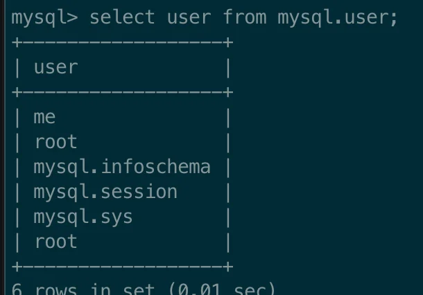

> ✏️ 
> 
> <a id="1c3eda9b0fe181269d78c8fa3ef684d0"></a>
> 
> root 계정에서 생성한 데이터베이스가 하위 계정에서 보이지 않는 이유는 해당하는 하위 계정에 적절한 권한 부여가 되지 않아서 이다&#46;

<a id="1c3eda9b0fe18115bd05fdb3253e280f"></a>

### 1&#46; MySQL에서 권한 추가

---

<details>
<summary><strong>🧐 </strong><strong><code>&#64;</code></strong><strong> 뒤에 오는 값의 의미&#58; </strong><strong><code>host</code></strong></summary>

<a id="1c3eda9b0fe18191aad4e265c36f1db7"></a>

MySQL에서 사용자 계정은 <strong><code>“사용자명&#64;호스트”</code></strong> 형식으로 저장된다&#46; 

<a id="1c3eda9b0fe181739199d6d7fb78f46e"></a>

즉, 접속 가능한 host 정보를 설정한다&#46; 

<a id="1c3eda9b0fe181359d8dc64e1a60ca65"></a>

<strong>예시</strong>

- <code>&#39;user1&#39;&#64;&#39;localhost’</code>&#58; <strong>로컬 접속(서버 자체에서만 접속 가능)</strong>

- <code>&#39;user1&#39;&#64;&#39;%’</code>&#58; <strong>모든 IP(원격 접속 포함)에서 접속 가능</strong>

- <code>&#39;user1&#39;&#64;&#39;192&#46;168&#46;1&#46;%’</code>&#58; 특정 IP(<code>192&#46;168&#46;1&#46;%</code>)에서 만 접속 가능

- <code>&#39;user1&#39;&#64;&#39;example&#46;com&#39;</code>&#58; <strong>특정 도메인에서만 접속 가능</strong>

</details>

<details>
<summary><strong>1) 특정 유저에게 DB 권한 부여</strong></summary>

<a id="1c3eda9b0fe18177bc51e059e75d6922"></a>

```sql
GRANT ALL PRIVILEGES ON db_name.* TO 'username'@'host';
```

- <code>db&#95;name&#46;&#42;</code>&#58; 권한을 부여할 DB 지정

- <code>‘username’&#64;’host’</code>&#58; 권할을 부여할 사용자 
    - ex) <code>‘user1’&#64;</code><strong><code>’%’</code></strong> &#58; 모든 IP에서 접속 가능

- <code>ALL PRIVILEGES</code>&#58; 모든 권한을 부여
    - 특정 권한만 부여 가능&#58; <code>SELECT</code>, <code>INSERT</code>, <code>UPDATE</code>, <code>DELETE</code> …

---

<details>
<summary>ex) user1에게 mydb에 대한 모든 권한 부여</summary>

<a id="1c3eda9b0fe1815e8c09f4387f29f623"></a>

```sql
GRANT ALL PRIVILEGES ON mydb.* TO 'user1'@'%';
```

</details>

<details>
<summary>ex) 유저 me에게 article DB에 대한 모든 권한 부여</summary>

<a id="1c3eda9b0fe1816996faf350677f6e02"></a>

```sql
GRANT ALL PRIVILEGES ON article.* TO 'me'@'%';
```

</details>

<details>
<summary>ex) 유저 me에게 comment DB에 대한 모든 권한 부여</summary>

<a id="1c3eda9b0fe1818aaaabcd533621ed2e"></a>

```sql
GRANT ALL PRIVILEGES ON comment.* TO 'me'@'%';
```

</details>

</details>

<details>
<summary><strong>2) 특정 권한만 부여</strong></summary>

<a id="1c3eda9b0fe1816ba725f01f10e253a7"></a>

```sql
GRANT SELECT, INSERT, UPDATE, DELETE ON mydb.* TO 'user1'@'%';
```

- 만약 특정 작업만 허용하려면 위와 같이 설정 가능하다&#46; 

</details>

<details>
<summary><strong>3) 변경 사항 적용</strong></summary>

<a id="1c3eda9b0fe18107a9e6f87960fae35c"></a>

```sql
FLUSH PRIVILEGES;
```

<a id="1c3eda9b0fe181799f60ff3af99ca86d"></a>

위 명령어를 실행해야 변경 사항이 적용된다&#46; 

</details>

<details>
<summary>4) 권한 확인</summary>

<a id="1c3eda9b0fe181b09c56e6329ed241b7"></a>

<strong>기본 문법</strong>

<a id="1c3eda9b0fe18120ba53f0477b20b1b3"></a>

```sql
SHOW GRANTS FOR 'user1'@'%';
```

<a id="1c3eda9b0fe1814eb183d7d3b95bca69"></a>

<strong>예시</strong>

<a id="1c3eda9b0fe18115b3fdf5124235926c"></a>

```sql
show grants for 'me'@'%';
```

<a id="1c3eda9b0fe1814aa9e4dcf857f040f9"></a>

<strong>출력 결과</strong>


<details>
<summary>1&#46; <code>GRANT USAGE ON </code><em><code>&#46;</code></em><code> TO &#96;me&#96;&#64;&#96;%&#96;</code></summary>

<details>
<summary><code>USAGE</code></summary>

- <code>USAGE</code> 권한은<strong><u> 특별한 권한이 없음</u></strong><strong>을 의미한다&#46;</strong>

- MySQL에서 사용자를 생성하면 <strong><u>기본적으로 USAGE 권한이 자동으로 부여</u></strong>되며, 이는 <code>“존재하는 사용자”</code>라는 의미만 가진다&#46;

</details>

<details>
<summary><code>&#42;&#46;&#42;</code></summary>

- 모든 데이터베이스 및 모든 테이블에 대한 의미지만,<br>실제로는 아무 권한도 없다&#46; 

</details>

<a id="1c3eda9b0fe1810db419fbf28b4647da"></a>

⇒  me라는 사용자가 존재하지만 기본적으로 아무 권한도 없다

</details>

<details>
<summary>2&#46; <code>GRANT ALL PRIVILEGES ON mydb&#46;&#42; TO &#39;me&#39;&#64;&#39;%&#39;</code></summary>

<details>
<summary><code>ALL PRIVILEGES</code></summary>

- mydb 데이터베이스에 대해 <strong>모든 권한</strong>을 가짐

- <code>SELECT</code>, <code>INSERT</code>, <code>UPDATE</code>, <code>DELETE</code>, <code>CREATE</code>, <code>DROP</code>, <code>ALTER</code>, etc&#46;

</details>

<details>
<summary><code>mydb&#46;&#42;</code></summary>

-  mydb 데이터베이스 내의 <strong>모든 테이블</strong>에 적용됨

</details>

<details>
<summary><code>&#39;me&#39;&#64;&#39;%’</code></summary>

- me 사용자는 <strong>어디서든 접속 가능</strong> ( <code>%</code>는 <strong><u>모든 IP 허용</u></strong><strong> </strong>)

</details>

</details>

</details>

<details>
<summary>5) 사용자 계정이 있는지 확인</summary>

<a id="1c3eda9b0fe181dcac0edc35011c4a6e"></a>

```sql
SELECT user FROM mysql.user;
```



- mysql 내 생성된 계정 확이

</details>
