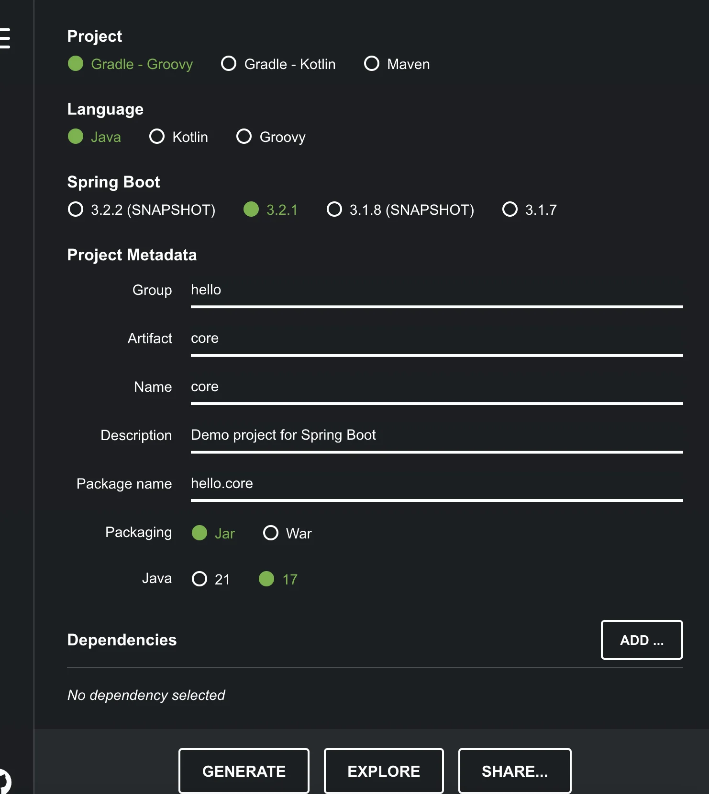
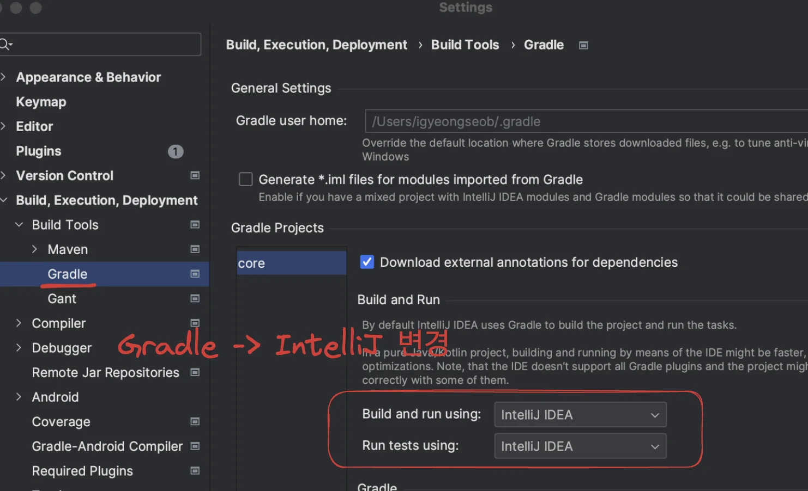

## 1&#46; spring 프로젝트 생성

> https&#58;//start&#46;spring&#46;io

- <strong>Dependencies 추가 x</strong> 

- GENERATE(<code>cmd</code> &#43; <code>enter</code>) 클릭 시 파일 생성 및 다운, 압출 풀고 IntelliJ로 열면 준비완료

### IntelliJ &#45; setting 변경

gradle로 실행이 느림, IntelliJ로 변경 (  IntelliJ에서 자바를 바로 실행 )

> 강의가 엣날 버전임, 그때 당시에는 더 빨랐으나, 지금은 한번 테스트 해봐야 할 듯 → 업데이트된 내용에 스프링 부트 3&#46;2 이전에만 적용된다고 함&#46;      <del>할 필요가 없었음…</del>
