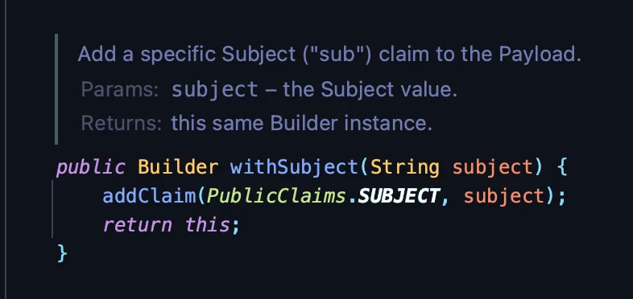

<a id="1c3eda9b0fe181838bb8d7bf58a71fb8"></a>

## JWT

---

> 📖 

<details>
<summary>JWT</summary>

- <em><code>package </code></em><code>com&#46;auth0&#46;jwt;</code>

</details>

<details>
<summary>JWTCreator</summary>

<a id="1c3eda9b0fe1813f8ac8d134f7aaa294"></a>

```java
public static String createToken(String name) {
    return JWT.create()
            .withSubject(name)
            .withIssuedAt(new Date())
            .withExpiresAt(new Date(System.currentTimeMillis() + tokenTimeForMinute * Constants.ON_MINUTE_TO_MILLITS))
            .sign(Algorithm.HMAC256(secretKey));
}
```

- withIssuedAt&#58; 생성 일자 설정

- withExpiresAt&#58; 만료 일자 설정

- sing(Algorithm&#46;<code>XXX</code>(secretkey));
    - 해당 알고리즘과 시크릿 키를 활용하여 JWT signature 생성 

    - <code>XXX</code>&#58; 사용하려는 암호화 알고리즘

<details>
<summary><code>withSubjcet()</code></summary>

- 데이터 값을 넣고 싶다



</details>

</details>

<details>
<summary>Base64</summary>

- <code>org&#46;apache&#46;commons&#46;codec&#46;binary&#46;Base64;</code>

</details>

<details>
<summary>HMAC256</summary>


</details>
