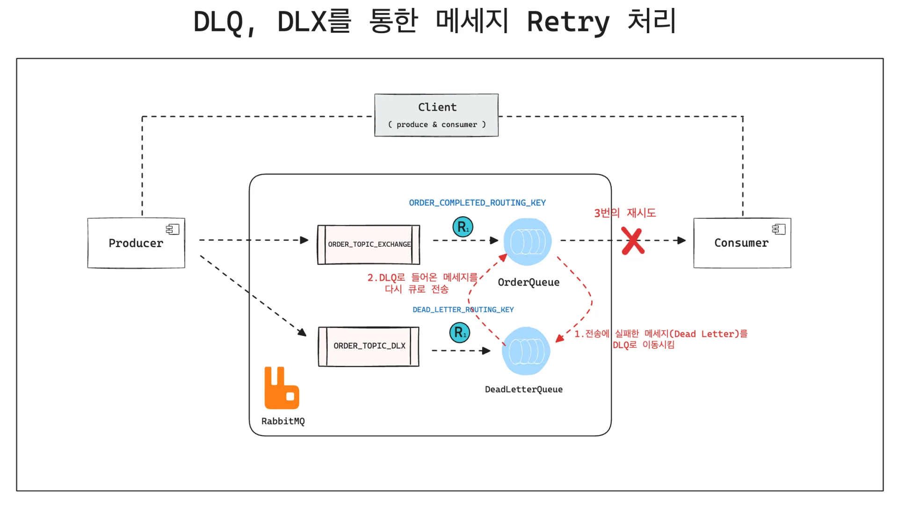
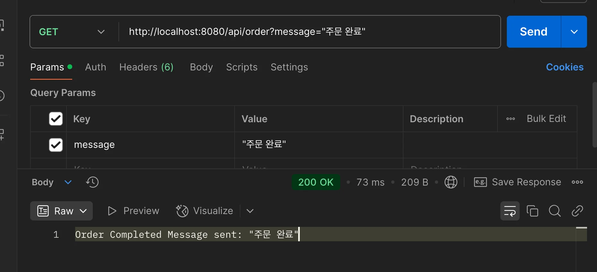
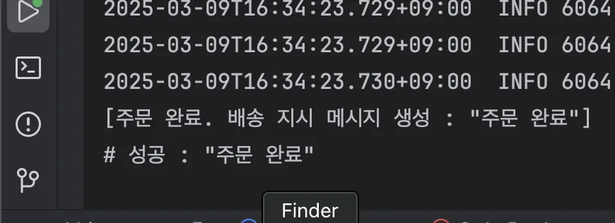

<a id="1c3eda9b0fe181458e58d33a7282d6cc"></a>

## DLQ, DLX를 통한 메세지 Retry

---



<a id="1c3eda9b0fe18134ab46d1862b53085b"></a>

### 코드

[step7: DLQ, DLX를 통한 retry 처리 - AcknowledgeMode.MANUAL](https://github.com/gyungsubLee/RabbitMQ_prac/commit/11e79d382a1a53cdeb880de1736cb0f538f95927)

<details>
<summary>개발 프로세스 </summary>

1. DLQ, DLX 빈 선언

1. SimpleRabbitListenerContainerFactory를 이용하여 AcknowledgeMode 모드를 Manual로 설정
    - Ack/Nack 처리를 개발 시점에 직접 핸들링 하도록 설정

1. Producer 메시지 발행

1. Consumer 에서 메시지 실패건에 대해 (channel&#46;basicReject) 3번의 재시도 후 DLQ 이동 (channel&#46;basicNack)

1. 성공일 경우 Ack 전송 (channel&#46;basicAck)

1. REST API로 성공과 실패건에 대한 테스트 진행 

</details>

- <code>config</code>
    <details>
    <summary>RabbitMQConfig</summary>

    <a id="1c3eda9b0fe18152b1bec659b12498cb"></a>

    ```java
    package com.prac.rabbimq.step7;

    import org.springframework.amqp.core.*;
    import org.springframework.context.annotation.Bean;
    import org.springframework.context.annotation.Configuration;

    @Configuration
    public class RabbitMQConfig {

        public static final String ORDER_COMPLETED_QUEUE = "order_completed_queue";
        public static final String ORDER_EXCHANGE = "order_completed_exchange";
        public static final String ORDER_ROUTING_KEY = "order.completed.*";

        public static final String DLQ = "deadLetterQueue";
        public static final String DLX = "deadLetterExchange";
        public static final String DEADLETTER_ROUTING_KEY = "deadLetterRoutingKey";

        @Bean
        public TopicExchange orderExchange() {
            return new TopicExchange(ORDER_EXCHANGE);
        }

        @Bean
        public TopicExchange deadLetterExchange() {
            return new TopicExchange(DLX);
        }

        // 메세지가 처리되지 못했을 경우 자동으로 DeadLetterQueue 이동시킴
        @Bean
        public Queue orderQueue() {
            return QueueBuilder.durable(ORDER_COMPLETED_QUEUE)
                    .withArgument("x-dead-letter-exchange", DLX) // Dead Letter Exchange 설정
                    .withArgument("x-dead-letter-routing-key", DLQ)
                    .ttl(5000)
                    .build();
        }

        @Bean
        public Queue deadLetterQueue() {
            return new Queue(DLQ);
        }

        @Bean
        public Binding orderCompletedBinding() {
            return BindingBuilder.bind(orderQueue()).to(orderExchange()).with(ORDER_ROUTING_KEY);
        }

        @Bean
        public Binding deadLetterBinding() {
            return BindingBuilder.bind(deadLetterQueue()).to(deadLetterExchange()).with(DEADLETTER_ROUTING_KEY);
        }
    }

    ```

    </details>

    <details>
    <summary>RabbitMQManualConfig &#45; <code>AcknowledgeMode&#46;</code><strong><code>MANUAL</code></strong> 설정</summary>

    <a id="1c3eda9b0fe1810f848edf7c6d488df4"></a>

    ```java
    package com.prac.rabbimq.step7;

    import org.springframework.amqp.core.AcknowledgeMode;
    import org.springframework.amqp.rabbit.annotation.EnableRabbit;
    import org.springframework.amqp.rabbit.config.SimpleRabbitListenerContainerFactory;
    import org.springframework.amqp.rabbit.connection.ConnectionFactory;
    import org.springframework.context.annotation.Bean;
    import org.springframework.context.annotation.Configuration;

    /**
     * RabbitMQ 리스너 설정 커스터마이징
     */
    @EnableRabbit
    @Configuration
    public class RabbitMQManualConfig {

        @Bean
        public SimpleRabbitListenerContainerFactory rabbitListenerContainerFactory(ConnectionFactory connectionFactory) {
            SimpleRabbitListenerContainerFactory factory = new SimpleRabbitListenerContainerFactory();
            factory.setConnectionFactory(connectionFactory);
            // 수정 모드 설정
            factory.setAcknowledgeMode(AcknowledgeMode.MANUAL);
            return factory;
        }
    }
    ```

    </details>

- <code>consumer</code>
    <details>
    <summary>OrderConsumer</summary>

    <a id="1c3eda9b0fe1818d87a1f24de0c9c995"></a>

    ```java
    package com.prac.rabbimq.step7;

    import org.springframework.amqp.rabbit.annotation.RabbitListener;
    import org.springframework.messaging.handler.annotation.Header;
    import org.springframework.stereotype.Component;
    import com.rabbitmq.client.Channel;

    import java.io.IOException;

    @Component
    public class OrderConsumer {

        public static final int MAX_RETRIES = 3; // 총 시도 제한 수
        private int retryCount = 0;

        @RabbitListener(queues = RabbitMQConfig.ORDER_COMPLETED_QUEUE, containerFactory = "rabbitListenerContainerFactory")
        public void processOrder(String message, Channel channel, @Header("amqp_deliveryTag") long tag) {
            try {
                // 실패 유발
                if ("fail".equalsIgnoreCase(message)) {
                    if (retryCount < MAX_RETRIES) {
                        System.err.println("#### Fail  & Retry = " + retryCount);
                        retryCount++;
                        throw new RuntimeException(message);
                    } else {
                        System.err.println("#### 최대 횟수 초과, DLQ 이동 시킴 ");
                        retryCount = 0;
                        channel.basicNack(tag, false, false);
                        return;
                    }
                }
                // 성공 처리
                System.out.println("# 성공 : " + message);
                channel.basicAck(tag, false);
                retryCount = 0;
            } catch (Exception e) {
                System.err.println("# error 발생 : " + e.getMessage());
                try {
                    // 실패 시 basicReject 재처리 전송
                    channel.basicReject(tag, true);
                } catch (IOException e1) {
                    System.err.println("# fail & reject message : " + e1.getMessage());
                }
            }
        }
    }
    ```

    </details>

    <details>
    <summary>OrderDLQConsumer</summary>

    <a id="1c3eda9b0fe18134b95ce1f90356e0dc"></a>

    ```java
    package com.prac.rabbimq.step7;

    import org.springframework.amqp.rabbit.annotation.RabbitListener;
    import org.springframework.amqp.rabbit.core.RabbitTemplate;
    import org.springframework.stereotype.Component;

    @Component
    public class OrderDLQConsumer {

        private final RabbitTemplate rabbitTemplate;

        public OrderDLQConsumer(RabbitTemplate rabbitTemplate) {
            this.rabbitTemplate = rabbitTemplate;
        }

        @RabbitListener(queues = RabbitMQConfig.DLQ)
        public void process(String message) {
            System.out.println("DLQ Message Received: " + message);

            try {
                String fixMessage = "success";

                rabbitTemplate.convertAndSend(
                        RabbitMQConfig.ORDER_EXCHANGE,
                        "order.completed.shipping",
                        fixMessage
                );
                System.out.println("DLQ Message Sent: " + fixMessage);
            } catch (Exception e) {
                System.err.println("### [DLQ Consumer Error] " + e.getMessage());
            }
        }
    }
    ```

    </details>

<details>
<summary><code>producer</code>&#58; OrderProducer</summary>

<a id="1c3eda9b0fe1816d979ae04a943e6e2d"></a>

```java
package com.prac.rabbimq.step7;

import org.springframework.amqp.rabbit.core.RabbitTemplate;
import org.springframework.stereotype.Component;

@Component
public class OrderProducer {

    private final RabbitTemplate rabbitTemplate;

    public OrderProducer(RabbitTemplate rabbitTemplate) {
        this.rabbitTemplate = rabbitTemplate;
    }

    public void sendShpping(String message) {

        rabbitTemplate.convertAndSend(
                RabbitMQConfig.ORDER_EXCHANGE,
                "order.completed.shipping",
                message);
        System.out.println("[주문 완료. 배송 지시 메시지 생성 : " + message + "]");
    }
}
```

</details>

<details>
<summary><code>controller</code>&#58; OrderController</summary>

<a id="1c3eda9b0fe1817c8e94c6c4be9ad967"></a>

```java
package com.prac.rabbimq.step7;

import org.springframework.http.ResponseEntity;
import org.springframework.web.bind.annotation.*;

@RestController
@RequestMapping("/api/order")
public class OrderController {

    private final OrderProducer orderProducer;

    public OrderController(OrderProducer orderProducer) {
        this.orderProducer = orderProducer;
    }


    @GetMapping
    public ResponseEntity<String> sendOrderMessage(@RequestParam String message) {
        orderProducer.sendShpping(message);
        return ResponseEntity.ok("Order Completed Message sent: " + message);
    }
}
```

</details>

---

<details>
<summary>포스트맨 api 호출</summary>

<a id="1c3eda9b0fe1815fb288feb06443dc06"></a>

```plaintext
http://localhost:8080/api/order?message="주문 완료"
```





</details>

<details>
<summary>정리 전</summary>

<a id="1c3eda9b0fe181e3bedcf8069cf650a2"></a>

이 예제를 통해 <code>SimpleRabbitListenerContainerFactory</code>의 <strong>수동 Ack 모드 설정(</strong><code>(AcknowledgeMode&#46;MANUAL)</code>을 통해 메시지의 처리 결과를 RabbitMQ에 명시적으로 전달하고 

<a id="1c3eda9b0fe181829429c4c36bcad693"></a>

<code>basicAck</code>, <code>basicNack</code>, <code>basicReject</code>를 사용하여 메시지 재시도 및 DLQ 처리를 유연하게 구현할 수 있다&#46;

<a id="1c3eda9b0fe181ffae05e0b6889ceb10"></a>

channel&#46;basicAck &#58; 메시지가 성공적으로 처리되었다는 것을 리턴 

- 메시지가 Ack 되면 메시지를 큐에서 삭제하고 다른 소비자에게 전송하지 않음 

- <code>channel&#46;basicAck(tag, </code><strong><code>false</code></strong><code>); </code><em><code>// Ack 전송</code></em><em> </em>
    - deliveryTag(long) 필드는 메시지 고유식별 태그 

    - multiple(boolean) 필드는 true 일 경우 이전의 모든 메시지를 한꺼번에 Ack 처리, false 일 경우 현재 태그의 메시지 하나만 Ack 처리

- <code>channel&#46;basicNack(tag, </code><strong><code>false</code></strong><code>, </code><strong><code>false</code></strong><code>); </code><em><code>// DLQ로 메시지 이동</code></em>
    - deliveryTag, multiple, requeue &#58; basicAck와 동일하며 requeue (boolean)의 경우 true 일 경우 메시지를 큐에 다시 넣어 재처리 하도록 설정, false 의 경우 메시지를 DLQ로 이동 또는 삭제 

- <code>channel&#46;basicReject(deliveryTag, requeue);</code>
    - 파라미터 동일 

<a id="1c3eda9b0fe18150b0b6e48efb116068"></a>

다만 이 처리가 다소 복잡하고, 메서드 호출도 혼동되기 쉬우므로 이런 처리보다는 Spring AMQP에서 제공하는 RetryTemplate을 통해 좀더 명확하고 간단하게 기능을 구현할 수 있다&#46;  

<a id="1c3eda9b0fe1810ca6e4d300423ff3f7"></a>

단, RabbitMQ에서 메시지 처리 실패를 관리하기 위해 수동으로 <code>Ack</code>와 <code>Nack</code>을 호출하는 방식은 <strong>RabbitMQ의 저수준 API</strong>를 명확히 이해를 전제로 하기 때문에 굉장히 세밀한 애플리케이션에는 적용할 수 있겠지만 Production 에서는 유지보수가 어렵다&#46; 

<a id="1c3eda9b0fe1812faf55f183732b5a25"></a>

이 경우 Spring AMQP에서 AcknowledgeMode가 AUTO로 기본 세팅되어 있기 때문에 별도의 SimpleRabbitListenerContainerFactory를 통하지 않고 자동으로 Ack/Nack 처리가 가능하다&#46;

<a id="1c3eda9b0fe18145a58effcfc02185f3"></a>

따라서, RetryTemplate을 통해 좀 더 로직을 쉽게 관리할 수 있도록 추상화된 방식으로 다음 튜토리얼을 참고하도록 한다&#46; 

</details>
