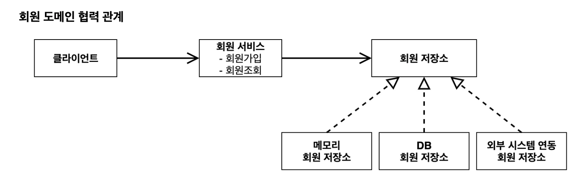
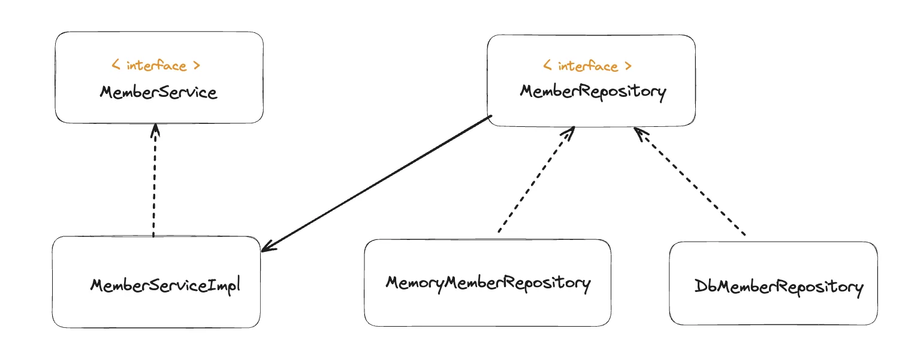
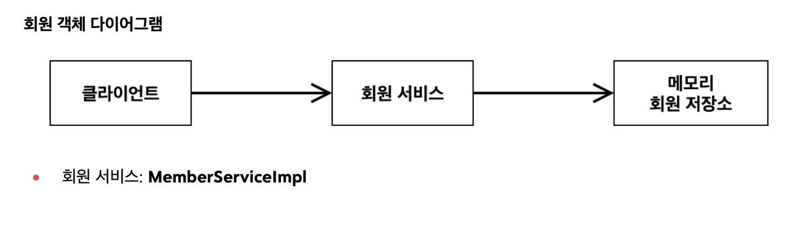

# 회원 도메인 설계

### 회원 도메인 요구사항

> • 회원을 가입하고 조회할 수 있다&#46; • 회원은 &#91; 일반, VIP &#93;  두가지 등급이 있다&#46; • 회원 데이터는 자체 DB를 구축할 수 있고, 외부 시스템과 연동할 수 있다&#46;(미확정)

### 1&#46; 도메인 협력 관계

기획자들도 볼수 있는 관계도, 이 그림을 바탕으로 클래스를 구체화함(클래스 다이어그램)

### 2&#46; 클래스 다이어그램

도메인 협력 관계를 바탕으로 개발자가 구체화해서 클래스 다이어그램을 만든다&#46; 

> 클래스 다이어그램은 실제 서버를 실행하지 않고 클래스들만 분석해서 볼 수 있는 그림이다&#46; 

### 3&#46; 객체 다이어그램

데이터를 <code>memory</code>에 넣을 지 <code>DB</code>에 넣을 지는 서버가 실행되고 동적으로 결정된다&#46; 

> 서버가 실행되고, <code>MemoryMemberReporitory</code> ( or <code>DbMemberRepository</code> )가 new 키워드로 인스턴스가 생성되고 데이터가 들어와 <code>memory</code> (or <code>DB</code>)에 저장된다&#46;

이때,  클라이언트가 실제로 사용하는 인스턴스(객체) 다이어그램이다&#46;

> 메모리 사용 시 →MemoryMemberRepository DB 사용 시 → DbMemberRepository

