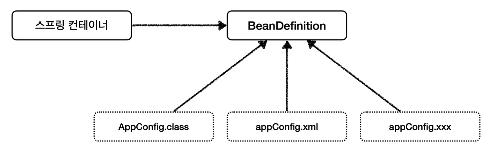
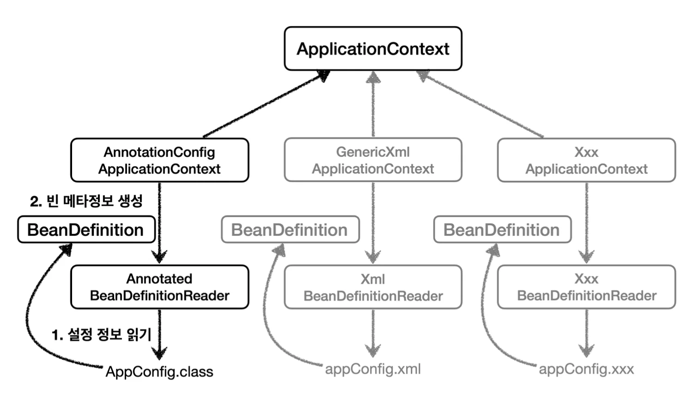

<a id="1c3eda9b0fe181a2ad6bfcd1aef02e36"></a>

# 스프링 빈 설정 메타 정보 &#45; BeanDefinition

<a id="1c3eda9b0fe181ee8f22ff069da3f446"></a>

스프링은 <code>BeanDefinition</code> 이라는 추상화를 통해, 여러 형식의 설정을 지원한다&#46;

<a id="1c3eda9b0fe1819fa272d5e7fd38d71f"></a>

 설정 파일(<strong>자바</strong> or <strong>XML</strong> or …) 을 읽어 BeanDefinition을 만는다&#46;

<a id="1c3eda9b0fe181658441d5f8cd706fc5"></a>

그리고 스프링 컨테이너는 <code>BeanDefinition</code>을 읽어, 스프링 빈을 구성한다&#46; 

> <code>BeanDefinition</code> 을 빈 설정 메타정보라 한다&#46;<br><code>&#64;Bean</code>, <code>&#60;bean&#62;</code>  당 <u>각각 하나씩 메타 정보가 생성</u>되며,<br>스프링 컨테이너는 이 <u>메타정보를 기반</u>으로 <strong>스프링 빈</strong> 을 생성한다&#46;



<a id="1c3eda9b0fe181228f69d96a270e4cc5"></a>

## 코드 레벨



- <code>AnnotationConfigApplicationContext</code>는 <code>AnnotatedBeanDefinitionReader</code> 를 통해, <code>AppConfig&#46;class</code>를 읽고 <code>BeanDefinition</code>을 생성한다&#46; 

- <code>GenericXmlApplicationContext</code> 는 <code>XmlBeanDefinitionReader</code>를 통해, <code>appConfig&#46;xml</code>설정 정보를 읽고 <code>BeanDefinition</code>을  생성한다&#46; 

- <code>새로운 형식의 설정 정보</code>가 추가되면, <code>XxxBeanDefinitionReader</code>를 만들어서 <code>BeanDefinition</code>을 생성하면 된다&#46;

<a id="1c3eda9b0fe181f49d91fc3c0bc1b1f7"></a>

### BeanDefinition 살펴보기

> <strong>BeabDefinition 정보</strong>
> 
> - BeanClassName&#58; 생성할 빈의 클래스 명 (자바 설정처럼 팩토리 역할의 빈을 사용하면 없음)
> 
> - factoryBeanName&#58; 팩토리 역할의 빈을 사용할 경우 이름   ex) appConfig
> 
> - factoryMethodName&#58; 빈을 생성할 팩토리 메서드 지정   ex) memberService
> 
> - Scope&#58; 싱글톤(기본값)
> 
> - lazylnit&#58; 스프링 컨테이너를 생성할 때, 빈을 생성하는 것이 아닌,  실제 빈을 사용할 때까지 최대한 생성을 지연 처리 하는지 여부
> 
> - initMethodName&#58; 빈을 생성하고, 의존관계를 적용한 뒤에 호출되는 초기화 메서드 명
> 
> - DestroyMethodName&#58; 빈의 생명주기가 끝나서 제거하기 직전에 호출되는 메서드 명
> 
> - Constructor arguments, Properties&#58; 의존관계 주입에서 사용한다&#46; (자바 설정 처럼 팩토리 역할의 빈을 사용하면 없음)

<a id="1c3eda9b0fe181729c31dff36ccf02be"></a>

### BeanDefinitionTest

> test…beanDefinition&#46;BeanDefinitionTest

<a id="1c3eda9b0fe181408e0df2f0c5429fc3"></a>

```java
package hello.core.beanDefinition;

import hello.core.AppConfig;
import org.junit.jupiter.api.DisplayName;
import org.junit.jupiter.api.Test;
import org.springframework.beans.factory.config.BeanDefinition;
import org.springframework.context.annotation.AnnotationConfigApplicationContext;

public class BeanDefinitionTest {
    AnnotationConfigApplicationContext ac = new AnnotationConfigApplicationContext(AppConfig.class);
    
    
    @DisplayName("빈 설정 메타정보 확인")
    @Test
    void findApplicationBean() {
        String[] beanDefinitionNames = ac.getBeanDefinitionNames();
        for (String beanDefinitionName : beanDefinitionNames) {
            BeanDefinition beanDefinition = ac.getBeanDefinition(beanDefinitionName);
 
            if (beanDefinition.getRole() == BeanDefinition.ROLE_APPLICATION){
                System.out.println("beanDefinitionName = " + beanDefinitionName +
                " beanDefinition = " + beanDefinition);
            }
        }

    }
}
```

- 출력

<a id="1c3eda9b0fe18166891bcba67a0c0115"></a>

```plaintext
beanDefinitionName = appConfig beanDefinition = Generic bean: class [hello.core.AppConfig$$SpringCGLIB$$0]; scope=singleton; abstract=false; lazyInit=null; autowireMode=0; dependencyCheck=0; autowireCandidate=true; primary=false; factoryBeanName=null; factoryMethodName=null; initMethodNames=null; destroyMethodNames=null
beanDefinitionName = memberService beanDefinition = Root bean: class [null]; scope=; abstract=false; lazyInit=null; autowireMode=3; dependencyCheck=0; autowireCandidate=true; primary=false; factoryBeanName=appConfig; factoryMethodName=memberService; initMethodNames=null; destroyMethodNames=[(inferred)]; defined in hello.core.AppConfig
beanDefinitionName = orderService beanDefinition = Root bean: class [null]; scope=; abstract=false; lazyInit=null; autowireMode=3; dependencyCheck=0; autowireCandidate=true; primary=false; factoryBeanName=appConfig; factoryMethodName=orderService; initMethodNames=null; destroyMethodNames=[(inferred)]; defined in hello.core.AppConfig
beanDefinitionName = memberRepository beanDefinition = Root bean: class [null]; scope=; abstract=false; lazyInit=null; autowireMode=3; dependencyCheck=0; autowireCandidate=true; primary=false; factoryBeanName=appConfig; factoryMethodName=memberRepository; initMethodNames=null; destroyMethodNames=[(inferred)]; defined in hello.core.AppConfig
beanDefinitionName = discountPolicy beanDefinition = Root bean: class [null]; scope=; abstract=false; lazyInit=null; autowireMode=3; dependencyCheck=0; autowireCandidate=true; primary=false; factoryBeanName=appConfig; factoryMethodName=discountPolicy; initMethodNames=null; destroyMethodNames=[(inferred)]; defined in hello.core.AppConfig
```

<a id="1c3eda9b0fe1816f8b5df8185ace03b1"></a>

### 정리 

<a id="1c3eda9b0fe1818eb77dceb52f8b958e"></a>

BeanDefinition을 직접 생성하여 스프링 컨테이너에 등록할 수 이싿&#46; 하지만 실수에서 BeanDefinition을 직접 정이ㅡ하거나 사용할 일은 거의 없다&#46; → 어려우면 그냥 넘어가도 됨&#46;

<a id="1c3eda9b0fe1811fa5fbf73b196e985f"></a>

BeanDefinition에 대해서는 너무 깊이있게 이해하기 보단, <strong>스프링이 다양한 형태의 설정 정보를 BeanDefinition으로 추상화해서 사용</strong>하는 것 정도만 알면 된다&#46;
