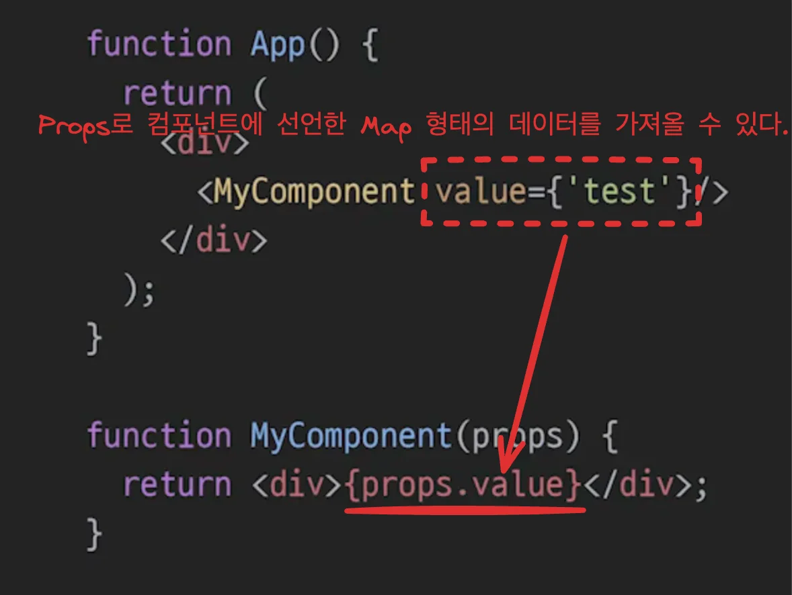
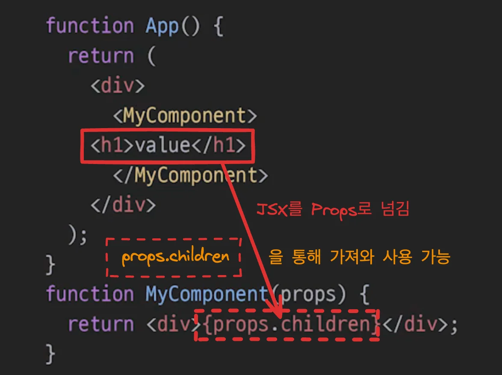

<a id="1c3eda9b0fe1811ea4c2fa8ae8a97f68"></a>

## Props

---

> 📖 
> 
> <a id="1c3eda9b0fe181d09c08cdb8c71ecb12"></a>
> 
> <u>부모 컴포넌트</u>에서 <u>자식 컴포넌트</u>로 <strong><u>내려주는 데이터</u></strong>

<details>
<summary>Props 예시</summary>

- 예시 1 &#45; Map 형태의 데이터
    

- 예시 2 &#45; JSX ( <code>Props&#46;children</code> )
    

</details>

<details>
<summary>컴포넌트 실습</summary>

> 컴포넌트는 <code>components</code>라는 폴더 하위에 놓는다&#46;

- components
    <details>
    <summary>Heading&#46;jsx</summary>

    <a id="1c3eda9b0fe181b9960ce8efb636271f"></a>

    ```javascript
    export default function Heading(props) {
      if (props.type === "h2") {
        return <h2>{props.children}</h2>;
      }

      return <h1>{props.children}</h1>;
    }
    ```

    <details>
    <summary>1&#46; props 받아오기 위해서는 하위 컴포넌트(함수)에 인자로 props를 넘겨줘야 한다 &#46;</summary>

    <a id="1c3eda9b0fe181bdbe46f5c9929d6b69"></a>

    ```javascript
    export default function Heading(props) {
    ```

    </details>

    <details>
    <summary>2&#46; 태그 사이에 선언한 value는 <code>props&#46;children</code>으로 받아온다&#46; </summary>

    <a id="1c3eda9b0fe1810b841cf24193f6df04"></a>

    ```javascript
    // App.js
    <Heading type="h2">World</Heading>

    // Heading.js
    return <h1>{props.children}</h1>;
    ```

    </details>

    <details>
    <summary>3&#46; 태그 안에 선언한 value는 <code>props&#46;{key}</code>로 받아온다&#46; </summary>

    <a id="1c3eda9b0fe1817dbb9ae1ea319b64de"></a>

    ```javascript
    // App.js
    <Heading type="h2">World</Heading>

    // Heading.js
    export default function Heading(props) {
      if (props.type === "h2") {
        return <h2>{props.children}</h2>;
      }
    ```

    </details>

    </details>

<details>
<summary>App&#46;jsx</summary>

<a id="1c3eda9b0fe18130bc58e1c7fbf2f208"></a>

```javascript
import "./styles.css";
import Heading from "./components/Heading";

export default function App() {
  return (
    <div className="App">
      <Heading>Heading</Heading>
      <Heading type="h2">World</Heading>
      <h2>Start editing to see some magic happen!</h2>
    </div>
  );
}
```

</details>

</details>
