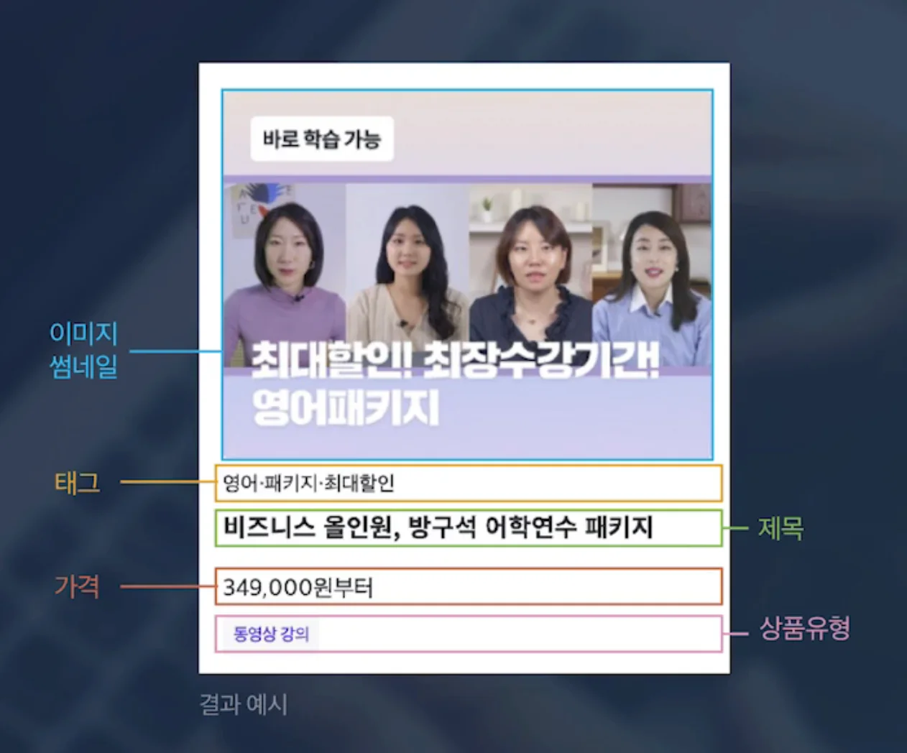

<a id="1c3eda9b0fe1819c9142fe3f9457bd17"></a>

## 실습 

---

> 📖 

<details>
<summary>제작할 컴포넌트 예시 </summary>



- <code>이미지 주소</code>, <code>태그</code>(영어, 패키지, 최대할인), <code>제목</code>, <code>가격</code>, <code>유형</code>(동영상 강의)을 Props로 받아서 처리

- 태그, 유형&#58; 배열

- 가격&#58; 3자리마다 콤마(<code>,</code>)

</details>

<details>
<summary></summary>

<a id="1c3eda9b0fe181229f7ec2752555000e"></a>

```javascript

```

</details>
