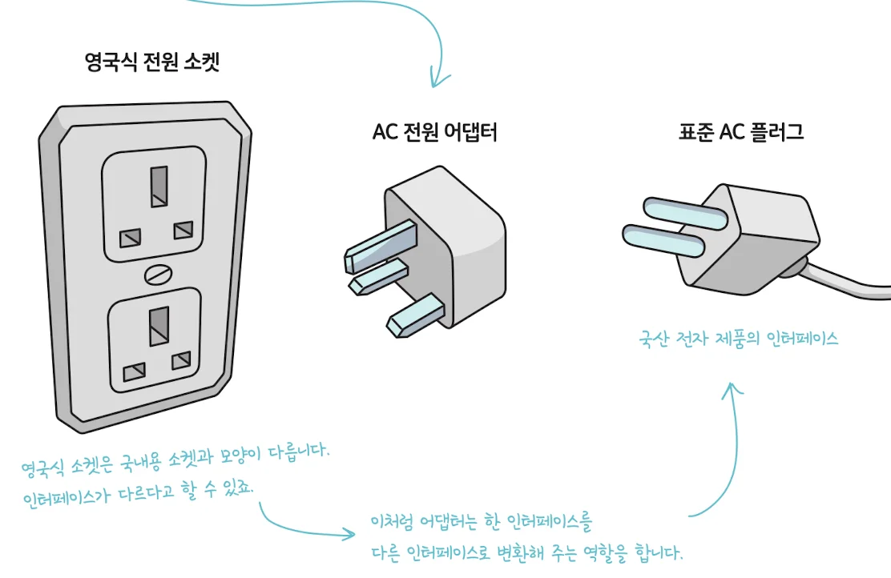
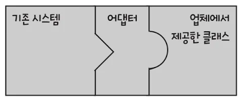
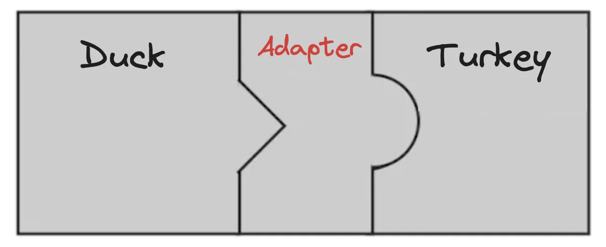
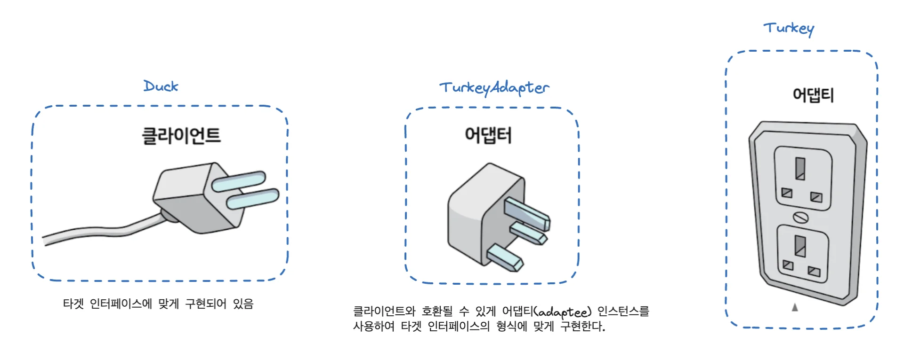
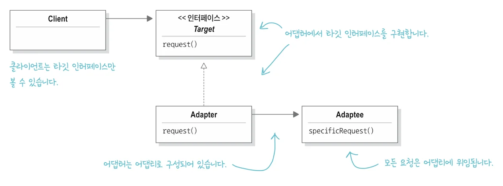
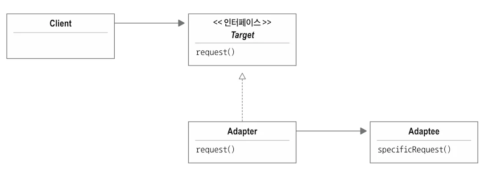
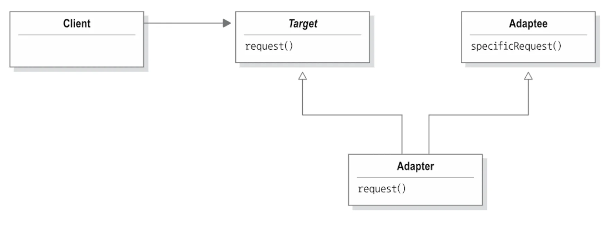
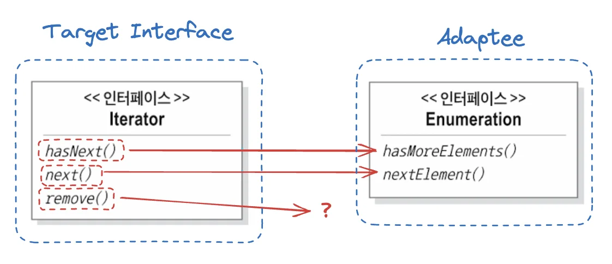
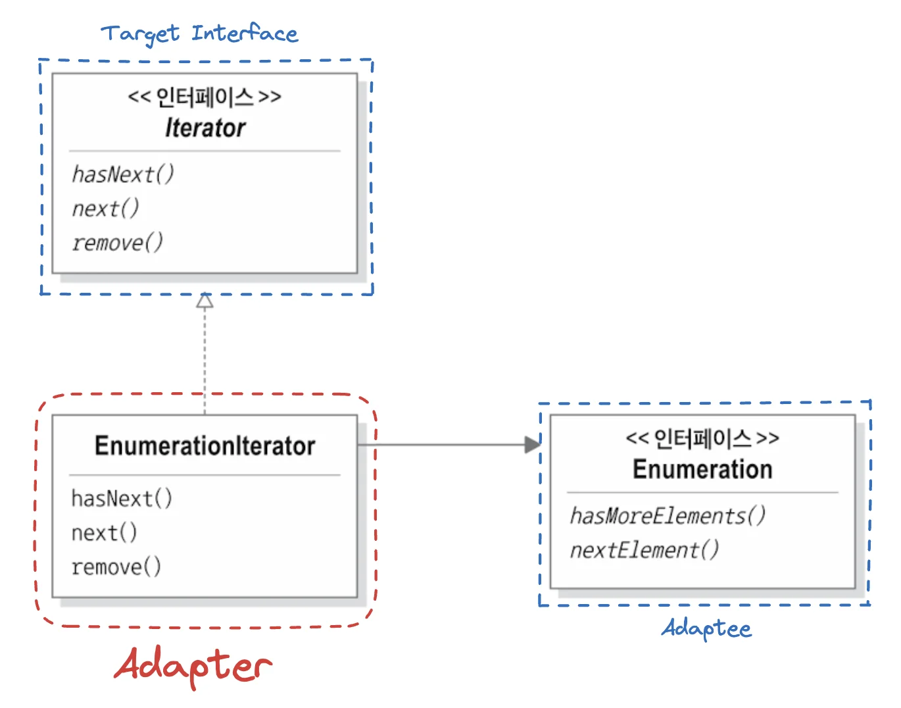

<a id="1c3eda9b0fe181a88524d1e239cb95ee"></a>

## 어댑터 

---



<a id="1c3eda9b0fe181749703d322b4cb0225"></a>

위 그림과 같이 어댑터는<u> 호환되지 않는 2개는 물체</u>를 중간에 변환기(어댑터)를 통해 <u>연결</u>해주는 역할을 한다&#46;

<a id="1c3eda9b0fe181bfaccdd7afa04de47f"></a>

## 객체지향 어댑터 

---

> 📌 
> 
> <a id="1c3eda9b0fe1815b9b87f71d589ebb1f"></a>
> 
> <strong>어댑터 패턴</strong>
> 
> <a id="1c3eda9b0fe181979610dc688d49f592"></a>
> 
> 특정 클래스 인터페이스를 클라이언트에서 요구하는 다른 인터페이스로 변환한다&#46; 
> 
> <a id="1c3eda9b0fe18189a49aed7260f10410"></a>
> 
> 인터페이스가 호환되지 않아 같이 쓸 수 없었던 클래스를 사용할 수 있게 한다&#46;

<a id="1c3eda9b0fe1810fa00bee4c41981fc5"></a>

어떤 인터페이스를 클라이언트에서 요구하는 형태로 적응시키는 역할을 한다&#46;



<a id="1c3eda9b0fe181b59067f5d2bb33d2b5"></a>

어떤 소프트웨어 시스템에 새로운 업체에서 제공한 클래스 라이브러리를 사용해야 하는데, 

<a id="1c3eda9b0fe181e1b601fe035adff466"></a>

그 업체에서 사용하는 인터페이스가 기존에 사용하던 인터페이스와 다르다고 한다면 

<a id="1c3eda9b0fe1818791faeac30dab847b"></a>

위 그림과 같이 새로운 업체에서 사용하는 인터페이스를 기존에 사용하던 인터페이스에 적응시켜 주는 클래스인 어댑터를 만들면 된다&#46;

<a id="1c3eda9b0fe181efa4baf0db3efde1ef"></a>

## 사용 예시

---

<details>
<summary>&#91; 코드 &#93; &#60; interface &#62; Duck</summary>

<a id="1c3eda9b0fe18114b2add1ed8c6ba0ba"></a>

```java
package adapter.ex1;

public interface Duck {
    public void quack();
    public void fly();
}

```

</details>

<details>
<summary>&#91; 코드 &#93; MallardDuck</summary>

<a id="1c3eda9b0fe1818fb7a0fe7f78adde9a"></a>

```java
package adapter.ex1;

public class MallardDuck implements Duck {
    public void quack() {
        System.out.println("꽥");
    }

    public void fly() {
        System.out.println("날고 있어요!");
    }
}

```

</details>

<details>
<summary>&#91; 코드 &#93; &#60; interface &#62; Turkey</summary>

<a id="1c3eda9b0fe18163b534ca2dabc53ba8"></a>

```java
package adapter.ex1;

public interface Turkey {
    public void gobble();
    public void fly();
}

```

</details>

<details>
<summary>&#91; 코드 &#93; WildTurkey</summary>

<a id="1c3eda9b0fe181b5ba79db10c14208e6"></a>

```java
package adapter.ex1;

public class WildTurkey implements Turkey {
    public void gobble() {
        System.out.println("골골");
    }

    public void fly() {
        System.out.println("짧은 거리를 날고 있어요!");
    }
}

```

</details>

<a id="1c3eda9b0fe181048e99fd2e32426866"></a>

예를 들어 Duck 객채가 모자라, Turkey 객체를 사용해야 하는 상황이라고 한다면,

<a id="1c3eda9b0fe181869ef1f8480197874c"></a>

두 객채는 다른 인터페이스를 가지고 있기 때문에, Turkey 인터페이스를 Duck 인터페이스 형식에 맞춰야 한다&#46; 



<a id="1c3eda9b0fe1810d8806e185d84cf841"></a>

이를 아래와 같이 어댑터 객체를 통해, 두 인터페이스가 호환될 수 있도록 한다&#46;

<details>
<summary>&#91; 코드 &#93; TurkeyAdapter</summary>

<a id="1c3eda9b0fe18156a0ffd1e42061d4b5"></a>

```java
package adapter.ex1;

public class TurkeyAdapter implements Duck {
    Turkey turkey;

    public TurkeyAdapter(Turkey turkey) {
        this.turkey = turkey;
    }

    @Override
    public void quack() {
        turkey.gobble();
    }

    @Override
    public void fly() {
        
        /** Turkey의 fly()는 짧은 거리를 날기 때문에,
         *  Duck의 fly()에 대응시키기 위해 5번을 호출하여 더 멀리 날수 있도록 함
         */
        for (int i = 0; i < 5; i++) {
             turkey.fly();
        }
    }
}
```

</details>

<details>
<summary><strong>테스트</strong></summary>

<details>
<summary>&#91; 코드 &#93; DuckTestDrive</summary>

<a id="1c3eda9b0fe181e9b124e4d59e1d6566"></a>

```java
package adapter.ex1;

public class DuckTestDrive {
    public static void main(String[] args) {
        Duck duck = new MallardDuck();

        Turkey turkey = new WildTurkey();
        Duck turkeyAdapter = new TurkeyAdapter(turkey);

        System.out.println("===========찰면조===========");
        turkey.gobble();
        turkey.fly();

        System.out.println("===========오리===========");
        testDuck(duck);

        System.out.println("===========칠면조 어댑터===========");
        testDuck(turkeyAdapter);
    }

    static void testDuck(Duck duck) {
        duck.quack();
        duck.fly();
    }
}
```

</details>

<details>
<summary>출력 확인</summary>

<a id="1c3eda9b0fe181c49904ec8d2794f52d"></a>

```plaintext
===========찰면조===========
골골
짧은 거리를 날고 있어요!
===========오리===========
꽥
날고 있어요!
===========칠면조 어댑터===========
골골
짧은 거리를 날고 있어요!
짧은 거리를 날고 있어요!
짧은 거리를 날고 있어요!
짧은 거리를 날고 있어요!
짧은 거리를 날고 있어요!
```

</details>

</details>

<details>
<summary>&#43;) Duck 클래스 Turkey로 변환하는 DuckAdapter 만들기 </summary>

<details>
<summary>&#91; 코드 &#93; DuckAdapter</summary>

<a id="1c3eda9b0fe1812386bcd3f9c5bff83a"></a>

```java
package adapter.ex1;

import java.util.Random;

public class DuckAdapter implements Turkey{
    Duck duck;
    Random rand;

    public DuckAdapter(Duck duck) {
        this.duck = duck;
        this.rand = new Random();
    }

    @Override
    public void gobble() {
        duck.quack();
    }

    @Override
    public void fly() {
        if (rand.nextInt(5) == 0){
            duck.fly();
        }
    }
}
```

</details>

</details>

<a id="1c3eda9b0fe18102af5ada26c5164ede"></a>

## 어댑터 동작 방식 이해 

---





- <code>타겟 인터페이스</code>&#58; 요구사항을 만족하는 인터페이스

- <code>클라이언트</code>&#58; 타겟 인터페이스에 맞게 구현됨

- <code>어댑터(Adapter)</code>&#58; 클라이언트와의 호환을 위해 어댑티(Adaptee)를 사용하여 타겟 인터페이스 형식에 맞게 변환

- <code>어댑티(Adaptee)</code><strong>&#58;</strong> 기존에 존재하던 인터페이스 

<details>
<summary>🧐 클라이언트에서는 어댑터의 유무를 알지 못한다&#46; </summary>

1. 클라이언트에서 타깃 인터페이스로 메서드를 호출, <u>어댑터</u>에 요청을 보낸다&#46;

1. <strong><u>어댑터</u></strong>는 해당 요청을 <strong><u>어댑티</u></strong>에 관한 메서드 호출로 변환 후 결과를 클라이언트로 반환한다&#46;

1. 클라이언트는 호출 결과를 받지만, 중간에 어댑터가 있다는 사실을 모른다&#46; 

</details>

<details>
<summary>🧐 <code>객체 어댑터</code> vs <code>클래스 어댑터</code></summary>

> 어댑터 패턴은 두 종류가 있다&#46; 

- 객체 어댑터
    

    - 지금까지 정리한 내용이 객체 어댑터이다&#46; 

    - 객체의 <strong><u><code>구성(Composition)</code></u></strong>을 활용하여 어댑티를 타겟 인터페이스와 호환 시킨다&#46;

- 클래스 어댑터
    - 클래스 어댑터를 사용하려면 <strong><u>다중 상속</u></strong>이 필요한데, 자바에서는 다중 상속이 불가능하므로 책에서는 간단하게만 정리한다&#46; 
        

        - 구조는 객체 어댑터와 동일하다&#46;

        - 어댑티를 적응 시킬 때 <code>구성</code> 대신,<code> 어댑터</code>를 <code>어댑티</code> 와 <code>타깃 클래스</code>의 <strong><u>서브 클래스</u></strong>로 만들어 사용한다&#46;

</details>

<details>
<summary>🧐 어댑터 패턴은 여러 객체지향 원칙을 반영하고 있다&#46; 어댑티를 새로 바뀐 인터페이스로 감쌀 때는, <br>객체 구성(composition)을 사용한다&#46; 이런 접근법은 어댑티의 모든 서브클래스에 어댑터를 쓸 수 있는 장점이 있다&#46;  &#45;p 279 </summary>

<a id="1c3eda9b0fe1816da356f59153953c92"></a>

구성에 대한 개념의 이해가 부족해서 생긴 의문점이다&#46; 

<a id="1c3eda9b0fe181d28e94f61be0725fd9"></a>

→ 아래 정리 참조

</details>

<details>
<summary>🧐 <code>구성(Composition)</code> vs <code>상속</code></summary>

- 상속
    - 부모 클래스로부터 기능을 물려받아 자식 클래스에서 사용 및 확장하는 방법

    - <code>is&#45;a(상속) 관계</code> 
        - ex) ‘자동차는 탈것이다&#46;’

- 구성(Composition)
    - 한 클래스가 <u>다른 클래스의 객체</u>를 <strong><u>자신의 필드로 포함</u></strong>하여<strong><u> 기능을 활용</u></strong>하는 방법

    - <code>has&#45;a(포함) 관계</code>
        - ex) ‘자동차는 엔진을 가지고 있다&#46;’

</details>

<details>
<summary>🧐<strong> 구성(Composition)</strong>,<code>포함(has&#45;a)관계</code></summary>

<a id="1c3eda9b0fe18132be5df53f411e3813"></a>

객체지향 프로그래밍(OOP)에서 ‘<strong><u>객체의 구성을 활용한다’</u></strong>는 말은 구성(Composition)을 사용하여 <strong><u>한객체가 다른 객체를 포함해 사용하는 방식</u></strong>으로 <strong><u>기능을 확장</u></strong>하거나 <strong><u>구현</u></strong>하는 것을 뜻 한다&#46; 

- 장점
    - 유연성&#58; 구성된 객체를 독립적으로 바꾸거나 확장 가능

    - 재사용성&#58; 다른 클래스에서 동일한 객체(ex&#46; Engine) 재사용 가능

    - 낮은 결합도&#58; 상속보다 낮은 결합도를 갖음

- 구성 활용 예시 &#45; <u>객체 필드 선언</u> 및 <u>생성자 주입</u>
    <a id="1c3eda9b0fe1811498aee623c0873eb8"></a>

    ```java
    class Car {
        private Engine engine; // 엔진 객체를 구성 요소로 포함

        public Car(Engine engine) {
            this.engine = engine;
        }
    	 
    	 .  .  .
    ```

- ex)
    <details>
    <summary>&#91; 코드 &#93; Engine</summary>

    <a id="1c3eda9b0fe1811b87e4cac91487786c"></a>

    ```java
    class Engine {
        public void start() {
            System.out.println("엔진이 시작됩니다.");
        }
    }
    ```

    </details>

    <details>
    <summary>&#91; 코드 &#93; Car</summary>

    <a id="1c3eda9b0fe18110b5fadb99bb60eaa1"></a>

    ```java
    class Car {
        private Engine engine; // 엔진 객체를 구성 요소로 포함

        public Car(Engine engine) {
            this.engine = engine;
        }

        public void startCar() {
            engine.start(); // 엔진 객체의 기능을 활용
            System.out.println("자동차가 출발합니다.");
        }
    }
    ```

    </details>

    <details>
    <summary>&#91; 코드 &#93; Main</summary>

    <a id="1c3eda9b0fe18113b0badd48f6ef40e4"></a>

    ```java
    public class Main {
        public static void main(String[] args) {
            Engine engine = new Engine(); // 엔진 객체 생성
            Car car = new Car(engine); // 엔진을 포함한 자동차 생성
            car.startCar();
        }
    }
    ```

    </details>

</details>

<details>
<summary>🧐 <strong><code>구성(Composition)</code></strong><strong> </strong>&#43;  <strong><code>다형성(Polymorphism)</code></strong> → <strong><code>DIP(의존성 역전 원칙)</code></strong></summary>

- <code>DIP(Dependency Inversion Principle)</code> 는 <code>구성</code>과 <code>다형성</code>을 효과적으로 활용하는 객체 지향 설계의 SOLID 원칙 중 하나이다&#46;

- DIP의 목적은 <u>높은 유연성</u>과 <strong><u>낮은 결합도</u></strong>를 통해 <strong><u>코드의 확장</u></strong>과 <strong><u>유지보수성을 높</u></strong>이는 것이다&#46;

- 이를 <code>구성(Composition)</code> 과 <code>다형성(Polymorphism)</code> 을 통해 <strong><u>의존성을 인터페이스나 추상 클래스에 두고</u></strong>, <strong><u>구체적인 구현을 외부에서 주입(Dependency Injection)하는 방식</u></strong>으로 구현한다&#46; 

<details>
<summary>DIP 핵심 원칙</summary>

> <strong>1&#46;</strong> <strong>상위 모듈이 하위 모듈에 의존하지 않게 한다&#46; </strong>

- 즉, 코드의 고수준(상위) 로직이 저수준(하위) 모듈에 종속되지 않도록<br>구체적인 클래스가 아닌 <strong><u>추상화된 인터페이스</u></strong>나 <strong><u>추상 클래스</u></strong>에 <u>의존</u>하게 한다&#46; 

> <strong>2&#46;  추상화는 구체화에 의존하지 않아야 한다&#46;</strong>

- 인터페이스와 같은 추상 타입은 구체적인 구현에 영향을 받지 않게 설계하여 유연하게 변경할 수 있도록 한다&#46;

</details>

<details>
<summary>DIP에서의 <code>구성</code>, <code>다형성</code> 사용</summary>

- <strong>구성(Composition)</strong>
    - DIP를 따르는 구조에서 <code>구성</code>은 <u>구체적인 객체가 아닌</u> <strong><u>인터페이스를 필드로 구성</u></strong>한다&#46;

- <strong>다형성(Polymorphism)</strong>
    - 추상화된 인터페이스를 구현한 여러 구체 클래스들이 다형성을 통해 교체 가능하다&#46;

</details>

<details>
<summary><code>구성</code> 과 <code>다형성</code>을 활용한 DIP 예시</summary>

<details>
<summary>&#91; 코드 &#93; &#60; interface &#62; <code>Printer</code> </summary>

<a id="1c3eda9b0fe1816aa864caa14aa94e2d"></a>

```java
interface Printer {
    void print();
}
```

</details>

<details>
<summary>&#91; 코드 &#93; <code>InkjetPrinter</code> &#45; 구현 클래스</summary>

<a id="1c3eda9b0fe181749f29e206404ce87f"></a>

```java
class InkjetPrinter implements Printer {
    @Override
    public void print() {
        System.out.println("잉크젯 프린터로 인쇄합니다.");
    }
}
```

</details>

<details>
<summary>&#91; 코드 &#93; <code>LaserPrinter</code> &#45; 구현 클래스</summary>

<a id="1c3eda9b0fe1818b9db2dbcfcf57d6b7"></a>

```java
class LaserPrinter implements Printer {
    @Override
    public void print() {
        System.out.println("레이저 프린터로 인쇄합니다.");
    }
}
```

</details>

<details>
<summary>&#91; 코드 &#93; <code>Computer</code> &#45; Printer 인터페이스(상위 모듈)에 의존하는 클래스</summary>

- 상위 모듈(<code>Printer 인터페이스</code>)에 의존하는 Computer 클래스

<a id="1c3eda9b0fe181e4b047cf063f564a3a"></a>

```java
class Computer {
    private Printer printer; // Printer 인터페이스에 의존

		// 생성자 주입을 통해 외부에서 Printer의 구현체를 주입받음
    public Computer(Printer printer) { 
        this.printer = printer;
    }

    public void printDocument() {
        printer.print(); // Printer의 구체적인 타입과 관계없이 호출 가능
    }
}
```

</details>

<details>
<summary>&#91; 코드 &#93; Main</summary>

- DIP를 따른 Computer 클래스는 <strong><u>Printer 인터페이스에 의존</u></strong>하며, 구체적인 Printer(구현 클래스)에 신경 쓰지 않음

<a id="1c3eda9b0fe181c0b24bdcbc44478715"></a>

```java
public class Main {
    public static void main(String[] args) {
        Printer inkjetPrinter = new InkjetPrinter(); // 구체 구현체 생성
        Printer laserPrinter = new LaserPrinter();   // 다른 구체 구현체 생성

        Computer computer = new Computer(inkjetPrinter);
        computer.printDocument();  // 잉크젯 프린터로 인쇄합니다.

        computer = new Computer(laserPrinter);
        computer.printDocument();  // 레이저 프린터로 인쇄합니다.
    }
}
```

</details>

</details>

</details>

<a id="1c3eda9b0fe181bb8cebf7581d55975c"></a>

## 어댑터 패턴 실전 적용

---

<a id="1c3eda9b0fe18196af21ee30841a3a76"></a>

### Enumeration을 Iterator에 적응 시키기



<a id="1c3eda9b0fe1811a902bd220f2db915f"></a>

### 어댑터 디자인



- <code>remove()</code>
    <a id="1c3eda9b0fe1816ba305ebdc82ea5baa"></a>

    Enumeration은 <code>remove()</code>에 해당하는 기능을 제공하지 않는다&#46; 

    <a id="1c3eda9b0fe18142b539d7a044df80c3"></a>

    어댑터 차원에서는 <code>remove()</code> 메서드를 구현 방법이 존재하지 않는다&#46;

    <a id="1c3eda9b0fe181eb957ded71e363b172"></a>

    그나마 가장 좋은 방법이 런타임 예외를 던지는 것이다&#46; 

    <a id="1c3eda9b0fe1814c997cd01ad56aae77"></a>

    아래의 경우는, 다행히도 Iterater 인터페이스 디자인 시에 <code>UnsupportedOperationException</code>을 지원하도록 만들었다&#46;

    <a id="1c3eda9b0fe181d29b94da2a4762b717"></a>

    이처럼  메서드가 일대일로 대응되지 않는 상황에서는 어댑터를 완벽하게 적용할 수는 없다&#46; 

    <a id="1c3eda9b0fe18138b043ee092c0b2f38"></a>

    따라서 클라이언트에서는  예외 발생 가능성을 염두하여, 어댑터 문서를 잘 만들어야 한다&#46; 

---

<details>
<summary>&#91; 코드 &#93; Enumeration 어댑터&#58; <code>EnumerationIterator</code></summary>

<a id="1c3eda9b0fe18199ac7dc933c1a6d8e6"></a>

```java
public class EnumerationIterator implements Iterable<Object>{
    Enumeration<?> enumeration;

    public EnumerationIterator(Enumeration<?> enumeration) {
        this.enumeration = enumeration;
    }

    public boolean hasNext() {
        return enumeration.hasMoreElements();
    }

    public Object next() {
        return enumeration.nextElement();
    }

    public void remove() {
        throw new UnsupportedOperationException();
    }
}
```

</details>

<details>
<summary>&#43;) Iterator를 Enumeration로 변환시켜 주는 어댑터 만들기</summary>

<details>
<summary>&#91; 코드 &#93; IteratorEnumeration</summary>

<a id="1c3eda9b0fe1819497e3fe15a5acece5"></a>

```java
package adapter.ex2;

import java.util.Enumeration;
import java.util.Iterator;

public class IteratorEnumeration implements Enumeration<Object> {
    Iterator<?> iterator;

    public IteratorEnumeration(Iterator<?> iterator) {
        this.iterator = iterator;
    }

    @Override
    public boolean hasMoreElements(){
        return iterator.hasNext();
    }

    @Override
    public Object nextElement(){
        return iterator.next();
    }
}
```

</details>

</details>
