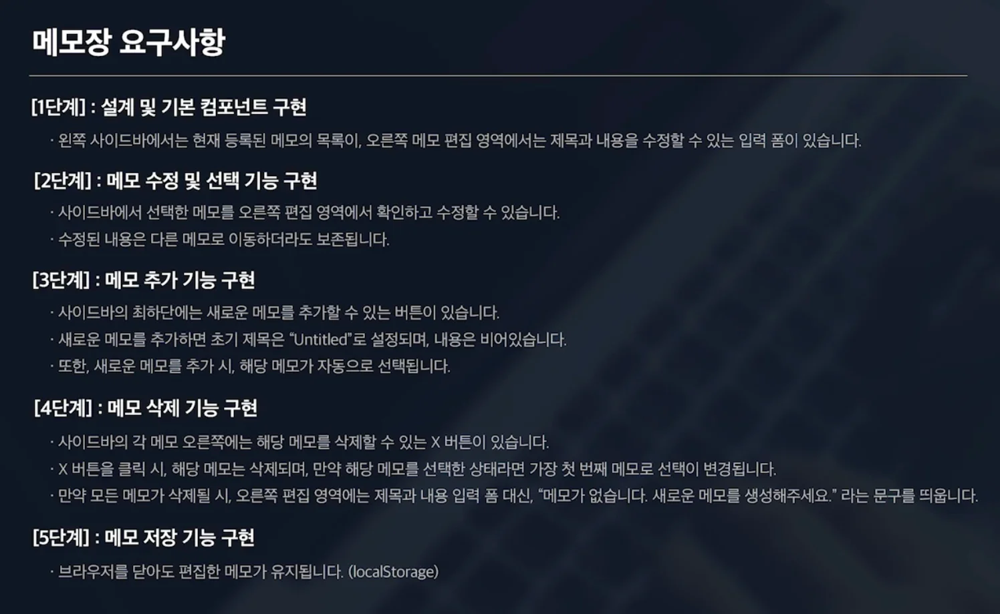
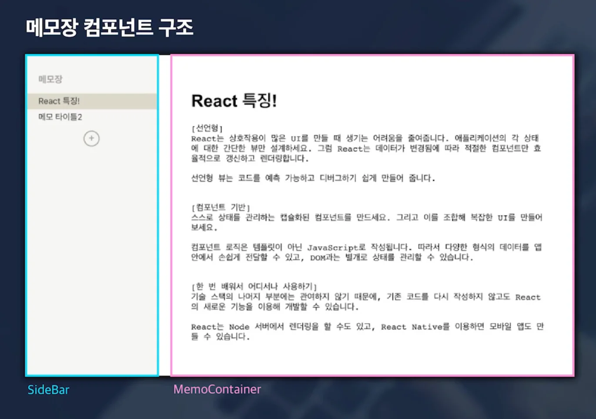
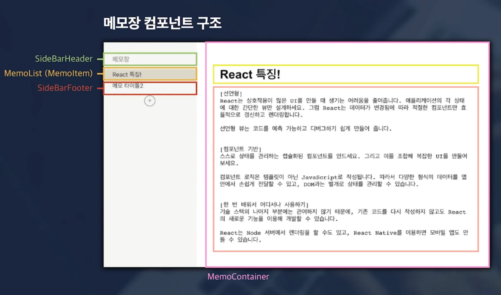
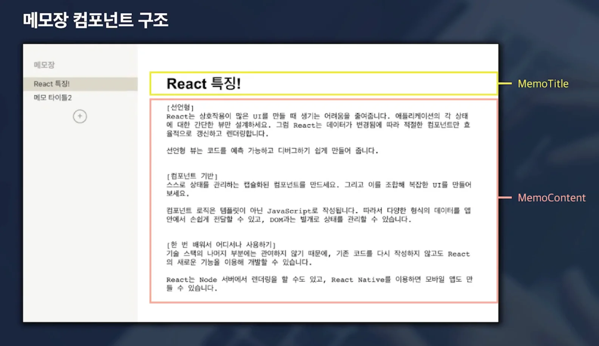
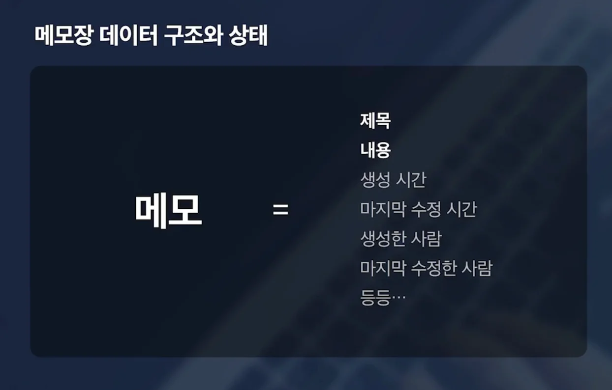
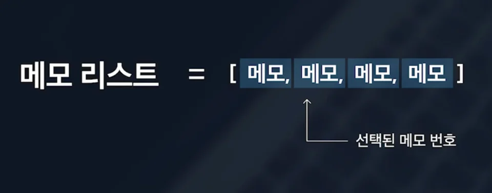
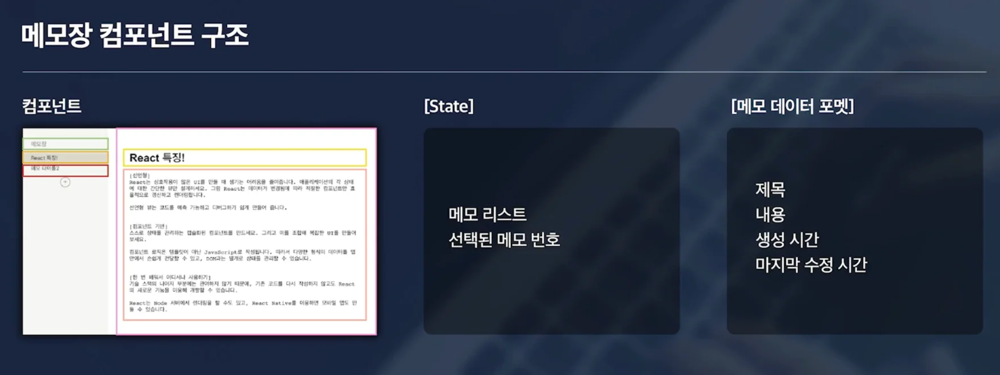
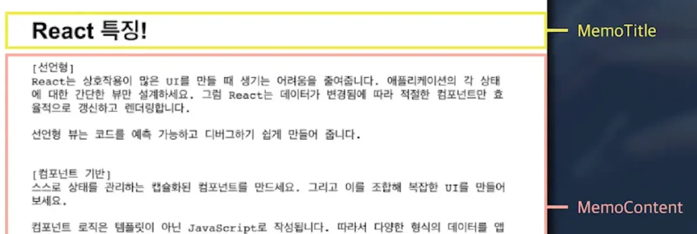

### 요구사항

### 메모장 컴포넌트 구조

- SideBar

- MemoContainer

- SideBar
    - SideBarHeader

    - MemoList ( MemoItem )

    - SideBarFooter

- MemoContainer
    - MemoTitle

    - MemoContent

### 메모장 &#45; 데이터 구조, 상테 

- 2가지의 상태 필요
    - 메모 리스트 데이터를 담고 있는 상태

    - 어떤 메모를 선택했는지 나타내는 상태 

### 정리

### 컴포넌트 

- SideBar
    - SideBarHeader

    - MemoList ( MemoItem )

    - SideBarFooter

- MemoContainer
    - MemoTitle

    - MemoContent

### State

- 메모 리스트

- 선택된 메모 번호

### 메모 데이터 포맷

- 제목

- 내용

- 생성 시간

- 마지막 수정 시간
