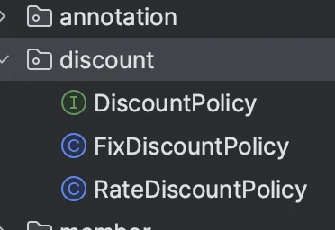

<a id="1c3eda9b0fe181088b88ee3153c8306b"></a>

## ‘<strong>자동 빈 등록’ 을 기본 설정으로 사용한다&#46; </strong>

---

<a id="1c3eda9b0fe181b6ac55cb5dea7c200d"></a>

스프링은 <code>&#64;Component</code> 뿐만 아 니라 <code>&#64;Controller</code> , <code>&#64;Service</code> , <code>&#64;Repository</code> 처럼 <strong>계층에 맞추어 일반적인 애플리케이션 로직을 자동으로 스 캔할 수 있도록 지원한다&#46;</strong>

<a id="1c3eda9b0fe181dab145c8d149b50fde"></a>

또한 스프링 부트는 자체에서도 컴포넌트 스캔을 기본으로 사용하고, 스프링 부트의 다양한 스프링 빈들도 조건이 맞으면 자동으로 등록하도록 설계했다&#46;

> 수동 등록시, <code>&#64;Configuration</code> 생성하고,  <code>&#64;Bean</code> 을 적고, 객체를 생성하고, 주입할 대상을 일일이 적어주는 과정은 상당히 번거롭다&#46;

<a id="1c3eda9b0fe18113806cd863cf730558"></a>

## <strong>그러면 수동 빈 등록은 언제 사용하면 좋은가?</strong>

---

<a id="1c3eda9b0fe181e98b39e44be0695db9"></a>

애플리케이션은 크게 ‘업무 로직’ 과 ‘기술 지원 로직’ 으로 나눈다&#46;

<a id="1c3eda9b0fe18140b0dcf62fe8579c10"></a>

→ 그 중 ‘<strong>기술 지원 로직’ 에 사용</strong>한다&#46; 

> ● <strong>업무 로직 빈</strong><strong>&#58;</strong> 웹을 지원하는 <strong>컨트롤러</strong>, 핵심 비즈니스 로직이 있는 <strong>서비스</strong>, 데이터 계층의 로직을 처리하는 <strong>리포지토리</strong> 등이 모두 업무 로직이다&#46; 보통 비즈니스 요구사항을 개발할 때 추가되거나 변경된다&#46;<strong><br><br></strong><strong>● 기술 지원 빈</strong><strong>&#58;</strong> <strong><u>기술적인 문제</u></strong>나 <strong><u>공통 관심사(AOP)</u></strong>를 처리할 때 주로 사용된다&#46; <strong>데이터베이스 연결</strong>이나, <strong>공통 로그 처리</strong> 처럼 <strong>업무 로직을 지원하기 위한 하부 기술이나 공통 기술들</strong>이다

<a id="1c3eda9b0fe18134b90cd038d1482f79"></a>

<strong><br></strong><strong> 업무 로직</strong>은 <strong>크기도 방대</strong>하며,<u> </u><strong><u>컨트롤러, 서비스, 리포지토리 처럼 어느 정도 유사한 패턴이 존재</u></strong>한다&#46;

<a id="1c3eda9b0fe181b4abb0ded1a365c9cd"></a>

보통 <strong><u>문제가 발생되어도 어떤 곳에서 문제가 발생했는지 명확하게 파악하기 쉽</u></strong>다&#46; 따라서<strong> 자동 스캔 기능을 사용</strong>한다&#46;<br>

<a id="1c3eda9b0fe181b08fb8efa8999fdecc"></a>

<strong>기술 지원 로직</strong><strong> </strong>은 업무로직과 비교해, 그 <strong>수가 매우 적</strong>고 보통 <strong><u>애플리케이션 전반에 걸쳐 광범위하게 영향을 미친다&#46;</u></strong> 그리고 <strong><u>적용이 잘 되고 있는지 아닌지 조차 파악하기 어려운 경우가 많</u></strong>다&#46; <br>따라서 이런 기술 지원 로직들은 가급적 <strong>수동</strong>으로  따로 등록하여 <strong>명확하게 드러</strong>내는 것이 좋다&#46; 

<a id="1c3eda9b0fe181c38ae1c04924ffabb7"></a>

### ⇒ <strong><u>애플리케이션에 광범위하게 영향을 미치는 </u></strong><strong><u>기술 지원 객체</u></strong><strong>는 </strong><strong>수동 빈으로 등록</strong><strong>해서 딱&#33; </strong><strong>설정 정보에 바로 나타</strong><strong>나게 하는 것이</strong><strong><u> 유지보수 하기 좋</u></strong><strong>다&#46;</strong><br> 

<a id="1c3eda9b0fe1818ca7dde42e2e8a608a"></a>

## 비지니스 로직 중 다형성을 적극 활용 시

---

> 이전  <a href="#/post/1c3eda9b-0fe1-816a-9d73-c1fc84719e97">페이지</a>  예시

<a id="1c3eda9b0fe181b68223e25d5f7f2be7"></a>

<code>DiscountService</code> 가 의존관계 자동 주입으로 <code>Map&#60;String, DiscountPolicy&#62;</code> 에 주입을 받는 상황을 생각할 때, 해당 로직에 어떤 빈들이 주입될 지, 각 빈들의 이름은 무엇일지 코드만 보고 한번에 쉽게 파악하기 어렵다&#46;  내가 개발했을 경우는 크게 상관이 없지만, 다른 개발자의 개발 코드를 확인하는 것이라면 여러 코드를 뒤지면서 의존관계를 찾아봐야한다&#46; <br>따라서 <strong>특정 인터페이스와 해당 구현체들</strong>은 <strong><u>수동 빈 등록으로 따로 표시</u></strong>하거나, <strong>특정패키지에 같이 묶어 놓는 것</strong>이 좋다&#46; 

<a id="1c3eda9b0fe181b386dae5de7cc628a4"></a>

### •  구현체(전략)들을 수동 빈으로 따로 등록

<a id="1c3eda9b0fe181039cd2e1b7eeaa5dc7"></a>

```java
@Configuration
 public class DiscountPolicyConfig {
     @Bean
     public DiscountPolicy rateDiscountPolicy() {
         return new RateDiscountPolicy();
     }
     @Bean
     public DiscountPolicy fixDiscountPolicy() {
         return new FixDiscountPolicy();
     }
}
```

<a id="1c3eda9b0fe181e1a4d4e384f3272003"></a>

### •   특정 패키지로 묶어서 구성( 자동 빈 등록 )



<a id="1c3eda9b0fe181bfb4a4c53867a0e673"></a>

해당 설정을 통해, 한눈에 빈과 의존관계를 파악할 수 있다&#46; 

> 📌 <strong>참고<br>스프링과 스프링 부트가 자동으로 등록하는 수 많은 빈들은 예외둔다&#46;<br></strong>이런 부분들은 <strong><u>스프링 자체를 잘 이해하고 스프링의 의도대로 잘 사용하는게 중요</u></strong>하다&#46; 스프링 부트의 경우 <code>DataSource</code> 같은 데이터베이스 연결에 사용하는 기술 지원 로직까지 내부에서 자동으로 등록하는데, 이런 부분은 <strong>메뉴얼을 잘 참고</strong>해서 <strong>스프링 부트가 의도한 대로 편리하게 사용</strong>하면 된다&#46;<br><br>반면에 <strong>스프링 부트가 아니라 내가 직접 기술 지원 객체를 스프링 빈으로 등록한다면 수동으로 등록해<br>서 명확하게 드러내는 것이 좋다&#46;</strong>
