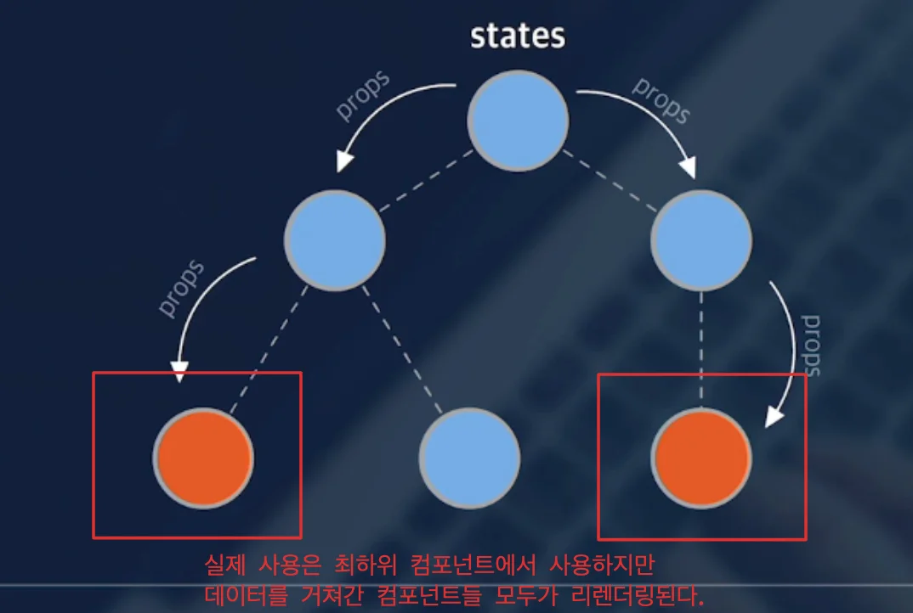
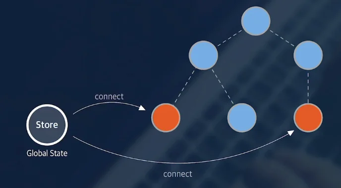

## Prop Drilling

---

컴포넌트들 위 그림과 같이 구조화 되어 있고, 최상단 컴포넌트에서 최하위 컴포넌트까지 props를 각각 전달하고 있다&#46;

이런 과정을 Prop drilling이라고 한다&#46; 

여기서 만약 <strong><u>최상단 컴포넌트의 </u></strong><strong><u><code>state</code></u></strong><strong><u>가 변경</u></strong>된다면, <u>해당 값을 실제로 사용</u>하는 것은 위 그림과 같이 <strong><u>최하단의  컴포넌트 </u></strong>지만, <strong><u>데이터가 전달되고 있는 중간 컴포넌트들</u></strong>도 <strong><u>모두</u></strong><strong><u> 리렌더링</u></strong> 된다&#46; 

즉, <code>Prop drilling</code>은 <strong><u>리액트 서비스</u></strong><strong>의 </strong><strong><u>성능을 저하 </u></strong>시키는 한 요인이 된다&#46; 

이를 해결하기 위해 <strong><u>State(상태)</u></strong>를 <strong><u>여러 컴포넌트와 공유</u></strong>해서 사용하는 <strong><u>전역 상태</u></strong>를 사용한다&#46; 

## 전역 상태 ( Global State )

---

컴포넌트 내부에 있던 state를 <strong><u>외부 저장소(store)로 분리</u></strong>하고, <strong><u>필요한 컴포넌트만 연결해서 사용</u></strong>한다&#46; 

이를 통해, <code>Prop Drilling</code> 시 생겼던 <strong><u>중간 컴포넌트들의 state 의존성을 제거</u></strong>할  수 있다&#46;

### 전역 상태 관리 라이브러리

> 직접 구현하는 일은 거의 없고, 아래의 전역 상태 라이브러리를 가져다가 사용하면 된다&#46; 

- Redux

- Recoil

> 리액트에서 자체적으로 제공

- ContextAPI

- Mobx
