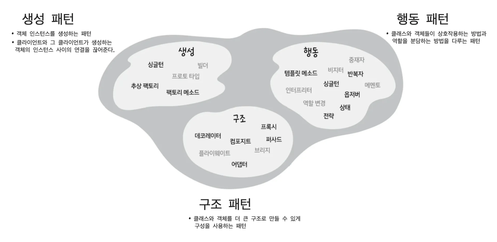

> 👉🏻 <strong>Reference</strong>
> 
> 
> 
> ‣
> 
> 
> 
> ‣
> 
> 
> 
> ‣
> 
> 
> 
> ‣
> 
> 
> 
> <a href="https://beautiful-college-c84.notion.site/65ec117a777b46b2b8c732d8188fd94e">페이지</a> 
> 
> 
> 
> <a href="https://inpa.tistory.com/category/%EB%94%94%EC%9E%90%EC%9D%B8%20%ED%8C%A8%ED%84%B4">https&#58;//inpa&#46;tistory&#46;com/category/디자인 패턴</a>

[SOLID 원칙](#/post/1c3eda9b-0fe1-819a-bde7-ff1e5e6ab2e6)

[전략( Strategy ) 패턴](#/post/1c3eda9b-0fe1-8163-b82a-e5403eac0992)

[옵저버 패턴](#/post/1c3eda9b-0fe1-81c6-9813-ec95a1d7f34c)

[데코레이션 패턴](#/post/1c3eda9b-0fe1-813e-b8f8-c8bacabfb050)

[팩토리 패턴](#/post/1c3eda9b-0fe1-81f5-9a9f-fdc9a28e707a)

[정적 팩토리 메서드 패턴](#/post/1c3eda9b-0fe1-8183-890d-fcd3cf86cae4)

[싱글톤 패턴](#/post/1c3eda9b-0fe1-8135-b338-feea3d45ac99)

[커맨드 패턴](#/post/1c3eda9b-0fe1-8153-b877-e6074f612850)

[어댑터 패턴](#/post/1c3eda9b-0fe1-81f2-b9e3-fce92998c817)

[퍼사드 패턴](#/post/1c3eda9b-0fe1-8173-b5b6-d388a59b781e)

[템플릿 메소드 패턴](#/post/1c3eda9b-0fe1-81dc-a35c-d260da976742)

[반복자 패턴, 컴포지트 패턴](#/post/1c3eda9b-0fe1-815f-852b-e37bf0ceb2c1)

[상태 패턴](#/post/1c3eda9b-0fe1-81ac-a75c-d3b6f23f7497)

[프록시 패턴](#/post/1c3eda9b-0fe1-815e-a31b-c2ad0a468c2d)

[복합 패턴(MVC)](#/post/1c3eda9b-0fe1-81af-a636-c5830e90e860)

[실전 디자인 패턴](#/post/1c3eda9b-0fe1-81cc-b5b2-cfd85e0706d6)

[브리지 패턴](#/post/1c3eda9b-0fe1-8199-80ab-ee745d35a451)

[빌더 패턴](#/post/1c3eda9b-0fe1-8196-ad8d-e7a04eac7b77)

[책임 연쇄 패턴](#/post/1c3eda9b-0fe1-8193-ac6c-e9f230812451)

[플라이웨이트 패턴](#/post/1c3eda9b-0fe1-81d5-82a5-f1943dbb661a)

[인터프리터 패턴](#/post/1c3eda9b-0fe1-815a-b8c3-e68bed253bc8)

[중재자 패턴](#/post/1c3eda9b-0fe1-8132-98f9-c6ffe8e1399b)

[메멘토 패턴](#/post/1c3eda9b-0fe1-8107-8fc8-f79619fb6ac6)

[프로토타입 패턴](#/post/1c3eda9b-0fe1-8132-824d-db5076fe59ff)

[비지터 패턴](#/post/1c3eda9b-0fe1-8192-8613-dc095fca8cab)
