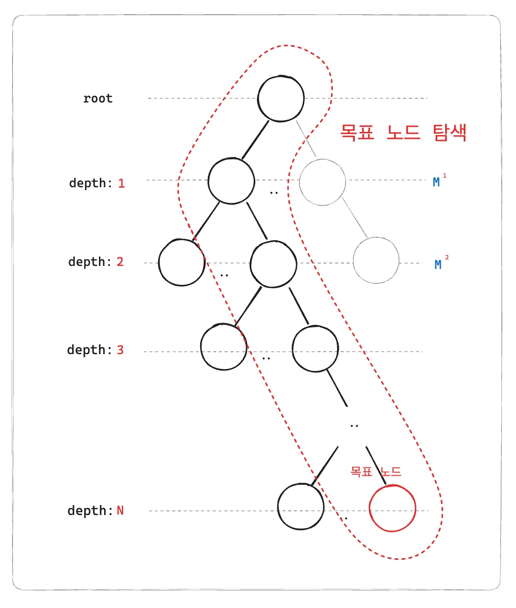
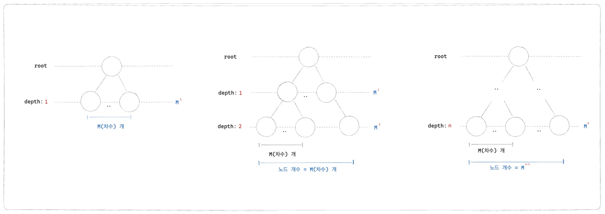

🧐 B&#43; Tree가 빠른 이유

> ✏️ 
> 
> 
> 
> <strong><code>B&#43; Tree</code></strong><strong>는 </strong><strong><u>정형화된(균형 잡힌) 트리 구조를 유지</u></strong><strong>하기 때문에, 특정 데이터가 어디 있는지 예측이 가능하고, 탐색 범위를 건너뛰면서 빠르게 원하는 노드로 접근 가능하다&#46; </strong>
> 
> - 1️⃣ 모든 리프 노트의 깊이가 동일 
>     - 특정 키 값이 어느 리프 노드에 있는지 일관되게 예층 가능
> 
> - 2️⃣ 각 노드는 <strong><u>여러 개의 키 값을 저장</u></strong>하여, 자식 노드로 가는 경로를 안내하는 역할을함
> 
> - 3️⃣ 이진 탐색(Binary Search) 방식으로 탐색 가능
> 
> - 4️⃣ <strong>트리의 깊이가 얕아서 빠르게 원하는 노드로 이동 가능 (</strong><strong><code>O(log N)</code></strong><strong>)</strong>

- <strong>트리가 균형 유지 →  특정 값이 어느 노드에 있을지 미리 예측 가능</strong>

-  <strong>탐색 시, 범위를 뛰어넘으면서 빠르게 적절한 내부 노드로 이동 가능 (O(log N))</strong>

-  <strong>이진 탐색(Binary Search) 방식으로 빠르게 경로를 찾음</strong>

- <strong>루트에서 리프까지 최대 4&#126;5단계만 이동하면 원하는 데이터를 찾을 수 있음</strong>

-  <strong>리프 노드는 정렬된 상태로 Linked List로 연결되어 있어서 순차 검색이 빠름</strong>

## SQL 검색 최적화&#58; 인덱스

---

> 📖 
> 
> 
> 
> <strong><code>SQL 인덱스</code></strong>는DB에서 <strong><u>데이터를 빠르게 검색하기 위한 자료구조</u></strong>이다&#46; 
> 
> 
> 
> 대부분 관계형 DB는 인덱스로 <strong><u>B&#43; Tree 구조를 사용</u></strong>한다&#46;

SQL 인덱스

> ✏️ 
> 
> 
> 
> SQL 인덱스는 <strong><u>테이블의 특정 컬럼</u></strong><strong>에 대해 </strong><strong><u>미리 정렬된 자료구조</u></strong><strong>를 만</strong>들어 <strong><u>데이터 검색 속도를 높</u></strong>이는 기술이다&#46;

- 효과
    - <code>빠른 검색</code>&#58;  <strong><u>전체 테이블 스캔(full table scan) 없</u></strong>이 필요한 데이터를 빠르게 찾을 수 있다&#46;

    - <code>효율적인 범위 검색</code>&#58; <strong>B&#43; Tree 구조</strong> 덕분에 <strong><u>범위 검색(ex&#46; BETWEEN, &#62;, &#60; 등)을 매우 효율적으로 처리</u></strong>할 수 있다&#46;

<strong><code>B&#43; Tree</code></strong><strong> 자료구조</strong>

> ✏️ 
> 
> 
> 
> <strong><code>B&#43; Tree</code></strong>는 <strong><u>균형 잡힌 트리</u></strong><strong><u> 자료구조</u></strong>로, <strong><u>모든 데이터 레코드</u></strong>(or 해당 레코드의 포인터)는 <strong><u>리프(leaf) 노드</u></strong>에만 저장되고, <strong><u>내부 노드</u></strong><strong>에는 </strong><strong><u>검색에 필요한 키 값</u></strong><strong>들만 저장</strong>된다&#46; 

주요 특징

- <code>균형 유지</code>&#58; 모든 리프 노드가 동일한 깊이에 위치하여 검색 시간이 일정하다&#46; 

- <code>내부 노드</code>&#58;  검색 키(ex&#46; 컬럼 값)를 저장하여, 어느 자식 노드로 내려갈지를 결정한다&#46; 

- <code>리프 노드</code>&#58; 실제 데이터에 접근할 수 있는 포인터(or 레코드 자체)를 가지고 있으며, 리프 노드끼리는 순차 연결(linked list로 연결)되어 있어 범위 검색에 유리하다&#46; 
    

    
🧐  리프 노드에서의 순차 탐색은 상수 시간의 연산이기 때문에 무시되는 것인가?

    

    하위 노드 탐색을 통해 근사 값을 가지는 리프 노드에 접근한 경우 리프 노드에서 해당 값을 찾기위한 순차 탐색이 필요하다&#46; 

    

    그런데 설명을 보면 해당 연산에 대한 비용은 신경쓰지 않는 것 같다&#46;

    - 의문점 1) 리프 노드에서의 순차 탐색은 상수 시간을 가지는 연산인가?

    - 의문점 2) 비용이 작기 때문에 무시하는 것 인가?

    

탐색 과정

1. 루트 노드에서 시작
    - 검색 시작 시, 루트 노드의 키 값을 비교하여 검색하려는 값이 어느 하위 노드에 있는지 결정한다&#46; 
        - 여기서 최선이면 O(1) 최악이면 O(M) 연산이 발생된다&#46; 

1. 내부 노드 탐색
    - 선택된 자식 노드의 내부 노드에서도 같은 방식으로 키 값을 비교하여 계속 내려간다&#46; 

    - 동일하게 최선&#58; O(1), 최악&#58; O(M)  

1. 리프 노드 도달
    - 최종적으로 리프 노드에 도달하면, 이곳엣 실제 데이터에 대한 포인터가 저장되어 바로 데이터를 조회할 수 있다&#46;

- 최선&#58; O(1), 최악&#58; O(차수(M) &#42; depth(n)) 

<strong><code>B&#43; Tree</code></strong>의 시간 복잡도가 <code class="language-math">O(&#92;log n)</code>인  이유

> <strong> B&#43; Tree 탐색의 최악 비용&#58; </strong><code class="language-math">O(M &#92;times &#92;text{depth}(n))</code>

<strong>B&#43; Tree</strong>

- 차수&#58; <code class="language-math">m</code>

- 깊이(depth)&#58; <code class="language-math">n</code>

- 노드 개수&#58; <code class="language-math">m^n</code>

따라서 <strong><code>B&#43; Tree의 높이(Depth)</code></strong>가<strong> </strong> <code class="language-math">&#10;&#10;&#10;&#10;&#10;&#10;&#10;&#10;&#10;&#10;&#10;&#92;log&#95;M n&#10;&#10;</code> 임을 알 수 있다&#46;

- 높이(Depth)&#58; <code class="language-math">&#92;log&#95;M m^n = n</code>

루트 노드에서부터 내부 노드 탐색하여 하위 노드로 넘어갈 때, 최선 과 최악은 아래와 같다&#46; 

- 최선&#58; <code class="language-math">O(1)</code> ( 한번에 바로 넘어감 )

- 최악&#58; <code class="language-math">O(m)</code> ( 모든 하위 차수 탐색 )

이 과정을 depth 만큼 반복하여 최종 노드를 찾는다&#46;

즉, 탐색 최선 비용은 <code class="language-math">O(1)</code> 이며, 최악인 경우 <code class="language-math">O(m&#92;log&#95;M n)</code>이 된다&#46;

- 최선&#58; 모두 한번에 찾음 ⇒ <code class="language-math">O(1)</code>

- 최악&#58; 각 높이(depth) 마다 모든 차수를 찾음,  <code class="language-math">M &#42;  &#92;log&#95;M n</code>  ⇒  <code class="language-math">O(m&#92;log&#95;M n)</code>

여기서 <code>M</code> 즉, <code>차수</code>는 <strong><u>데이터 크기에 따라 변하지 않</u></strong>는 <strong>고정 상수</strong>이다&#46; 

알고리즘 시간복잡도를 계산에서는 <strong><u>상수 값은 무시</u></strong>하므로 결국 B&#43; Tree의 탐색 비용(시간복잡도)는 <code class="language-math">O(&#92;log n)</code>이 된다&#46;

index 설정 방법

<a href="#/post/1c3eda9b-0fe1-813a-ace7-f627fa5cfe29">페이지</a> 

## <code>B&#43; Tree</code>&#58; <u>빠른 검색</u>,  <u>쓰기 비용</u>

---

<code>B&#43; Tree</code>는 데이터베이스와 파일 시스템에서 널리 사용되는 트리 구조이다&#46;

그러나  <u>&#34;왜 검색이 빠른지&#34;</u>, <u>&#34;왜 쓰기 비용이 높은지&#34;</u>에 정확한 이해를 하지 못해, 해당 내용을 학습 후 학습한 내용을 정리한다&#46;

### 1&#46; B&#43; Tree에서 탐색이 빠른 이유

> ✏️ 
> 
> 
> 
> <strong><u>정렬</u></strong>된 상태 유지로 인한 빠른 탐색
> 
> - <strong>각 노드가 정렬된 상태</strong>로 유지되므로 내부에서 <strong>이진 탐색 가능</strong>
> 
> - <strong>트리의 깊이가 log(N)으로 유지</strong>되어 빠른 탐색 가능
> 
> - <strong>M(차수)이 크면 트리의 깊이가 얕아지므로 검색 성능이 향상됨</strong>

B&#43; Tree는 각 노드 내부에서 <strong><u>정렬된 상태</u></strong><strong>를 유지한다&#46;</strong>

덕분에 키를 탐색할 때 <strong>이진 탐색(Binary Search)을 활용</strong>하여 빠르게 이동할 수 있다&#46;

예제 

### 2&#46; B&#43; Tree에서 쓰기 비용이 높은 이유

> 📖 
> 
> 
> 
> B&#43; Tree는 <strong>검색을 빠르게 하기 위해 정렬된 상태를 유지</strong>해야 하므로, <strong>삽입/삭제 시 추가적인 연산이 필요하다&#46;</strong>
> 
> 
> 
> 즉, <strong><u>데이터터가 삭제되거나 추가</u></strong>되어 <strong>트리 균형이 깨는 경우</strong>, <strong><u>균형을 맞취 위한 트리 재구조화</u></strong>가 필요하다&#46; 

<strong>데이터(노드) </strong><strong><u>삽입</u></strong><strong> </strong>

> ✏️ 
> 
> 
> 
> <strong>데이터(노드) </strong><strong><u>삽입</u></strong><strong> 시 추가비용</strong>
> 
> 1. <strong>탐색 후 정렬된 위치에 삽입해야 함</strong>
> 
> 1. <strong>노드가 가득 찼을 경우 </strong><strong><u>노드 분할(Split)</u></strong><strong>이 발생</strong>
> 
> 1. <strong>부모 노드로 키를 올려야 할 수도 있음 (재귀적으로 영향을 줌)</strong>

예졔

<strong>데이터(노드) </strong><strong><u>삭제</u></strong>

> ✏️ 
> 
> 
> 
> <strong>데이터(노드) </strong><strong><u>삭제</u></strong><strong> 시 추가비용</strong>
> 
> 1. <strong>탐색 후 노드를 찾아 삭제</strong>
> 
> 1. 삭제 후 키 개수가 부족하면 <strong><u>노드 병합(Merge)</u></strong><strong> or  </strong><strong><u>재분배(Redistribution)</u></strong><strong> 진행</strong>
> 
> 1. <strong>부모 노드까지 조정이 필요할 수도 있음</strong>

예제 

정리

- <strong>삽입 시 정렬된 상태를 유지해야 하므로 추가적인 연산 필요</strong>

- <strong>노드가 가득 찰 경우 분할(Split) 발생 → 부모 노드까지 영향</strong>

- <strong>삭제 시 병합(Merge) 또는 재분배(Redistribution) 필요 → 부모 노드까지 영향</strong>

- <strong>결과적으로, 쓰기 연산이 트리 전체에 영향을 미칠 가능성이 있음</strong>

### 🧐 <strong>B&#43; Tree에서 </strong><strong><code>이진 탐색</code></strong><strong>이 사용되는 이유</strong>

---

> ✏️ 
> 
> 
> 
> <strong><code>B&#43; Tree</code></strong>는 <strong><u>이진 트리가 아</u></strong>닌 <strong><code>M&#45;원 검색 트리</code></strong><strong> ( </strong><strong><code>M&#45;ary Search Tree</code></strong><strong> ) </strong>이지만, <u>각 노드 내부에서 키 값들을 정렬된 상태로 유지</u>하기 때문에 <strong><u>이진 탐색이 가능</u></strong>하다&#46; 

- B&#43; Tree의 <strong>각 노드는 최대 M개의 자식 노드를 가질 수 있음</strong>

- <strong>각 노드 내부에 여러 개의 키 값이 “정렬된 상태”로 저장됨</strong>

- <strong>이진 탐색을 사용하여 적절한 자식 포인터를 빠르게 선택할 수 있음</strong>

---

ex) 차수(M) =  5인 B&#43; Tree 탐색 과정

> 📖 
> 
> 
> 
> <code>B&#43; Tree</code>
> 
> - <strong>검색 성능이 뛰어남</strong> (탐색 과정이 <code>O(log N)</code>으로 유지)
> 
> - <strong>쓰기 비용이 높음</strong> (균형을 유지하기 위한 추가적인 연산 발생)
> 
> - <strong>읽기 성능이 중요한 DBMS, 파일 시스템에서 자주 사용됨</strong>
> 
> -  <strong>쓰기 비용을 줄이기 위해 Batch Insert 같은 기법 활용 가능</strong>
> 
> ---
> 
> 
> 
> <strong>⇒  즉, </strong><strong><code>B&#43; Tree</code></strong><strong>는 </strong><strong><u>&#34;읽기(검색)에 최적화된 트리 구조&#34;</u></strong><strong>이며, </strong><strong><u>쓰기 성능을 위해 트랜잭션 최적화 전략이 필요</u></strong><strong>하다&#46;</strong>
