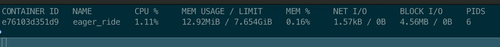
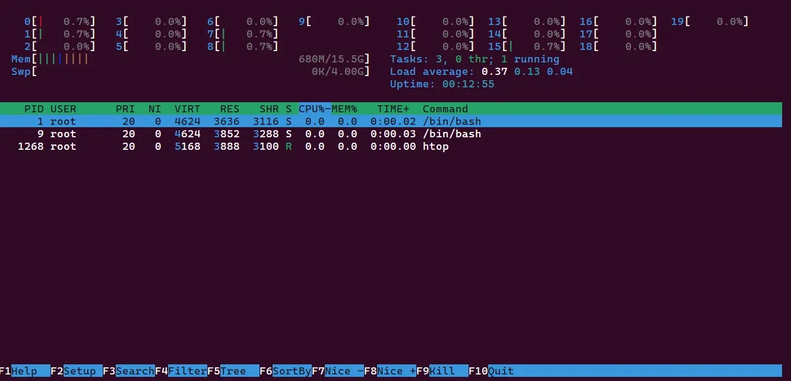

<a id="1c3eda9b0fe181198aadcbd31b2e6401"></a>

## Docker 모니터링

---

> 📖 
> 
> <a id="1c3eda9b0fe181e58e89c03a1380cb04"></a>
> 
> 모니터링을 통해 <u>컨테이너의 성능, 사용중인 자원(CPU, 메모리 &#46;&#46;&#46; ), 네트워크 사용</u><strong><u>량</u></strong><strong><u> 등</u></strong>을 확인할 수 있다&#46; 
> 
> <a id="1c3eda9b0fe181aa9f19fda8246e8ce8"></a>
> 
> 실행 과정을 기록하는 <strong><u>로그 내역들</u></strong>도 확인 가능하다&#46; 
> 
> <a id="1c3eda9b0fe1812095bef2ef9cab61a3"></a>
> 
> 이를 통해 <u>오류에 대한 원인들을 추적</u>할 <em>수</em> 있다&#46; 

<details>
<summary>왜 모니터링이 중요한가?</summary>

<a id="1c3eda9b0fe181508dd2cdf867e90c35"></a>

모니터링을 통해 실행되는 컨테이너가 잘 돌아가는지, 어떤 문제가 발생 되었는지 확인할 수 있다&#46; 

- <strong><u>문제 빨리 발견</u></strong> →  해결

- <strong><u>컨테이너 효율적으로 관리,  최적화</u></strong>
    - ex) 특정 컨테이너가 너무 많은 메모리 사용하는 경우 → 오류 발생 ↑ → 조정 

</details>

<details>
<summary>모니터링 방법</summary>

<details>
<summary>1&#46; Docker 모니터링<code>&#58;stats</code></summary>

> ✏️ 
> 
> <a id="1c3eda9b0fe1815f8506e3689ac55e3d"></a>
> 
> Docker에서 제공하는 간단하고 실용적인 모니터링 도구이다&#46;
> 
> - <strong><u>실행 중인 컨테이너의 자원 사용량</u></strong>을 <strong><u>실시간 확인</u></strong> 가능

<a id="1c3eda9b0fe181648422d1f4b148f292"></a>

```bash
docker stats
```

<details>
<summary>ex) </summary>

<a id="1c3eda9b0fe181b392ccf0d76abf24fa"></a>

```bash
 docker run -d redis
 
 docker ps
 
 docker stats
```



- CPU, 메모리 등 해당 컨테이너가 사용하는 자원들을 실시간으로 확인할 수 있다&#46; 

</details>

</details>

<details>
<summary>2&#46; 외부 모니터링 tools&#58; <code>htop</code></summary>

> ✏️ 
> 
> <a id="1c3eda9b0fe181cb9078e6521ad04e06"></a>
> 
> <strong><u>리눅스 시스템 모니터링</u></strong> 시 사용되는 툴
> 
> - 일반적인 시스템 모니터링과 유사 &#43; 여려 편리 기능
> 
> <a id="1c3eda9b0fe181f79d5efc8752d49d84"></a>
> 
> 컴퓨터의 <strong><u>CPU, 메모리 사용량 등</u></strong> <strong><u>실시간 확인</u></strong> 가능하다&#46;
> 
> - 어느 프로세스가 자원들 많이 사용하는지 파악 가능하다&#46;

<details>
<summary> 주요 기능</summary>

- <code>실시간 모니터링</code>&#58; CPU, 메모리, 스왑 사용량 실시간 확인 가능

- <code>프로세스 관리</code>&#58; 실행 중니 프로세스를 쉽게 확인하고 필요하면 종료 가능

- <code>사용자 친화적 인터페이스</code>

</details>

<details>
<summary>사용 방법</summary>

- htop 설치
    <a id="1c3eda9b0fe181229226f23a72f674dd"></a>

    ```bash
    docker run --name test-tools -d ubuntu:22.04

    docker exec -it test-tools bash

    # htop 설치
    apt update; apt upgrade -y; apt install htop -y;

    htop

    exit
    ```

- 사용
    

    - <code>←</code>, <code>→</code>&#58; 프로세스 이동

    - <code>F9</code>&#58; 프로세스 종료 …

</details>

</details>

<details>
<summary>3&#46; <strong><u>전체 디스크</u></strong> 사용량 확인&#58; <code>df</code></summary>

> ✏️ 
> 
> <a id="1c3eda9b0fe181de9b37e40dcab5b8b9"></a>
> 
> <code>disk free</code>의 약자로, <strong><u>리눅스 시스템 전체의 디스크 사용량 확인</u></strong> 가능하다&#46;

<details>
<summary>ex)</summary>

<a id="1c3eda9b0fe181b9a7c7e396f27598eb"></a>

```bash
docker exec -it test-tools bash
df -h
exit
```

</details>

</details>

<details>
<summary>4&#46; <strong><u>디렉토리 별</u></strong>, 디스크 사용량 확인&#58; <code>du</code></summary>

> ✏️ 
> 
> <a id="1c3eda9b0fe181b0922ef41e2e7b2c01"></a>
> 
> 디렉토리 별로 사용 공간 확인

<details>
<summary>ex)</summary>

<a id="1c3eda9b0fe18195ba09f44bd2b5ab40"></a>

```bash
docker exec -it test-tools bash

# 현재 디렉토리의 총 디스크 사용량을 GB 단위로 보여줌
du -sh 

# 현재 디렉토리 한 단계 아래 디렉토리 까지만 사용량을 보여줌
du -h --max-depth=1 

exit
```

</details>

</details>

</details>

<a id="1c3eda9b0fe1818bb2eff812c3876737"></a>

## Container 로깅

---

> 📖 
> 
> - Docker는 모든 컨테이너 <strong><u>로그의 표준 출력(</u></strong><strong><u><code>stdout</code></u></strong><strong><u>)</u></strong> 또는 <u>표준 에러(</u><u><code>stderr</code></u><u>)</u>를 캡처하여 <code>json&#45;file</code> 로깅 드라이버를 사용하여  json 형식으로 파일에 기록한다&#46;

<details>
<summary>로그 파일 위치</summary>

- Ubuntu
    - <code>var/lib/docker/containers/&#91;컨테이너ID&#93;/&#91;컨테이너ID&#93;&#45;json&#46;log</code>

</details>

<details>
<summary>예제</summary>

<details>
<summary> 특정 컨테이너의 로그 보기</summary>

<a id="1c3eda9b0fe181549568c9e8bff4626d"></a>

```bash
docker run --name logs-test --rm -d ubuntu:22.04 /bin/bash -c 'while true; do date; sleep 1; done'

# logs-test 컨테이너의 로그를 전체 출력하기
docker logs logs-test

# logs-test 컨테이너의 로그를 tailing하기
docker logs -f logs-test

# 마지막 10줄부터 로그를 계속 보기
docker logs -f --tail 10 logs-test
```

</details>

<details>
<summary> 로그 파일 설정 확인</summary>

<a id="1c3eda9b0fe181a59842e861914b313e"></a>

```bash
# docker inspect [컨테이너 ID, 명] --format "{{.LogPath}}
docker inspect logs-test --format "{{.LogPath}}"
```

</details>

</details>

<details>
<summary>로그 파일 제한 설정</summary>

> ✏️ 
> 
> <a id="1c3eda9b0fe181ed9e19e049378afdfe"></a>
> 
> 실제로 운영하다 보면 <strong><u>로그 파일의 크기가 계속 커질 수 있</u></strong>다&#46;
> 
> <a id="1c3eda9b0fe181ac9acdf567ed3f53ca"></a>
> 
> 따라서 <strong><u>로그 파일의 </u></strong><strong><u>최대 크기</u></strong><strong><u>와 </u></strong><strong><u>최대 파일 개수</u></strong><strong><u>를 지정</u></strong>하는 것이 좋다&#46; 

- Container 별 로깅 드라이버 구성
    <a id="1c3eda9b0fe181799276e6bfd15cb818"></a>

    ```bash
    docker run -d \
    --log-driver json-file \
    --log-opt max-size=10m \
    --log-opt max-file=10 \
    --name nginxtest \
    --restart always \
    -p 80:80 \
    -p 443:443 \
    nginx:latest
    ```

</details>

<details>
<summary>&#91; 실습 &#93; nginx 컨테이너 실행, log file 크기 및 개수 제한 확인</summary>

<details>
<summary>docker cli</summary>

1. Container 의 log file 크기와 개수 제한
    <a id="1c3eda9b0fe18119892be99c9a663dad"></a>

    ```bash
    docker run -d \
    --log-driver json-file \
    --log-opt max-size=1m \
    --log-opt max-file=5 \
    --name nginxtest \
    --restart always \
    -p 80:80 \
    -p 443:443 \
    nginx:latest
    ```

1. 로그 확인
    <a id="1c3eda9b0fe181d0b853ead387730cb3"></a>

    ```bash
    docker logs -f nginxtest
    ```

1. 테스트틀 위해 로그 여러개 생성
    <a id="1c3eda9b0fe181d79e0bcf9ffb8f6b05"></a>

    ```bash
    sudo apt update && sudo apt install -y wrk

    wrk -t10 -c100 -d30s http://localhost:80/
    ```

</details>

<details>
<summary>docker compose </summary>

<a id="1c3eda9b0fe1814aaefff25c38bbcce1"></a>

```yaml
services:
  app:
    ...
    logging:
      driver: 'json-file'
      options:
        max-size: '10m'
        max-file: '10'
```

- app 컨테이너의 로그 파일  설정
    - <code>크기</code>&#58; 10mb 이하

    - <code>개수</code>&#58; 최대 10개 

</details>

<details>
<summary>사용한 컨테이너 정리</summary>

- docker cli
    <a id="1c3eda9b0fe1816f8b37cd93e716e784"></a>

    ```bash
    docker stop nginxtest
    docker rm nginxtest
    ```

- docker compose
    <a id="1c3eda9b0fe1810e9332caaf458934d0"></a>

    ```bash
    docker compose down
    ```

</details>

</details>
