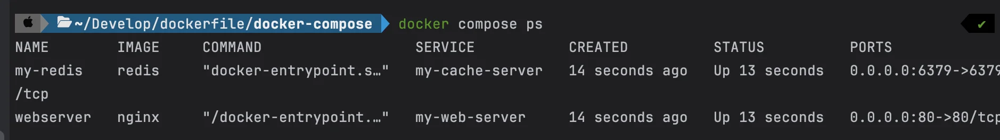
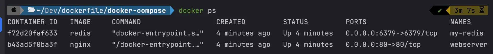
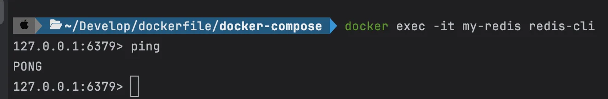
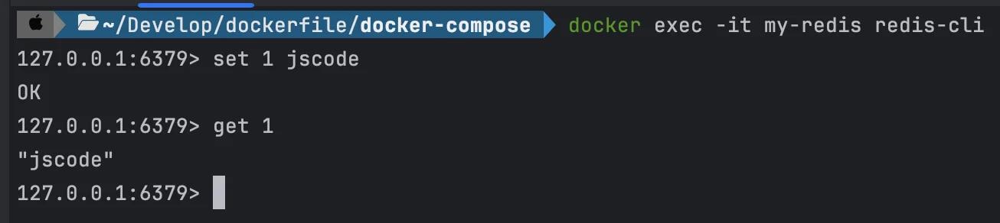

<a id="1c3eda9b0fe1813f838fc0136140cc35"></a>

## &#91;실습&#93; Docker Compose로 Redis 실행

---

- Docker CLI로 컨테이너 실행
    <a id="1c3eda9b0fe181d4b522cdd3ee6c519e"></a>

    ```bash
    docker run -d -p 6379:6379 redis
    ```

<a id="1c3eda9b0fe181d5b7cbf0cda6b02f4f"></a>

### Docker Compose로 컨테이너 실행

<details>
<summary>1&#46; <code>compose&#46;yml</code> 파일 작성</summary>

<details>
<summary>nginx &#43; redis</summary>

<a id="1c3eda9b0fe181f69f2ed47697c4dd4c"></a>

```bash
services:
  my-web-server:
    container_name: webserver
    image: nginx
    ports:
      - 80:80

  my-cache-server:
    container_name: my-redis
    image: redis
    ports:
      - 6379:6379
```

</details>

<a id="1c3eda9b0fe1817ab501f6a78c218634"></a>

```bash
services:
	my-cache-server:
		image: redis
		ports:
			- 6379:6379
```

</details>

<details>
<summary>2&#46; compose 파일 실행</summary>

<a id="1c3eda9b0fe181748969ec8ea78c9268"></a>

```bash
docker compose up -d
```

</details>

<details>
<summary>3&#46; compose 실행 현황보기</summary>

> ❓ 
> 
> <a id="1c3eda9b0fe18180930ffa45d3332a36"></a>
> 
> <code>docker compose up</code> vs <code>docker ps</code>
> 
> > 동일&#58; <code>NAME(s)</code>, <code>IMAGE</code>, <code>COMMAND</code>,  <code>CREATED</code>, <code>STATUS</code>, <code>PORTS</code>
> 
> <a id="1c3eda9b0fe181969038d544c6807163"></a>
> 
> 대부분의 내용은 동일하나 아래와 같은 차이점이 있다&#46; 
> 
> - docker compose ps&#58; <code>SERVICE</code>
>     
> 
> - docker ps&#58; <code>CONTAINER ID</code>
>     

<a id="1c3eda9b0fe181bfabd9fc09348ecfed"></a>

```bash
docker compose ps
```



<a id="1c3eda9b0fe1810b99ecd50cb93aa410"></a>

```bash
docker ps
```



</details>

<details>
<summary>4&#46; 내부 컨테이너의 redis 접속</summary>

<a id="1c3eda9b0fe1816cb255fd58e68ea5f5"></a>

```bash
# 실행중인 컨테이너 확인
docker compose ps

# redis 컨테이너 내부 redis-cli 접속
docker exec -it my-redis redis-cli 

# 나가기
exit
```

- PING &#45; PONG
    <a id="1c3eda9b0fe181499795fe6f73654e62"></a>

    ```bash
    ping
    # PONG
    ```

    

- 데이터 저장 및 확인
    <a id="1c3eda9b0fe18182b52ce4e9780b5627"></a>

    ```bash
    <redis-cli>

    set 1 jscode
    # OK

    get 1
    # "jscode"
    ```

    

</details>

<details>
<summary>5&#46; compose 실행된 컨테이너 삭제</summary>

<a id="1c3eda9b0fe181b0b38ddf64707956e0"></a>

```bash
docker compose dowen 
```

</details>
