<a id="1c3eda9b0fe18122b692cb76c23d66a1"></a>

## 테이블 과 Entity 연관관계 

<a id="1c3eda9b0fe181e9a5edf3f269187212"></a>

### SQL 복습 

<details>
<summary>주문 APP DB table 설계</summary>

<details>
<summary>고객 (users) 테이블</summary>

| id | name |
| --- | --- |
| 1 | Robbie |
| 2 | Robbert |

<details>
<summary>create users table</summary>

<a id="1c3eda9b0fe1817ca37bf0023afedc58"></a>

```sql
create table users
(
    id   bigint not null auto_increment,
    name varchar(255),
    primary key (id)
);
```

</details>

<details>
<summary>Insert </summary>

<a id="1c3eda9b0fe1811da3b7f618be4ff1d5"></a>

```sql
insert into users(name) values("Robbie");
insert into users(name) values("Robbert");
```

</details>

</details>

<details>
<summary>음식 (food) 테이블</summary>

| id | name | price |
| --- | --- | --- |
| 1 | 후라이드 치킨 | 15000 |
| 2 | 양념 치킨 | 20000 |
| 3 | 고구마 피자 | 30000 |
| 4 | 아보카도 피자 | 50000 |

<details>
<summary>create food table</summary>

<a id="1c3eda9b0fe18129b61ef1057e71de00"></a>

```sql
create table food
(
    id    bigint not null auto_increment,
    name  varchar(255),
    price float(53) not null,
    primary key (id)
);
```

</details>

<details>
<summary>Insert</summary>

<a id="1c3eda9b0fe1818fadd8f30ff4caf3ad"></a>

```sql
insert into food(name, price) values("후라이드 치킨", 15000);
insert into food(name, price) values("양념 치킨", 20000);
insert into food(name, price) values("고구마 피자", 30000);
insert into food(name, price) values("아보카도 피자", 50000);
```

</details>

</details>

</details>

<a id="1c3eda9b0fe181e381ebf4dd3699fd7a"></a>

### 테이블 간 연관관계 예시 ( SQL)

<a id="1c3eda9b0fe181deac81dc03eb17980c"></a>

고객과 음식에 대한 정보를 담는 테이블을 만들었다&#46; 

> 🧐 <strong>만약 고객이 음식을 주문한다면 , 주문 정보는 어느 테이블에 들어가야하는가?</strong>

<details>
<summary><code>고객 테이블</code>에 <strong><u>주문한 음식 정보</u></strong>(<code>food&#95;id</code>) 추가</summary>

> 👉🏻 한명의 고객은 여러 개의 주문을 할 수 있다&#46; 
> 
> > <strong>고객&#58; 음식 = </strong><strong><code>1 &#58; N</code></strong> 

- 주문한 음식의 정보를 고객 테이블에 추가한다&#46; 
    <details>
    <summary>1&#46; 고객 테이블(users)에 주문 정보(food&#95;id) 컬럼 추가</summary>

    <a id="1c3eda9b0fe18137a184caa1bde6d38b"></a>

    ```sql
    ALTER TABLE users ADD food_id bigint;
    ```

    </details>

    <details>
    <summary>2&#46;  고객 테이블에 주문한 음식 정보 insert</summary>

    <a id="1c3eda9b0fe18109b6e5c381c66fba83"></a>

    ```sql
    INSERT INTO USERS(name, food_id) VALUES('Robbie', 1);
    INSERT INTO USERS(name, food_id) VALUES('Robbert', 1);
    INSERT INTO USERS(name, food_id) VALUES('Robbie', 2);
    ```

    </details>

    <a id="1c3eda9b0fe18121bc58cc740dc538bf"></a>

    아래와 같이 고객 테이블이 생성됨

    | id | name | food&#95;id |
    | --- | --- | --- |
    | 1 | Robbie | 1 |
    | 2 | Robbert | 1 |
    | 3 | Robbie | 2 |

> <strong>🧐 문제점</strong><br><u> Robbie는 후라이드와 양념 치킨을 주문</u>했고 위 테이블은 불필요하게 <strong><u>고객(Robbie) 이름이 중복</u></strong>되어 나타낸다&#46; 

</details>

<details>
<summary><code>음식 테이블</code>에 <strong><u>주문한 고객 정보</u></strong>(<code>user&#95;id</code>) 추가</summary>

> 👉🏻 하나의 음식은 여러명의 고객에게 주문될 수 있다&#46; 
> 
> > <strong>음식 &#58; 고객 = </strong><strong><code>1 &#58; N</code></strong>

- 주문한 고객의 정보를 음식 테이블에 추가한다&#46; 
    <details>
    <summary>1&#46; 음식 테이블(food)에 고객 정보(user&#95;Id) 컬럼 추가</summary>

    <a id="1c3eda9b0fe181f79423d6a843176307"></a>

    ```sql
    ALTER TABLE food ADD user_id bigint not null;
    ```

    </details>

    <details>
    <summary>2&#46;  음식 테이블에 주문한 고객 정보 insert</summary>

    <a id="1c3eda9b0fe1810a8d79f1f53bd7aa79"></a>

    ```sql
    INSERT INTO food (name, price, user_id) VALUES ('후라이드 치킨', 15000, 1);
    INSERT INTO food (name, price, user_id) VALUES ('후라이드 치킨', 15000, 2);
    INSERT INTO food (name, price, user_id) VALUES ('양념 치킨', 20000, 1);
    ```

    </details>

    <a id="1c3eda9b0fe18167ad5cef58fdcf3794"></a>

    아래와 같이 음식 테이블이 생성된다&#46;

    | id | name | price | user&#95;id |
    | --- | --- | --- | --- |
    | 1 | 후라이드 치킨 | 15000 | 1 |
    | 2 | 후라이드 치킨 | 15000 | 2 |
    | 3 | 양념 치킨 | 20000 | 1 |

    > <strong>🧐 문제점</strong><br>같은 이름의 음식을 여러 사람이 주문했을 떄, 불필요하게 음식의 이름이 중복된다&#46; 

</details>

> 👉🏻 정리 
> 
> - 고객 1명은 음식 N개를 주문할 수 있다&#46;
>     - 고객 &#58; 음식 = <code>1 &#58; N</code> 
> 
> - 음식 1개는 고객 N명에게 주문될 수 있다&#46;
>     - 음식 &#58; 고객 = <code>1 &#58; N</code>
> 
> > 고객 &#58; 음식 =<code> N &#58; M </code>관계

<a id="1c3eda9b0fe181febf49ec3717898e82"></a>

위 두 내용을 정리해보면<strong> 고객과 음식은 서로 N&#58;M 의 연관관계를 가진다</strong>&#46; <br>이렇게 다대다 연관관계가 형성되는 경우 각 테이블간에<strong> </strong><strong>중간 테이블을 하나 생성</strong>하여 두개의 <strong>일대다 연관관계</strong>로 풀어내어 다대다 연관관계의 문제점을 해결할 수 있다&#46;

<details>
<summary><code>주문 테이블</code> 추가하여 <code>다대다</code> 연관관계를 <code>일다대</code> 연관관계들로 풀어낸다&#46;</summary>

<details>
<summary>1&#46; <code>주문 테이블</code> 생성</summary>

<a id="1c3eda9b0fe181349502eec5b4f4c1b9"></a>

```sql
CREATE TABLE orders (
    id         bigint not null auto_increment,
    user_id    bigint,
    food_id    bigint,
    order_date date,
    primary key (id)
);
```

</details>

<details>
<summary>2&#46; <code>주문 테이블</code> 적용</summary>

<a id="1c3eda9b0fe181cab24ccfcc90323ed6"></a>

```sql
// drop 
drop table if exists food;
drop table if exists users;

// create 테이블(users, food)
create table users
(
    id   bigint not null auto_increment,
    name varchar(255),
    primary key (id)
);

create table food
(
    id    bigint    not null auto_increment,
    name  varchar(255),
    price float(53) not null,
    primary key (id)
);


// FK 값 설정
alter table orders
    add constraint orders_user_fk
        foreign key (user_id)
            references users (id);

alter table orders
    add constraint orders_food_fk
        foreign key (food_id)
            references food (id);

// 데이터 insert
INSERT INTO users (name) VALUES ('Robbie');
INSERT INTO users (name) VALUES ('Robbert');

INSERT INTO food (name, price) VALUES ('후라이드 치킨', 15000);
INSERT INTO food (name, price) VALUES ('양념 치킨', 20000);
INSERT INTO food (name, price) VALUES ('고구마 피자', 30000);
INSERT INTO food (name, price) VALUES ('아보카도 피자', 50000);

INSERT INTO orders (user_id, food_id, order_date) VALUES (1, 1, SYSDATE());
INSERT INTO orders (user_id, food_id, order_date) VALUES (2, 1, SYSDATE());
INSERT INTO orders (user_id, food_id, order_date) VALUES (2, 2, SYSDATE());
INSERT INTO orders (user_id, food_id, order_date) VALUES (1, 4, SYSDATE());
INSERT INTO orders (user_id, food_id, order_date) VALUES (2, 3, SYSDATE());

```

</details>

<details>
<summary>결과 테이블</summary>

- 

- 고객
    | id | name |
    | --- | --- |
    | 1 | Robbie |
    | 2 | Robbert |

- 음식
    | id | name | price |
    | --- | --- | --- |
    | 1 | 후라이드 치킨 | 15000 |
    | 2 | 양념 치킨 | 20000 |
    | 3 | 고구마 피자 | 30000 |
    | 4 | 아보카도 피자 | 50000 |

- 주문
    | id | user&#95;id | food&#95;id | 주문일 |
    | --- | --- | --- | --- |
    | 1 | 1 | 1 | 2023&#45;01&#45;01 |
    | 2 | 2 | 1 | 2023&#45;01&#45;01 |
    | 3 | 2 | 2 | 2023&#45;01&#45;01 |
    | 4 | 1 | 4 | 2023&#45;01&#45;01 |
    | 5 | 2 | 3 | 2023&#45;01&#45;01 |

</details>

</details>

<details>
<summary>Entity &#45; 테이블 매핑</summary>

<details>
<summary>고객 (users) 테이블</summary>

| id | name |
| --- | --- |
| 1 | Robbie |
| 2 | Robbert |

<details>
<summary><strong>User</strong></summary>

<a id="1c3eda9b0fe181e1ae03feab1e4ed801"></a>

```java
package com.sparta.jpaadvance.entity;

import jakarta.persistence.*;
import lombok.Getter;
import lombok.NoArgsConstructor;

@Entity
@Table(name="users")
@Getter
@NoArgsConstructor
public class User {
    @Id
    @GeneratedValue(strategy = GenerationType.IDENTITY)
    private Long id;

    @Column(name="name", nullable = false)
    private String name;

    public User(String name) {
        this.name = name;
    }
}

```

</details>

</details>

<details>
<summary>음식 (food) 테이블</summary>

| id | name | price |
| --- | --- | --- |
| 1 | 후라이드 치킨 | 15000 |
| 2 | 양념 치킨 | 20000 |
| 3 | 고구마 피자 | 30000 |
| 4 | 아보카도 피자 | 50000 |

<details>
<summary><strong>Food</strong></summary>

<a id="1c3eda9b0fe18169ae91d5836e3b5a91"></a>

```java
package com.sparta.jpaadvance.entity;

import jakarta.persistence.*;
import lombok.Getter;
import lombok.NoArgsConstructor;

@Entity
@Getter
@NoArgsConstructor
@Table(name="food")
public class Food {
    @Id
    @GeneratedValue(strategy = GenerationType.IDENTITY)
    private Long id;

    @Column(nullable = false)
    private String name;

    @Column(nullable = false)
    private int price;

    public Food(String name, int price) {
        this.name = name;
        this.price = price;
    }
}

```

</details>

</details>

</details>

<a id="1c3eda9b0fe1814e9f55ebf2c07c9cd2"></a>

### <code>🧐 다대다(ManyToMany) 연관관계의 문제점</code>

<details>
<summary>데이터 중복 및 무결성</summary>


</details>

<details>
<summary>복잡한 쿼리</summary>


</details>

<a id="1c3eda9b0fe1816abef3fd8dd2aa2bc4"></a>

### 방향

<a id="1c3eda9b0fe18111a81aeaf33c3f316a"></a>

### 테이블 간의 방향

> <strong>🧐 DB 테이블들간의 관계에서 방향의 개념이 존재하는가?</strong>

- 방향&#58; <code>단방향</code>, <code>양방향</code> 
    - ex) 단방향 &#45; users 테이블에서만 food 테이블을 참조

    - ex) 양방향 &#45; users 테이블과 food 테이블 서로 참조

<details>
<summary> ‘Robbie’가 주문한 음식 정보를 <code>users</code><strong> </strong><strong><u>테이블 기준으로 조회</u></strong></summary>

<a id="1c3eda9b0fe181308278d7ffc9962acb"></a>

```sql
SELECT u.name as username, f.name as foodname, o.order_date as orderdate
FROM users u
         INNER JOIN orders o on u.id = o.user_id
         INNER JOIN food f on o.food_id = f.id
WHERE o.user_id = 1;
```

</details>

<details>
<summary> ‘Robbie’가 주문한 음식 정보를 <code>food</code><strong> </strong><strong><u>테이블 기준으로 조회</u></strong></summary>

<a id="1c3eda9b0fe181abb6fae4be122e3ffe"></a>

```sql
SELECT u.name as username, f.name as foodname, o.order_date as orderdate
FROM food f
         INNER JOIN orders o on f.id = o.food_id
         INNER JOIN users u on o.user_id = u.id
WHERE o.user_id = 1;
```

</details>

<a id="1c3eda9b0fe181dfade1d93bfa38df33"></a>

DB에서는 어떤 테이블을 기준으로 하든 원하는 정보를 JOIN을 사용하여 조회할 수 있다&#46; 이처럼 <strong>DB 테이블간의 관계에서는 방향의 개념이 없</strong>다&#46;

<a id="1c3eda9b0fe18178ad34f7b1bcafe9c5"></a>

### Entity &#45; 단방향

<a id="1c3eda9b0fe181408eded2eaaa077d4e"></a>

### Entity &#45; 양방향

<a id="1c3eda9b0fe181e9b0fae1973c91d3e5"></a>

### 복합키 생성

- StudentCourse 엔티티는 복합 키를 사용하여 student&#95;id와 course&#95;id의 조합이 중복되지 않도록 한다&#46;
    <a id="1c3eda9b0fe181fb837bfeb273851c47"></a>

    ```java
    @Entity
    @IdClass(StudentCourseId.class)
    public class StudentCourse {
        @Id
        @ManyToOne
        @JoinColumn(name = "student_id")
        private Student student;

        @Id
        @ManyToOne
        @JoinColumn(name = "course_id")
        private Course course;
        
        // getters and setters
    }

    public class StudentCourseId implements Serializable {
        private Long student;
        private Long course;

        // equals and hashCode
    }
    ```

<details>
<summary>전체 코드</summary>

<a id="1c3eda9b0fe1817eaefbd32e7ce525ea"></a>

```java
@Entity
public class Student {
    @Id
    @GeneratedValue(strategy = GenerationType.IDENTITY)
    private Long id;
    private String name;

    @OneToMany(mappedBy = "student")
    private List<StudentCourse> studentCourses;
    
    // getters and setters
}

@Entity
public class Course {
    @Id
    @GeneratedValue(strategy = GenerationType.IDENTITY)
    private Long id;
    private String title;

    @OneToMany(mappedBy = "course")
    private List<StudentCourse> studentCourses;
    
    // getters and setters
}

@Entity
@IdClass(StudentCourseId.class)
public class StudentCourse {
    @Id
    @ManyToOne
    @JoinColumn(name = "student_id")
    private Student student;

    @Id
    @ManyToOne
    @JoinColumn(name = "course_id")
    private Course course;
    
    // getters and setters
}

public class StudentCourseId implements Serializable {
    private Long student;
    private Long course;

    // equals and hashCode
}
```

</details>

> <strong>추가 정리할 내용  우선 적음</strong>
> 
> <a id="1c3eda9b0fe1810eb3b7f3f295fc9c2e"></a>
> 
> 테이블에는 방향성이 없다&#46; 
> 
> > 외래키 하나를 통한 단방향 관계만 존재하며, join하여 양 쪽에서 가능하다&#46; 
> 
> <a id="1c3eda9b0fe1814eb1e6dc3263d69f57"></a>
> 
> JPA의 엔티티는 객체지향을 활용하기 위한 기술이다&#46; 
> 
> <a id="1c3eda9b0fe181d9a074f0ace8afe13d"></a>
> 
> 양방향 연관관계는 엔티티간의 참조값을 제공하지 실제 테이블 매핑시에는 단방향 매핑만 형성된다&#46; <br>

<a id="1c3eda9b0fe181e3a1a2ceedbc177dea"></a>

### <code>&#64; Transaction</code>  변경감지(dirty checking)

> <code>&#64;Transaction</code>은 자동으로 rollback 된다&#46; 
> 
> > <code>RollBack=false</code> 옵션을 통해 자동 rollback을 취소할 수있다&#46; 

- 1) 오류가 하나라도 발생되면 전체 <code>rollback</code>이 필요한 경우 →  트랜젝션 적용(<code>&#64;Transaction</code>)


<details>
<summary>2) 오류가 발생되더라도 위에 수행된 로직의 결과가 저장이 필요하다면 →  트랜젝션 미적용 </summary>


</details>

---

<a id="1c3eda9b0fe18144af71cbf4a3dacb3a"></a>

## 1 대 1 관계 ( <code>&#64;OneToOne</code> ) 

> 📌 <code>&#64;OneToOne</code><br>1 대 1 관계를 맺어주는 Anotation
> 
> - <code>&#64;OneToOne</code><br><code>&#64;JoinColumn(name = &#34;user&#95;id&#34;)</code>
> 
> - <code>&#64;OneToOne(mappedBy = &#34;user&#34;)</code>
>     - mappedBy 옵션을 통해 외래키의 주인과 반대되는 엔티티의 참조값을 만든다&#46; 
> 
>     - JPA에서만 존재하는 

<a id="1c3eda9b0fe181b9808ad8072f66e6ad"></a>

### 단방향 관계

> <strong>외래 키 주인</strong>만이 <strong>외래 키</strong> 를 <strong>등록, 수정, 삭제</strong>할 수 있으며, <strong>주인이 아닌 쪽</strong>은 오직 <strong>외래 키</strong>를<strong> 읽기만 가능</strong>하다&#46;

- <code>1 대 1 관계</code>에서는 <strong>외래 키의 주인</strong>을 직접 지정해야 한다&#46;
    - <code>&#64;JoinColumn()</code>을 통해 외래 키의 주인을 지정한다&#46; 
        - 컬럼명, null 여부, unique 여부 등을 지정할 수 있다&#46;

<details>
<summary>1) Food 엔티티에 외래키 주인 설정</summary>

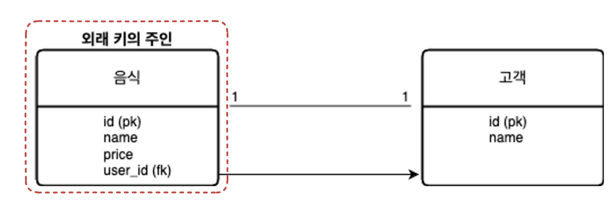

- <strong>Food</strong>
    <a id="1c3eda9b0fe181399a10e06c14549633"></a>

    ```java
    @Entity
    @Table(name = "food")
    public class Food {
        @Id
        @GeneratedValue(strategy = GenerationType.IDENTITY)
        private Long id;
        private String name;
        private double price;

        @OneToOne
        @JoinColumn(name = "user_id")
        private User user;
    }
    ```

<details>
<summary><strong>User</strong></summary>

<a id="1c3eda9b0fe18134b665c1caa99002e6"></a>

```java
@Entity
@Table(name = "users")
public class User {
    @Id
    @GeneratedValue(strategy = GenerationType.IDENTITY)
    private Long id;
    private String name;
}
```

</details>

</details>

<details>
<summary>2) User 엔티티에 외래키 주인 설정</summary>

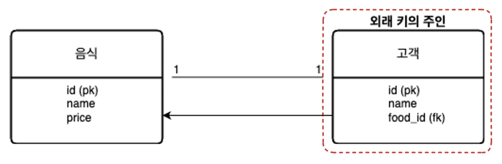

<details>
<summary><strong>Food</strong></summary>

<a id="1c3eda9b0fe181ed9866c1f04ad1e455"></a>

```java
@Entity
@Table(name = "food")
public class Food {
    @Id
    @GeneratedValue(strategy = GenerationType.IDENTITY)
    private Long id;
    private String name;
    private double price;
}
```

</details>

- <strong>User</strong>
    <a id="1c3eda9b0fe181c1a5b5ccfaf22dab1d"></a>

    ```java
    @Entity
    @Table(name = "users")
    public class User {
        @Id
        @GeneratedValue(strategy = GenerationType.IDENTITY)
        private Long id;
        private String name;
        
        @OneToOne
        @JoinColumn(name = "food_id")
        private Food food;
    }
    ```

</details>

<a id="1c3eda9b0fe18156931ac1ad810ff1d0"></a>

### 양방향 관계

- 양방향 설정
    - 양방향은 외래 키의 주인은 상대 Entity 타입의 필드를 가지면서 &#64;JoinColumn()을 활용하여 외래 키의 속성을 설정을 해준다&#46;

    - 그리고 상대 Entity는 외래 키의 주인 Entity 타입의 필드를 가지면서 mappedBy 옵션을 사용하여 속성 값으로 외래 키의 주인 Entity에 선언된 &#64;JoinColumn()으로 설정되고 있는 필드명을 넣어준다&#46;

    > ⚠️ <strong>주의</strong>
    > 
    > 1.  외래 키의 주인 Entity에서 &#64;JoinColumn() 애너테이션을 사용하지 않아도 default 옵션이 적용되기 때문에 생략이 가능하다
    >     - 다만 1 대 N 관계에서 외래 키의 주인 Entity가 &#64;JoinColumn() 애너테이션을 생략한다면 JPA가 외래 키를 저장할 컬럼을 파악할 수가 없어서 의도하지 않은 중간 테이블이 생성됩니다&#46;
    > 
    >     - 따라서 외래 키의 주인 Entity에서 &#64;JoinColumn() 애너테이션을 활용하시는게 좋습니다&#46;
    > 
    > 1.  양방향 관계에서 mappedBy 옵션을 생략할 경우 JPA가 외래 키의 주인 Entity를 파악할 수가 없어 의도하지 않은 중간 테이블이 생성되기 때문에 반드시 설정해주시는게 좋습니다&#46;
    >     - 양방향 관계에서 mappedBy 옵션을 빼버리면 중간 테이블을 만들고 해당 테이블에 외래키를 저장한다&#46; 

    <details>
    <summary><code>Entity</code>&#58; Food → 외래 키의 주인</summary>

    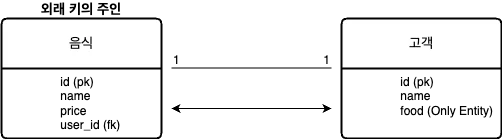

    <details>
    <summary><code>Entity</code>&#58; Food</summary>

    <a id="1c3eda9b0fe1811fa427fa956b828c40"></a>

    ```java
    @Entity
    @Table(name = "food")
    public class Food {
        @Id
        @GeneratedValue(strategy = GenerationType.IDENTITY)
        private Long id;
        private String name;
        private double price;

        @OneToOne
        @JoinColumn(name = "user_id")
        private User user;
    }
    ```

    </details>

    <details>
    <summary><code>Entity</code>&#58; User</summary>

    <a id="1c3eda9b0fe1811fbdb1ec31232de4a9"></a>

    ```java
    @Entity
    @Table(name = "users")
    public class User {
        @Id
        @GeneratedValue(strategy = GenerationType.IDENTITY)
        private Long id;
        private String name;

        @OneToOne(mappedBy = "user")
        private Food food;
    }
    ```

    </details>

    </details>

    <details>
    <summary><code>Entity</code>&#58; User → 외래 키의 주인</summary>

    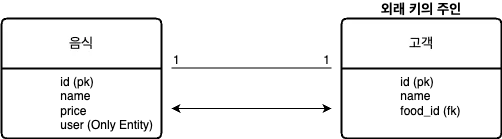

    <details>
    <summary><code>Entity</code>&#58; Food</summary>

    <a id="1c3eda9b0fe1816fba74e9daddd2db8e"></a>

    ```java
    @Entity
    @Table(name = "food")
    public class Food {
        @Id
        @GeneratedValue(strategy = GenerationType.IDENTITY)
        private Long id;
        private String name;
        private double price;

        @OneToOne(mappedBy = "food")
        private User user;
    }
    ```

    </details>

    <details>
    <summary><code>Entity</code>&#58; User</summary>

    <a id="1c3eda9b0fe181d58353f284ac6026e4"></a>

    ```java
    @Entity
    @Table(name = "users")
    public class User {
        @Id
        @GeneratedValue(strategy = GenerationType.IDENTITY)
        private Long id;
        private String name;

        @OneToOne
        @JoinColumn(name = "food_id")
        private Food food;
    }
    ```

    </details>

    </details>

<a id="1c3eda9b0fe1810ab8e0c95f0ea77534"></a>

###  예시

> 외래 키 주인 &#45; Food 엔티티

<details>
<summary>테스트 클래스 init &#45; <strong>OneToOneTest</strong></summary>

<a id="1c3eda9b0fe1817e82a7c5f49c02264e"></a>

```java
package com.sparta.jpaadvance.relation;

import com.sparta.jpaadvance.repository.FoodRepository;
import com.sparta.jpaadvance.repository.UserRepository;
import org.springframework.beans.factory.annotation.Autowired;
import org.springframework.boot.test.context.SpringBootTest;
import org.springframework.transaction.annotation.Transactional;

@Transactional
@SpringBootTest
public class OneToOneTest {

    @Autowired
    UserRepository userRepository;
    @Autowired
    FoodRepository foodRepository;


}
```

</details>

<details>
<summary>단방향 </summary>

<details>
<summary><code>Entity</code>&#58; Food</summary>

<a id="1c3eda9b0fe181c68e55cde8d95478ab"></a>

```java
package com.sparta.jpaadvance.entity;

import jakarta.persistence.*;
import lombok.Getter;
import lombok.Setter;

@Entity
@Getter
@Setter
@Table(name = "food")
public class Food {
    @Id
    @GeneratedValue(strategy = GenerationType.IDENTITY)
    private Long id;
    private String name;
    private double price;

    @OneToOne
    @JoinColumn(name = "user_id")
    private User user;
}
```

</details>

<details>
<summary><code>Entity</code>&#58; User</summary>

<a id="1c3eda9b0fe18136aca9d5e3cf53000e"></a>

```java
package com.sparta.jpaadvance.entity;

import jakarta.persistence.*;
import lombok.Getter;
import lombok.Setter;

@Entity
@Getter
@Setter
@Table(name = "users")
public class User {
    @Id
    @GeneratedValue(strategy = GenerationType.IDENTITY)
    private Long id;
    private String name;
}
```

</details>

<details>
<summary>OneToOne 단방향 테스트</summary>

<a id="1c3eda9b0fe18195a94dfa3780ad9c6c"></a>

```java
@Test
@Rollback(value = false) // 테스트에서는 @Transactional 에 의해 자동 rollback 됨으로 false 설정해준다.
@DisplayName("1대1 단방향 테스트")
void test1() {

    User user = new User();
    user.setName("Robbie");

    // 외래 키의 주인인 Food Entity user 필드에 user 객체를 추가해 줍니다.
    Food food = new Food();
    food.setName("후라이드 치킨");
    food.setPrice(15000);
    food.setUser(user); // 외래 키(연관 관계) 설정

    userRepository.save(user);
    foodRepository.save(food);
}
```

</details>

</details>

<details>
<summary>양방향 </summary>

<details>
<summary><code>Entity</code>&#58; User</summary>

<a id="1c3eda9b0fe18193b663d21559ccf98a"></a>

```java

```

</details>

<details>
<summary><code>Entity</code>&#58; User</summary>

<a id="1c3eda9b0fe181e696b5c1b63a57695f"></a>

```java

```

</details>

<details>
<summary>OneToOne 양방향 테스트</summary>

<a id="1c3eda9b0fe1810ca5a9d0ceca0a46dc"></a>

```java
@Test
@Rollback(value = false)
@DisplayName("1대1 양방향 테스트 : 외래 키 저장 실패")
void test2() {
    Food food = new Food();
    food.setName("고구마 피자");
    food.setPrice(30000);

    // 외래 키의 주인이 아닌 User 에서 Food 를 저장해보겠습니다.
    User user = new User();
    user.setName("Robbie");
    user.setFood(food);

    userRepository.save(user);
    foodRepository.save(food);

    // 확인해 보시면 user_id 값이 들어가 있지 않은 것을 확인하실 수 있습니다.
}

@Test
@Rollback(value = false)
@DisplayName("1대1 양방향 테스트 : 외래 키 저장 실패 -> 성공")
void test3() {
    Food food = new Food();
    food.setName("고구마 피자");
    food.setPrice(30000);

    // 외래 키의 주인이 아닌 User 에서 Food 를 저장하기 위해 addFood() 메서드 추가
    // 외래 키(연관 관계) 설정 food.setUser(this); 추가
    User user = new User();
    user.setName("Robbie");
    user.addFood(food);

    userRepository.save(user);
    foodRepository.save(food);
}

@Test
@Rollback(value = false)
@DisplayName("1대1 양방향 테스트")
void test4() {
    User user = new User();
    user.setName("Robbert");

    Food food = new Food();
    food.setName("고구마 피자");
    food.setPrice(30000);
    food.setUser(user); // 외래 키(연관 관계) 설정

    userRepository.save(user);
    foodRepository.save(food);
}
```

</details>

</details>

<details>
<summary>OneToOne 조회 테스트</summary>

<a id="1c3eda9b0fe181b48a7ef21109ec9e65"></a>

```java
@Test
@DisplayName("1대1 조회 : Food 기준 user 정보 조회")
void test5() {
    Food food = foodRepository.findById(1L).orElseThrow(NullPointerException::new);
    // 음식 정보 조회
    System.out.println("food.getName() = " + food.getName());

    // 음식을 주문한 고객 정보 조회
    System.out.println("food.getUser().getName() = " + food.getUser().getName());
}

@Test
@DisplayName("1대1 조회 : User 기준 food 정보 조회")
void test6() {
    User user = userRepository.findById(1L).orElseThrow(NullPointerException::new);
    // 고객 정보 조회
    System.out.println("user.getName() = " + user.getName());

    // 해당 고객이 주문한 음식 정보 조회
    Food food = user.getFood();
    System.out.println("food.getName() = " + food.getName());
    System.out.println("food.getPrice() = " + food.getPrice());
}
```

</details>

<a id="1c3eda9b0fe181538b9ced7a0d73bc9b"></a>

## N 대 1 관계 ( <code>&#64;ManyToOne</code> )

> 📌 <code>&#64;ManyToOne</code><br>N 대 1 관계를 맺어주는 Anotation<br>
> 
> - <code>&#64;ManyToOne</code><br><code>&#64;JoinColumn(name = &#34;user&#95;id&#34;)</code>
> 
> - <code>&#64;OneToMany(mappedBy = &#34;user&#34;)<br>private List&#60;Food&#62; foodList = new ArrayList&#60;&#62;();</code>
>     - N 관계이기 때문에 List를 사용

<a id="1c3eda9b0fe1816cb027f06c62140c08"></a>

### 단방향 관계

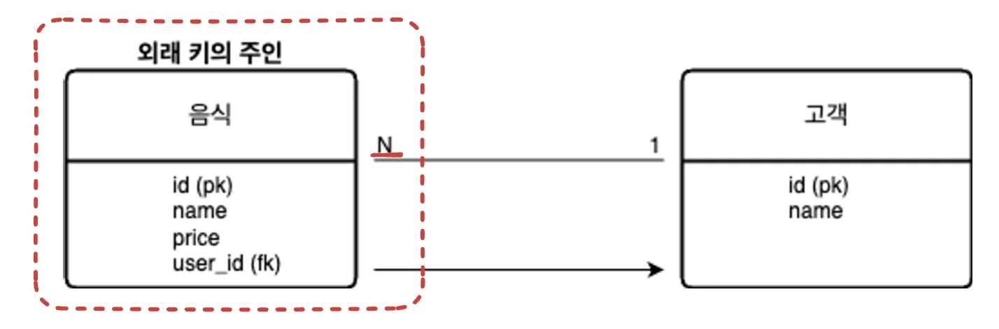

> <code>Food</code> Entity N의 관계 → 외래 키의 주인

<details>
<summary><code>Entity</code>&#58; Food</summary>

<a id="1c3eda9b0fe181e4ab24e965b5c3b0f5"></a>

```java
@Entity
@Table(name = "food")
public class Food {
    @Id
    @GeneratedValue(strategy = GenerationType.IDENTITY)
    private Long id;
    private String name;
    private double price;

    @ManyToOne
    @JoinColumn(name = "user_id")
    private User user;
}
```

</details>

<details>
<summary><code>Entity</code>&#58; User</summary>

<a id="1c3eda9b0fe181e58b60e3908d81fdee"></a>

```java
@Entity
@Table(name = "users")
public class User {
    @Id
    @GeneratedValue(strategy = GenerationType.IDENTITY)
    private Long id;
    private String name;
}
```

</details>

<a id="1c3eda9b0fe18183b8c2def147b16a00"></a>

### 양방향 관계

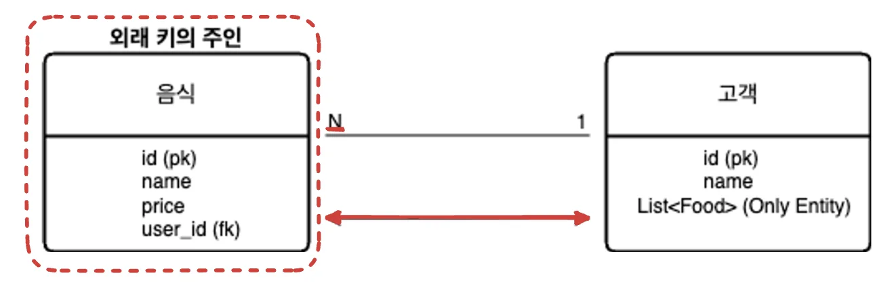

> <code>Food</code> Entity N의 관계 → 외래 키의 주인

<details>
<summary><code>Entity</code>&#58; Food</summary>

<a id="1c3eda9b0fe18141a204d79177cd65e4"></a>

```java
@Entity
@Table(name = "food")
public class Food {
    @Id
    @GeneratedValue(strategy = GenerationType.IDENTITY)
    private Long id;
    private String name;
    private double price;

    @ManyToOne
    @JoinColumn(name = "user_id")
    private User user;
}
```

</details>

<details>
<summary><code>Entity</code>&#58; User</summary>

> 고객 한명 당 여러개의 음식을 주문할 수 있다&#46; → <code>1&#58;N</code><br>따라서 양방향 참조를 위해 List를 통해 Food 들을 담아 참조한다&#46; 

<a id="1c3eda9b0fe18172baefea56bb796cb6"></a>

```java
@Entity
@Table(name = "users")
public class User {
    @Id
    @GeneratedValue(strategy = GenerationType.IDENTITY)
    private Long id;
    private String name;

    @OneToMany(mappedBy = "user")
    private List<Food> foodList = new ArrayList<>();
}
```

</details>

<a id="1c3eda9b0fe1814abebdcde978dded42"></a>

### 예시

<details>
<summary>테스트 클래스 init &#45; <strong>ManyToOneTest</strong></summary>

<a id="1c3eda9b0fe18154b26acbb98c2288c8"></a>

```java
package com.sparta.jpaadvance.relation;

import com.sparta.jpaadvance.repository.FoodRepository;
import com.sparta.jpaadvance.repository.UserRepository;
import org.springframework.beans.factory.annotation.Autowired;
import org.springframework.boot.test.context.SpringBootTest;
import org.springframework.transaction.annotation.Transactional;

@Transactional
@SpringBootTest
public class ManyToOneTest {

    @Autowired
    UserRepository userRepository;
    @Autowired
    FoodRepository foodRepository;


}
```

</details>

<details>
<summary>단방향 </summary>

<details>
<summary><code>Entity</code>&#58; Food</summary>

<a id="1c3eda9b0fe18181aa43d7dd290df191"></a>

```java
package com.sparta.jpaadvance.entity;

import jakarta.persistence.*;
import lombok.Getter;
import lombok.Setter;

@Entity
@Getter
@Setter
@Table(name = "food")
public class Food {
    @Id
    @GeneratedValue(strategy = GenerationType.IDENTITY)
    private Long id;
    private String name;
    private double price;

    @ManyToOne
    @JoinColumn(name = "user_id")
    private User user;
}
```

</details>

<details>
<summary><code>Entity</code>&#58; User</summary>

<a id="1c3eda9b0fe181b5ac3ee91e8d586cc8"></a>

```java
package com.sparta.jpaadvance.entity;

import jakarta.persistence.*;
import lombok.Getter;
import lombok.Setter;

@Entity
@Getter
@Setter
@Table(name = "users")
public class User {
    @Id
    @GeneratedValue(strategy = GenerationType.IDENTITY)
    private Long id;
    private String name;
}
```

</details>

<details>
<summary><code>ManyToOne</code> 단방향 테스트</summary>

<a id="1c3eda9b0fe181828a02dcb0f6395d73"></a>

```java
@Test
@Rollback(value = false)
@DisplayName("N대1 단방향 테스트")
void test1() {
    User user = new User();
    user.setName("Robbie");

    Food food = new Food();
    food.setName("후라이드 치킨");
    food.setPrice(15000);
    food.setUser(user); // 외래 키(연관 관계) 설정

    Food food2 = new Food();
    food2.setName("양념 치킨");
    food2.setPrice(20000);
    food2.setUser(user); // 외래 키(연관 관계) 설정

    userRepository.save(user);
    foodRepository.save(food);
    foodRepository.save(food2);
}
```

</details>

</details>

<details>
<summary>양방향 </summary>

> 

<details>
<summary><code>Entity</code>&#58; User</summary>

<a id="1c3eda9b0fe1819b9b02eae714863d5d"></a>

```java
package com.sparta.jpaadvance.entity;

import jakarta.persistence.*;
import lombok.Getter;
import lombok.Setter;

import java.util.ArrayList;
import java.util.List;

@Entity
@Getter
@Setter
@Table(name = "users")
public class User {
    @Id
    @GeneratedValue(strategy = GenerationType.IDENTITY)
    private Long id;
    private String name;

    @OneToMany(mappedBy = "user")
    private List<Food> foodList = new ArrayList<>();

    public void addFoodList(Food food) {
        this.foodList.add(food);
        food.setUser(this); // 외래 키(연관 관계) 설정
    }
}
```

</details>

<details>
<summary> <code>ManyToOne</code> 양방향 테스트</summary>

<a id="1c3eda9b0fe181cb972cc9c20051d10a"></a>

```java
@Test
@Rollback(value = false)
@DisplayName("N대1 양방향 테스트 : 외래 키 저장 실패")
void test2() {

    Food food = new Food();
    food.setName("후라이드 치킨");
    food.setPrice(15000);

    Food food2 = new Food();
    food2.setName("양념 치킨");
    food2.setPrice(20000);

    // 외래 키의 주인이 아닌 User 에서 Food 를 저장해보겠습니다.
    User user = new User();
    user.setName("Robbie");
    user.getFoodList().add(food);
    user.getFoodList().add(food2);

    userRepository.save(user);
    foodRepository.save(food);
    foodRepository.save(food2);

    // 확인해 보시면 user_id 값이 들어가 있지 않은 것을 확인하실 수 있습니다.
}

@Test
@Rollback(value = false)
@DisplayName("N대1 양방향 테스트 : 외래 키 저장 실패 -> 성공")
void test3() {

    Food food = new Food();
    food.setName("후라이드 치킨");
    food.setPrice(15000);

    Food food2 = new Food();
    food2.setName("양념 치킨");
    food2.setPrice(20000);

    // 외래 키의 주인이 아닌 User 에서 Food 를 쉽게 저장하기 위해 addFoodList() 메서드 생성하고
    // 해당 메서드에 외래 키(연관 관계) 설정 food.setUser(this); 추가
    User user = new User();
    user.setName("Robbie");
    user.addFoodList(food);
    user.addFoodList(food2);

    userRepository.save(user);
    foodRepository.save(food);
    foodRepository.save(food2);
}

@Test
@Rollback(value = false)
@DisplayName("N대1 양방향 테스트")
void test4() {
    User user = new User();
    user.setName("Robbert");

    Food food = new Food();
    food.setName("고구마 피자");
    food.setPrice(30000);
    food.setUser(user); // 외래 키(연관 관계) 설정

    Food food2 = new Food();
    food2.setName("아보카도 피자");
    food2.setPrice(50000);
    food2.setUser(user); // 외래 키(연관 관계) 설정

    userRepository.save(user);
    foodRepository.save(food);
    foodRepository.save(food2);
}
```

</details>

</details>

<details>
<summary>ManyToOne 조회 테스트</summary>

<a id="1c3eda9b0fe181318968d9a963fd696c"></a>

```java
@Test
@DisplayName("N대1 조회 : Food 기준 user 정보 조회")
void test5() {
    Food food = foodRepository.findById(1L).orElseThrow(NullPointerException::new);
    // 음식 정보 조회
    System.out.println("food.getName() = " + food.getName());

    // 음식을 주문한 고객 정보 조회
    System.out.println("food.getUser().getName() = " + food.getUser().getName());
}

@Test
@DisplayName("N대1 조회 : User 기준 food 정보 조회")
void test6() {
    User user = userRepository.findById(1L).orElseThrow(NullPointerException::new);
    // 고객 정보 조회
    System.out.println("user.getName() = " + user.getName());

    // 해당 고객이 주문한 음식 정보 조회
    List<Food> foodList = user.getFoodList();
    for (Food food : foodList) {
        System.out.println("food.getName() = " + food.getName());
        System.out.println("food.getPrice() = " + food.getPrice());
    }
}
```

</details>

<a id="1c3eda9b0fe181bbbe20eab0e285f31b"></a>

## 1 대 N 관계 ( <code>&#64;OneToMany</code> )

> 📌 <code>&#64;OneToMany</code><br>1 대  N 관계를 맺어주는 Anotation<br>
> 
> - <code>&#64;OneToMany</code><br><code>&#64;JoinColumn(name = &#34;food&#95;id&#34;) </code><br><code>private List&#60;User&#62; userList = new ArrayList&#60;&#62;();</code>
>     - 연관관계의 주인인 Food 가 1의 관계를 가지기 때문에 List를 통해 고객을 참조한다&#46;
>         > 실제는 
> 
> - <code>&#64;OneToMany(mappedBy = &#34;user&#34;)<br>private List&#60;Food&#62; foodList = new ArrayList&#60;&#62;();</code>
>     - N 관계이기 때문에 List를 사용

<a id="1c3eda9b0fe18171b597de4f2b8fb4eb"></a>

### 단방향 관계

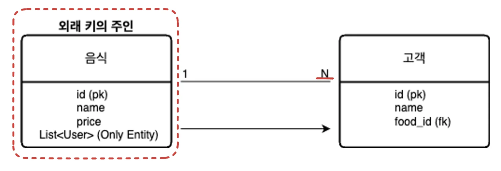

> <code>Food</code> Entity N의 관계 → 외래 키의 주인

- <code>Entity</code>&#58; Food
    <a id="1c3eda9b0fe181198333ee77056dcad1"></a>

    ```java
    @Entity
    @Table(name = "food")
    public class Food {
        @Id
        @GeneratedValue(strategy = GenerationType.IDENTITY)
        private Long id;
        private String name;
        private double price;

        @OneToMany
        @JoinColumn(name = "food_id") // users 테이블에 food_id 컬럼
        private List<User> userList = new ArrayList<>();
    }
    ```

<details>
<summary><code>Entity</code>&#58; User</summary>

<a id="1c3eda9b0fe18124bfa9f33899433118"></a>

```java
@Entity
@Table(name = "users")
public class User {
    @Id
    @GeneratedValue(strategy = GenerationType.IDENTITY)
    private Long id;
    private String name;
}
```

</details>

> ⚠️ <strong>1 관계를 연관관계의 주인으로 설정하는 경우<br></strong>외래 키를 음식 Entity가 직접 가질 수 있다면 INSERT 발생 시 한번에 처리할 수 있지만 실제 DB에서 외래 키를 고객 테이블이 가지고 있기 때문에 추가적인 UPDATE가 발생된다는 단점이 있다&#46;

<details>
<summary>양방향 관계</summary>

> ⚠️ 양방향 관계를 형성하기 위해서는 연관관계의 주인 엔티티와 반대되는 엔티티에  &#64;OneToMany에 반대되는 <code>&#64;ManyToOne</code>와 <code>mappedBy</code> 옵션을 제공해야 한다&#46;  <br><strong>그러나</strong> <strong>&#64;ManyToOne</strong> 애너테이션은 <strong><u>mappedBy 속성을 제공하지 않</u></strong>는다&#46;<br>따라서 <code>1 대 N </code>관계에서는 일반적으로 <strong>양방향 관계가 존재하지 않</strong>는다&#46;

<details>
<summary>아래와 같이 어거지 표현은 가능… 사용은 안함</summary>

> &#64;JoinColum의 insertable 과 updatable 옵션을 false로 설정하여 양쪽으로 JOIN 설정을 하면 양방향처럼 설정할 수는 있다&#46;

<a id="1c3eda9b0fe1811894e8c9a69502165b"></a>

```java
@Entity
@Table(name = "users")
public class User {
    @Id
    @GeneratedValue(strategy = GenerationType.IDENTITY)
    private Long id;
    private String name;

		@ManyToOne
		@JoinColumn(name = "food_id", insertable = false, updatable = false)
		private Food food;
}
```

</details>

</details>

<a id="1c3eda9b0fe1811496b9f2eaa5d01099"></a>

### 예시

<details>
<summary>테스트 클래스 init &#45; <strong>OneToManyTest</strong></summary>

<a id="1c3eda9b0fe1818f9335c75ea473d119"></a>

```java
package com.sparta.jpaadvance.relation;

import com.sparta.jpaadvance.repository.FoodRepository;
import com.sparta.jpaadvance.repository.UserRepository;
import org.springframework.beans.factory.annotation.Autowired;
import org.springframework.boot.test.context.SpringBootTest;
import org.springframework.transaction.annotation.Transactional;

@Transactional
@SpringBootTest
public class ManyToOneTest {

    @Autowired
    UserRepository userRepository;
    @Autowired
    FoodRepository foodRepository;


}
```

</details>

<details>
<summary>단방향 테스트</summary>

<details>
<summary><code>Entity</code>&#58; Food</summary>

<a id="1c3eda9b0fe18170b0afde5769d82a4e"></a>

```java
package com.sparta.jpaadvance.entity;

import jakarta.persistence.*;
import lombok.Getter;
import lombok.Setter;

import java.util.ArrayList;
import java.util.List;

@Entity
@Getter
@Setter
@Table(name = "food")
public class Food {
    @Id
    @GeneratedValue(strategy = GenerationType.IDENTITY)
    private Long id;
    private String name;
    private double price;

    @OneToMany
    @JoinColumn(name = "food_id") // users 테이블에 food_id 컬럼
    private List<User> userList = new ArrayList<>();
}
```

</details>

<details>
<summary><code>Entity</code>&#58; User</summary>

<a id="1c3eda9b0fe1817e9f36deca376cdcb8"></a>

```java
package com.sparta.jpaadvance.entity;

import jakarta.persistence.*;
import lombok.Getter;
import lombok.Setter;

@Entity
@Getter
@Setter
@Table(name = "users")
public class User {
    @Id
    @GeneratedValue(strategy = GenerationType.IDENTITY)
    private Long id;
    private String name;
}
```

</details>

<details>
<summary><code>OneToMany</code> 단방향 테스트</summary>

<a id="1c3eda9b0fe18178a11fda624e3c68c5"></a>

```java
@Test
@Rollback(value = false)
@DisplayName("1대N 단방향 테스트")
void test1() {
    User user = new User();
    user.setName("Robbie");

    User user2 = new User();
    user2.setName("Robbert");

    Food food = new Food();
    food.setName("후라이드 치킨");
    food.setPrice(15000);
    food.getUserList().add(user); // 외래 키(연관 관계) 설정
    food.getUserList().add(user2); // 외래 키(연관 관계) 설정

    userRepository.save(user);
    userRepository.save(user2);
    foodRepository.save(food);

    // 추가적인 UPDATE 쿼리 발생을 확인할 수 있습니다.
}
```

</details>

---

- 1&#58;N 연관관계 주인 설정
    <a id="1c3eda9b0fe1811da9d5d8f91f79019b"></a>

    ```java
    // Food 엔티티

    @OneToMany
    @JoinColumn(name = "food_id") // users 테이블에 food_id 컬럼
    	private List<User> userList = new ArrayList<>();
    }
    ```

- 테스트 시 외래키 연관관계 설정 
    <a id="1c3eda9b0fe181bfaa37d0e73d10e298"></a>

    ```java
    // OneToManyTest

    food.getUserList().add(user);  // 외래 키(연관 관계) 설정
    food.getUserList().add(user2); // 외래 키(연관 관계) 설정
    ```

- 테이블 생성 
    > Food 엔티티에서 연관관계의 주인을 필드를 생성하여 값을 저장했는데, 실제 테이블에서 해당 값이 User 테이블로 들어갔다&#46;

    - User
        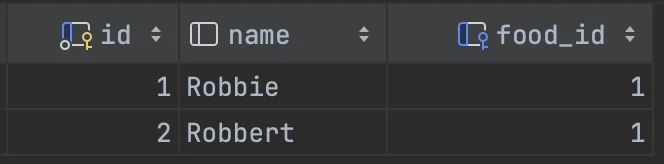

    - Food
        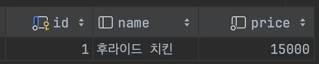

</details>

<details>
<summary>OneToMany<strong> </strong><strong><u>조회</u></strong> 테스트</summary>

<a id="1c3eda9b0fe18106ac4bc3e56948c6e4"></a>

```java
@Test
@DisplayName("1대N 조회 테스트")
void test2() {
    Food food = foodRepository.findById(1L).orElseThrow(NullPointerException::new);
    System.out.println("food.getName() = " + food.getName());

    // 해당 음식을 주문한 고객 정보 조회
    List<User> userList = food.getUserList();
    for (User user : userList) {
        System.out.println("user.getName() = " + user.getName());
    }
}
```

<details>
<summary>생성 테이블</summary>

- Food
    

- User
    

</details>

<details>
<summary>쿼리 </summary>

<a id="1c3eda9b0fe181b6b97adb022d2f0773"></a>

```sql
Hibernate: 
    select
        f1_0.id,
        f1_0.name,
        f1_0.price 
    from
        food f1_0 
    where
        f1_0.id=?
        
food.getName() = 후라이드 치킨

Hibernate: 
    select
        ul1_0.food_id,
        ul1_0.id,
        ul1_0.name 
    from
        users ul1_0 
    where
        ul1_0.food_id=?
        
user.getName() = Robbie
user.getName() = Robbert

```

</details>

</details>

<a id="1c3eda9b0fe181319a90e56cf27f43be"></a>

## N 대 M 관계 ( <code>&#64;ManyToMany</code> )

> ⚠️ 실무에선 <em><strong>다대다 연관관계 </strong></em><em>(</em><em><code>&#64;ManyToMany</code></em><em>) </em>를 사용하지 않는다&#46;

> 📌 <code>&#64;ManyToMany</code><br> N 대 M 관계를 맺어주는 Anotation

<a id="1c3eda9b0fe1812f979cf5043cb5528f"></a>

### 단방향 관계

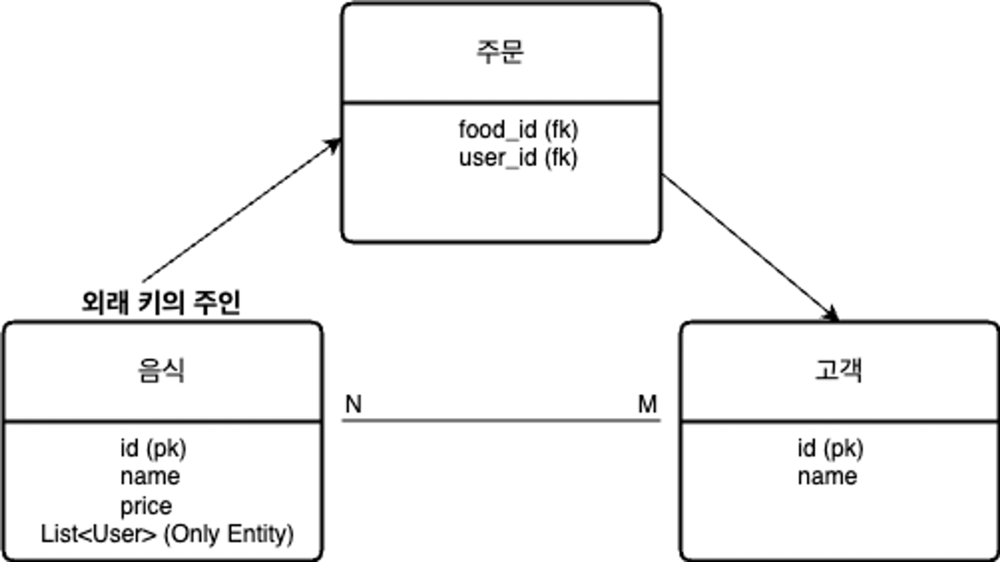

> <code>Food</code> Entity N의 관계 → 외래 키의 주인

- <code>Entity</code>&#58; Food
    <a id="1c3eda9b0fe1818b9b90d6b60b06a5b2"></a>

    ```java
    @Entity
    @Table(name = "food")
    public class Food {
        @Id
        @GeneratedValue(strategy = GenerationType.IDENTITY)
        private Long id;
        private String name;
        private double price;

        @ManyToMany
        @JoinTable(name = "orders", // 중간 테이블 생성
        joinColumns = @JoinColumn(name = "food_id"), // 현재 위치인 Food Entity 에서 중간 테이블로 조인할 컬럼 설정
        inverseJoinColumns = @JoinColumn(name = "user_id")) // 반대 위치인 User Entity 에서 중간 테이블로 조인할 컬럼 설정
        private List<User> userList = new ArrayList<>();
    }
    ```

<details>
<summary><code>Entity</code>&#58; User</summary>

<a id="1c3eda9b0fe1812ea3cee9c8bfe8e92f"></a>

```java
@Entity
@Table(name = "users")
public class User {
    @Id
    @GeneratedValue(strategy = GenerationType.IDENTITY)
    private Long id;
    private String name;
}
```

</details>

<a id="1c3eda9b0fe181829d98e7751fb9161f"></a>

### 양방향 관계

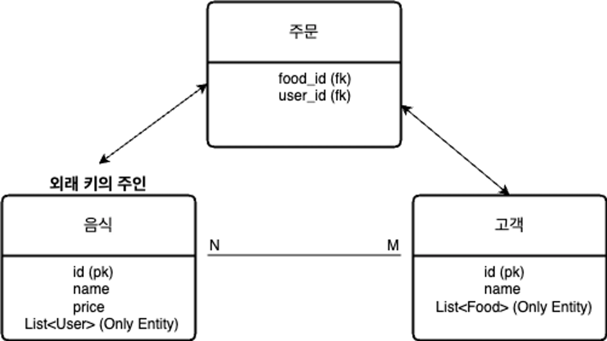

> <code>Food</code> Entity N의 관계 → 외래 키의 주인

<details>
<summary><code>Entity</code>&#58; Food</summary>

<a id="1c3eda9b0fe181f6b887f14ce4526626"></a>

```java
@Entity
@Table(name = "food")
public class Food {
    @Id
    @GeneratedValue(strategy = GenerationType.IDENTITY)
    private Long id;
    private String name;
    private double price;

    @ManyToMany
    @JoinTable(name = "orders", // 중간 테이블 생성
    joinColumns = @JoinColumn(name = "food_id"), // 현재 위치인 Food Entity 에서 중간 테이블로 조인할 컬럼 설정
    inverseJoinColumns = @JoinColumn(name = "user_id")) // 반대 위치인 User Entity 에서 중간 테이블로 조인할 컬럼 설정
    private List<User> userList = new ArrayList<>();
}
```

</details>

<details>
<summary><code>Entity</code>&#58; User</summary>

<a id="1c3eda9b0fe1818d9c6eff29bf76f38e"></a>

```java
@Entity
@Table(name = "users")
public class User {
    @Id
    @GeneratedValue(strategy = GenerationType.IDENTITY)
    private Long id;
    private String name;

    @ManyToMany(mappedBy = "userList")
    private List<Food> foodList = new ArrayList<>();
}
```

</details>

<a id="1c3eda9b0fe18120af6aebd650bb5907"></a>

### ManyToMany 실습

<details>
<summary>테스트 클래스 init &#45; <strong> ManyToManyTest</strong></summary>

<a id="1c3eda9b0fe18108b487efe74f4391c0"></a>

```java
package com.sparta.jpaadvance.relation;

import com.sparta.jpaadvance.repository.FoodRepository;
import com.sparta.jpaadvance.repository.UserRepository;
import org.springframework.beans.factory.annotation.Autowired;
import org.springframework.boot.test.context.SpringBootTest;
import org.springframework.transaction.annotation.Transactional;

@Transactional
@SpringBootTest
public class ManyToOneTest {

    @Autowired
    UserRepository userRepository;
    @Autowired
    FoodRepository foodRepository;


}
```

</details>

<details>
<summary>단방향 </summary>

<details>
<summary><code>Entity</code>&#58; Food</summary>

<a id="1c3eda9b0fe1812cbfaecf064a9a80f7"></a>

```java
package com.sparta.jpaadvance.entity;

import jakarta.persistence.*;
import lombok.Getter;
import lombok.Setter;

import java.util.ArrayList;
import java.util.List;

@Entity
@Getter
@Setter
@Table(name = "food")
public class Food {
    @Id
    @GeneratedValue(strategy = GenerationType.IDENTITY)
    private Long id;
    private String name;
    private double price;

    @ManyToMany
    @JoinTable(name = "orders", // 중간 테이블 생성
            joinColumns = @JoinColumn(name = "food_id"), // 현재 위치인 Food Entity 에서 중간 테이블로 조인할 컬럼 설정
            inverseJoinColumns = @JoinColumn(name = "user_id")) // 반대 위치인 User Entity 에서 중간 테이블로 조인할 컬럼 설정
    private List<User> userList = new ArrayList<>();
}
```

</details>

<details>
<summary><code>ManyToMany</code> 단방향 테스트</summary>

<a id="1c3eda9b0fe1813989aaeb7205adcec8"></a>

```java
@Test
@Rollback(value = false)
@DisplayName("N대M 단방향 테스트")
void test1() {

    User user = new User();
    user.setName("Robbie");

    User user2 = new User();
    user2.setName("Robbert");

    Food food = new Food();
    food.setName("후라이드 치킨");
    food.setPrice(15000);
    food.getUserList().add(user);
    food.getUserList().add(user2);

    userRepository.save(user);
    userRepository.save(user2);
    foodRepository.save(food);

    // 자동으로 중간 테이블 orders 가 create 되고 insert 됨을 확인할 수 있습니다.
}
```

</details>

</details>

<details>
<summary>양방향 </summary>

<details>
<summary><code>Entity</code>&#58; Food</summary>

<a id="1c3eda9b0fe181f89347fd8b7f7a7a25"></a>

```java
package com.sparta.jpaadvance.entity;

import jakarta.persistence.*;
import lombok.Getter;
import lombok.Setter;

import java.util.ArrayList;
import java.util.List;

@Entity
@Getter
@Setter
@Table(name = "food")
public class Food {
    @Id
    @GeneratedValue(strategy = GenerationType.IDENTITY)
    private Long id;
    private String name;
    private double price;

    @ManyToMany
    @JoinTable(name = "orders", // 중간 테이블 생성
            joinColumns = @JoinColumn(name = "food_id"), // 현재 위치인 Food Entity 에서 중간 테이블로 조인할 컬럼 설정
            inverseJoinColumns = @JoinColumn(name = "user_id")) // 반대 위치인 User Entity 에서 중간 테이블로 조인할 컬럼 설정
    private List<User> userList = new ArrayList<>();

    public void addUserList(User user) {
        this.userList.add(user); // 외래 키(연관 관계) 설정
        user.getFoodList().add(this);
    }
}
```

</details>

<details>
<summary><code>Entity</code>&#58; User</summary>

<a id="1c3eda9b0fe181f3bcbdc41810c6eacc"></a>

```java
package com.sparta.jpaadvance.entity;

import jakarta.persistence.*;
import lombok.Getter;
import lombok.Setter;

import java.util.ArrayList;
import java.util.List;

@Entity
@Getter
@Setter
@Table(name = "users")
public class User {
    @Id
    @GeneratedValue(strategy = GenerationType.IDENTITY)
    private Long id;
    private String name;

    @ManyToMany(mappedBy = "userList")
    private List<Food> foodList = new ArrayList<>();

    public void addFoodList(Food food) {
        this.foodList.add(food);
        food.getUserList().add(this); // 외래 키(연관 관계) 설정
    }
}
```

</details>

<details>
<summary> <code>ManyToMany</code> 양방향 테스트</summary>

<a id="1c3eda9b0fe181fc83deda8ef621ba6c"></a>

```java
@Test
@Rollback(value = false)
@DisplayName("N대M 양방향 테스트 : 외래 키 저장 실패")
void test2() {

    Food food = new Food();
    food.setName("후라이드 치킨");
    food.setPrice(15000);

    Food food2 = new Food();
    food2.setName("양념 치킨");
    food2.setPrice(20000);

    // 외래 키의 주인이 아닌 User 에서 Food 를 저장해보겠습니다.
    User user = new User();
    user.setName("Robbie");
    user.getFoodList().add(food);
    user.getFoodList().add(food2);

    userRepository.save(user);
    foodRepository.save(food);
    foodRepository.save(food2);

    // 확인해 보시면 orders 테이블에 food_id, user_id 값이 들어가 있지 않은 것을 확인하실 수 있습니다.
}

@Test
@Rollback(value = false)
@DisplayName("N대M 양방향 테스트 : 외래 키 저장 실패 -> 성공")
void test3() {

    Food food = new Food();
    food.setName("후라이드 치킨");
    food.setPrice(15000);

    Food food2 = new Food();
    food2.setName("양념 치킨");
    food2.setPrice(20000);

    // 외래 키의 주인이 아닌 User 에서 Food 를 쉽게 저장하기 위해 addFoodList() 메서드를 생성해서 사용합니다.
    // 외래 키(연관 관계) 설정을 위해 Food 에서 userList 를 호출해 user 객체 자신을 add 합니다.
    User user = new User();
    user.setName("Robbie");
    user.addFoodList(food);
    user.addFoodList(food2);


    userRepository.save(user);
    foodRepository.save(food);
    foodRepository.save(food2);
}

@Test
@Rollback(value = false)
@DisplayName("N대M 양방향 테스트")
void test4() {

    User user = new User();
    user.setName("Robbie");

    User user2 = new User();
    user2.setName("Robbert");


    Food food = new Food();
    food.setName("아보카도 피자");
    food.setPrice(50000);
    food.getUserList().add(user); // 외래 키(연관 관계) 설정
    food.getUserList().add(user2); // 외래 키(연관 관계) 설정

    Food food2 = new Food();
    food2.setName("고구마 피자");
    food2.setPrice(30000);
    food2.getUserList().add(user); // 외래 키(연관 관계) 설정

    userRepository.save(user);
    userRepository.save(user2);
    foodRepository.save(food);
    foodRepository.save(food2);

    // User 를 통해 food 의 정보 조회
    System.out.println("user.getName() = " + user.getName());

    List<Food> foodList = user.getFoodList();
    for (Food f : foodList) {
        System.out.println("f.getName() = " + f.getName());
        System.out.println("f.getPrice() = " + f.getPrice());
    }

    // 외래 키의 주인이 아닌 User 객체에 Food 의 정보를 넣어주지 않아도 DB 저장에는 문제가 없지만
    // 이처럼 User 를 사용하여 food 의 정보를 조회할 수는 없습니다.
}

@Test
@Rollback(value = false)
@DisplayName("N대M 양방향 테스트 : 객체와 양방향의 장점 활용")
void test5() {

    User user = new User();
    user.setName("Robbie");

    User user2 = new User();
    user2.setName("Robbert");


    // addUserList() 메서드를 생성해 user 정보를 추가하고
    // 해당 메서드에 객체 활용을 위해 user 객체에 food 정보를 추가하는 코드를 추가합니다. user.getFoodList().add(this);
    Food food = new Food();
    food.setName("아보카도 피자");
    food.setPrice(50000);
    food.addUserList(user);
    food.addUserList(user2);

    Food food2 = new Food();
    food2.setName("고구마 피자");
    food2.setPrice(30000);
    food2.addUserList(user);


    userRepository.save(user);
    userRepository.save(user2);
    foodRepository.save(food);
    foodRepository.save(food2);

    // User 를 통해 food 의 정보 조회
    System.out.println("user.getName() = " + user.getName());

    List<Food> foodList = user.getFoodList();
    for (Food f : foodList) {
        System.out.println("f.getName() = " + f.getName());
        System.out.println("f.getPrice() = " + f.getPrice());
    }
}
```

</details>

</details>

<details>
<summary>ManyToMany 조회 테스트</summary>

<a id="1c3eda9b0fe181dda558f1c6d16af6f7"></a>

```java
@Test
@DisplayName("N대M 조회 : Food 기준 user 정보 조회")
void test6() {
    Food food = foodRepository.findById(1L).orElseThrow(NullPointerException::new);
    // 음식 정보 조회
    System.out.println("food.getName() = " + food.getName());

    // 음식을 주문한 고객 정보 조회
    List<User> userList = food.getUserList();
    for (User user : userList) {
        System.out.println("user.getName() = " + user.getName());
    }
}

@Test
@DisplayName("N대M 조회 : User 기준 food 정보 조회")
void test7() {
    User user = userRepository.findById(1L).orElseThrow(NullPointerException::new);
    // 고객 정보 조회
    System.out.println("user.getName() = " + user.getName());

    // 해당 고객이 주문한 음식 정보 조회
    List<Food> foodList = user.getFoodList();
    for (Food food : foodList) {
        System.out.println("food.getName() = " + food.getName());
        System.out.println("food.getPrice() = " + food.getPrice());
    }
}
```

</details>

<a id="1c3eda9b0fe1816ea033ef042f5f36b8"></a>

###  <code>N&#58;M</code> 관계는 실무에서 사용 시 <code>1&#58;N</code>, <code>N&#58;1</code> 로 풀어서 사용한다&#46;<br>→ <code>&#64;OneToMany</code>, <code>&#64;ManyToOne</code>

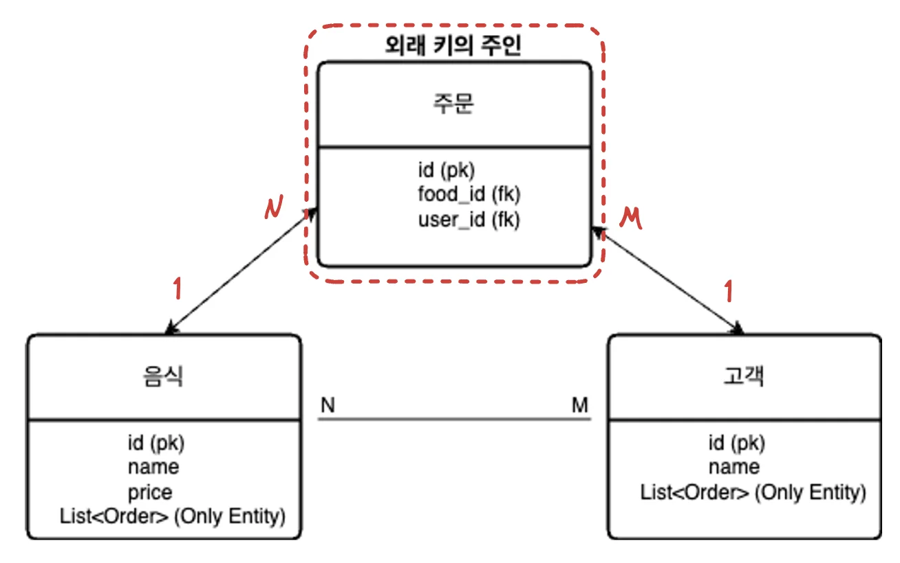

<details>
<summary><code>Entity</code>&#58; Food</summary>

<a id="1c3eda9b0fe1811b9cdde7de03a7c571"></a>

```java
@Entity
@Table(name = "food")
public class Food {
    @Id
    @GeneratedValue(strategy = GenerationType.IDENTITY)
    private Long id;
    private String name;
    private double price;

    @OneToMany(mappedBy = "food")
    private List<Order> orderList = new ArrayList<>();
}
```

</details>

<details>
<summary><code>Entity</code>&#58; User</summary>

<a id="1c3eda9b0fe181ce9533e0fee3719d3b"></a>

```java
@Entity
@Table(name = "users")
public class User {
    @Id
    @GeneratedValue(strategy = GenerationType.IDENTITY)
    private Long id;
    private String name;

    @OneToMany(mappedBy = "user")
    private List<Order> orderList = new ArrayList<>();
}
```

</details>

<details>
<summary><code>Entity</code>&#58; Order</summary>

<a id="1c3eda9b0fe1818bac74f88e574f5aa5"></a>

```java
@Entity
@Table(name = "orders")
public class Order {
    @Id
    @GeneratedValue(strategy = GenerationType.IDENTITY)
    private Long id;

    @ManyToOne
    @JoinColumn(name = "food_id")
    private Food food;

    @ManyToOne
    @JoinColumn(name = "user_id")
    private User user;
}
```

</details>

<a id="1c3eda9b0fe181a088b0ff72110ab644"></a>

### 예시 

<details>
<summary><code>Entity</code>&#58; Food</summary>

<a id="1c3eda9b0fe181208b58f9b2bfb2d23b"></a>

```java
package com.sparta.jpaadvance.entity;

import jakarta.persistence.*;
import lombok.Getter;
import lombok.Setter;

import java.util.ArrayList;
import java.util.List;

@Entity
@Getter
@Setter
@Table(name = "food")
public class Food {
    @Id
    @GeneratedValue(strategy = GenerationType.IDENTITY)
    private Long id;
    private String name;
    private double price;

    @OneToMany(mappedBy = "food")
    private List<Order> orderList = new ArrayList<>();
}
```

</details>

<details>
<summary><code>Entity</code>&#58; User</summary>

<a id="1c3eda9b0fe181d79a0fc2fcf5d25895"></a>

```java
package com.sparta.jpaadvance.entity;

import jakarta.persistence.*;
import lombok.Getter;
import lombok.Setter;

import java.util.ArrayList;
import java.util.List;

@Entity
@Getter
@Setter
@Table(name = "users")
public class User {
    @Id
    @GeneratedValue(strategy = GenerationType.IDENTITY)
    private Long id;
    private String name;

    @OneToMany(mappedBy = "user")
    private List<Order> orderList = new ArrayList<>();
}
```

</details>

<details>
<summary><code>Entity</code>&#58; Order</summary>

<a id="1c3eda9b0fe1818ea52de6133fad8745"></a>

```java
package com.sparta.jpaadvance.entity;

import jakarta.persistence.*;
import lombok.Getter;
import lombok.Setter;

@Entity
@Getter
@Setter
@Table(name = "orders")
public class Order {
    @Id
    @GeneratedValue(strategy = GenerationType.IDENTITY)
    private Long id;

    @ManyToOne
    @JoinColumn(name = "food_id")
    private Food food;

    @ManyToOne
    @JoinColumn(name = "user_id")
    private User user;
}
```

</details>

<details>
<summary><code>Test init</code>&#58; OrderTest</summary>

<a id="1c3eda9b0fe1815b8bc7feb59f751d3b"></a>

```java
package com.sparta.jpaadvance.relation;

import com.sparta.jpaadvance.repository.FoodRepository;
import com.sparta.jpaadvance.repository.OrderRepository;
import com.sparta.jpaadvance.repository.UserRepository;
import org.springframework.beans.factory.annotation.Autowired;
import org.springframework.boot.test.context.SpringBootTest;
import org.springframework.transaction.annotation.Transactional;

@Transactional
@SpringBootTest
public class OrderTest {

    @Autowired
    UserRepository userRepository;
    @Autowired
    FoodRepository foodRepository;
    @Autowired
    OrderRepository orderRepository;


}
```

</details>

<details>
<summary><code>중간 테이블(Order)</code> 테스트</summary>

<a id="1c3eda9b0fe181faa100f60fd7937590"></a>

```java
@Test
@Rollback(value = false)
@DisplayName("중간 테이블 Order Entity 테스트")
void test1() {

    User user = new User();
    user.setName("Robbie");

    Food food = new Food();
    food.setName("후라이드 치킨");
    food.setPrice(15000);

    // 주문 저장
    Order order = new Order();
    order.setUser(user); // 외래 키(연관 관계) 설정
    order.setFood(food); // 외래 키(연관 관계) 설정

    userRepository.save(user);
    foodRepository.save(food);
    orderRepository.save(order);
}

@Test
@DisplayName("중간 테이블 Order Entity 조회")
void test2() {
    // 1번 주문 조회
    Order order = orderRepository.findById(1L).orElseThrow(NullPointerException::new);

    // order 객체를 사용하여 고객 정보 조회
    User user = order.getUser();
    System.out.println("user.getName() = " + user.getName());

    // order 객체를 사용하여 음식 정보 조회
    Food food = order.getFood();
    System.out.println("food.getName() = " + food.getName());
    System.out.println("food.getPrice() = " + food.getPrice());
}
```

</details>

<details>
<summary>중간 테이블 Order에 <code>주문일 컬럼</code> 추가</summary>

<a id="1c3eda9b0fe18110b760ff2de6b9a373"></a>

```java
package com.sparta.jpaadvance.entity;

import jakarta.persistence.*;
import lombok.Getter;
import lombok.Setter;
import org.springframework.data.annotation.CreatedDate;
import org.springframework.data.jpa.domain.support.AuditingEntityListener;

import java.time.LocalDateTime;

@Entity
@Getter
@Setter
@Table(name = "orders")
@EntityListeners(AuditingEntityListener.class)
public class Order {
    @Id
    @GeneratedValue(strategy = GenerationType.IDENTITY)
    private Long id;

    @ManyToOne
    @JoinColumn(name = "food_id")
    private Food food;

    @ManyToOne
    @JoinColumn(name = "user_id")
    private User user;

    @CreatedDate
    @Temporal(TemporalType.TIMESTAMP)
    private LocalDateTime orderDate;
}
```

</details>

---

<a id="1c3eda9b0fe181a98d48ec53527ec078"></a>

## 지연로딩 

> 📌 <strong>Point&#33;</strong>
> 
> - <code>즉시로딩</code>&#58; fetch = FetchType&#46;<code>EAGER</code>
> 
> - <code>지연로딩</code>&#58; fetch = FetchType&#46;<code>LAZY</code>

> 👉🏻 <strong><code>지연 로딩</code></strong><strong>이 적용된 엔티티를 조회</strong>하려고 할때<u>, </u><strong><u>영속성 컨텍스트</u></strong><u>가 반드시 </u><strong><u>적용</u></strong><u>되어 있어야 한</u>다&#46; 
> 
> - 트랜젝션 적용&#58; <code>&#64;Transactional</code>

- <strong>연관관계 Anotation 기본값 확인</strong>
    <details>
    <summary><code>&#64;OneToOne</code> &#45;  즉시로딩(<strong>EAGER)</strong></summary>

    > <strong>Default</strong>&#58; <strong>즉시로딩</strong>(<code>FetchType&#46;</code><strong><code>EAGER</code></strong>)

    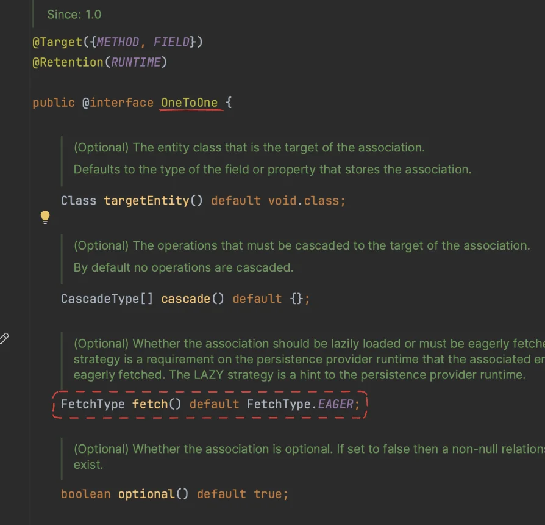

    </details>

    <details>
    <summary><code>&#64;ManyToOne</code> &#45;  즉시로딩(<strong>EAGER)</strong></summary>

    > <strong>Default</strong>&#58;  <strong>즉시로딩</strong>(<code>FetchType&#46;</code><strong><code>EAGER</code></strong>)

    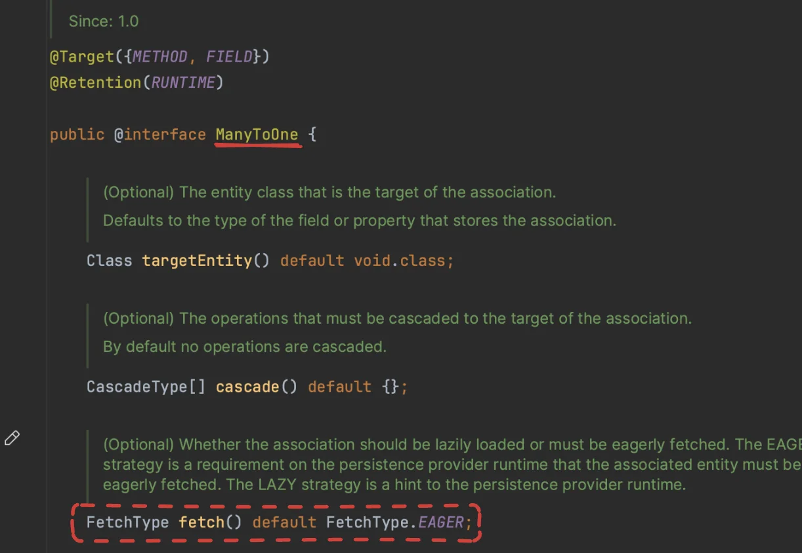

    </details>

    <details>
    <summary><code>&#64;OneToMany</code> &#45;<strong> </strong>지연로딩<strong>(LAZY)</strong></summary>

    > <strong>Default</strong>&#58; <strong>지연로딩</strong>(<code>FetchType&#46;</code><strong><code>Lazy</code></strong>)

    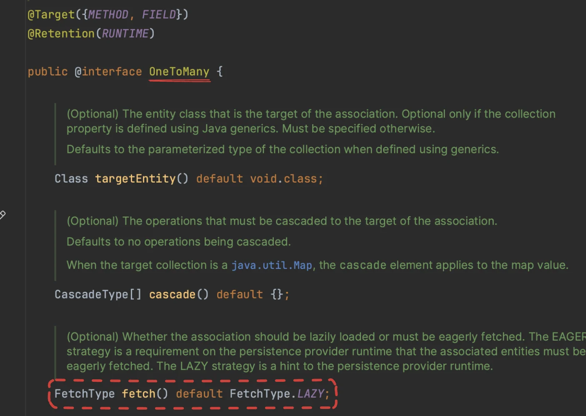

    </details>

<a id="1c3eda9b0fe1812cbc9fc37c2b7aa160"></a>

### 프록시 

<a id="1c3eda9b0fe1819fb175ea149be1b3f9"></a>

### 영속성 컨텍스트와 지연로딩

> ⚠️ <strong>주의사항</strong>
> 
> ---
> 
> - <strong><code>N&#43;1 문제</code></strong><strong>&#58; </strong> 지연 로딩을 사용할 때, 많은 연관 엔티티를 하나씩 로드하게 되어 성능 저하가 발생할 수 있다&#46; 이를 해결하기 위해서는 <strong><u>&#64;EntityGraph</u></strong>나 <strong><u>join fetch</u></strong>를 사용해 <u>필요한 연관 엔티티를 한 번에 로드 </u>할 수 있다&#46;
> 
> - <strong><code>트랜잭션 범위</code></strong>&#58; 지연 로딩은 트랜잭션 범위 내에서만 사용할 수 있다&#46; 트랜잭션 밖에서 접근하면 <code>LazyInitializationException</code> 발생
> 
> ---
> 
> <a id="1c3eda9b0fe181dcbf64f3a5043e9605"></a>
> 
> <strong>기본적으로 지연 로딩을 사용</strong>하고, <strong><u>필요에 따라 즉시 로딩을 적용</u></strong><br>성능을 모니터링하고, <strong><u>N&#43;1 문제가 발생하는 부분을 최적화 </u></strong><br><strong>필요한 경우 쿼리를 튜닝</strong>하여 최적의 성능을 유지

<a id="1c3eda9b0fe181798249de7392d8d340"></a>

## 영속성 전이

<a id="1c3eda9b0fe1815facfbdc41324c00ea"></a>

### CASCADE &#58; PERSIST

<a id="1c3eda9b0fe1816f8e9fc3c6030fc5ff"></a>

### CASCADE &#58; REMOVE

<a id="1c3eda9b0fe1813c8763c6564bb70737"></a>

## 고아 Entity 삭제

> 📌 <code>orphanRemoval = true</code><br>연관관계를 제거하는 것 만으로도 해당하는 Entity를 삭제할 수 있다&#46;<br><br>또한 <code>CascadeType&#46;Remove</code> 와 같은 기능도 있어  상위 엔티티 삭제 시, 연관된 하위 엔티티 모두가 삭제된다&#46;<br><br>따라서 상위 엔티티가 참조되는 하위 엔티티를 모두 확인 후 해당 옵션을 적용해야한다&#46; <br>안그러면 예상치 못하게 다른 엔티티까지 삭제되는 오류가 발생된다&#46;
