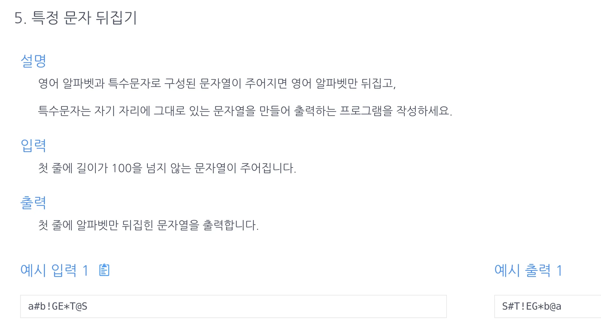

<a id="1c3eda9b0fe181949155c26ad2a42b8c"></a>

## 문제)



<a id="1c3eda9b0fe1811582b6e5a7278bd928"></a>

```latex
a#b!GE*T@S
```

<a id="1c3eda9b0fe181c29077c1f2a013ec24"></a>

## 풀이)

<a id="1c3eda9b0fe181718ecbd63d4eeb79c0"></a>

### 풀이1) 투포인터, 알파벳 판별(Character&#46;isAlphabetic())

<a id="1c3eda9b0fe181928dc7c9c7e4e6ab1f"></a>

```java
import java.util.Scanner;

public class Main {
    // 풀이)
    // 2. 투포인터
    // 3. left, right 특수문자 판별 -> true 시 포인터 진행
    public String solution(char[] str) {
        int l=0, r=str.length-1;
        while(l<r){
            if (!Character.isAlphabetic(str[l]))  l++;
            else if (!Character.isAlphabetic(str[r])) r--;
            else {
                char tmp = str[l];
                str[l] = str[r];
                str[r] = tmp;
                l++;
                r--;
            }
        }
        return String.valueOf(str);
    }
    public static void main(String[] args){
        Main m = new Main();
        Scanner sc=new Scanner(System.in);
        String str = sc.nextLine();
        System.out.print(m.solution(str.toCharArray()));
    }
}
```

<a id="1c3eda9b0fe181eda78bd54974bec50e"></a>

### 풀이2) 투포인터, <a href="https://ko.wikipedia.org/wiki/ASCII"><code>아스키코드</code></a>(숫자&#91;48&#126;57&#93;, 대문자&#91;65&#126;90&#93;, 소문자&#91;97&#126;122&#93;)

> 조건에 따라서 91&#126;96, 123&#126;126 제거 필요

<a id="1c3eda9b0fe181ee81bfe239e37d6df2"></a>

```java
import java.util.Scanner;

public class Main {
    public String solution(char[] s){
        int l=0, r=s.length-1;
        while(l<r){
            if(65 > (int)s[l]) l++;
						else if(65 > (int)s[r])r--;
            else {
                char tmp = s[l];
                s[l] = s[r];
                s[r] = tmp;
                l++;
                r--;
            }
        }
        return String.valueOf(s);
    }
    public static void main(String[] args) {
        Main m = new Main();
        Scanner sc = new Scanner(System.in);
        String str = sc.next();
        System.out.println(m.solution(str.toCharArray()));

    }
}
```

<a id="1c3eda9b0fe18166857ad3e9b78eb1da"></a>

### 풀이 3) 2차 풀이 → &#91;풀이 1&#93;로 개선

<a id="1c3eda9b0fe18103a1feead2844537af"></a>

while문 축약 가능

<a id="1c3eda9b0fe181808f18d162c5831e69"></a>

boolean 의미 중복으로 사용됨 &#91; isLeftPointAlpha, Character&#46;isAlphabetic(arr&#91;l&#93;) &#93;

<a id="1c3eda9b0fe181e4bb59e8c44ab6234e"></a>

```java
import java.sql.Array;
import java.util.*;
public class Main {
    public String solution(String str) {
        String answer="";
        char[] arr = str.toCharArray();
        int l=0, r=arr.length-1;
        while(l<r){
            boolean isLeftPointAlpha=false, isRightPointAlpha=false;
            while(!isLeftPointAlpha){
                if(Character.isAlphabetic(arr[l])){
                    // isLeftPointAlpha=true;
                    break;
                }
                l++;
            }
            while(!isRightPointAlpha){
                if(Character.isAlphabetic(arr[r])){
                    // isRightPointAlpha=true;
                    break;
                }
                r--;
            }
            char tmp=arr[l];
            arr[l]=arr[r];
            arr[r]=tmp;
            l++; r--;
        }
        return answer = String.valueOf(arr);
    }

    public static void main (String[] args){
        Main m = new Main();
        Scanner sc = new Scanner(System.in);
        String str =sc.next();
        System.out.println(m.solution(str));
//        char t = sc.next().charAt(0);
    }
}
```

<a id="1c3eda9b0fe1811ba644c2dc99bc2244"></a>

### 풀이 4) 3차 풀이  <code>최적화</code>  투포인터 

<a id="1c3eda9b0fe181ce87d0e592b5789a40"></a>

```java
import java.util.ArrayList;
import java.util.Arrays;
import java.util.Scanner;

public class Main {
    public String solution(char[] s) {
        int l=0, r=s.length-1;
        while(l<r){
            // 알파벳이 아닐 시, 포인터 넘김
            while(!Character.isAlphabetic(s[l])) l++;
            while(!Character.isAlphabetic(s[r])) r--;

            // 대칭 변환 정렬
            char tmp = s[l];
            s[l] = s[r];
            s[r] = tmp;
            l++; r--;
        }
        return String.valueOf(s);
    }
    public static void main(String[] args){
        Main m = new Main();
        Scanner sc = new Scanner(System.in);
        String s = sc.next();
        System.out.println(m.solution(s.toCharArray()));
    }
};
```

<a id="1c3eda9b0fe1813d88b6e29c32f1a750"></a>

### <del>풀이 ★) 투포인터, 판별(</del><del>정규식(”</del><del><strong>^&#91;a&#45;zA&#45;Z&#93;&#42;&#36;”)</strong></del><del><strong>) ← char 타입 오류 </strong></del>

<a id="1c3eda9b0fe181c18ef9c7961bd5a0bd"></a>

<em>정규식 필터 문자열만 가능?</em>

<a id="1c3eda9b0fe181058196dbe35d7695ae"></a>

→ matches 메소드 String 타입에만 가능함&#46;

<a id="1c3eda9b0fe18143af3cfc8a1f9d713f"></a>

### String<code>&#46;matches(정규식)</code>
