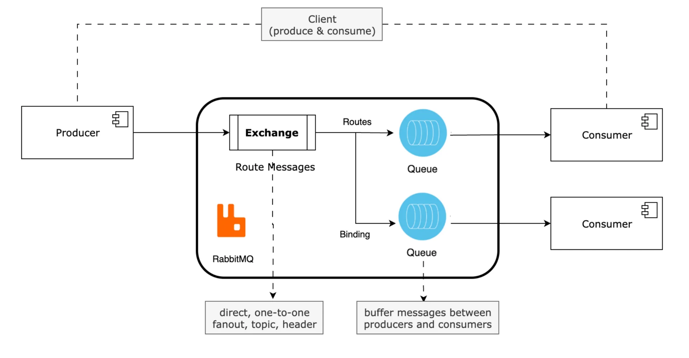
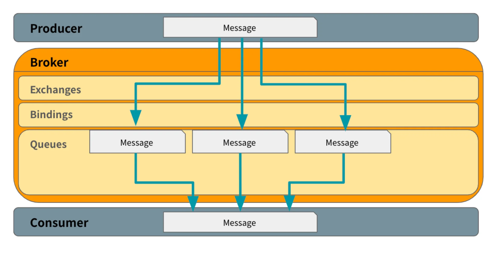

🧐 클러스터링

🧐 페더레이션(federation)

## 메세지 큐를 사용하는 이유

---

- 비동기 메세지를 사용하여 다른 응용프로그램 사이에서 데이터를 송수신

- <strong><u>클라이언트에 대한 동기 처리</u></strong>는 <strong><u>병목의 요인</u></strong>이므로 <strong><u>비동기 처리 해도 될 영역</u></strong>에 대해서는 <strong><u>큐를 통해 분리</u></strong>해서 처리한다&#46; 

-  <strong><u>분산 환경</u></strong>에서 <strong><u>응용 프로그램들을 분리</u></strong>하고 <strong><u>독립적으로 확장</u></strong>하기 위해서 사용한다 이를 통해 <strong><u>트래픽에 대해서 유연한 아키텍처를 설계</u></strong>할 수 있다&#46;

- 기능별로 모듈 구성이 용이 (Scalability)

- 요청에 대한 응답을 기다릴 필요가 없기 때문에 각 영역의 역할만 신경쓰면 된다&#46;  어플리케이션 레벨에서 분리 가능 ( Abstraction of concerned )

- 데이터를 메모리 대신에 디스크에 저장하여 데이터 유실을 방지(Reliability)
    - 즉시 처리하지 않아도 나중에 다시 처리가 가능하다&#46;

    - 메세지 영구 저장, 메세지 확인, 장애 복수 매커니증을 통해 메세지의 신뢰성을 보장한다&#46; 

확장성

- 여러 노드에 걸쳐 쉽게 확장할 수 있어 높은 가용성을 제공

- 필요에 따라 메세지를 클러스터링 하거나 페더레이션(federation) 방식으로 확장 가능

유연성

- <strong><u>다양한 exchange 유형과 라우팅 규칙을 지원하여 메세지를 효과적으로 라우팅하여 관리</u></strong>할 수 있다&#46;

- 광범위한 프로토콜 지원
    - 기본적으로 AMQP를 사용하지만, STOMP, MQTT, HTTP 등 다양한 프로토콜을 지원한다&#46;

- 풍부한 클라이언트 라이브러리
    - Java, Python, Ruby, NET 등 다양한 언어로 클라이언트 라이브러리를 제공하여 다양한 애플리케이션에서 사용할 수 있다&#46;

---

ex) 이벤트 응모

- 로그인한 이후, 어떤 응모 페이지에 들어가 기본적인 정보들을 넣은 뒤 응모 버튼을 눌렀을 경우 응모 정보를 수집하여 어딘가에 저장하고 그 정보가 고객 쪽 DB에 맞는 회원인지 검증하고, 그 다음에 고객의 전화번호 같은 것을 추출하여 상품권에 대해 쿠폰을 발행하거나 문자 메세지를 보낸다&#46;

---

🤬 동기적 처리

- 위 과정을 동기적으로 처리한다면 500, 1000명의 유저들이 몰리게 되면 <strong><u>병목이 발생</u></strong>되고 이는 <strong><u>서버에 부하를 발생</u></strong> 시키며, 그에 비례하여 <strong><u>DB에도 부하</u></strong>가 발생된다&#46; 

- 결국 <strong><u>해당 이벤트 프로세스를 처리하는 시간이 점점 증가</u></strong>하다가 많은 트래픽이 발생되면 결국 <strong><u>서버가 다운</u></strong>된다&#46; 

😁 비동기적 처리

이벤트 응모 페이지 정보들을 DB에만 저장하고 클라이언트에 바로 <code>200 OK</code>를 던진다&#46;

그러면 고객은 그냥 ‘이벤트 응모 완료되었습니다&#46;’라는 메세지만 받고 나가기 때문에, 훨씬 더 많은 트래픽을 처리할 수 있다&#46; 

뒷단에서는 RabbitMQ 같은 미들웨어를 통해서 응모 정보들을 다른 서버, 다른 프로세스에 넘김으로 써 부하들을 분산시켜 처리한다&#46; 

## AMQP

---

> ✏️ 
> 
> 
> 
> Advanced Message Queing Protocol의 약자로, 흔히 알고 있는 MQ의 오픈소스에 기반한 표준 프로토콜을 의미한다&#46; 

- one to one fanout
    - Fanout 익스체인지는 여러 큐에 메세지를 브로드캐스트하지만,<strong><u> 각 큐에 연결된 소비자는 한 명</u></strong>이므로 <strong><u>메세지는 각각의 큐에서 하나의 소비자에게만 전달</u></strong>되므로<strong><u> 1&#58;1 방식의 메세지 소비</u></strong>를 뜻한다&#46; 

    - 여러 소비자에게 동시에 메세지를 전달하되 각 메세지가 단일 소비자에게만 전달되도록 보장하고 싶은 경우를 의미한다고 보면 된다&#46;

## AMQP 특징

---

이전에도 상용화된 MQ 제품들은 많았지만, 한가지 문제가 있다면 <strong><u>대부분 플랫폼 종속적</u></strong>인 제품들이었다&#46;

따라서 서로 다른, <strong><u>이기종간에 메세지를 교환</u></strong>하기 위해서는 메세지 포맷 컨버전을 위한<strong><u> 메세지 브릿지를 별도로 만들거나 (속도 저하 발생)</u></strong> <strong><u>시스템 자체를 통일</u></strong>시켜야 했다&#46;

→  <code>불편</code>, <code>비효율적</code>

즉, <code>AMQP</code>의 목적은 <strong><u>서로 다른 시스템 간에 (비용/기술/시간) 최대한 효율적인 방법으로 메세지를 교환</u></strong>하는 것에 있다&#46; 

주요 특징

- <strong>모든 broker들</strong>은 <strong><u>똑같은 방식으로 동작</u></strong>해야 한다&#46;
    > Broker의 역할

    - 메세지 수신, 라우팅, 큐 관리, 메세지 전달 보장

    - 네트워크 불안정이나, 어플리케이션 오류들을 처리하기 위해서 <code>acknowledge</code>를 날려줘야 하는데, 이를 브로커 레벨에서 확인할 수 있다&#46;

    - 이러한 브로커(미들웨어)를 구현한 기술 중 하나가 <code>RabbitMQ</code> 이다&#46; 이를 통해 <strong><u>라우팅 규칙, 메세지 전달, 큐 관리 등</u></strong>을 처리할 수 있다&#46; 

- 모든 client들 같은 방식으로 동작

- 네트워크 상으로 전송되는 명령어들의 표준화

- 프로그래밍 언어 중립적

> ✏️ 
> 
> 
> 
> <strong>RabbitMQ의 주요 특징</strong>
> 
> 
> 
> The core idea in the messaging model in RabbitMQ is that the producer never sends any messages directly to a queue&#46; Actually, quite often the producer doesn&#39;t even know if a message will be delivered to any queue at all&#46;
> 
> ---
> 
> 
> 
> <strong><u>RabbitMQ의 메시징 모델</u></strong>의 핵심 아이디어는 <code>Producer</code>가 <strong><u>큐에 직접 메시지를 보내지 않는다는 것</u></strong>이다 사실, <code>Producer</code>는 메시지가 어떤 큐에 전달될 지조차 모르는 경우가 많다&#46;
> 
> - 앱(객체) 간의 <strong><u>의존성을 낮</u></strong>춘다&#46;
> 
> 
> 
> Instead, the producer can only send messages to an <em>exchange</em>&#46; An exchange is a very simple thing&#46; On one side it receives messages from producers and the other side it pushes them to queues&#46; The exchange must know exactly what to do with a message it receives&#46; Should it be appended to a particular queue? Should it be appended to many queues? Or should it get discarded&#46; The rules for that are defined by the <em>exchange type</em>&#46;
> 
> ---
> 
> 
> 
> 대신, <code>producer</code>는 <code>exchange</code>에만 메시지를 보낼 수 있다&#46; <code>exchange</code>는 매우 간단하다 한 쪽에서는 <code>producer</code> 로부터 메시지를 받고 다른 쪽에서는 메시지를 <code>큐</code>에 푸시한다&#46; <code>exchange</code>는 수신한 메시지로 정확히 무엇을 해야 하는지 알아야 한다
> 
> - <code>특정 대기열에 추가</code> or <code>여러 대기열에 추가</code> or <code>버림</code>
> 
> 
> 
>  이에 대한 규칙은 <strong><u>exchagne 유형에</u></strong> 의해 정의된다&#46;
> 
> ---
> 
> - 참조&#58; ‣

## Routing Model Components

---

> ✏️ 
> 
> 
> 
> 프로듀서가 메세지를 발급하면, 브로커에 들어오면서 Exchage를 통해 메세지들이 분배가 된다&#46; 
> 
> 
> 
> 어디에 Binding될 건지 정해지고, 그 Binding 타입에 따라서 Queue들이 생성되고, Queue를 바라보고 있는(subscribe) 컨슈머에 의해 메세지들이 프로세싱(소진)된다&#46;

- <code>Producer</code> 모듈 ( 송신부 )

- 브로커 레벨
    

    
<strong><code>Exchange</code></strong>

    - <code>Publisher</code>로부터 수신한 메세지를 <code>적절한 큐 </code>or<code> 다른 exchange</code>로 <strong><u>분배</u></strong>하는 <strong><u>라우터의 기능</u></strong>을 한다&#46;

    

    

    
<strong><code>Binding</code></strong>

    - <strong><code>exchange</code></strong><strong>와 </strong><strong><code>큐</code></strong><strong>와의 </strong><strong><u>관계</u></strong><strong>를 </strong><strong><u>정의</u></strong>한 일종의 <strong><u>라우팅 테이블</u></strong>이다&#46; 

    - 같은 큐가 여러 개의 exchange에  bind 될 수 도 있고, 하나의 exchange에 여러 개의 큐가 binding 될 수도 있다&#46; 

    

    

    
<strong><code>Queue</code></strong>

    - 일반적으로 알고있는 큐이다&#46; ( First In First Out)

    - <code>메모리</code>나 <code>디스크</code>에 <strong><u>메시지를 저장</u></strong>하고, 해당 메세지를 <strong><u><code>consumer</code></u></strong><strong><u>에 전달</u></strong>한다&#46; 

    

    ---

    

    
<code>Routing Key</code>

    - 라우팅 키는 <strong><code>발행된 메세지</code></strong>와 <strong><code>큐</code></strong>가 <strong><u>라우팅 테이블</u></strong>을 통해 <strong><u>매칭되는 키</u></strong>를 뜻한다&#46; 

    - <code>Publisher</code>(or <code>Producer</code>)에서 <strong><u>송신한 메세지 헤더에 포함</u></strong>되는 것으로 <strong><u>일종의 가상 주소</u></strong>라고 보면 된다&#46; 

    

- <strong><code>Cunsumer</code></strong> 모듈 ( 수신부 )
