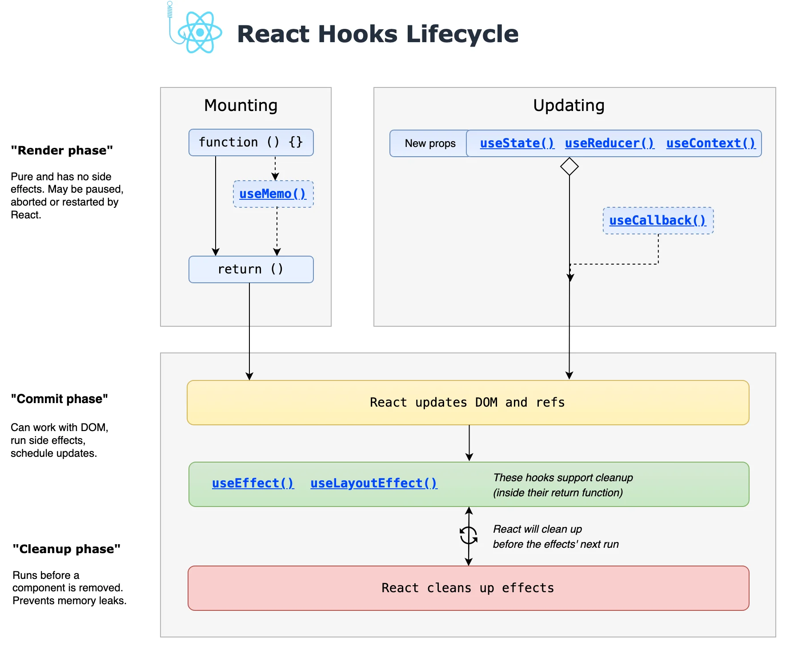
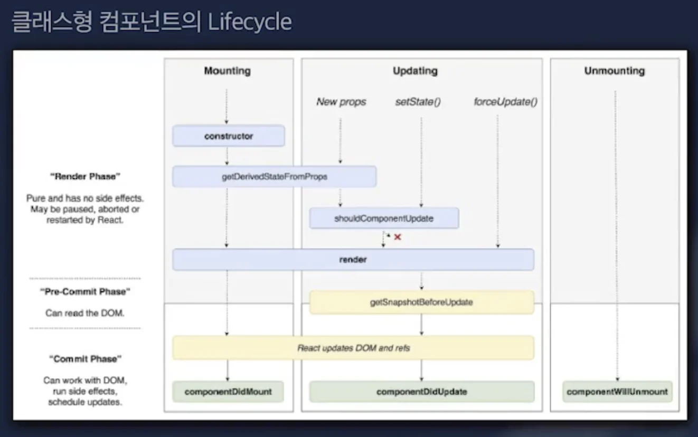
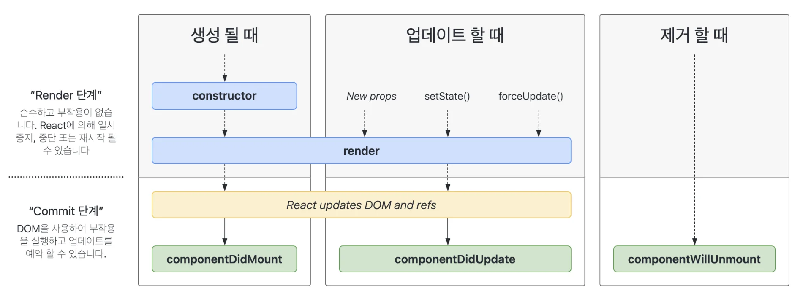

## Rerendering

---

> 📖 
> 
> 
> 
> 리액트에서 리렌더링은 컴포넌트의 상태(<code>State</code>, <code>Props</code>)가 변경되면서 발생한다&#46; 
> 
> - <code>state</code>, <code>Props</code> 변경 시 화면을 다시 그린다&#46;

react hook life cycle

‣

‣

클래스형 컴포넌트의 Lifecycle

함수형 컴포넌트의 Lifecycle

‣

- 생성 ( Mounting )

- 업데이트 ( Updating

- 제거 ( Unmounting )

실습

‣

&#91; 코드 &#93;

