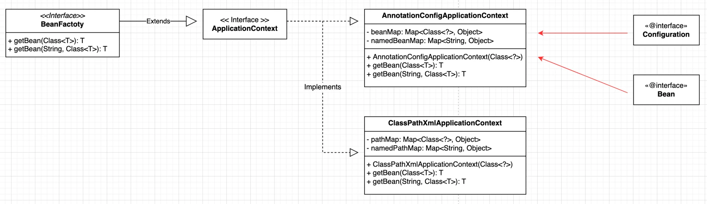

<a id="1c4eda9b0fe18056b1afc61b7971aa5a"></a>

##  자바 환경에서의 빈 컨테이너 구현

---



<a id="1c4eda9b0fe18077b1a2ff0d98675016"></a>

### 코드 

---

<details>
<summary>&#91; 코드 &#93; BeansException</summary>

<a id="1c4eda9b0fe18069adb7d735fb4782bc"></a>

```java
package spring_dumy;

public class BeansException extends Exception {
}
```

</details>

<details>
<summary>&#91; 코드 &#93; FactoryBean</summary>

<a id="1c4eda9b0fe18026b042efc26fd8a251"></a>

```java
package spring_dumy;

public interface FactoryBean<T> {
    T getObject();
    Class<?> getObjectType();
}

```

</details>

<details>
<summary>&#91; 코드 &#93; BeanFactory</summary>

<a id="1c4eda9b0fe180b1991ef18e9465b736"></a>

```java
package spring_dumy;

public interface BeanFactory {
    <T> T getBean(Class<T> clazz);
    <T> T getBean(String name, Class<T> Clazz);
}

```

</details>

<details>
<summary>&#91; 코드 &#93; ApplicationContext</summary>

<a id="1c4eda9b0fe1801b83bfcfecf343e1e8"></a>

```java
package spring_dumy;

public interface ApplicationContext extends BeanFactory{
}

```

</details>

<details>
<summary>&#91; 코드 &#93; <code>AnnotationConfigApplicationContext</code></summary>

<a id="1c4eda9b0fe1806a9da6dd8c6d8b1458"></a>

```java
package spring_dumy;

import spring_dumy.annotation.Bean;

import java.lang.reflect.Method;
import java.util.HashMap;
import java.util.Map;

public class AnnotationConfigApplicationContext implements ApplicationContext {

    private final Map<Class<?>, Object> beanMap = new HashMap<>();
    private final Map<String, Object> namedBeanMap = new HashMap<>();

    public AnnotationConfigApplicationContext(Class<?> configClass) {
        try {
            Object configInstance = configClass.getDeclaredConstructor().newInstance();

            for (Method method : configClass.getDeclaredMethods()) {
                if (method.isAnnotationPresent(Bean.class)) {
                    Object returnObj = method.invoke(configInstance);
                    String beanName = method.getName();

                    if (returnObj instanceof FactoryBean<?> factoryBean) {
                        Object obj = factoryBean.getObject();
                        Class<?> type = factoryBean.getObjectType();
                        beanMap.put(type, obj);
                        namedBeanMap.put(beanName, obj);
                    } else {
                        beanMap.put(method.getReturnType(), returnObj);
                        namedBeanMap.put(beanName, returnObj);
                    }
                }
            }
        } catch (Exception e) {
            throw new RuntimeException("빈 등록 중 오류 발생", e);
        }
    }

    @Override
    public <T> T getBean(Class<T> clazz) {
        return clazz.cast(beanMap.get(clazz));
    }

    @Override
    public <T> T getBean(String name, Class<T> clazz) {
        return clazz.cast(namedBeanMap.get(name));
    }

}

```

</details>

<details>
<summary>Annotataion</summary>

<details>
<summary>&#91; 코드 &#93; <code>&#64;Bean</code></summary>

<a id="1c4eda9b0fe180c6b82cdd44dc059dbd"></a>

```java
package spring_dumy.annotation;

import java.lang.annotation.ElementType;
import java.lang.annotation.Retention;
import java.lang.annotation.RetentionPolicy;
import java.lang.annotation.Target;

@Retention(RetentionPolicy.RUNTIME)
@Target(ElementType.METHOD)
public @interface Bean {
}
```

</details>

<details>
<summary>&#91; 코드 &#93; <code>&#64;Configuration</code></summary>

<a id="1c4eda9b0fe180acae7ccac6d6289620"></a>

```java
package spring_dumy.annotation;

import java.lang.annotation.ElementType;
import java.lang.annotation.Retention;
import java.lang.annotation.RetentionPolicy;
import java.lang.annotation.Target;

@Retention(RetentionPolicy.RUNTIME)
@Target({ElementType.TYPE, ElementType.METHOD})
public @interface Configuration {
}

```

</details>

</details>
